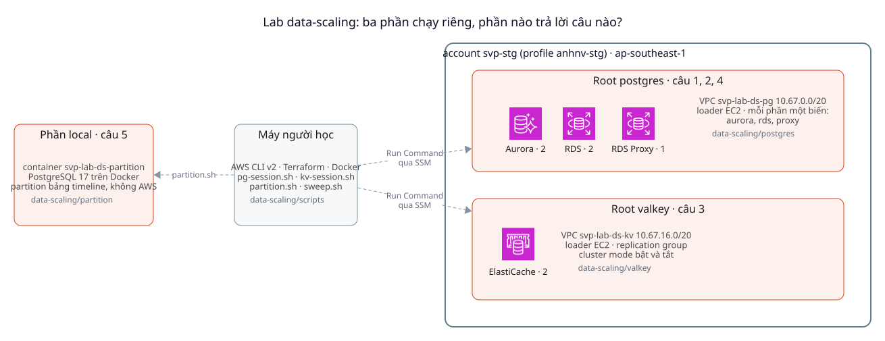
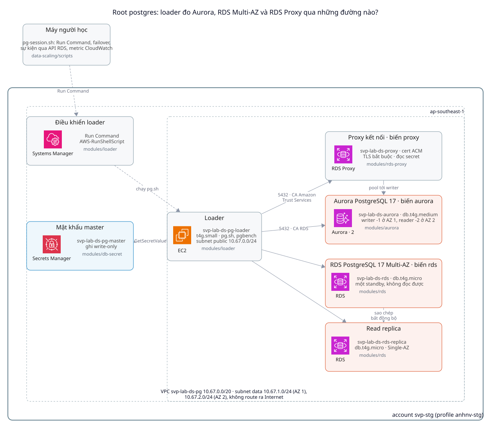
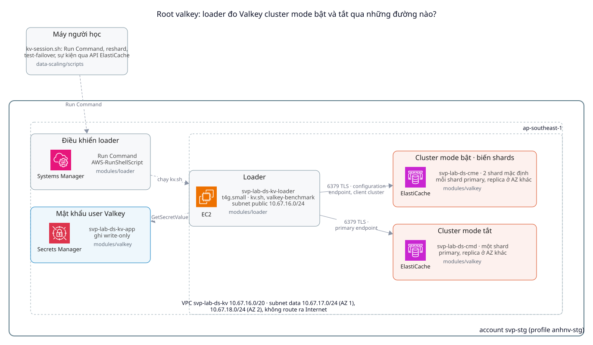
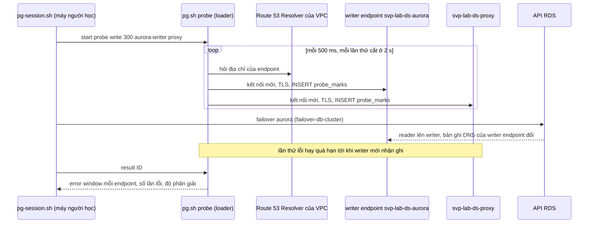

# Lab `data-scaling`: mở rộng tầng dữ liệu của svp quá một RDS instance

Bài dựng tầng dữ liệu của svp ở cỡ lớn hơn một RDS instance: Aurora PostgreSQL có reader, RDS for PostgreSQL
Multi-AZ có read replica, RDS Proxy, ElastiCache for Valkey bật và tắt cluster mode, cùng partition bảng `timeline` trên
máy. Số đo (độ trễ replica, cửa sổ lỗi khi failover, số kết nối, p95 đọc, chi phí dọn dữ liệu) trả lời svp nên mở rộng
bằng gì khi một instance không còn đủ. Ba phần chạy riêng: root `postgres/` (câu 1, 2, 4), root `valkey/` (câu 3), phần
local `scripts/partition.sh` (câu 5, không AWS); phần chỉ trên giấy (Aurora Global Database, DynamoDB global tables và
DAX, Aurora Serverless v2, Aurora I/O-Optimized) ở [`docs/data-tier-options.md`](docs/data-tier-options.md).

| | |
| --- | --- |
| Dựng | Aurora writer và reader, RDS Multi-AZ và read replica, RDS Proxy; hai replication group Valkey; container partition |
| Trả lời | Một RDS instance không đủ: replica trễ bao lâu, failover lỗi bao lâu, proxy và cluster mode đổi gì, partition rẻ hơn ra sao |
| Phí | `postgres/` ~0,415 USD mỗi giờ, ≤ 1,23 mỗi buổi; `valkey/` ~0,143–0,181 mỗi giờ, ≤ 0,37 mỗi buổi; local 0 ([Chi phí](#chi-phí)) |
| Thời gian | Ước tính, phút: `postgres/` dựng 35 + đo 55 + gỡ 25 ≈ 2 giờ; `valkey/` 15 + 37 + 15 ≈ 67; local ~10 ([cách tính](#chi-phí)) |

## Câu hỏi

1. **Aurora PostgreSQL so với RDS PostgreSQL có read replica** với dạng đọc nhiều của feed và engagement: dưới tải ghi
   đều, replica trễ bao nhiêu; failover làm client lỗi trong bao lâu (writer endpoint so với instance endpoint; failover
   Aurora so với reboot có failover của RDS Multi-AZ); bao nhiêu lần đọc, ghi lỗi trong lúc đó?
2. **RDS Proxy** trước writer: với nhiều client sống ngắn (burst kiểu Lambda), database thấy bao nhiêu kết nối; failover
   qua proxy so với nối thẳng khác bao nhiêu; proxy thêm bao nhiêu tiền?
3. **Valkey cluster mode bật so với tắt**: client thấy gì khác (slot, `MOVED`, lệnh nhiều khoá khác slot, tiền tố khoá và
   hash tag của svp); reshard online trong lúc có tải làm client lỗi bao lâu, mất bao nhiêu thông lượng; failover primary
   của một shard?
4. **Chia đọc ghi ở client**: p95 của một câu đọc trên endpoint ghi so với endpoint đọc, trong lúc có tải ghi đều?
5. **Partition `timeline`** (local, không AWS): p95 câu đọc feed trên bảng thường so với bảng partition theo
   `published_at`; dọn dữ liệu quá 30 ngày bằng `DELETE` theo lô so với `DETACH` + `DROP`; partition pruning.

svp đang quyết:

- Một RDS for PostgreSQL 17 instance mỗi env, mỗi service một database trên đó; không Aurora; service nối thẳng bằng
  pool `pgx`, không RDS Proxy hay PgBouncer
  ([ADR-0057](https://github.com/anhnvcoder/svp-backend/blob/main/docs/adr/0057-postgres17-verify-full.md) §5, §7). prd
  là instance Multi-AZ, không read replica.
- ElastiCache for Valkey node-based, cluster mode tắt, giữ db 9, 10, 14 với ACL `db=` và tiền tố `svp:<service>:`
  ([ADR-0053](https://github.com/anhnvcoder/svp-backend/blob/main/docs/adr/0053-msk-elasticache-valkey.md) §7).
- Alarm của RDS và ElastiCache theo khuyến nghị của AWS
  ([ADR-0058](https://github.com/anhnvcoder/svp-backend/blob/main/docs/adr/0058-managed-data-operations.md)); chưa
  alarm nào cho độ trễ replica.

Số đo của bài là đầu vào cho ADR mới của `svp-backend` sau buổi chạy, khi svp cần đọc nhiều hơn một instance chịu, cần
failover ngắn hơn, hay cần nhiều bộ nhớ cache hơn một node.

## Thiết kế

<picture>
  <source media="(prefers-color-scheme: dark)" srcset="../docs/diagrams/data-scaling/overview-dark.svg">
  
</picture>

Ba phần không dùng chung tài nguyên nào, nên mỗi buổi dựng một phần hay cả hai. Mũi tên liền trong các sơ đồ dưới là dữ
liệu đi, mũi tên đứt là điều khiển (lệnh SSM, đọc secret). AZ 1, AZ 2 là hai AZ đầu của region xếp theo tên.

Root `postgres/`:

<picture>
  <source media="(prefers-color-scheme: dark)" srcset="../docs/diagrams/data-scaling/postgres-dark.svg">
  
</picture>

Mọi đường Postgres là cổng 5432, `sslmode=verify-full`. Nối thẳng tin bundle CA của RDS; qua proxy tin các root CA của
Amazon Trust Services. RDS Proxy đọc chính secret `svp-lab-ds-pg-master` để đăng nhập Aurora.

Root `valkey/`:

<picture>
  <source media="(prefers-color-scheme: dark)" srcset="../docs/diagrams/data-scaling/valkey-dark.svg">
  
</picture>

Mỗi root có VPC, loader và secret riêng, không tra cứu tài nguyên của root kia. Loader là nơi duy nhất nối tới database:
máy người học điều khiển nó bằng SSM Run Command qua `scripts/pg-session.sh`, `scripts/kv-session.sh`, mọi mốc thời gian
của phép đo lấy từ đồng hồ của loader. Root `postgres/` có ba biến bật tắt: `aurora`, `rds` (mặc định bật), `proxy` (mặc
định tắt, chỉ bật được khi `aurora` bật); tắt một biến rồi `apply` chỉ xoá phần đó. Root `valkey/` luôn dựng cả hai
replication group; biến `shards` giữ số shard của `svp-lab-ds-cme`.

Một lần đo failover của Aurora, hai probe chạy song song trên cùng một lần failover:



Lựa chọn chính và phương án khác. Trạng thái là xếp loại của trang này: legacy chỉ khi AWS gọi là legacy hay
deprecated, còn lại là hiện hành; nguồn chứng minh tính năng và giới hạn.

| Phần | Bài dựng | Phương án khác | Trạng thái |
| --- | --- | --- | --- |
| Đọc ở AZ khác | Aurora PostgreSQL 17, writer và reader ở hai AZ | Multi-AZ DB cluster: hai standby đọc được | Hiện hành [N1], [N5] |
| Postgres kiểu svp | RDS Multi-AZ một standby không đọc được, read replica | Multi-AZ DB cluster (dưới) | Hiện hành [N4], [N6] |
| Proxy kết nối | RDS Proxy trước cluster Aurora | Proxy trước RDS; endpoint chỉ đọc của proxy; nối thẳng (svp) | Hiện hành [N7], [N8] |
| Cache | ElastiCache Valkey node-based, cluster mode bật và tắt | ElastiCache Serverless (luôn cluster mode) | Hiện hành [N19], [N20] |
| Chia đọc ghi | Client chọn writer, reader hay instance endpoint | Endpoint chỉ đọc của RDS Proxy | Hiện hành [N8] |
| Dọn `timeline` | Partition theo ngày, `DETACH … CONCURRENTLY`, `DROP` | `DELETE` theo lô (svp); pg_partman | Hiện hành [N30], [N33] |

Trên giấy, không dựng:

- **Multi-AZ DB cluster.** Một writer và hai reader ở ba AZ, sao chép bán đồng bộ, reader đọc được [N5]; failover thường
  dưới 35 giây [N5], so với 60–120 giây của Multi-AZ một standby [N3]. Chỉ nhận một danh sách lớp (`db.c6gd`, `db.m5d`,
  `db.m6gd`, `db.r6gd`…), không lớp T nào [N5]: bài không dựng vì nằm ngoài các lớp nhỏ nhất bài dùng.
- **RDS Proxy trước RDS Multi-AZ và endpoint chỉ đọc của proxy.** Proxy đứng trước được cả RDS instance [P7]; endpoint
  chỉ đọc của proxy chia câu đọc cho các reader như reader endpoint của Aurora [N8]. Bài chỉ đo proxy trước Aurora (câu
  2).
- **ElastiCache Serverless.** Chạy Valkey ở cluster mode và chỉ nhận client có TLS [N19]: client của svp phải là client
  cluster như ở `svp-lab-ds-cme`. Giá theo dữ liệu lưu (tối thiểu 100 MB với Valkey) và ECPU [P11]; so ở `## Chi phí`.

Lý do các lựa chọn:

- **Lớp nhỏ nhất đủ tính năng.** Aurora PostgreSQL 17 nhỏ nhất là `db.t4g.medium` [N12]. RDS PostgreSQL 17 nhận
  `db.t4g.micro` [N13]; trang Multi-AZ một standby và trang read replica không nêu giới hạn lớp [N4], [N6]. Valkey dùng
  `cache.t4g.micro` [N25]; trang Multi-AZ và trang reshard online không giới hạn lớp T [N21], [N22]. Loader `t4g.small`
  chế độ unlimited: `t4g.micro` có 1 GiB và mức nền CPU thấp hơn, bắt tay TLS của burst sẽ bóp CPU của chính loader
  [N29].
- **Công cụ trên loader.** User data chỉ cài gói từ kho của Amazon Linux 2023: `postgresql17`, `postgresql17-contrib`,
  `valkey`, `jq`, `bind-utils` [N18]. Danh sách gói không liệt kê file, nên buổi kiểm `pgbench`, `valkey-benchmark` có
  thật trên loader (bước 7 phần `postgres/`, bước 6 phần `valkey/`). Không key pair, không cổng 22, IMDSv2 bắt buộc.
- **Version.** Aurora lấy minor mới nhất của major 17 (Aurora đòi version đầy đủ); RDS Proxy nhận Aurora PostgreSQL
  từ 17.4 ở `ap-southeast-1` [N9]. RDS để `engine_version = "17"`, RDS chọn minor. Valkey 9.1, họ parameter group
  `valkey9` [N24].
- **Hai AZ.** DB subnet group và Multi-AZ của ElastiCache đều cần subnet, replica ở AZ khác [N16], [N21]. Writer Aurora ở
  AZ thứ nhất, reader ở AZ thứ hai, cùng promotion tier; loader ở AZ thứ nhất.
- **Backup.** Aurora không tắt được backup, bài giữ 1 ngày [N14]; RDS nguồn phải bật backup để có read replica [N6], giữ 1
  ngày; replica và Valkey không backup [N27]. Destroy không snapshot cuối, xoá automated backup.
- **TLS.** Postgres luôn `sslmode=verify-full`. Nối thẳng tin bundle global của RDS; RDS Proxy trình chứng chỉ của ACM,
  client tin các root CA của Amazon Trust Services [N7], loader tải cả hai lúc boot. Valkey bắt buộc TLS, xác thực bằng
  user group RBAC, không user `default` [N26]; client kiểm chuỗi CA với kho của hệ thống. Với TLS, ElastiCache trả
  hostname trong `CLUSTER SLOTS` [N28].
- **Một mật khẩu, một nguồn.** Mỗi root một secret. Mật khẩu là ephemeral `aws_secretsmanager_random_password`, đi vào
  secret qua `secret_string_wo`; Aurora (`master_password_wo`), RDS (`password_wo`) và user Valkey (`passwords_wo`) đọc
  lại giá trị từ phiên bản hiện tại của secret. Plan, state, user data và output không giữ mật khẩu. RDS Proxy đọc secret
  bằng role chỉ có `secretsmanager:GetSecretValue` trên đúng secret và `kms:Decrypt` qua Secrets Manager [N10].
- **Mật khẩu trên argv của `valkey-benchmark`.** `valkey-cli` nhận mật khẩu qua biến `VALKEYCLI_AUTH`, `psql`, `pgbench`
  qua file `.pgpass` mode 600; `valkey-benchmark` không đọc biến môi trường nào nên chỉ nhận `-a` trên dòng lệnh [N34].
  Bài chấp nhận vì loader dùng riêng cho bài: không user nào khác, chỉ vào qua SSM, sống trong buổi.
- **Probe không qua cache DNS của máy.** Mỗi lần thử của `pg.sh probe` hỏi thẳng Route 53 Resolver của VPC [N17] rồi nối
  tới địa chỉ đó: cửa sổ lỗi chỉ còn phụ thuộc TTL của bản ghi. Mỗi lần thử cắt ở 2 s cả kết nối lẫn câu lệnh: RDS Proxy
  nhận kết nối ngay rồi giữ câu lệnh khi chưa có writer, chỉ cắt lúc kết nối thì lần thử đó vẫn tính là thành công.
- **Reshard qua API.** `kv-session.sh reshard` gọi `modify-replication-group-shard-configuration` để có mốc "lệnh được
  nhận". Script của bài chỉ thêm shard, tối đa 5 (biến `shards` của root nhận 1–5): giới hạn của bài, không của AWS;
  AWS bớt shard online được khi dữ liệu vừa các shard còn lại [N22]. Sau đó đặt `shards` bằng số mới trong
  `valkey/valkey.auto.tfvars`, nếu không lần `plan` sau đòi bớt shard. Shard mới có số node bằng shard nhỏ nhất đang
  có [N22].
- **Failover Valkey.** `test-failover` một lần mỗi lệnh, không lặp: AWS giới hạn số shard failover trong 24 giờ trượt và
  với cluster mode, lần sau phải chờ lần trước thay node xong [N23].

Partition `timeline` (câu 5, local):

- `partition/schema.sql` dựng hai bản của read model của feed-service cạnh nhau: `plain.timeline` như service đang có và
  `part.timeline` partition theo ngày trên `published_at`, cùng `follows`, `videos` mà câu đọc join. Câu đọc
  `GetFollowingFeed` và câu ghi fan-out chạy nguyên văn trên bản nào là theo `search_path`.
- Khoảng range là một ngày: đơn vị `DROP` khớp hạn giữ 30 ngày của feed-service (dọn mỗi giờ các dòng quá 30 ngày), dữ
  liệu mẫu có khoảng 33 partition. Theo tuần thì giữ thừa tới bảy ngày.
- Dọn bằng `DETACH PARTITION … CONCURRENTLY` rồi `DROP`: dạng `CONCURRENTLY` chỉ giữ `SHARE UPDATE EXCLUSIVE` trên bảng
  cha, chờ các transaction đang dùng bảng; dạng thường, như mọi `ALTER TABLE` không có ngoại lệ ghi riêng, giữ `ACCESS
  EXCLUSIVE` [N33]. `CONCURRENTLY` không chạy trong transaction block và không nhận bảng có partition default [N33].
- So với vòng `DELETE` theo lô như `DeleteExpiredTimeline`: `DELETE` để lại dead tuple cho autovacuum và ghi WAL theo số
  dòng; `DROP` bỏ cả file. Phương án ngoài bài: pg_partman tạo và dọn partition theo lịch bằng `run_maintenance_proc`,
  gọi từ pg_cron, cả hai có trên RDS for PostgreSQL [N30].
- Để hai cách dọn xoá đúng cùng tập dòng, dữ liệu mẫu để trống từ đầu ngày chứa mốc 30 ngày tới mốc cộng hai giờ; script
  từ chối dọn khi mốc đã qua khoảng trống đó.
- Số đo trên laptop chỉ để so hai bảng với nhau, không đoán số của RDS.

Áp vào svp, đọc từ code `backend/`:

- **Pool `pgx`.** Mọi service mở pool qua `internal/pgpool` từ một `DATABASE_URL`. engagement-service mở hai pool `read`
  và `write` trên cùng URL đó, chia ngân sách kết nối (`DATABASE_MAX_CONNS`) làm đôi; chưa service nào có URL đọc riêng.
  Chia đọc ghi theo câu 4 là thêm một URL trỏ reader endpoint cho pool `read`; câu đọc ngay sau câu ghi của cùng người
  dùng khi đó thấy độ trễ replica của câu 1.
- **Client Valkey.** `internal/redisx` dựng `redis.NewClient` của go-redis, client một node; cluster mode cần client
  cluster. Mọi lệnh svp gửi chạm một khoá: script GCRA (`EVAL` với một `KEYS[1]`), `SET NX`, `DEL` của rate limit
  gateway, `GET`, `SET` của khoá cặp IP và email đã đăng nhập (`login-known`) ở gateway; `GET`, `SET` của cache khám
  phá ở feed-service. Với cluster mode, lệnh một khoá đi tới shard giữ slot của khoá; lệnh nhiều khoá chỉ chạy khi mọi
  khoá cùng slot, hash tag `{…}` ép điều đó [N32].
- **Database số.** svp tách service bằng db 9, 10, 14 và ACL `db=`. ElastiCache Valkey từ 9.0 có nhiều database trong
  cluster mode qua parameter `cluster-databases` đặt lúc tạo; tài liệu AWS ghi giá trị mặc định không thống nhất [N24].
  Group `svp-lab-ds-cme` để mặc định; `kv.sh client` in câu trả lời thật của `SELECT 9`, `SELECT 10`, `SELECT 14`.
  CLI vận hành `svp-valkey` (`deploy/ops/` của `svp-backend`) cũng chọn db 10 rồi `--scan`: cần kiểm lại cùng lúc.
- **Tiền tố khoá.** `svp:gw:…`, `svp:feed:…` là tiền tố, không phải hash tag: slot tính trên cả khoá, khoá cùng tiền tố rải
  khắp các slot [N32].
  `kv.sh client` in slot của khoá thật của svp và của một cặp khoá cùng hash tag `{user-1}`.

## Đo gì

Các số đo dưới đây theo định nghĩa của bài; mốc thời gian theo đồng hồ của loader, in kèm UTC.

**Tải ghi đều** (câu 1, 4): `pg.sh load <đích> 50 <giây>`: `pgbench` 4 client, tốc độ cố định 50 giao dịch mỗi giây, mỗi
giao dịch cộng một lượt xem vào `view_counts` và thêm một `likes` của một video ngẫu nhiên, như engagement-service. Dữ
liệu khởi tạo giống nhau ở mọi đích: `pg.sh init` tạo 100 000 dòng `view_counts` và 500 000 dòng `likes`. Failover làm
rớt client thì tải tự chạy lại cho thời gian còn lại.

- **Độ trễ replica** (câu 1).
  - Cách đo: `pg.sh lag <writer> <reader> 30` ghi một dòng đánh dấu ở writer rồi hỏi reader mỗi 10 ms trong một phiên tới
    khi thấy; 30 mẫu, in trung vị và lớn nhất, độ phân giải 10 ms. Đặt cạnh `pg-session.sh metrics lag 15`: Maximum mỗi
    phút của `AuroraReplicaLag` (mili giây) và `ReplicaLag` (giây) cùng khoảng giờ [N15].
  - Mong đợi: Aurora thường dưới 100 ms theo AWS [N2]; RDS không có số công bố, tăng theo tải ghi.
- **Cửa sổ lỗi** của failover Postgres (câu 1, 2).
  - Cách đo: `pg.sh probe write|read <giây> <endpoint> [<endpoint>]` thử mỗi 500 ms trên một kết nối mới, cả lần thử cắt ở
    2 s. Cửa sổ là lúc lần thành công đầu sau chuỗi lỗi trừ lúc lần thành công cuối trước chuỗi, in kèm số lần lỗi. Hai
    endpoint chạy song song trên cùng một failover: writer endpoint với proxy, hai instance endpoint với nhau.
  - Mốc AWS, không phải kết quả của bài: Aurora thường dưới 60 s, hay dưới 30 s [N1]; Multi-AZ một standby thường 60–120 s
    [N3]; qua RDS Proxy, thời gian failover của Aurora và RDS giảm tới 66 % [N35], vì proxy nối thẳng instance mới,
    client không chịu trễ DNS và cache DNS cục bộ [N7].
- **Số kết nối của burst** (câu 2).
  - Cách đo: `pg.sh burst <đích> 50 60` chạy `pgbench -C` (kết nối mới mỗi giao dịch) với 50 client trong 60 s, cùng số cho
    đường thẳng và đường qua proxy; in số giao dịch lỗi và độ trễ trung bình. `pg-session.sh metrics burst 5` in Maximum
    mỗi phút của `DatabaseConnections` của hai instance Aurora, `ClientConnections` và `DatabaseConnections` của proxy [N11].
  - Mong đợi (dự đoán của bài, AWS không công bố số): qua proxy, instance thấy ít kết nối hơn số kết nối client.
- **p95 đọc** (câu 4).
  - Cách đo: `pg.sh read <endpoint> 100 120` đọc một dòng `view_counts` ở 100 giao dịch mỗi giây trong 120 s, trong lúc
    **Tải ghi đều**; p95 theo nearest-rank của độ trễ từng giao dịch trong file `pgbench --log`.
  - Mong đợi: không có số công bố; so writer với reader endpoint của Aurora, RDS với replica.
- **Cửa sổ lỗi** của Valkey (câu 3).
  - Cách đo: `kv.sh probe <giây> <endpoint> [<slot>]` thử mỗi 500 ms trên một kết nối mới, ghi rồi đọc 16 khoá rải đều
    trên slot của node group bị tác động (một khoá với cluster mode tắt), cắt ở 2 s; cửa sổ tính như của Postgres.
  - Mong đợi: sau failover, ghi tiếp được trong vài giây [N21]; trong lúc reshard, lệnh một khoá vẫn chạy [N32].
- **Thời gian reshard** (câu 3).
  - Cách đo: `kv-session.sh reshard <số shard>` tính từ lúc API nhận lệnh tới lần đọc đầu thấy group `available` với đủ
    shard, đọc mỗi 10 s. Kèm cửa sổ lỗi và thông lượng: `kv.sh bench` chạy `valkey-benchmark` (SET, GET) theo lô, `kv.sh
    rates` in số request mỗi giây theo phút, trước và trong lúc reshard.
  - Lưu ý: khi reshard trao slot cho primary mới, một lô `valkey-benchmark` có thể thoát 1 với `Failed to update cluster slots
    configuration: could not find node with ID …`. Đó là giới hạn của công cụ (lô chỉ biết các node có slot lúc nó bắt đầu), không
    phải server từ chối ghi: `rates` in lỗi đó ở phút reshard, còn probe là phép đo lỗi phía client.
  - Mong đợi: không có số công bố. Reshard tốn CPU: AWS khuyên giữ CPU dưới 80 % với node nhiều nhân, dưới 50 % với node
    một nhân [N22]; `kv.sh bench` chỉ chạy 10 client.
- **Tải partition** (câu 5).
  - Cách đo: `partition.sh` đọc bằng câu `GetFollowingFeed` 200 lần mỗi giây với 8 client, cạnh tải ghi fan-out một video
    mỗi giây, cùng cửa sổ 60 s cho bốn lượt: bảng thường, bảng partition, trong `DELETE` theo lô, trong `DETACH` +
    `DROP`. In p95 và max của đọc, ghi; thời gian, WAL, dead tuple, cỡ bảng của hai cách dọn; `EXPLAIN (ANALYZE,
    BUFFERS)` của trang đầu và một trang lùi 15 ngày.
  - Mong đợi (dự đoán của bài): `DETACH` + `DROP` không để dead tuple và ghi ít WAL hơn `DELETE`; câu đọc trang đầu dò
    ít partition. Số tuyệt đối của laptop không dùng để đoán RDS.

Sai số:

- Độ trễ replica tính từ lúc lệnh ghi trả về, nên có thể thấp hơn thật tối đa một vòng mạng; mẫu không thấy trong 30 s
  được đếm riêng, không vào trung vị.
- Cửa sổ lỗi có độ phân giải 500 ms, một lần thử treo tính tới 2 s. Lần thành công được tính lúc câu trả lời về.
- Metric CloudWatch có độ phân giải 60 s.
- Một lần đo một loại failover: con số có thể khác ở lần sau, nhất là Multi-AZ.

## Tài nguyên

| Root | Việc | Tạo gì trên account trống |
| --- | --- | --- |
| `data-scaling/postgres` | Câu 1, 2, 4: mạng, loader, secret, Aurora, RDS Multi-AZ và replica, RDS Proxy | [Inventory][inv-pg] |
| `data-scaling/valkey` | Câu 3: mạng, loader, secret, user Valkey, hai replication group | [Inventory][inv-kv] |

Plan đầu trên account trống, với giá trị của file mẫu `<root>/*.auto.tfvars.example`, hứa đúng dòng `Plan:` ở mục root
đó; trang inventory chia số theo phần và theo loại tài nguyên, kèm sơ đồ. Phần local (câu 5) không có root: container
chạy trên máy, không tạo gì trên AWS.

[inv-pg]: docs/inventory.md#data-scalingpostgres
[inv-kv]: docs/inventory.md#data-scalingvalkey

## Chi phí

Đơn giá on-demand, USD, `ap-southeast-1`, đọc 2026-11-18 từ file Price List bulk công khai và trang giá (cột nguồn).
Free Tier không tính. Buổi của `postgres/` tính 2 giờ với cả ba biến bật; buổi của `valkey/` 1 giờ, tính như
`svp-lab-ds-cme` có ba shard cả giờ. Phần local (câu 5) không tốn tiền AWS.

Thời gian ở tóm tắt là ước tính, chưa đo; AWS không công bố thời gian tạo, xoá Aurora, RDS, RDS Proxy hay ElastiCache
node-based:

- `postgres/`: dựng ~35 phút (bước 1–8; apply tạo nối tiếp cluster Aurora, writer, reader, và song song RDS primary rồi
  read replica; proxy sau writer), đo 55 phút (tải 3 300 s của bước 9 bao các bước 10–14, rồi bước 15), gỡ và quét
  ~25 phút: cộng ~2 giờ, bằng buổi mà bảng dưới tính.
- `valkey/`: dựng ~15 phút (bước 1–8; hai group tạo song song), đo 37 phút (thời lượng định sẵn của bước 9–11, đoạn
  dưới bảng của phần này), gỡ và quét ~15 phút: cộng ~67 phút. Node tính tiền từ lúc `available` (cuối bước 4) tới
  khi xoá xong: bước 5–8, đo và xoá group, ước ~55 phút, nên vừa 1 giờ mà bảng dưới tính.
- Local: ~10 phút. Script dựng container, nạp ~4,6 triệu dòng `timeline` mỗi bản (khoảng 9 300 video, mỗi tác giả 500
  người theo dõi với giá trị mặc định) ước ~5 phút, đo bốn cửa sổ 60 s cùng `EXPLAIN`, rồi xoá container khi thoát;
  dòng `size:` của output in số giây nạp thật.

[Sau buổi](#sau-buổi) thay các số này bằng số đo.

| Tài nguyên | Đơn vị | Đơn giá | Nguồn | Ngày đọc |
| --- | --- | --- | --- | --- |
| EC2 `t4g.small` (loader) | giờ | 0,0212 | [P3] | 2026-11-18 |
| CPU credit T4G vượt mức nền (unlimited) | vCPU-giờ | 0,04 | [P3] | 2026-11-18 |
| EBS gp3 | GB-tháng | 0,096 | [P3] | 2026-11-18 |
| IPv4 công khai đang dùng | giờ | 0,005 | [P4] | 2026-11-18 |
| Aurora PostgreSQL `db.t4g.medium`, Standard | giờ | 0,114 | [P1] | 2026-11-18 |
| Aurora storage Standard | GB-tháng | 0,11 | [P1] | 2026-11-18 |
| Aurora I/O, Standard | 1 000 000 request | 0,22 | [P1] | 2026-11-18 |
| RDS PostgreSQL `db.t4g.micro` Multi-AZ | giờ | 0,051 | [P1] | 2026-11-18 |
| RDS PostgreSQL `db.t4g.micro` Single-AZ (replica) | giờ | 0,025 | [P1] | 2026-11-18 |
| RDS gp3 Multi-AZ | GB-tháng | 0,276 | [P1] | 2026-11-18 |
| RDS gp3 Single-AZ | GB-tháng | 0,138 | [P1] | 2026-11-18 |
| CPU credit T4G của Aurora (không cộng, dưới) | vCPU-giờ | 0,09 | [P8] | 2026-11-18 |
| CPU credit T4G của RDS (không cộng, dưới) | vCPU-giờ | 0,075 | [P9] | 2026-11-18 |
| RDS Proxy, mỗi vCPU của instance Aurora sau proxy | vCPU-giờ | 0,018 | [P1], [P7] | 2026-11-18 |
| ElastiCache Valkey `cache.t4g.micro` | node-giờ | 0,0192 | [P2] | 2026-11-18 |
| ElastiCache Serverless Valkey, dữ liệu (không dựng, để so) | GB-giờ | 0,101 | [P2] | 2026-11-18 |
| ElastiCache Serverless Valkey, ECPU (không dựng, để so) | 1 000 000 ECPU | 0,0027 | [P2] | 2026-11-18 |
| Secret Secrets Manager, tính theo giờ khi lưu dưới một tháng | secret-tháng | 0,40 | [P6] | 2026-11-18 |
| API Secrets Manager | 10 000 request | 0,05 | [P6] | 2026-11-18 |
| Chuyển dữ liệu giữa hai AZ, mỗi chiều phía EC2 | GB | 0,01 | [P5], [P10] | 2026-11-18 |

Không tính:

- Backup của Aurora và RDS: không tính tới 100 % dung lượng database [P8], [P9]; bài giữ 1 ngày với vài trăm MB dữ liệu.
- Sao chép giữa AZ của Multi-AZ và của cluster Aurora: miễn phí [P8], [P10]; dữ liệu giữa node ElastiCache và AZ khác
  chỉ tính ở phía ứng dụng [P11].
- CPU credit của instance T4G của Aurora (0,09 mỗi vCPU-giờ) và RDS (0,075): chỉ tính khi CPU trung bình 24 giờ trượt
  vượt mức nền [P8], [P9]. Buổi chạy 2 giờ rồi destroy.
- RDS Proxy tính theo giây, tối thiểu 10 phút sau mỗi lần đổi trạng thái [P7]: không đáng kể so với buổi.

Phần `postgres/`, mỗi giờ khi cả ba biến bật:

| Khoản | Cách tính | USD mỗi giờ |
| --- | --- | --- |
| Loader | 0,0212 | 0,0212 |
| EBS gp3 8 GB của loader | 8 × 0,096 / 730 | 0,0011 |
| IPv4 công khai của loader | 0,005 | 0,005 |
| Aurora, writer và reader | 2 × 0,114 | 0,228 |
| Aurora storage, dưới 1 GB | 0,11 / 730 | 0,0002 |
| RDS Multi-AZ | 0,051 | 0,051 |
| gp3 20 GB Multi-AZ | 20 × 0,276 / 730 | 0,0076 |
| Read replica | 0,025 | 0,025 |
| gp3 20 GB của replica, bằng nguồn | 20 × 0,138 / 730 | 0,0038 |
| RDS Proxy, 2 instance × 2 vCPU [N12] | 4 × 0,018 | 0,072 |
| Secret `svp-lab-ds-pg-master` | 0,40 / 730 | 0,0005 |
| **Cộng mỗi giờ** | | **~0,415** |

Tắt `proxy` bớt 0,072 mỗi giờ; tắt `rds` bớt 0,0874; tắt `aurora` (kéo theo `proxy`) bớt 0,3002.

Phần `postgres/`, mỗi buổi 2 giờ:

| Khoản | Cách tính | USD |
| --- | --- | --- |
| Tài nguyên chạy cả buổi | 2 × 0,415 | 0,83 |
| Aurora I/O, ước dưới 1 000 000 request (chú thích dưới) | 1 × 0,22 | ≤ 0,22 |
| Giữa hai AZ: loader tới instance ở AZ thứ hai, ước dưới 2 GB mỗi chiều | 2 × 2 × 0,01 | ≤ 0,04 |
| CPU credit của loader: tối đa 2 vCPU trên mức nền 20 % [N29] suốt buổi | 2 × 0,8 × 2 × 0,04 | ≤ 0,13 |
| API Secrets Manager, mỗi lệnh `pg.sh` một request | dưới 1 000 request | < 0,01 |
| **Cộng mỗi buổi** | | **≤ 1,23** |

Aurora I/O ước từ tải của buổi: 50 giao dịch mỗi giây trong 2 giờ là 360 000 giao dịch; tính tối đa hai I/O ghi mỗi
giao dịch và câu đọc nằm trong bộ nhớ đệm của instance (dữ liệu dưới 1 GB, instance 4 GiB [N12]), dưới 1 000 000 I/O.

Phần `valkey/`, mỗi giờ:

| Khoản | Cách tính | USD mỗi giờ |
| --- | --- | --- |
| Loader, EBS, IPv4 | 0,0212 + 0,0011 + 0,005 | 0,0273 |
| `svp-lab-ds-cme` hai shard, mỗi shard primary và replica | 4 × 0,0192 | 0,0768 |
| Shard thứ ba sau reshard | 2 × 0,0192 | 0,0384 |
| `svp-lab-ds-cmd` primary và replica | 2 × 0,0192 | 0,0384 |
| Secret `svp-lab-ds-kv-app` | 0,40 / 730 | 0,0005 |
| **Cộng mỗi giờ, hai shard** | | **~0,143** |
| **Cộng mỗi giờ, ba shard** | | **~0,181** |

Phần `valkey/`, mỗi buổi 1 giờ:

| Khoản | Cách tính | USD |
| --- | --- | --- |
| Tài nguyên, ba shard cả giờ | 1 × 0,181 | 0,181 |
| Giữa hai AZ: `valkey-benchmark` tới node ở AZ thứ hai, ước dưới 5 GB mỗi chiều | 2 × 5 × 0,01 | ≤ 0,10 |
| CPU credit của loader | 2 × 0,8 × 1 × 0,04 | ≤ 0,07 |
| API Secrets Manager | dưới 1 000 request | < 0,01 |
| **Cộng mỗi buổi** | | **≤ 0,37** |

Node ElastiCache on-demand tính từ lúc node `available` tới khi bị xoá, mỗi giờ lẻ tính tròn một giờ [P11]: bảng trên
đúng khi mọi node sống dưới 60 phút. Các bước 9–11 của phần `valkey/` ở [Chạy buổi](#chạy-buổi) có thời lượng định sẵn
37 phút (`bench` 2 × 60 s, bước 10 1 800 s, bước 11 300 s), cộng vài phút lệnh kiểm; thời gian dựng và xoá group không có
số AWS công bố, nên gỡ ngay sau bước 11. Sáu node dựng từ đầu sống quá 60 phút thì mỗi node tính thêm một giờ:
6 × 0,0192 = 0,1152. Chạy lại reshard lên bốn shard (bước 10) dẫn tới trường hợp đó, cộng hai node của shard thứ tư:
2 × 0,0192 = 0,0384 mỗi giờ.

So ElastiCache Serverless: tối thiểu 0,1 GB × 0,101 = 0,0101 mỗi giờ cho dữ liệu, cộng ECPU (mỗi KB đọc hay ghi một
ECPU [P11]); 10 000 request mỗi giây dưới 1 KB là 36 000 000 ECPU mỗi giờ, 36 × 0,0027 ≈ 0,097. Hai node
`cache.t4g.micro` của group cluster mode tắt là 0,0384 mỗi giờ, bất kể tải.

## Điều kiện trước

- [ ] **Account `svp-stg`** có và profile `anhnv-stg` ghi vào nó (runbook
  [`accounts-setup.md`](https://github.com/anhnvcoder/svp-infra/blob/main/docs/runbooks/accounts-setup.md) của
  `svp-infra`). Bài chỉ dùng region `ap-southeast-1`.
- [ ] **Trên máy:** AWS CLI v2, `jq`, Terraform 1.15; phần local cần Docker.
- [ ] **Repo:** PR của bài đã merge; chạy từ gốc repo `svp-labs`, trên `main`.
- [ ] **Biến account:** `SVP_AWS_STG_ACCOUNT_ID` (12 số của account `svp-stg`) export trong terminal, không ghi vào file
  nào; mọi script buổi đọc nó.
- [ ] **Thư mục buổi** đặt ngay đầu buổi, cùng terminal với mọi lệnh sau (lý do:
  [`docs/terraform-commands.md`](../docs/terraform-commands.md#thư-mục-buổi)):

  ```sh
  export SVP_LAB_SESSION_DIR="$PWD/.session/data-scaling-$(date -u +%Y%m%dT%H%M%SZ)" && mkdir -p "$SVP_LAB_SESSION_DIR"
  ```

- [ ] **Lab chạy trước:** không cần; bài không đọc tài nguyên của lab khác, hai root không đọc tài nguyên của nhau.

## Chạy buổi

Mọi lệnh `terraform` theo khuôn của [`docs/terraform-commands.md`](../docs/terraform-commands.md) (lý do từng phần ở đó).
Buổi chạy trong account `svp-stg` bằng profile `anhnv-stg`, region `ap-southeast-1`. Mỗi lệnh `start` in một command
id: ghi lại để đọc bằng `result`.

### Phần `postgres/` (câu 1, 2, 4)

1. **Kiểm account** trước lệnh ghi đầu tiên.

   ```sh
   AWS_PROFILE=anhnv-stg aws sts get-caller-identity --query Account --output text --region ap-southeast-1
   ```

   - Mong đợi, dán lại: 12 số bằng `$SVP_AWS_STG_ACCOUNT_ID`.
   - Bẫy: số khác thì dừng; profile đang trỏ account khác.

2. **Chọn phần của buổi:** chép file mẫu (bật cả ba biến `aurora`, `rds`, `proxy`). Muốn bỏ proxy thì đặt `proxy =
   false` trong file chép.

   ```sh
   cp data-scaling/postgres/postgres.auto.tfvars.example data-scaling/postgres/postgres.auto.tfvars
   ```

3. **Init.** Root không có backend: state là file local, `init` chỉ tải provider theo lock file đã commit.

   ```sh
   AWS_PROFILE=anhnv-stg terraform -chdir=data-scaling/postgres init -input=false
   ```

   - Mong đợi: `Terraform has been successfully initialized!`.

4. **Plan** ra file, bản văn bản vào thư mục buổi, rồi đọc.

   ```sh
   AWS_PROFILE=anhnv-stg \
   TF_VAR_account_id="$SVP_AWS_STG_ACCOUNT_ID" \
     terraform -chdir=data-scaling/postgres plan -input=false -out=data-scaling-postgres.tfplan
   AWS_PROFILE=anhnv-stg terraform -chdir=data-scaling/postgres show -no-color data-scaling-postgres.tfplan \
     > "$SVP_LAB_SESSION_DIR/data-scaling-postgres-plan.txt"
   grep -E '^\s*# .* (will|must) be|^Plan:' "$SVP_LAB_SESSION_DIR/data-scaling-postgres-plan.txt"
   ```

   - Mong đợi, dán lại: dòng `Plan:` bằng dòng `Plan:` của root ở [trang inventory][inv-pg] (inventory đếm với cả ba
     biến bật như file mẫu); mọi dòng `will be created`.
   - Phần chênh: `proxy = false` bớt 9 `to add` (8 tài nguyên của `module.rds_proxy` và luật vào từ proxy ở
     `module.aurora`); `rds = false` bớt 5 (`module.rds`); `aurora = false` (cần `proxy = false`) bớt thêm 6.
   - Bẫy: `No value for required variable` là thiếu `TF_VAR_account_id` (biến account chưa export). Có `destroyed` hay
     `must be replaced`, hay số khác mong đợi: không apply, dán các dòng đó
     ([Đọc plan](../docs/terraform-commands.md#đọc-plan)).

5. **Apply** đúng file plan đã đọc.

   ```sh
   AWS_PROFILE=anhnv-stg terraform -chdir=data-scaling/postgres apply -input=false data-scaling-postgres.tfplan \
     && rm data-scaling/postgres/data-scaling-postgres.tfplan
   ```

   - Mong đợi, dán lại: `Apply complete!` cùng output `loader_instance_id`, `aurora_endpoints`, `proxy_endpoint`.
   - Bẫy: lỗi giữa chừng thì đọc lỗi, đừng apply lại ngay
     ([Khi apply lỗi giữa chừng](../docs/terraform-commands.md#khi-apply-lỗi-giữa-chừng)).

6. **Plan lại**, không `-out`: code và account phải khớp.

   ```sh
   AWS_PROFILE=anhnv-stg \
   TF_VAR_account_id="$SVP_AWS_STG_ACCOUNT_ID" \
     terraform -chdir=data-scaling/postgres plan -input=false
   ```

   - Mong đợi: `No changes. Your infrastructure matches the configuration.`
   - Bẫy: còn dòng đổi là lỗi code: dán plan, không apply.

7. **Chờ SSM agent và script boot của loader**, rồi kiểm công cụ trên loader. Lệnh thứ hai in một command id; lệnh thứ
   ba đọc kết quả của id đó.

   ```sh
   AWS_PROFILE=anhnv-stg aws ssm describe-instance-information --region ap-southeast-1 --output text \
     --query 'InstanceInformationList[].[InstanceId,PingStatus]'
   AWS_PROFILE=anhnv-stg aws ssm send-command --region ap-southeast-1 --document-name AWS-RunShellScript \
     --targets Key=tag:Name,Values=svp-lab-ds-pg-loader \
     --parameters 'commands=["command -v psql pgbench timeout dig"]' \
     --query Command.CommandId --output text
   AWS_PROFILE=anhnv-stg aws ssm list-command-invocations --region ap-southeast-1 --details --command-id <id> \
     --query 'CommandInvocations[].CommandPlugins[].Output' --output text
   ```

   - Mong đợi, dán lại: dòng `<loader_instance_id> Online` (id là output của bước 5); bốn đường dẫn (`psql`, `pgbench`,
     `timeout`, `dig`).
   - Bẫy: thiếu đường nào thì script boot chưa xong hay gói thiếu: chờ một phút rồi chạy lại hai lệnh sau.

8. **Kiểm script buổi và endpoint**, rồi tạo dữ liệu mẫu ở Aurora và RDS (replica nhận qua sao chép; proxy dùng
   database của Aurora).

   ```sh
   data-scaling/scripts/pg-session.sh check
   data-scaling/scripts/pg-session.sh endpoints
   data-scaling/scripts/pg-session.sh run init aurora-writer
   data-scaling/scripts/pg-session.sh run init rds
   ```

   - Mong đợi, dán lại: dòng `profile anhnv-stg signs in…`, bảy dòng endpoint (không dòng `off` nào) và hai dòng `init`.
   - Bẫy: dòng `off` là phần đó đang tắt trong `postgres.auto.tfvars`; các bước đo phần đó sẽ lỗi.

9. **Bật tải ghi đều** 50 giao dịch mỗi giây trên Aurora và RDS cho cả phần còn lại của buổi (3 300 s, mức tối đa của
   `pg.sh`). Hai lệnh trả về ngay.

   ```sh
   data-scaling/scripts/pg-session.sh start load aurora-writer 50 3300
   data-scaling/scripts/pg-session.sh start load rds 50 3300
   ```

   - Mong đợi: hai command id; ghi lại, đọc kết quả ở bước 15.

10. **Câu 1, độ trễ replica**, sau khi tải chạy ít nhất 2 phút. Mỗi lệnh `lag` mất khoảng một phút.

    ```sh
    data-scaling/scripts/pg-session.sh run lag aurora-writer aurora-reader 30
    data-scaling/scripts/pg-session.sh run lag rds rds-replica 30
    data-scaling/scripts/pg-session.sh metrics lag 15
    ```

    - Mong đợi, dán lại: hai dòng `replica lag … over 30 samples` và ba dòng metric.

11. **Câu 4, p95 đọc** trên endpoint ghi rồi endpoint đọc, trong lúc tải chạy. Mỗi lệnh 2 phút.

    ```sh
    data-scaling/scripts/pg-session.sh run read aurora-writer 100 120
    data-scaling/scripts/pg-session.sh run read aurora-reader 100 120
    data-scaling/scripts/pg-session.sh run read rds 100 120
    data-scaling/scripts/pg-session.sh run read rds-replica 100 120
    ```

    - Mong đợi, dán lại: bốn dòng `p95 read latency`.

12. **Câu 1 và 2, failover Aurora.** Hai probe song song 300 s: probe ghi trên writer endpoint và qua proxy, probe đọc
    trên hai instance endpoint. Chờ 30 s sau hai lệnh `start` (có lần thành công trước failover), rồi failover. Sau 300
    s, đọc hai kết quả bằng hai command id.

    ```sh
    data-scaling/scripts/pg-session.sh start probe write 300 aurora-writer proxy
    data-scaling/scripts/pg-session.sh start probe read 300 aurora-1 aurora-2
    data-scaling/scripts/pg-session.sh failover aurora
    data-scaling/scripts/pg-session.sh result <command id của probe write>
    data-scaling/scripts/pg-session.sh result <command id của probe read>
    data-scaling/scripts/pg-session.sh events 30
    ```

    - Mong đợi, dán lại: các dòng `== …`, `error window …`, `chain …`, `attempts: …` và các sự kiện.
    - Bẫy: một dòng `window not closed` nghĩa là probe dừng trước khi endpoint trở lại: chạy lại bước này với số giây lớn
      hơn. Dòng `== … (…, log <đường>)` cho đường log; `run window <đường>` in lại cửa sổ từ log đó.

13. **Câu 1, reboot có failover của RDS Multi-AZ.** Probe ghi trên `rds` 600 s (mốc AWS tới 120 s [N3]); chờ 30 s rồi
    failover.

    ```sh
    data-scaling/scripts/pg-session.sh start probe write 600 rds
    data-scaling/scripts/pg-session.sh failover rds
    data-scaling/scripts/pg-session.sh result <command id của probe>
    data-scaling/scripts/pg-session.sh events 30
    ```

    - Mong đợi, dán lại: kết quả probe sau 600 s và các sự kiện.

14. **Câu 2, burst** thẳng vào writer rồi qua proxy, 50 client trong 60 s. Sau mỗi burst chờ 3 phút cho metric về rồi
    đọc 5 phút gần nhất.

    ```sh
    data-scaling/scripts/pg-session.sh run burst aurora-writer 50 60
    data-scaling/scripts/pg-session.sh metrics burst 5
    data-scaling/scripts/pg-session.sh run burst proxy 50 60
    data-scaling/scripts/pg-session.sh metrics burst 5
    ```

    - Mong đợi, dán lại: hai khối `burst …` và hai lần bốn dòng metric.
    - Bẫy: hai burst cách nhau ít nhất 6 phút, nếu không hai cửa sổ metric chồng nhau.

15. **Đọc kết quả hai lệnh tải** của bước 9 khi chúng xong.

    ```sh
    data-scaling/scripts/pg-session.sh result <command id của load aurora-writer>
    data-scaling/scripts/pg-session.sh result <command id của load rds>
    ```

    - Mong đợi, dán lại: các dòng `tps`, `number of failed transactions` và các dòng `pgbench ended with …` (mỗi lần
      failover làm rớt client).
    - Bẫy: `command … still running` thì đọc lại sau.

### Phần `valkey/` (câu 3)

1. **Kiểm account** như bước 1 của phần `postgres/`, rồi chép file mẫu (`shards = 2`).

   ```sh
   AWS_PROFILE=anhnv-stg aws sts get-caller-identity --query Account --output text --region ap-southeast-1
   cp data-scaling/valkey/valkey.auto.tfvars.example data-scaling/valkey/valkey.auto.tfvars
   ```

   - Mong đợi, dán lại: 12 số bằng `$SVP_AWS_STG_ACCOUNT_ID`; số khác thì dừng.

2. **Init.**

   ```sh
   AWS_PROFILE=anhnv-stg terraform -chdir=data-scaling/valkey init -input=false
   ```

   - Mong đợi: `Terraform has been successfully initialized!`.

3. **Plan** ra file, bản văn bản vào thư mục buổi, rồi đọc.

   ```sh
   AWS_PROFILE=anhnv-stg \
   TF_VAR_account_id="$SVP_AWS_STG_ACCOUNT_ID" \
     terraform -chdir=data-scaling/valkey plan -input=false -out=data-scaling-valkey.tfplan
   AWS_PROFILE=anhnv-stg terraform -chdir=data-scaling/valkey show -no-color data-scaling-valkey.tfplan \
     > "$SVP_LAB_SESSION_DIR/data-scaling-valkey-plan.txt"
   grep -E '^\s*# .* (will|must) be|^Plan:' "$SVP_LAB_SESSION_DIR/data-scaling-valkey-plan.txt"
   ```

   - Mong đợi, dán lại: dòng `Plan:` bằng dòng `Plan:` của root ở [trang inventory][inv-kv]; số shard không đổi số tài
     nguyên. Mọi dòng `will be created`.
   - Bẫy: như bước 4 của phần `postgres/`.

4. **Apply** đúng file plan đã đọc.

   ```sh
   AWS_PROFILE=anhnv-stg terraform -chdir=data-scaling/valkey apply -input=false data-scaling-valkey.tfplan \
     && rm data-scaling/valkey/data-scaling-valkey.tfplan
   ```

   - Mong đợi, dán lại: `Apply complete!` cùng output `cme_configuration_endpoint`, `cmd_primary_endpoint`.

5. **Plan lại**, không `-out`.

   ```sh
   AWS_PROFILE=anhnv-stg \
   TF_VAR_account_id="$SVP_AWS_STG_ACCOUNT_ID" \
     terraform -chdir=data-scaling/valkey plan -input=false
   ```

   - Mong đợi: `No changes. Your infrastructure matches the configuration.`

6. **Chờ SSM agent và kiểm công cụ trên loader** `svp-lab-ds-kv-loader`, như bước 7 của phần `postgres/`.

   ```sh
   AWS_PROFILE=anhnv-stg aws ssm describe-instance-information --region ap-southeast-1 --output text \
     --query 'InstanceInformationList[].[InstanceId,PingStatus]'
   AWS_PROFILE=anhnv-stg aws ssm send-command --region ap-southeast-1 --document-name AWS-RunShellScript \
     --targets Key=tag:Name,Values=svp-lab-ds-kv-loader \
     --parameters 'commands=["command -v valkey-cli valkey-benchmark timeout getent"]' \
     --query Command.CommandId --output text
   AWS_PROFILE=anhnv-stg aws ssm list-command-invocations --region ap-southeast-1 --details --command-id <id> \
     --query 'CommandInvocations[].CommandPlugins[].Output' --output text
   ```

   - Mong đợi, dán lại: dòng `<loader_instance_id> Online`; bốn đường dẫn (`valkey-cli`, `valkey-benchmark`, `timeout`,
     `getent`).
   - Bẫy: thiếu đường nào thì chờ một phút rồi chạy lại hai lệnh sau.

7. **Đọc hai group:** trạng thái, endpoint, node group và slot của mỗi node group (số `0001`, `0002` mà probe và
   failover nhận).

   ```sh
   data-scaling/scripts/kv-session.sh check
   data-scaling/scripts/kv-session.sh groups
   ```

   - Mong đợi, dán lại: toàn bộ output.

8. **Câu 3, client thấy gì:** slot của khoá svp, `MOVED` với client không biết cluster, `CROSSSLOT`, hash tag, `SELECT`
   các db svp dùng, trên cả hai group.

   ```sh
   data-scaling/scripts/kv-session.sh run client
   ```

   - Mong đợi, dán lại: toàn bộ output.

9. **Thông lượng nền**, mỗi group 60 s.

   ```sh
   data-scaling/scripts/kv-session.sh run bench 60 cme
   data-scaling/scripts/kv-session.sh run bench 60 cmd
   ```

   - Mong đợi, dán lại: hai dòng `bench log: …` và các dòng theo phút.

10. **Reshard online** từ hai lên ba shard trong lúc có tải, cùng lúc failover primary của `svp-lab-ds-cmd`: hai group
    độc lập, gộp chung để buổi vừa một giờ ([Chi phí](#chi-phí)). Chạy `bench` và probe trên node group `0001` của
    `cme` 1 800 s và probe 300 s trên `cmd`; chờ 30 s rồi failover `cmd` (mỗi lệnh `failover` chỉ gọi một lần); chờ đủ
    2 phút từ lệnh `start` đầu (có số trước reshard), rồi reshard. Lệnh `reshard` đợi tới khi group về `available` với
    ba shard và in `reshard time`; khi `reshard` trả về, đọc kết quả probe `cmd`, hai kết quả còn lại sau 1 800 s.

    ```sh
    data-scaling/scripts/kv-session.sh start bench 1800 cme
    data-scaling/scripts/kv-session.sh start probe 1800 cme 0001
    data-scaling/scripts/kv-session.sh start probe 300 cmd
    data-scaling/scripts/kv-session.sh failover cmd 0001
    data-scaling/scripts/kv-session.sh reshard 3
    data-scaling/scripts/kv-session.sh result <command id của probe cmd>
    data-scaling/scripts/kv-session.sh result <command id của bench>
    data-scaling/scripts/kv-session.sh result <command id của probe cme>
    data-scaling/scripts/kv-session.sh groups
    ```

    - Mong đợi, dán lại: output của `reshard`, của ba `result` và `groups`. Khoá probe in kèm slot: so với slot của node
      group mới để biết khoá nào đã sang shard khác.
    - Ngay sau `reshard`, đặt `shards = 3` trong `data-scaling/valkey/valkey.auto.tfvars`: lần plan, apply sau không đòi
      bớt shard. Muốn đọc lại thông lượng theo phút hay cửa sổ lỗi: `run rates <đường bench.log>`, `run window <đường
      probe.log>` với đường mà `result` in.
    - Bẫy: reshard chưa xong khi probe dừng thì cửa sổ in `window not closed`: chạy lại `start bench`, `start probe …
      cme 0001` với số giây lớn hơn (tối đa 3 300) và `reshard 4`, không failover lại; buổi khi đó quá một giờ
      ([Chi phí](#chi-phí)).

11. **Failover primary** của node group `0001` ở `svp-lab-ds-cme` sau reshard, probe 300 s; chờ 30 s sau `start` rồi
    failover, một lần.

    ```sh
    data-scaling/scripts/kv-session.sh start probe 300 cme 0001
    data-scaling/scripts/kv-session.sh failover cme 0001
    data-scaling/scripts/kv-session.sh result <command id của probe cme>
    data-scaling/scripts/kv-session.sh events 60
    ```

    - Mong đợi, dán lại: kết quả và sự kiện (gồm cả failover của `cmd` ở bước 10).

### Phần local: partition `timeline` (câu 5)

Chạy trên máy, không AWS, không mạng trong container; cần Docker, khoảng 2 GB RAM và 3 GB đĩa trống trong lúc chạy. Script
dựng container `svp-lab-ds-partition` từ image PostgreSQL 17 ghim digest, nạp dữ liệu, đo bốn lượt, `EXPLAIN`, in bảng
kết quả, rồi xoá container và volume khi thoát. Mặc định 20 000 user, 50 follow mỗi user, 300 video mỗi ngày.

```sh
data-scaling/scripts/partition.sh
```

- Mong đợi, dán lại: toàn bộ output.
- Bẫy: script dừng với `a container or volume named svp-lab-ds-partition exists` khi một lần chạy khác đang chạy hay bị
  cắt giữa chừng: lệnh xoá in ngay trong thông báo. Máy bận việc khác làm số tuyệt đối nhiễu: chạy khi máy rảnh.

### Bật tắt phần và xoay mật khẩu

Mỗi thay đổi dưới đây đi qua plan, apply theo cùng khuôn với phần đó (cùng lệnh `plan -out`, `show`, `apply`: bước 4,
5 của `postgres/`, bước 3, 4 của `valkey/`), rồi plan lại như bước 6 của `postgres/`, bước 5 của `valkey/`.

- **Bỏ một phần của `postgres/` giữa buổi:** đặt biến đó `false` trong `data-scaling/postgres/postgres.auto.tfvars`
  rồi plan; chỉ phần đó bị xoá. `proxy = true` cần `aurora = true`. Mong đợi `Plan: 0 to add, 0 to change, N to
  destroy.`, N bằng số `to add` mà phần đó bớt ở bước 4 (proxy 9, rds 5, aurora 6 khi proxy đã tắt); bật lại thì N
  thành `to add`.
- **Xoay mật khẩu master của `postgres/`:** tăng `password_version` trong `postgres.auto.tfvars` (ví dụ
  `password_version = 2`, giữ số đó ở file), rồi plan, apply. Terraform ghi mật khẩu mới vào secret, Aurora và RDS
  cùng lượt; replica theo nguồn. Mong đợi: không dòng `destroyed`, `must be replaced` nào của `aws_rds_cluster`,
  `aws_db_instance`; có thì dừng, dán các dòng đó. `pg.sh` đọc secret ở mỗi lệnh, nhưng lệnh `start` đang chạy giữ mật
  khẩu cũ và kết nối lại sẽ lỗi: xoay khi không còn lệnh `start` nào chạy. Sau `apply`, thử ghi ngắn trên mọi đường;
  mỗi khối phải in `no failed attempt`:

  ```sh
  data-scaling/scripts/pg-session.sh run probe write 5 aurora-writer proxy
  data-scaling/scripts/pg-session.sh run probe write 5 rds
  ```

- **Xoay mật khẩu của user Valkey:** tăng `password_version` trong `valkey.auto.tfvars` (giữ cả `shards`), plan,
  apply; Terraform ghi secret và user cùng lượt. Mong đợi: không dòng `destroyed`, `must be replaced` nào của
  `aws_elasticache_*`. Lệnh `start` đang chạy (mật khẩu của `valkey-benchmark` nằm trên argv) kết nối lại sẽ lỗi: xoay
  khi không còn lệnh nào chạy, rồi thử `run probe 5 cmd`.

## Dọn dẹp

Chạy đủ năm bước trước khi kết thúc buổi, kể cả khi buổi dừng giữa chừng; bước 1, 2 cho mọi root đã dựng.

1. **Gỡ root `postgres/`** bằng plan `-destroy`, đọc rồi apply đúng file đó. Lệnh `start` còn chạy trên loader dừng theo
   loader. Database xoá không snapshot cuối, xoá automated backup; secret xoá ngay.

   ```sh
   AWS_PROFILE=anhnv-stg \
   TF_VAR_account_id="$SVP_AWS_STG_ACCOUNT_ID" \
     terraform -chdir=data-scaling/postgres plan -destroy -input=false -out=data-scaling-postgres-destroy.tfplan
   AWS_PROFILE=anhnv-stg terraform -chdir=data-scaling/postgres show -no-color data-scaling-postgres-destroy.tfplan \
     > "$SVP_LAB_SESSION_DIR/data-scaling-postgres-destroy-plan.txt"
   grep -E '^\s*# .* (will|must) be|^Plan:' "$SVP_LAB_SESSION_DIR/data-scaling-postgres-destroy-plan.txt"
   ```

   Đọc `data-scaling-postgres-destroy-plan.txt` trong thư mục buổi; đúng như mong đợi (dưới) thì sang khối sau, apply đúng file plan đã đọc:

   ```sh
   AWS_PROFILE=anhnv-stg terraform -chdir=data-scaling/postgres apply -input=false data-scaling-postgres-destroy.tfplan \
     && rm data-scaling/postgres/data-scaling-postgres-destroy.tfplan
   ```

   - Mong đợi, dán lại: `Plan: 0 to add, 0 to change, N to destroy.`, N bằng số tài nguyên đang có: số `to add` của bước
     4, cộng trừ các phần bật tắt giữa buổi; rồi `Destroy complete!`.
   - Bẫy: N nhỏ hơn thì một phần chưa từng tạo (apply lỗi giữa chừng) hay đã bị xoá tay; đọc danh sách trước khi apply.

2. **Gỡ root `valkey/`** cùng khuôn. `shards` trong `valkey.auto.tfvars` đã bằng số shard thật (bước 10 của phần
   `valkey/`), nên plan không đòi đổi gì trước khi xoá.

   ```sh
   AWS_PROFILE=anhnv-stg \
   TF_VAR_account_id="$SVP_AWS_STG_ACCOUNT_ID" \
     terraform -chdir=data-scaling/valkey plan -destroy -input=false -out=data-scaling-valkey-destroy.tfplan
   AWS_PROFILE=anhnv-stg terraform -chdir=data-scaling/valkey show -no-color data-scaling-valkey-destroy.tfplan \
     > "$SVP_LAB_SESSION_DIR/data-scaling-valkey-destroy-plan.txt"
   grep -E '^\s*# .* (will|must) be|^Plan:' "$SVP_LAB_SESSION_DIR/data-scaling-valkey-destroy-plan.txt"
   ```

   Đọc `data-scaling-valkey-destroy-plan.txt` trong thư mục buổi; đúng như mong đợi (dưới) thì sang khối sau, apply đúng file plan đã đọc:

   ```sh
   AWS_PROFILE=anhnv-stg terraform -chdir=data-scaling/valkey apply -input=false data-scaling-valkey-destroy.tfplan \
     && rm data-scaling/valkey/data-scaling-valkey-destroy.tfplan
   ```

   - Mong đợi, dán lại: `Plan: 0 to add, 0 to change, N to destroy.` với N bằng số `to add` của bước 3, rồi
     `Destroy complete!`.

3. **Quét sót**, chỉ đọc.

   ```sh
   data-scaling/scripts/sweep.sh
   ```

   - Mong đợi, dán lại: mọi dòng `none` và `sweep: nothing left`.
   - Bẫy: dòng `ERROR` là một danh sách không đọc được (thường do phiên đăng nhập của profile hết hạn): đăng nhập lại
     rồi quét lại. Có dòng `LEFT` thì xoá thứ đó rồi quét lại.

4. **Xoá log group của RDS Proxy.** Proxy tự tạo log group `/aws/rds/proxy/…` mà gỡ root không xoá; sweep in tên nó
   dưới dòng `LEFT` của mục log group. Xoá đúng tên in ra, rồi quét lại.

   ```sh
   AWS_PROFILE=anhnv-stg aws logs delete-log-group --log-group-name '<tên log group sweep in ra>' --region ap-southeast-1
   data-scaling/scripts/sweep.sh
   ```

   - Mong đợi, dán lại: `sweep: nothing left`.

5. **Xoá state local, file plan còn sót và thư mục buổi.** State không giữ mật khẩu (write-only) nhưng giữ account ID,
   ARN, endpoint và IP; thư mục buổi giữ bản văn bản của plan. Xoá thư mục buổi sau khi đã chép số đo của mục
   [Sau buổi](#sau-buổi). File `*.auto.tfvars` chỉ giữ biến bật tắt, `shards`, `password_version`, gitignore; giữ hay
   xoá đều được.

   ```sh
   rm -f data-scaling/postgres/terraform.tfstate data-scaling/postgres/terraform.tfstate.backup \
     data-scaling/postgres/*.tfplan data-scaling/valkey/terraform.tfstate \
     data-scaling/valkey/terraform.tfstate.backup data-scaling/valkey/*.tfplan
   rm -rf "$SVP_LAB_SESSION_DIR"
   ```

   - Bẫy: sweep chưa in `sweep: nothing left` thì chưa xoá state.

## Sau buổi

Ghi lại, từ output đã dán:

- Phần `postgres/`: độ trễ replica và metric (bước 10), p95 đọc (bước 11), cửa sổ lỗi và số lần lỗi của failover Aurora
  qua writer endpoint, proxy và instance endpoint (bước 12), của reboot có failover RDS (bước 13), số kết nối của hai
  burst (bước 14), số giao dịch lỗi của tải (bước 15).
- Phần `valkey/`: output `client` (bước 8), thông lượng nền (bước 9), thời gian reshard, cửa sổ lỗi và thông lượng
  trong lúc reshard, failover `cmd` (bước 10), failover `cme` (bước 11).
- Phần local: bảng kết quả của `partition.sh`.
- Thời gian thật của dựng, đo và gỡ mỗi phần, thay số ước tính ở bảng đầu trang và [Chi phí](#chi-phí); phí thật
  của buổi trên Cost Explorer khi số đã cập nhật, so với [Chi phí](#chi-phí).

Kết luận vào ADR mới của `svp-backend`, đầu vào để quyết lại
[ADR-0057](https://github.com/anhnvcoder/svp-backend/blob/main/docs/adr/0057-postgres17-verify-full.md) §5, §7 (một RDS
instance, không proxy) và [ADR-0053](https://github.com/anhnvcoder/svp-backend/blob/main/docs/adr/0053-msk-elasticache-valkey.md)
§7 (Valkey cluster mode tắt). README này không viết kết luận trước buổi.

## Ôn SAP-C03

Task statement của exam guide SAP-C03 [N31] mà bài phục vụ:

- 1.5 Design data, storage, and database architectures (skill 1.5.3, 1.5.4, 1.5.6): chọn Aurora hay RDS theo cách đọc,
  nhất quán, mở rộng; read replica, Multi-AZ (Global Database, global tables ở trang giấy); cache bằng ElastiCache (DAX
  ở trang giấy).
- 2.2 Design solutions to implement encryption and key management strategies (skill 2.2.2): TLS với CA của RDS, chứng
  chỉ ACM của RDS Proxy, TLS bắt buộc của Valkey.
- 3.1 Design architectures based on AWS pricing models (skill 3.1.2): instance Graviton, giá RDS Proxy theo vCPU.
- 3.2 Optimize data transfer and network costs (skill 3.2.2): chuyển dữ liệu giữa AZ của loader, replica, cache.
- 3.4 Optimize storage and database costs (skill 3.4.3): Aurora Serverless, I/O-Optimized ở trang giấy; node so với
  Serverless của ElastiCache.
- 4.3 Design solutions to meet business continuity and resiliency requirements (skill 4.3.2, 4.3.3): thử failover và đo
  thời gian phục hồi; dư thừa, chịu lỗi qua AZ.
- 5.3 Design observability and monitoring solutions (skill 5.3.1): metric CloudWatch của độ trễ replica và kết nối.

### 1. Đọc nhiều, failover ngắn: Aurora hay RDS Multi-AZ (task 1.5)

Một ứng dụng chạy RDS for PostgreSQL Multi-AZ một standby; đọc gấp nhiều lần ghi, CPU của instance chính chạm trần giờ
cao điểm. Yêu cầu: thêm sức đọc ở AZ khác với độ trễ sao chép dưới một giây, và khi instance chính hỏng thì ghi trở lại
trong khoảng một phút, tự động. Giữ PostgreSQL. Chọn cách nào?

- A. Thêm read replica RDS ở AZ khác, giữ Multi-AZ một standby.
- B. Chuyển sang Aurora PostgreSQL, một Aurora Replica ở AZ khác, client đọc qua reader endpoint.
- C. Cho client đọc từ standby của Multi-AZ.
- D. Đặt ElastiCache trước database, giữ nguyên RDS.

**Đáp án:** B. Aurora Replica đọc chung cluster volume, độ trễ thường dưới 100 ms [N2]; khi writer hỏng, Aurora tự
nâng một replica lên writer, thường dưới 60 s, hay dưới 30 s [N1].

**Vì sao không phải:**

- A: replica RDS sao chép bất đồng bộ, AWS không công bố độ trễ; failover vẫn qua standby, thường 60–120 s [N3].
- C: standby của Multi-AZ một standby không nhận đọc [N4].
- D: cache bớt tải đọc nhưng không đổi thời gian failover, và trả dữ liệu cũ tới khi hết hạn.

**Trong lab:** bước 10 (độ trễ replica), 12, 13 (failover) của [phần `postgres/`](#phần-postgres-câu-1-2-4).

### 2. Burst kết nối từ Lambda và failover qua proxy (task 4.3)

Một API trên Lambda ghi vào Aurora PostgreSQL. Lúc cao điểm, hàng nghìn lần gọi đồng thời mở kết nối mới; database chạm
`max_connections` và tốn CPU cho bắt tay TLS. Đội muốn bớt kết nối tới database và rút ngắn thời gian client lỗi khi
failover, không đổi code ngoài chuỗi kết nối. Chọn cách nào?

- A. Nâng lớp instance Aurora để có `max_connections` lớn hơn.
- B. Đặt RDS Proxy trước cluster; Lambda nối endpoint của proxy.
- C. Cho Lambda nối reader endpoint.
- D. Tự dựng PgBouncer trên một EC2 instance.

**Đáp án:** B. Proxy giữ pool kết nối tới database và dùng lại cho các client, gánh phần mở kết nối TLS thay database;
khi failover, proxy nhận kết nối ở cùng địa chỉ và chuyển tới writer mới, client không chịu trễ DNS [N7]. AWS ghi thời
gian failover qua proxy giảm tới 66 % [N35].

**Vì sao không phải:**

- A: tốn thêm tiền mà mỗi lần gọi vẫn mở kết nối mới; failover không ngắn hơn.
- C: reader endpoint chỉ đọc, câu ghi lỗi.
- D: một EC2 là điểm hỏng đơn, phải tự vận hành và tự theo dõi writer mới khi failover.

**Trong lab:** bước 12 (probe qua proxy cạnh writer endpoint) và 14 (burst) của
[phần `postgres/`](#phần-postgres-câu-1-2-4).

### 3. Cache vượt một node: cluster mode (task 1.5)

Một cache ElastiCache for Valkey chạy cluster mode tắt: một primary, hai replica. Dữ liệu sắp vượt bộ nhớ của node lớn
nhất mà ngân sách cho phép, và tải ghi đã làm primary nghẽn. Cần thêm cả bộ nhớ lẫn sức ghi, và thêm tiếp về sau mà
không dừng dịch vụ. Chọn cách nào?

- A. Thêm replica tới mức tối đa.
- B. Bật cluster mode, đổi client sang client cluster, rồi thêm shard bằng reshard online.
- C. Nâng node lên lớp lớn hơn.
- D. Đặt DynamoDB Accelerator (DAX) trước cache.

**Đáp án:** B. Cluster mode bật chia dữ liệu qua nhiều shard, mỗi shard một primary nhận ghi, tới 500 node group
[N20]; thêm bớt shard online được [N22]. Cái giá: client phải là client cluster, lệnh nhiều khoá chỉ chạy khi mọi khoá
cùng slot (hash tag) [N32].

**Vì sao không phải:**

- A: replica chỉ thêm sức đọc, tối đa 5 replica; không thêm bộ nhớ hay sức ghi [N20].
- C: một shard vẫn phải chứa toàn bộ dữ liệu trên một node [N20]; trần là node lớn nhất, vượt ngân sách.
- D: DAX là cache của DynamoDB, không đứng trước Valkey.

**Trong lab:** bước 8 (client thấy gì) và 10 (reshard trong lúc có tải) của [phần `valkey/`](#phần-valkey-câu-3).

### 4. Đọc ngay sau ghi trên replica (task 1.5)

Một ứng dụng chia đọc ghi: ghi vào writer endpoint của Aurora PostgreSQL, mọi câu đọc vào reader endpoint. Người dùng
báo vừa thích một video, tải lại trang thì chưa thấy lượt thích của mình; người khác thấy chậm vài trăm mili giây thì
chấp nhận được. Cách sửa nào ít tốn nhất?

- A. Thêm Aurora Replica.
- B. Câu đọc ngay sau câu ghi của chính người dùng đi writer endpoint; câu đọc khác giữ ở reader endpoint.
- C. Chuyển mọi câu đọc về writer endpoint.
- D. Đặt ElastiCache trước reader endpoint.

**Đáp án:** B. Aurora Replica nhận thay đổi bất đồng bộ, độ trễ thường dưới 100 ms nhưng khác 0 [N2]; chỉ câu đọc cần
thấy ghi của chính mình phải đọc writer.

**Vì sao không phải:**

- A: thêm sức đọc, không đưa độ trễ về 0.
- C: sửa được nhưng dồn mọi câu đọc lên writer, mất phần sức đọc của reader.
- D: cache thêm một tầng dữ liệu cũ, người dùng càng chậm thấy lượt thích của mình.

**Trong lab:** bước 10, 11 của [phần `postgres/`](#phần-postgres-câu-1-2-4); pool `read` của engagement-service ở
[Thiết kế](#thiết-kế).

### 5. Aurora Standard hay I/O-Optimized (task 3.4)

Hoá đơn tháng của một cluster Aurora PostgreSQL: instance 70 %, storage 10 %, I/O 20 %. Đội hỏi có nên đổi cấu hình
storage để giảm chi phí. Chọn cách nào?

- A. Chuyển sang Aurora I/O-Optimized ngay.
- B. Giữ Aurora Standard; xem lại khi I/O chiếm từ 25 % tổng chi Aurora.
- C. Chuyển sang RDS for PostgreSQL gp3 để bỏ phí I/O.
- D. Đổi qua lại giữa Standard và I/O-Optimized mỗi tuần theo tải.

**Đáp án:** B. I/O-Optimized không tính I/O nhưng giá instance và storage cao hơn; AWS ghi nó giảm chi phí khi I/O từ
25 % tổng chi Aurora, dưới mức đó Standard thường rẻ hơn [N36].

**Vì sao không phải:**

- A: 20 % dưới ngưỡng; phần instance, storage tăng giá lớn hơn phần I/O bỏ được [N36].
- C: đổi engine là quyết định kiến trúc (mất Aurora Replica, failover của Aurora), không phải chỉnh storage.
- D: từ Standard sang I/O-Optimized chỉ đổi được mỗi 30 ngày một lần [N36].

**Trong lab:** [Chi phí](#chi-phí) đặt trần I/O của buổi ở 0,22 USD, cạnh 2 × 0,228 USD của hai instance trong hai
giờ; tỉ lệ thật đọc trên Cost Explorer sau buổi ([Sau buổi](#sau-buổi)). Điểm hoà vốn ở
[`docs/data-tier-options.md`](docs/data-tier-options.md#aurora-io-optimized-so-với-standard).

## Kiểm offline

Chạy từ gốc repo, không chạm AWS (test script cần `jq` trên máy):

```sh
make tf-check DIRS=data-scaling
make shellcheck DIRS=data-scaling
make script-test DIRS=data-scaling
make docs-check DOCS='data-scaling/**/*.md'
make diagrams-check NAMES=data-scaling
make inventory-check
make lock DIRS=data-scaling/postgres  # only when the root changes its providers
make lock DIRS=data-scaling/valkey  # only when the root changes its providers
```

## Tham chiếu

- `postgres/`: root phần Postgres, ba biến `aurora`, `rds`, `proxy`, `password_version`; user data của loader
  (`user-data.sh.tftpl`), `postgres.auto.tfvars.example`.
- `valkey/`: root phần Valkey, biến `shards`, `password_version`; user data của loader, `valkey.auto.tfvars.example`.
- `modules/network/`: VPC /20, một subnet public cho loader, hai subnet data ở hai AZ không route ra ngoài.
- `modules/loader/`: EC2 loader, IMDSv2, không SSH, không inbound, egress 443 và cổng dữ liệu trong VPC, role SSM và đọc
  đúng secret.
- `modules/db-secret/`: secret master của phần Postgres, ghi write-only.
- `modules/aurora/`: cluster Aurora PostgreSQL 17, writer và reader ở hai AZ.
- `modules/rds/`: RDS for PostgreSQL 17 Multi-AZ và read replica.
- `modules/rds-proxy/`: RDS Proxy trước cluster Aurora, role đọc secret, TLS bắt buộc.
- `modules/valkey/`: secret, user, user group, hai replication group `svp-lab-ds-cme`, `svp-lab-ds-cmd`.
- `scripts/pg.sh`: chạy trên loader Postgres (`init`, `load`, `lag`, `probe`, `burst`, `read`, `window`).
- `scripts/pg-test.sh`: test của `pg.sh` với lệnh giả.
- `scripts/pg-session.sh`: chạy trên máy người học (`check`, `endpoints`, `run`, `start`, `result`, `failover`,
  `events`, `metrics`).
- `scripts/pg-session-test.sh`: test của `pg-session.sh`.
- `scripts/kv.sh`: chạy trên loader Valkey (`probe`, `bench`, `client`, `window`, `rates`).
- `scripts/kv-test.sh`: test của `kv.sh`.
- `scripts/kv-session.sh`: chạy trên máy người học (`check`, `groups`, `run`, `start`, `result`, `reshard`,
  `failover`, `events`).
- `scripts/kv-session-test.sh`: test của `kv-session.sh`.
- `scripts/partition.sh`: phần local, container PostgreSQL 17, đo partition `timeline`.
- `scripts/partition-test.sh`: test của `partition.sh`, khẳng định không gọi `aws`.
- `scripts/sweep.sh`: quét sót, chỉ đọc.
- `scripts/sweep-test.sh`: test của `sweep.sh`.
- `partition/`: SQL của phần local: `schema.sql`, `load.sql`, `read.sql`, `write.sql`, `prune-delete.sql`,
  `prune-detach.sql`, `explain.sql`.
- `docs/data-tier-options.md`: trang giấy.
- `docs/inventory.md`: tài nguyên mỗi root tạo trên account trống, sinh bằng `make inventory`.
- `../docs/diagrams/data-scaling/`: nguồn D2 và SVG của ba sơ đồ ở [Thiết kế](#thiết-kế).
- Tên và tag mà script tra cứu: tag `Lab = data-scaling`, tiền tố `svp-lab-ds-`; loader `svp-lab-ds-pg-loader`,
  `svp-lab-ds-kv-loader`; cluster `svp-lab-ds-aurora`, instance `svp-lab-ds-aurora-1`, `svp-lab-ds-aurora-2`,
  `svp-lab-ds-rds`, `svp-lab-ds-rds-replica`; proxy `svp-lab-ds-proxy`; replication group `svp-lab-ds-cme`,
  `svp-lab-ds-cmd`; secret `svp-lab-ds-pg-master`, `svp-lab-ds-kv-app`; database `svp_lab`, user `svp_admin`.

## Nguồn

Tài liệu AWS đọc 2026-11-18, trừ dòng ghi ngày khác.

- [N1] Amazon Aurora, High availability for Amazon Aurora (failover thường dưới 60 s, hay dưới 30 s):
  <https://docs.aws.amazon.com/AmazonRDS/latest/AuroraUserGuide/Concepts.AuroraHighAvailability.html>
- [N2] Amazon Aurora, Replication with Amazon Aurora (độ trễ replica thường dưới 100 ms):
  <https://docs.aws.amazon.com/AmazonRDS/latest/AuroraUserGuide/Aurora.Replication.html>
- [N3] Amazon RDS, Failover process for Multi-AZ DB instance deployments (60–120 s, reboot có failover, TTL DNS):
  <https://docs.aws.amazon.com/AmazonRDS/latest/UserGuide/Concepts.MultiAZ.Failover.html>
- [N4] Amazon RDS, Multi-AZ DB instance deployments (một standby, không đọc được), đọc 2026-11-17:
  <https://docs.aws.amazon.com/AmazonRDS/latest/UserGuide/Concepts.MultiAZSingleStandby.html>
- [N5] Amazon RDS, Multi-AZ DB cluster deployments (hai standby đọc được, ba AZ, lớp hỗ trợ) và Failover process for
  Multi-AZ DB clusters (thường dưới 35 s):
  <https://docs.aws.amazon.com/AmazonRDS/latest/UserGuide/multi-az-db-clusters-concepts.html>,
  <https://docs.aws.amazon.com/AmazonRDS/latest/UserGuide/multi-az-db-clusters-concepts-failover.html>
- [N6] Amazon RDS, Creating a read replica (nguồn phải bật backup), đọc 2026-11-17:
  <https://docs.aws.amazon.com/AmazonRDS/latest/UserGuide/USER_ReadRepl.Create.html>
- [N7] Amazon RDS Proxy, How RDS Proxy works (failover không chịu trễ DNS, cache DNS; chứng chỉ ACM, root CA của Amazon
  Trust Services): <https://docs.aws.amazon.com/AmazonRDS/latest/AuroraUserGuide/rds-proxy.howitworks.html>
- [N8] Amazon RDS Proxy, Working with Amazon RDS Proxy endpoints (endpoint chỉ đọc):
  <https://docs.aws.amazon.com/AmazonRDS/latest/AuroraUserGuide/rds-proxy-endpoints.html>
- [N9] Amazon RDS Proxy, Planning for RDS Proxy và Supported Regions and Aurora DB engines for RDS Proxy (Aurora
  PostgreSQL từ 17.4), đọc 2026-11-17:
  <https://docs.aws.amazon.com/AmazonRDS/latest/AuroraUserGuide/rds-proxy-planning.html>,
  <https://docs.aws.amazon.com/AmazonRDS/latest/AuroraUserGuide/Concepts.Aurora_Fea_Regions_DB-eng.Feature.RDS_Proxy.html>
- [N10] Amazon RDS Proxy, Configuring IAM authentication và secret (`GetSecretValue`, `kms:Decrypt`, dạng JSON), đọc
  2026-11-17: <https://docs.aws.amazon.com/AmazonRDS/latest/AuroraUserGuide/rds-proxy-iam-setup.html>,
  <https://docs.aws.amazon.com/AmazonRDS/latest/AuroraUserGuide/rds-proxy-secrets-arns.html>
- [N11] Amazon RDS Proxy, Monitoring RDS Proxy metrics (`ClientConnections`, `DatabaseConnections`, chiều `ProxyName`),
  đọc 2026-11-17: <https://docs.aws.amazon.com/AmazonRDS/latest/AuroraUserGuide/rds-proxy.monitoring.html>
- [N12] Amazon Aurora, Supported DB engines for DB instance classes (Aurora PostgreSQL 17 nhỏ nhất `db.t4g.medium`, đọc
  2026-11-17) và Hardware specifications for DB instance classes (`db.t4g.medium` 2 vCPU):
  <https://docs.aws.amazon.com/AmazonRDS/latest/AuroraUserGuide/Concepts.DBInstanceClass.SupportAurora.html>,
  <https://docs.aws.amazon.com/AmazonRDS/latest/AuroraUserGuide/Concepts.DBInstanceClass.Summary.html>
- [N13] Amazon RDS, Supported DB engines for DB instance classes, đọc 2026-11-17:
  <https://docs.aws.amazon.com/AmazonRDS/latest/UserGuide/Concepts.DBInstanceClass.Support.html>
- [N14] Amazon Aurora, Overview of backing up and restoring an Aurora DB cluster (backup tối thiểu 1 ngày), đọc
  2026-11-17: <https://docs.aws.amazon.com/AmazonRDS/latest/AuroraUserGuide/Aurora.Managing.Backups.html>
- [N15] CloudWatch metrics của Aurora (`AuroraReplicaLag`, mili giây) và của RDS (`ReplicaLag`, giây):
  <https://docs.aws.amazon.com/AmazonRDS/latest/AuroraUserGuide/Aurora.AuroraMonitoring.Metrics.html>,
  <https://docs.aws.amazon.com/AmazonRDS/latest/UserGuide/rds-metrics.html>
- [N16] Amazon RDS, Working with a DB instance in a VPC (DB subnet group ở ít nhất hai AZ):
  <https://docs.aws.amazon.com/AmazonRDS/latest/UserGuide/USER_VPC.WorkingWithRDSInstanceinaVPC.html>
- [N17] Amazon VPC, Amazon DNS server (Route 53 Resolver `169.254.169.253`), đọc 2026-11-17:
  <https://docs.aws.amazon.com/vpc/latest/userguide/AmazonDNS-concepts.html>
- [N18] Amazon Linux 2023, danh sách gói (`postgresql17`, `postgresql17-contrib`, `valkey`, `jq`, `bind-utils`), đọc
  2026-11-17: <https://docs.aws.amazon.com/linux/al2023/release-notes/all-packages-AL2023.12.html>
- [N19] Amazon ElastiCache, ElastiCache components and features (Serverless chạy cluster mode, chỉ client TLS):
  <https://docs.aws.amazon.com/AmazonElastiCache/latest/dg/WhatIs.corecomponents.html>
- [N20] Amazon ElastiCache, Replication: Valkey and Redis OSS cluster mode disabled vs. enabled:
  <https://docs.aws.amazon.com/AmazonElastiCache/latest/dg/Replication.Redis-RedisCluster.html>
- [N21] Amazon ElastiCache, Minimizing downtime with Multi-AZ (cần replica ở AZ khác, ghi tiếp được sau vài giây):
  <https://docs.aws.amazon.com/AmazonElastiCache/latest/dg/AutoFailover.html>
- [N22] Amazon ElastiCache, Scaling clusters (cluster mode enabled) (thêm và bớt shard online, giới hạn, số node của
  shard mới) và Best practices: online resharding:
  <https://docs.aws.amazon.com/AmazonElastiCache/latest/dg/scaling-redis-cluster-mode-enabled.html>,
  <https://docs.aws.amazon.com/AmazonElastiCache/latest/dg/best-practices-online-resharding.html>
- [N23] Amazon ElastiCache API, TestFailover (giới hạn trong 24 giờ trượt):
  <https://docs.aws.amazon.com/AmazonElastiCache/latest/APIReference/API_TestFailover.html>
- [N24] Amazon ElastiCache, Engine versions và Engine specific parameters (Valkey 9.1, `cluster-databases`):
  <https://docs.aws.amazon.com/AmazonElastiCache/latest/dg/engine-versions.html>,
  <https://docs.aws.amazon.com/AmazonElastiCache/latest/dg/ParameterGroups.Engine.html>
- [N25] Amazon ElastiCache, Supported node types (`cache.t4g.micro`):
  <https://docs.aws.amazon.com/AmazonElastiCache/latest/dg/CacheNodes.SupportedTypes.html>
- [N26] Amazon ElastiCache, Role-Based Access Control và UserGroup:
  <https://docs.aws.amazon.com/AmazonElastiCache/latest/dg/Clusters.RBAC.html>,
  <https://docs.aws.amazon.com/AmazonElastiCache/latest/APIReference/API_UserGroup.html>
- [N27] Amazon ElastiCache, Scheduling automatic backups (giới hạn 0 tắt backup tự động):
  <https://docs.aws.amazon.com/AmazonElastiCache/latest/dg/backups-automatic.html>
- [N28] Amazon ElastiCache, Choosing a network type (hostname trong lệnh cluster khi bật TLS):
  <https://docs.aws.amazon.com/AmazonElastiCache/latest/dg/network-type.html>
- [N29] Amazon EC2 T4g (2 vCPU, mức nền 20 % mỗi vCPU của `t4g.small`) và unlimited mode, đọc 2026-11-17:
  <https://aws.amazon.com/ec2/instance-types/t4/>,
  <https://docs.aws.amazon.com/AWSEC2/latest/UserGuide/burstable-performance-instances-unlimited-mode-concepts.html>
- [N30] Amazon RDS, Managing PostgreSQL partitions with the pg_partman extension (`run_maintenance_proc`, pg_cron):
  <https://docs.aws.amazon.com/AmazonRDS/latest/UserGuide/PostgreSQL_Partitions.html>
- [N31] AWS Certified Solutions Architect - Professional (SAP-C03) exam guide và năm trang domain:
  <https://docs.aws.amazon.com/aws-certification/latest/solutions-architect-professional-03/solutions-architect-professional-03.html>
- [N32] Valkey, Cluster specification (lệnh nhiều khoá chỉ khi cùng slot, hash tag, lệnh một khoá trong lúc reshard):
  <https://valkey.io/topics/cluster-spec/>
- [N33] PostgreSQL 17, ALTER TABLE (mức khoá, `DETACH PARTITION … CONCURRENTLY`):
  <https://www.postgresql.org/docs/17/sql-altertable.html>
- [N34] Valkey 9.0.7, `src/valkey-benchmark.c` (mật khẩu chỉ qua `-a`, không đọc biến môi trường):
  <https://github.com/valkey-io/valkey/blob/9.0.7/src/valkey-benchmark.c>
- [N35] Amazon RDS Proxy, trang sản phẩm (thời gian failover của Aurora và RDS giảm tới 66 %):
  <https://aws.amazon.com/rds/proxy/>
- [N36] Amazon Aurora, Amazon Aurora storage (I/O-Optimized giảm chi phí khi I/O từ 25 % tổng chi Aurora; từ Standard
  sang I/O-Optimized mỗi 30 ngày một lần), đọc 2026-11-22:
  <https://docs.aws.amazon.com/AmazonRDS/latest/AuroraUserGuide/Aurora.Overview.StorageReliability.html>

Giá đọc 2026-11-18 (file Price List bulk công khai, bản 2026-11-13 của AmazonRDS, và trang giá):

- [P1] AmazonRDS `ap-southeast-1` (instance, storage, I/O Aurora, RDS Proxy):
  <https://pricing.us-east-1.amazonaws.com/offers/v1.0/aws/AmazonRDS/current/ap-southeast-1/index.csv>
- [P2] AmazonElastiCache `ap-southeast-1` (node, Serverless):
  <https://pricing.us-east-1.amazonaws.com/offers/v1.0/aws/AmazonElastiCache/current/ap-southeast-1/index.csv>
- [P3] AmazonEC2 `ap-southeast-1` (instance, CPU credit T4G, EBS):
  <https://pricing.us-east-1.amazonaws.com/offers/v1.0/aws/AmazonEC2/current/ap-southeast-1/index.csv>
- [P4] AmazonVPC `ap-southeast-1` (IPv4 công khai):
  <https://pricing.us-east-1.amazonaws.com/offers/v1.0/aws/AmazonVPC/current/ap-southeast-1/index.csv>
- [P5] AWSDataTransfer `ap-southeast-1` (`APS1-DataTransfer-Regional-Bytes`):
  <https://pricing.us-east-1.amazonaws.com/offers/v1.0/aws/AWSDataTransfer/current/ap-southeast-1/index.csv>
- [P6] AWSSecretsManager `ap-southeast-1` và AWS Secrets Manager pricing (dưới một tháng tính theo giờ):
  <https://pricing.us-east-1.amazonaws.com/offers/v1.0/aws/AWSSecretsManager/current/ap-southeast-1/index.csv>,
  <https://aws.amazon.com/secrets-manager/pricing/>
- [P7] Amazon RDS Proxy pricing (theo vCPU của mọi instance trong cluster Aurora, tối thiểu 2 vCPU, tối thiểu 10 phút):
  <https://aws.amazon.com/rds/proxy/pricing/>
- [P8] Amazon Aurora pricing (backup tới 100 % cluster, sao chép giữa AZ miễn phí, CPU credit T4G):
  <https://aws.amazon.com/rds/aurora/pricing/>
- [P9] Amazon RDS for PostgreSQL pricing (backup tới 100 % storage, CPU credit T4G):
  <https://aws.amazon.com/rds/postgresql/pricing/>
- [P10] Amazon RDS pricing (chuyển dữ liệu: cùng AZ và sao chép Multi-AZ miễn phí, EC2 khác AZ 0,01 mỗi GB mỗi chiều):
  <https://aws.amazon.com/rds/pricing/>
- [P11] Amazon ElastiCache pricing (node on-demand tính từ lúc `available` tới khi xoá, giờ lẻ tính tròn giờ;
  Serverless tối thiểu 100 MB với Valkey, ECPU, chuyển dữ liệu giữa AZ):
  <https://aws.amazon.com/elasticache/pricing/>
