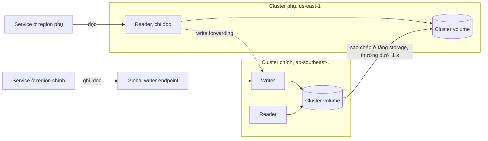
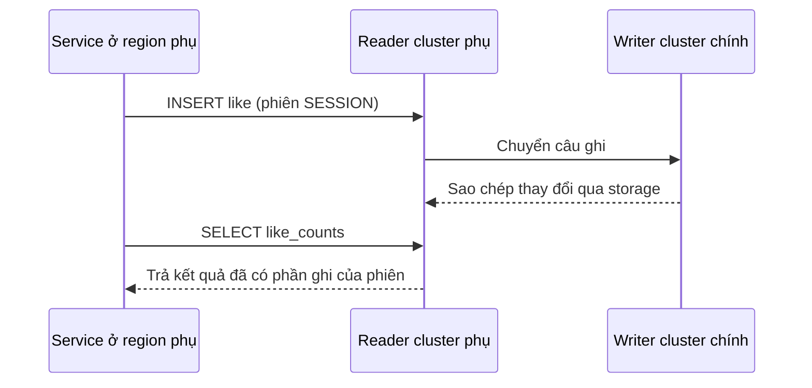

# Các lựa chọn tầng dữ liệu không dựng trong buổi

Trang này giải thích bốn lựa chọn của tầng dữ liệu trên AWS mà bài lab của thư mục này không dựng: Aurora Global
Database, DynamoDB global tables cùng DAX, Aurora Serverless v2 so với instance provisioned, Aurora I/O-Optimized so với
Aurora Standard. Mỗi lựa chọn có: bài toán nó giải, cách nó chạy theo tài liệu AWS, trạng thái ngành, đơn giá ở
`ap-southeast-1`, và chỗ nó khớp với svp. Bài lab đo những phần dựng được trong một buổi: Aurora và RDS for
PostgreSQL trong một region, RDS Proxy, ElastiCache for Valkey cluster mode, partition PostgreSQL.

## Bối cảnh của svp

- **Database.** Mỗi service một database PostgreSQL
  ([ADR-0001](https://github.com/anhnvcoder/svp-backend/blob/main/docs/adr/0001-service-boundaries-and-data-ownership.md)),
  cả bốn trên một instance RDS for PostgreSQL 17
  ([ADR-0057](https://github.com/anhnvcoder/svp-backend/blob/main/docs/adr/0057-postgres17-verify-full.md)). ADR-0057 giữ
  RDS, không Aurora, và hẹn xem lại khi svp cần failover dưới 30 giây hay storage trải ba AZ.
- **Quy mô** theo [`capacity.md`](https://github.com/anhnvcoder/svp-backend/blob/main/docs/explanation/capacity.md): feed
  khoảng 21 request/giây lúc cao điểm, mục tiêu tải 1.000 request/giây; 6 triệu lượt xem mỗi ngày, khoảng 10.000 event
  lượt xem/giây ở mục tiêu tải; timeline thêm 2 triệu dòng mỗi ngày, giữ 30 ngày (60 triệu dòng, khoảng 7 GB); PostgreSQL
  khoảng 38 GB sau một năm (follow 8 GB ở hai nơi, timeline 7 GB, like 15 GB).
- **Nhất quán** theo
  [`architecture.md`](https://github.com/anhnvcoder/svp-backend/blob/main/docs/architecture.md#2-ràng-buộc-và-yêu-cầu-phi-chức-năng):
  số lượt xem trễ tối đa khoảng một phút; like của chính mình thấy ngay, vì bảng `likes` và `like_counts` đổi trong cùng
  transaction.
- **Session** của `web` nằm ở Valkey db 9
  ([ADR-0053](https://github.com/anhnvcoder/svp-backend/blob/main/docs/adr/0053-msk-elasticache-valkey.md)), idle timeout
  7 ngày, absolute timeout 30 ngày
  ([ADR-0046](https://github.com/anhnvcoder/svp-backend/blob/main/docs/adr/0046-web-session-lifetime.md)).
- **Khôi phục** theo [ADR-0067](https://github.com/anhnvcoder/svp-backend/blob/main/docs/adr/0067-backup-dr.md) §2, §12:
  hỏng dữ liệu RDS có RPO tối đa 5 phút, RTO tối đa 60 phút; mất region nằm ngoài phạm vi.
- **svp chưa đo** số I/O tính tiền, số ACU một cluster Aurora sẽ dùng, hay số lần ghi bộ đếm sau khi gom lô. Các phép
  tính dưới đây dùng đơn giá có nguồn và số của `capacity.md`; chỗ nào cần số chưa đo thì trang nói rõ.

Giá: on-demand, USD, `ap-southeast-1`, từ file Price List bulk công khai [P1]–[P3]; một tháng tính 730 giờ.

## Tóm tắt

| Lựa chọn | Bài toán | Trạng thái ngành | svp dùng khi |
| --- | --- | --- | --- |
| Aurora Global Database | Đọc ở region khác; RPO giây, RTO phút khi mất region | Current | Mất region vào phạm vi, có người dùng xa |
| DynamoDB global tables | Ghi, đọc ở nhiều region, AWS lo sao chép | Current; MRSC: emerging | Bảng key-value cần nhiều region |
| DAX | Cache đọc micro giây trước DynamoDB | Current | Chỉ khi dữ liệu nóng đã ở DynamoDB |
| Aurora Serverless v2 | Tải lên xuống khó đoán, môi trường ít dùng | Current; v1: legacy | Env sống qua đêm, phần lớn thời gian rảnh |
| Aurora I/O-Optimized | Chi phí I/O lớn và khó đoán | Current | I/O chiếm từ khoảng một phần tư hoá đơn Aurora |

Trạng thái ngành ở bảng là xếp loại của trang này, dựa trên tài liệu ở từng mục: current là tài liệu hiện hành khuyên
dùng; legacy là bản AWS gọi là legacy hay deprecated; emerging là tính năng có tài liệu nhưng còn thiếu nhiều tính năng
mà chế độ chính có.

## Aurora Global Database

### Bài toán

Một database PostgreSQL phục vụ người dùng ở nhiều region, hay phải sống sót khi cả region chính hỏng. Read replica
chéo region của RDS for PostgreSQL sao chép bằng engine; Aurora Global Database sao chép ở tầng storage.

### Cách sao chép

- Một cluster chính ở một region nhận ghi, tối đa 10 cluster phụ chỉ đọc ở các region khác [N1].
- Aurora sao chép bằng cluster storage volume trên hạ tầng riêng, không qua engine; độ trễ thường dưới một giây [N1].
- Cluster phụ chỉ đọc, giữ tới 16 instance đọc thay vì 15 của một cluster thường [N1]. Cluster phụ có thể không có
  instance nào (headless); muốn switchover hay failover sang nó thì phải thêm instance trước [N2].
- Global writer endpoint luôn trỏ tới writer của cluster chính, kể cả sau switchover hay failover [N1].
- Aurora PostgreSQL 17 dùng được Global Database ở `ap-southeast-1` từ bản 17.4 [N3].
- Giới hạn chạm tới svp: không tích hợp Secrets Manager (phải tắt trước khi thêm region), không Aurora Auto Scaling ở
  cluster phụ, tự nâng minor không áp dụng; writer của cluster chính khởi động lại hay failover thì instance đọc ở cluster
  phụ cũng khởi động lại, cluster phụ không phục vụ tới khi bắt kịp [N1].



### Switchover và failover

| Thao tác | Dùng khi | RPO | Thời gian không phục vụ |
| --- | --- | --- | --- |
| Switchover | Region chính khoẻ: xoay region, diễn tập [N2] | 0, chờ đồng bộ xong [N2] | Thường dưới 30 s ở bản đủ điều kiện [N2] |
| Managed failover | Region chính hỏng [N2] | Thường vài giây, khác 0 [N2] | Cluster phụ lên chính trong vài phút [N2] |
| Failover tay | Không dùng được managed failover, ví dụ lệch patch level [N2] | Như trên | Tuỳ các bước tay |

- Switchover trước đây tên là managed planned failover. Mức dưới 30 giây áp cho Aurora PostgreSQL 16.8, 15.12, 14.17,
  13.20 hoặc cao hơn; trang không nêu riêng major 17 [N2].
- Switchover và managed failover đòi cluster chính và phụ cùng major và minor [N1].
- Managed failover (`--allow-data-loss`) không chờ đồng bộ. Aurora thử chặn ghi ở tầng storage của region cũ (write
  fencing), thử chụp snapshot volume cũ tên `rds:unplanned-global-failover-…` để lấy lại phần dữ liệu thiếu, rồi đưa
  region cũ về làm cluster phụ khi nó khoẻ lại [N2].
- Riêng Aurora PostgreSQL: tham số `rds.global_db_rpo` (từ 20 giây) đặt trần RPO. Khi mọi cluster phụ trễ quá trần,
  Aurora chặn commit ở cluster chính tới khi một cluster phụ bắt kịp [N2]. Trần RPO đổi lấy độ sẵn sàng ghi.

### Write forwarding

Cluster phụ nhận câu ghi và chuyển về cluster chính; dữ liệu luôn đổi ở cluster chính trước rồi mới sao chép ra
[N4]. Với Aurora PostgreSQL [N5]:

- Có ở mọi minor của 16 trở lên; tắt mặc định; bật hay tắt không downtime, không khởi động lại.
- Phiên dùng write forwarding chạy `REPEATABLE READ` hay `READ COMMITTED`, không `SERIALIZABLE`.
- `apg_write_forward.consistency_mode` chọn mức nhất quán khi đọc ở cluster phụ: `SESSION` (mặc định: phiên thấy thay
  đổi của chính nó, câu đọc chờ phần ghi đã chuyển đi sao chép về), `EVENTUAL` (có thể đọc dữ liệu cũ), `GLOBAL` (câu đọc
  chờ cluster phụ bắt kịp mọi commit tính tới lúc câu bắt đầu), `OFF` (tắt write forwarding trong phiên). Mức càng cao
  thì câu càng chờ lâu.



### Trạng thái ngành và giá

Current: Global Database, switchover, managed failover và write forwarding cho Aurora PostgreSQL đều nằm trong tài liệu
hiện hành [N1], [N2], [N5]. Đơn giá ở `ap-southeast-1` [P1]:

| Tài nguyên | Đơn vị | USD |
| --- | --- | --- |
| Aurora PostgreSQL `db.r7g.large` (2 vCPU, 16 GiB), Standard | instance-giờ | 0,333 |
| I/O ghi được sao chép (replicated write I/O) | triệu I/O | 0,22 |

Chi phí dựng region phụ cho svp (instance, lưu trữ, chuyển dữ liệu chéo region) nằm ở bài
[`multi-region-dr`](https://github.com/anhnvcoder/svp-labs/tree/main/multi-region-dr), tính ở `us-east-1`.

### Áp vào svp

- **Điều kiện.** Mất region vào phạm vi (đổi ADR-0067 §12), hay svp có người dùng đủ xa để đọc ở region khác. Bài
  [`multi-region-dr`](https://github.com/anhnvcoder/svp-labs/tree/main/multi-region-dr) so bốn chiến lược DR và đo hai
  mức đầu; Global Database hợp với pilot light tới warm standby.
- **Đổi gì.** Đổi engine từ RDS for PostgreSQL sang Aurora PostgreSQL; bỏ mật khẩu master do Secrets Manager quản
  (`manage_master_user_password` của
  [module `rds`](https://github.com/anhnvcoder/svp-infra/blob/main/aws/modules/rds/main.tf)), vì Global Database không
  hỗ trợ tích hợp đó [N1]. Cả bốn database nằm trên một cluster nên sao chép cùng nhau.
- **Feed.** `GetFollowingFeed` đọc `timeline` ở reader của region phụ. Video mới vào feed trễ thêm độ trễ sao chép,
  thường dưới một giây [N1], trong ngân sách p95 10 giây của
  [ADR-0005](https://github.com/anhnvcoder/svp-backend/blob/main/docs/adr/0005-feed-fan-out-on-write.md).
- **Engagement.** Like ở region phụ đi bằng write forwarding với `SESSION`: đủ cho "like của chính mình thấy ngay",
  không cần `GLOBAL`. Consumer gom lượt xem ghi `view_counts` ở region chính, nơi có Kafka.
- **Video, session.** Upload và trạng thái video vẫn ghi ở region chính. Session ở Valkey, không thuộc Global Database:
  [`multi-region-dr`](https://github.com/anhnvcoder/svp-labs/tree/main/multi-region-dr) xét ElastiCache Global Datastore.

## DynamoDB global tables và DAX

### Bài toán

Bảng key-value nhận cả đọc và ghi ở nhiều region (multi-active), AWS lo sao chép. DAX đặt cache trong bộ nhớ trước
DynamoDB để đọc lặp lại nhanh hơn và bớt read capacity.

### Global tables

- Mọi replica nhận đọc và ghi [N6]; mỗi region một replica, mọi replica cùng tên bảng, khoá chính, dữ liệu [N7].
- Hai chế độ nhất quán chọn lúc tạo, không đổi được sau đó, mặc định MREC [N6]:

| Chế độ | Sao chép | Xung đột | RPO |
| --- | --- | --- | --- |
| MREC (multi-Region eventual) | Bất đồng bộ, thường dưới 1 s [N8] | Last writer wins theo item [N8] | Trễ sao chép, thường vài giây [N8] |
| MRSC (multi-Region strong) | Đồng bộ trước khi trả thành công [N8] | `ReplicatedWriteConflictException`, thử lại được [N8] | 0 [N8] |

- MREC: đọc strongly consistent chỉ trả bản mới nhất khi item được ghi lần cuối ở chính region đó; transaction chỉ
  nguyên tử trong region gọi nó [N7], [N8].
- MRSC: đúng ba region, ba replica hay hai replica cùng một witness; `ap-southeast-1` nằm trong danh sách region; ghi
  và đọc strongly consistent chậm hơn MREC vì phải nói chuyện chéo region. Không TTL, không LSI, không transaction; chuyển
  bảng một region sang MRSC đòi bảng rỗng [N7], [N8].
- SLA 99,999 % cho global tables so với 99,99 % cho bảng một region [N7].
- Tính tiền: mỗi lần ghi tính một rWRU (tới 1 KB) ở mọi region có replica, cùng giá WRU; không phí chuyển dữ liệu
  chéo region; witness không tốn rWRU [N10], [N11].

### DAX

- Cache trong bộ nhớ tương thích API DynamoDB, trả đọc eventually consistent trong micro giây; client của AWS cho Go,
  Java, Node.js, Python, .NET [N12].
- Write-through: ghi qua DAX đi đồng bộ xuống DynamoDB rồi cập nhật item cache. Query cache không bị cập nhật khi item
  đổi, chỉ hết theo TTL. Đọc strongly consistent và `TransactGetItems` đi thẳng xuống DynamoDB [N13].
- Không hợp với ứng dụng cần đọc strongly consistent, ghi nhiều, hay ít đọc lặp lại; chạy tốt khi tỉ lệ cache hit trên
  90 % [N12]. Production nên có ít nhất ba node ở ba AZ [N14].

### Trạng thái ngành và giá

- Global tables bản 2019.11.21 là Current, bản 2017.11.29 là Legacy theo cách gọi của AWS [N9].
- MREC: current. MRSC: emerging theo xếp loại của trang này, vì thiếu TTL, LSI, transaction và chỉ có ở một danh sách
  region [N8].
- DAX: current [N12].

| Tài nguyên ([P2], [P3]) | Đơn vị | USD |
| --- | --- | --- |
| Write request unit (on-demand), rWRU cùng giá | triệu | 0,71 |
| Read request unit (on-demand) | triệu | 0,1425 |
| Lưu trữ Standard, không tính 25 GB miễn phí đầu | GB-tháng | 0,285 |
| Node DAX `dax.t3.small` | node-giờ | 0,061 |
| Node DAX `dax.r7i.large` | node-giờ | 0,306 |

### Áp vào svp

Đổi một bảng sang DynamoDB là refactor kho dữ liệu của service sở hữu nó (ADR-0001), không chỉ đổi hạ tầng. Các bảng
có thể đổi:

- **`view_counts` (engagement).** Bộ đếm chịu được trễ một phút. Ghi mỗi lượt xem bằng một `UpdateItem` dưới 1 KB:
  6 triệu × 30 = 180 triệu WRU mỗi tháng, 180 × 0,71 = 127,80 USD; global tables hai replica tính 2 rWRU mỗi lần ghi,
  255,60 USD. Consumer của svp gom lô theo `video_id`, nên số lần ghi thật thấp hơn; svp chưa đo. Với MREC, hai region
  cùng tăng một item thì last writer wins làm mất lượt cộng của một bên [N8]: bộ đếm chỉ ghi ở một region, hay mỗi region
  một item rồi cộng khi đọc. Với MRSC, video viral bị `ReplicatedWriteConflictException` liên tục.
- **`likes` và `like_counts` (engagement).** Hai bảng đổi trong cùng transaction; MREC chỉ nguyên tử trong một region,
  MRSC không có transaction [N7]. Không hợp nếu không thiết kế lại.
- **`timeline` (feed).** Khoá phân vùng `user_id`, khoá sắp xếp theo thời điểm phát hành khớp phân trang keyset của
  ADR-0005. Fan-out 2 triệu dòng mỗi ngày là 60 triệu WRU mỗi tháng, 42,60 USD ở một region. TTL của DynamoDB thay job
  dọn 30 ngày ở MREC, không có ở MRSC [N7].
- **Session của `web`.** TTL của DynamoDB khớp idle và absolute timeout của ADR-0046 ở MREC. Chỉ đáng khi `web` chạy
  active-active ở nhiều region; một region thì Valkey đã đủ.
- **DAX.** Key nóng của svp là feed khám phá, đã cache-aside ở Valkey với TTL vài giây (ADR-0005). DAX chỉ thay được
  khi dữ liệu đó nằm ở DynamoDB; ba node `dax.t3.small` tốn 3 × 0,061 × 730 = 133,59 USD mỗi tháng. Bộ đếm ghi nhiều và
  like cần đọc mới nhất, cả hai là loại DAX không hợp [N12].

## Aurora Serverless v2 so với provisioned

### Bài toán

Tải lên xuống khó đoán, hay môi trường phần lớn thời gian rảnh: trả theo dung lượng dùng thay vì giữ instance cỡ đỉnh.

### Cách chạy

- Đơn vị là ACU: khoảng 2 GiB bộ nhớ cùng CPU và mạng tương ứng [N16]. Mỗi writer, reader có dung lượng riêng trong dải
  tối thiểu, tối đa chung của cluster, tăng giảm theo bước 0,5 ACU [N15], [N16].
- Dải theo bản engine và platform: Aurora PostgreSQL 17.4 trở lên có 0–256 ACU, 17.10 trở lên có 0–384 ACU [N16];
  Aurora PostgreSQL 17 dùng Serverless v2 ở `ap-southeast-1` từ 17.4 [N18].
- Cluster rảnh tiêu khoảng n × ACU tối thiểu, n là số writer và reader [N16]. Instance provisioned và Serverless v2 trộn
  được trong một cluster, đổi qua lại không cần tạo cluster mới [N15].
- **Về 0 ACU (auto-pause)** khi đặt tối thiểu 0: instance dừng sau `SecondsUntilAutoPause` (300 tới 86.400 giây), không
  tính tiền instance lúc dừng, vẫn tính storage. Kết nối mới đánh thức nó, thường khoảng 15 giây; dừng quá 24 giờ thì
  có thể 30 giây hay lâu hơn [N17].
- Không auto-pause khi: còn kết nối của người dùng, cluster gắn RDS Proxy, bật logical replication (writer và reader tầng
  0, 1), là cluster chính hay cluster phụ của Global Database, có zero-ETL tới Redshift [N17].

### Trạng thái ngành và giá

Current; Aurora Serverless v1 là sản phẩm deprecated, kiến trúc khác [N16]. Tài liệu hiện gọi Serverless v2 là "Aurora
serverless" [N15].

| Tài nguyên ([P1]) | Đơn vị | Standard | I/O-Optimized |
| --- | --- | --- | --- |
| Aurora PostgreSQL Serverless v2 | ACU-giờ | 0,20 | 0,26 |
| Aurora PostgreSQL `db.r7g.large` (2 vCPU, 16 GiB) | instance-giờ | 0,333 | 0,433 |
| Aurora PostgreSQL `db.t4g.medium` (2 vCPU, 4 GiB) | instance-giờ | 0,114 | 0,148 |

**Khi nào rẻ hơn** (Standard): Serverless v2 rẻ hơn `db.r7g.large` khi dung lượng trung bình dưới 0,333 / 0,20 = 1,67
ACU, rẻ hơn `db.t4g.medium` khi dưới 0,114 / 0,20 = 0,57 ACU. Ở cỡ bộ nhớ ngang `db.r7g.large` (16 GiB, khoảng 8 ACU)
Serverless v2 tốn 8 × 0,20 = 1,60 USD mỗi giờ, gần 4,8 lần instance. Vậy Serverless v2 thắng khi database rảnh phần lớn
thời gian và chỉ lên cao trong đỉnh ngắn; tải đều và cao thì provisioned rẻ hơn.

### Áp vào svp

- **stg, prd.** Mục tiêu tải 1.000 request/giây là tải đều trong lúc chạy k6; cao điểm thật gấp ba trung bình
  (`capacity.md`, A3). svp chưa đo ACU dưới tải nên chưa so được với lớp `db.m7g.large` của prd.
- **Môi trường sống qua đêm.** stg dựng và xoá trong buổi, không có giờ rảnh để tiết kiệm. ADR-0067 hẹn xem lại khi env
  sống qua đêm: lúc đó Serverless v2 với tối thiểu 0 ACU trả 0 tiền instance ban đêm, đổi lại kết nối đầu tiên chờ
  khoảng 15 giây. Pool của service phải để timeout kết nối dài hơn mức đó, và không gắn RDS Proxy, không bật logical
  replication [N17].
- **Region phụ của Global Database.** Reader Serverless v2 ở cluster phụ chạy nhỏ, tăng khi region phụ lên chính [N15];
  nó không auto-pause [N17].

## Aurora I/O-Optimized so với Standard

### Bài toán

Với Aurora Standard, mỗi triệu I/O tính tiền riêng; tải I/O lớn hay khó đoán làm hoá đơn khó đoán. I/O-Optimized bỏ phí
I/O, đổi lại instance và storage đắt hơn [N19].

### Cách chạy

- AWS khuyên I/O-Optimized khi chi cho I/O từ 25 % tổng chi Aurora trở lên, Standard khi dưới 25 % [N19].
- Đổi Standard sang I/O-Optimized mỗi 30 ngày một lần; đổi ngược lúc nào cũng được. Instance không NVMe (cả Serverless
  v2) đổi không downtime; instance NVMe phải khởi động lại engine [N19].

### Trạng thái ngành và giá

Current [N19]. Đơn giá [P1]:

| Tài nguyên | Đơn vị | Standard | I/O-Optimized |
| --- | --- | --- | --- |
| Instance `db.r7g.large` | instance-giờ | 0,333 | 0,433 |
| Storage | GB-tháng | 0,11 | 0,248 |
| I/O | triệu I/O | 0,22 | 0 |
| Serverless v2 | ACU-giờ | 0,20 | 0,26 |

Instance và ACU của I/O-Optimized đắt hơn khoảng 1,3 lần, storage khoảng 2,25 lần.

### Điểm hoà vốn

Gọi C là tiền instance mỗi tháng ở Standard, S là GB lưu trữ, N là triệu I/O mỗi tháng:

```text
Standard        = C + 0,11 × S + 0,22 × N
I/O-Optimized   = 1,3 × C + 0,248 × S
Hoà vốn khi  N  = (0,3 × C + 0,138 × S) / 0,22
```

Ví dụ svp nếu chạy Aurora ở prd: một writer và một reader `db.r7g.large`, 38 GB sau một năm.

| Khoản | Standard (USD/tháng) | I/O-Optimized (USD/tháng) |
| --- | --- | --- |
| Instance: 2 × giá giờ × 730 | 486,18 | 632,18 |
| Storage: 38 GB | 4,18 | 9,42 |
| **Cộng, chưa tính I/O** | **490,36** | **641,60** |

Chênh 151,24 USD, tức 151,24 / 0,22 ≈ 687 triệu I/O mỗi tháng, khoảng 262 I/O mỗi giây trung bình. Ở điểm đó I/O
chiếm 151,24 / 641,60 ≈ 23,6 % tổng của Standard, gần mốc 25 % của AWS [N19]. Storage của svp nhỏ nên điểm hoà vốn gần
như chỉ phụ thuộc tiền instance.

### Áp vào svp

svp chưa đo số I/O của một cluster Aurora. Các đường ghi chính là fan-out `timeline` (2 triệu dòng mỗi ngày) và lô
`view_counts`; cách tính của Aurora cho từng đường này chưa có số. Chọn Standard khi bắt đầu, đọc số I/O tính tiền của
một tháng chạy thật rồi so với ngưỡng trên; đổi sang I/O-Optimized được bất cứ lúc nào, đổi ngược bị giới hạn 30 ngày
[N19].

## Nguồn

Tài liệu AWS đọc 2026-11-17.

- [N1] Amazon Aurora, Using Amazon Aurora Global Database:
  <https://docs.aws.amazon.com/AmazonRDS/latest/AuroraUserGuide/aurora-global-database.html>
- [N2] Amazon Aurora, Using switchover or failover in Amazon Aurora Global Database:
  <https://docs.aws.amazon.com/AmazonRDS/latest/AuroraUserGuide/aurora-global-database-disaster-recovery.html>
- [N3] Amazon Aurora, Supported Regions and DB engines for Aurora global databases:
  <https://docs.aws.amazon.com/AmazonRDS/latest/AuroraUserGuide/Concepts.Aurora_Fea_Regions_DB-eng.Feature.GlobalDatabase.html>
- [N4] Amazon Aurora, Using write forwarding in an Amazon Aurora global database:
  <https://docs.aws.amazon.com/AmazonRDS/latest/AuroraUserGuide/aurora-global-database-write-forwarding.html>
- [N5] Amazon Aurora, Using write forwarding in an Aurora PostgreSQL global database:
  <https://docs.aws.amazon.com/AmazonRDS/latest/AuroraUserGuide/aurora-global-database-write-forwarding-apg.html>
- [N6] Amazon DynamoDB, Global tables: <https://docs.aws.amazon.com/amazondynamodb/latest/developerguide/GlobalTables.html>
- [N7] Amazon DynamoDB, Global tables core concepts:
  <https://docs.aws.amazon.com/amazondynamodb/latest/developerguide/globaltables-CoreConcepts.html>
- [N8] Amazon DynamoDB, How DynamoDB global tables work:
  <https://docs.aws.amazon.com/amazondynamodb/latest/developerguide/V2globaltables_HowItWorks.html>
- [N9] Amazon DynamoDB, DynamoDB global tables versions:
  <https://docs.aws.amazon.com/amazondynamodb/latest/developerguide/V2globaltables_versions.html>
- [N10] Amazon DynamoDB, Understanding Amazon DynamoDB billing for global tables:
  <https://docs.aws.amazon.com/amazondynamodb/latest/developerguide/global-tables-billing.html>
- [N11] Amazon DynamoDB, DynamoDB read and write operations:
  <https://docs.aws.amazon.com/amazondynamodb/latest/developerguide/read-write-operations.html>
- [N12] Amazon DynamoDB, In-memory acceleration with DynamoDB Accelerator (DAX):
  <https://docs.aws.amazon.com/amazondynamodb/latest/developerguide/DAX.html>
- [N13] Amazon DynamoDB, DAX and DynamoDB consistency models:
  <https://docs.aws.amazon.com/amazondynamodb/latest/developerguide/DAX.consistency.html>
- [N14] Amazon DynamoDB, DAX cluster components:
  <https://docs.aws.amazon.com/amazondynamodb/latest/developerguide/DAX.concepts.cluster.html>
- [N15] Amazon Aurora, Using Aurora serverless:
  <https://docs.aws.amazon.com/AmazonRDS/latest/AuroraUserGuide/aurora-serverless-v2.html>
- [N16] Amazon Aurora, How Aurora serverless works:
  <https://docs.aws.amazon.com/AmazonRDS/latest/AuroraUserGuide/aurora-serverless-v2.how-it-works.html>
- [N17] Amazon Aurora, Scaling to Zero ACUs with automatic pause and resume for Aurora serverless:
  <https://docs.aws.amazon.com/AmazonRDS/latest/AuroraUserGuide/aurora-serverless-v2-auto-pause.html>
- [N18] Amazon Aurora, Supported Regions and Aurora DB engines for Aurora serverless:
  <https://docs.aws.amazon.com/AmazonRDS/latest/AuroraUserGuide/Concepts.Aurora_Fea_Regions_DB-eng.Feature.ServerlessV2.html>
- [N19] Amazon Aurora, Amazon Aurora storage (Storage configurations for Amazon Aurora DB clusters):
  <https://docs.aws.amazon.com/AmazonRDS/latest/AuroraUserGuide/Aurora.Overview.StorageReliability.html>

Giá on-demand `ap-southeast-1`, đọc 2026-11-17 (file Price List bulk công khai, bản công bố 2026-11-13):

- [P1] AmazonRDS (Aurora PostgreSQL: `db.r7g.large` 0,333 và I/O-Optimized 0,433 mỗi giờ, `db.t4g.medium` 0,114 và
  0,148 mỗi giờ, Serverless v2 0,20 và 0,26 mỗi ACU-giờ, storage 0,11 và 0,248 mỗi GB-tháng, I/O 0,22 mỗi triệu,
  replicated write I/O 0,22 mỗi triệu; vCPU và bộ nhớ của lớp):
  <https://pricing.us-east-1.amazonaws.com/offers/v1.0/aws/AmazonRDS/current/ap-southeast-1/index.csv>
- [P2] AmazonDynamoDB (WRU và rWRU 0,71 mỗi triệu, RRU 0,1425 mỗi triệu, storage 0,285 mỗi GB-tháng sau 25 GB đầu):
  <https://pricing.us-east-1.amazonaws.com/offers/v1.0/aws/AmazonDynamoDB/current/ap-southeast-1/index.csv>
- [P3] AmazonDAX (`dax.t3.small` 0,061, `dax.r7i.large` 0,306 mỗi node-giờ):
  <https://pricing.us-east-1.amazonaws.com/offers/v1.0/aws/AmazonDAX/current/ap-southeast-1/index.csv>
