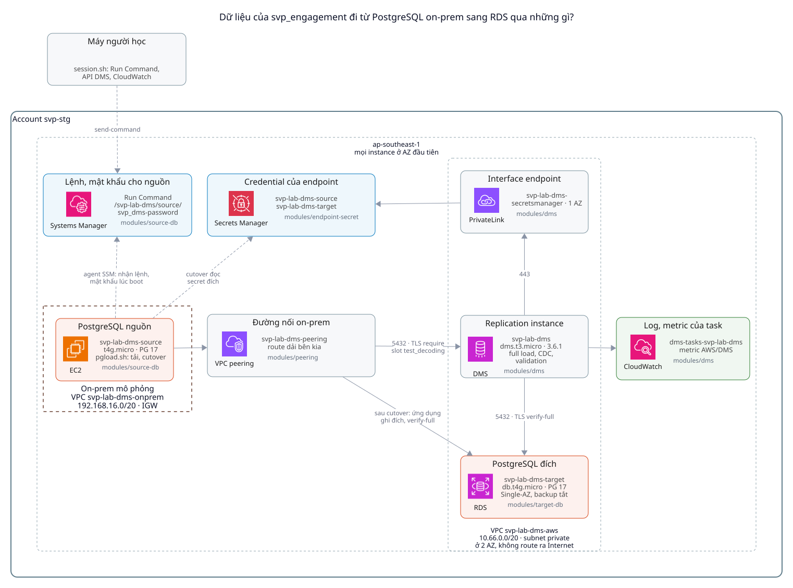
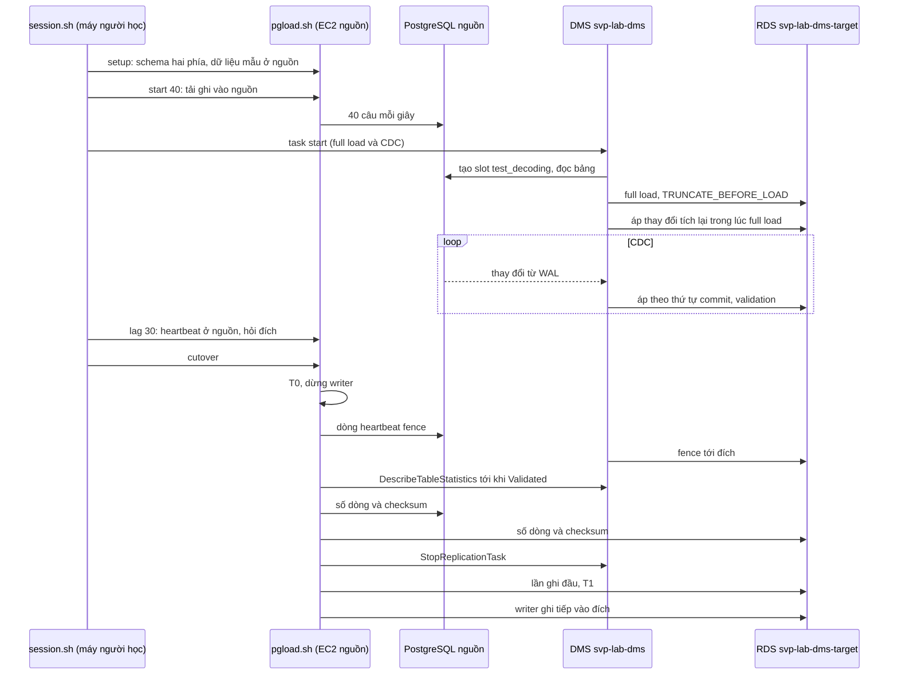

# Lab `dms-migration`: svp chạy on-prem, chuyển database engagement sang RDS bằng DMS

Bài giả định database `svp_engagement` của svp là PostgreSQL 17 tự quản trong data center, và dựng "on-prem" đó bằng một EC2
trong VPC riêng nối sang VPC phía AWS bằng VPC peering. AWS DMS chuyển database sang RDS for PostgreSQL: full load, CDC dưới tải
ghi đều, rồi cutover có đo downtime. Trang [`docs/migration-strategies.md`](docs/migration-strategies.md) đặt bài vào bức tranh
chung: 7 chiến lược, MGN, DataSync, Snow, Migration Hub áp vào svp.

| | |
| --- | --- |
| Dựng | Một root ở `svp-stg`, `ap-southeast-1`: VPC on-prem có EC2 PostgreSQL 17, VPC peering, VPC phía AWS có DMS và RDS |
| Trả lời | Full load mất bao lâu, CDC trễ bao nhiêu dưới tải, cutover dừng ghi bao lâu và bước nào chiếm phần lớn |
| Phí | ~0,091 USD mỗi giờ khi dựng; ~0,33 USD mỗi buổi 3 giờ ([Chi phí](#chi-phí)) |
| Thời gian | Ước tính, chưa đo: dựng ~25 phút, đo ~60 phút, gỡ và quét ~20 phút; ~1 giờ 45, trong buổi 3 giờ ([Chạy buổi](#chạy-buổi)) |

## Câu hỏi

- Chuyển `svp_engagement` từ PostgreSQL tự quản sang RDS bằng DMS full load và CDC thì full load mất bao lâu, CDC trễ
  bao nhiêu dưới tải ghi đều, cutover dừng ghi bao lâu, và bước nào của cutover (chờ CDC rút hết, chờ validation, đối
  chiếu, đổi chuỗi kết nối) chiếm phần lớn downtime?
- svp đang quyết: mỗi service một RDS for PostgreSQL 17, client nối `verify-full`
  ([ADR-0057](https://github.com/anhnvcoder/svp-backend/blob/main/docs/adr/0057-postgres17-verify-full.md)); đổi schema
  không downtime bằng expand/contract
  ([ADR-0068](https://github.com/anhnvcoder/svp-backend/blob/main/docs/adr/0068-zero-downtime-migrations.md)). Cả hai
  coi database đã ở AWS; chưa ADR nào nói cách chuyển cả một database từ nơi khác vào.
- Số đo của bài là đầu vào cho ADR của `svp-backend` sau buổi chạy, khi svp cần một đường migration có số.

## Thiết kế

<picture>
  <source media="(prefers-color-scheme: dark)" srcset="../docs/diagrams/dms-migration/overview-dark.svg">
  
</picture>

Bên trái là phía on-prem mô phỏng, giữa là đường nối, bên phải là VPC phía AWS; hàng trên là dịch vụ của region nằm ngoài cả hai VPC.
Mỗi khối là một tài nguyên của root, đúng tên trong Terraform. Mũi tên liền chở dữ liệu, mũi tên đứt là điều khiển hay đọc
credential. Nguồn sơ đồ: [`overview.d2`](../docs/diagrams/dms-migration/overview.d2).

EC2 `svp-lab-dms-source` đóng hai vai của on-prem: server PostgreSQL nguồn và máy ứng dụng ghi tải. `scripts/pgload.sh`
trên nó ghi tải đều vào nguồn, đo độ trễ CDC và chạy cutover; mọi mốc thời gian lấy từ đồng hồ của chính máy này. Máy
người học điều khiển bằng `scripts/session.sh` qua SSM Run Command và API DMS. Lệnh Run Command tới Systems Manager; agent SSM
trên EC2 tự mở kết nối ra ngoài để nhận lệnh, nên EC2 không mở cổng SSH. Mọi instance đặt ở AZ đầu tiên của
region: chuyển dữ liệu qua peering trong một AZ và giữa DMS với RDS, EC2 cùng AZ không tính tiền [N16], [P9].

| Phần | Chọn | Phương án khác | Trạng thái ngành, nguồn |
| --- | --- | --- | --- |
| Công cụ chuyển dữ liệu | DMS replication instance, engine 3.6.1, task full load và CDC, validation bật | DMS Serverless (bảng dưới); logical replication gốc của PostgreSQL (so ở [`docs/migration-strategies.md`](docs/migration-strategies.md)); `pg_dump`/`pg_restore` (dừng ghi suốt lúc dump và restore) | Hiện hành [N1], [N8], [N11] |
| Đường nối on-prem | VPC peering một account, một region | Site-to-Site VPN, Direct Connect: [bài `multi-account-networking`](https://github.com/anhnvcoder/svp-labs/tree/main/multi-account-networking) | Peering rẻ nhất cho buổi; DMS dùng được nhiều VPC nối peering [N4], [N16] |
| Credential của endpoint | Mỗi endpoint một secret `username`, `password`, `host`, `port`; role đọc secret tin service principal theo region của DMS | `username`, `password` ghi thẳng vào endpoint (state Terraform giữ dạng rõ) | Hiện hành [N3] |
| DMS tới Secrets Manager | Interface endpoint một AZ, `secretsManagerEndpointOverride` | Replication instance public (fail control `DMS.1` mức Critical của Security Hub [N14]); NAT Gateway | DMS trong subnet private cần endpoint [N3] |
| TLS | Nguồn `require` (cert tự ký), đích `verify-full` với bundle CA RDS của region | Nguồn `verify-full` với CA nội bộ import vào DMS | Cert tự ký thì dùng `require` [N6]; bundle region [N21] |
| Đích | RDS for PostgreSQL 17 `db.t4g.micro`, Single-AZ, backup tắt tới cutover | Aurora PostgreSQL; Multi-AZ | DMS khuyên tắt backup và Multi-AZ của đích tới cutover [N13] |
| Schema | Tạo trước ở hai phía, full load `TRUNCATE_BEFORE_LOAD`, `CaptureDdls` tắt | DMS tự tạo bảng: chỉ bảng và khoá chính, không index phụ [N13]; DMS Schema Conversion cho migration khác engine | Dữ liệu nhỏ thì tạo khoá trước full load được [N13]; svp giữ schema ở migration của mỗi service |

DMS replication instance so với DMS Serverless, ở `ap-southeast-1`:

| | Replication instance | DMS Serverless |
| --- | --- | --- |
| Đơn vị tính | Instance class chọn tay, `dms.t3.micro` 0,028 USD/giờ, cộng lưu trữ GP2 [P2] | DCU (1 DCU = 2 GB RAM), tối thiểu mặc định 1 DCU, tự co giãn tới mức tối đa; 1 DCU Single-AZ 0,122 USD/giờ [N11], [P2], [P9] |
| Engine | Chọn version: 3.6.1 | 3.5.4 [N11] |
| CDC từ PostgreSQL | Có, `test_decoding` hay `pglogical` [N1] | Có, cùng loại endpoint [N11] |
| Validation bảng khoá chính `uuid` | Có từ 3.6.1 [N8] | Engine 3.5.4 chưa có tính năng đó [N8], [N11] |
| Secrets Manager | Cần đường mạng: endpoint, NAT hay IP public [N3] | Bắt buộc VPC endpoint [N12] |
| Khởi động | Instance có sẵn sau `apply` | Tính và cấp capacity khi start replication [N11] |
| Buổi 3 giờ | 3 × (0,028 + 0,0038) ≈ 0,095 USD | Ít nhất 3 × 0,122 ≈ 0,37 USD |

Bài dựng replication instance: rẻ hơn khoảng bốn lần cho buổi 3 giờ, và trong hai lựa chọn chỉ nó validate được bảng
khoá `uuid` của svp.

Lý do các lựa chọn:

- **User DMS ở nguồn là superuser.** Với nguồn PostgreSQL tự quản chạy CDC, tài liệu DMS yêu cầu superuser [N1].
  `pg_hba.conf` chỉ cho user `svp_dms` vào bằng `hostssl` từ hai subnet của DMS, cổng 5432 của security group cũng vậy.
  `CaptureDdls` tắt nên DMS không tạo trigger hay bảng phụ nào ở nguồn [N1].
- **User đích là master.** Endpoint đích và ứng dụng sau cutover dùng user master `svp_admin` của RDS cho gọn. DMS chỉ
  cần `CONNECT`, `CREATE` và `INSERT`, `UPDATE`, `SELECT`, `DELETE`, `TRUNCATE` trên schema đích [N2]; migration thật
  dùng một user riêng với đúng các quyền đó, và ứng dụng một user khác.
- **Cấu hình logical decoding.** `wal_level = logical`, `max_replication_slots`, `max_wal_senders` theo tài liệu DMS;
  `wal_sender_timeout = 0` là giá trị DMS chấp nhận [N1]. Plugin `test_decoding` nằm trong gói `postgresql17-contrib`
  của Amazon Linux 2023 [N1], [N20]. `max_slot_wal_keep_size = 2GB` chặn một slot bị bỏ quên làm đầy đĩa nguồn: vượt
  ngưỡng thì task DMS lỗi thay vì server dừng [N1].
- **Engine 3.6.1.** PostgreSQL 17 cần DMS từ 3.5.4 [N7]; validation bảng khoá chính `uuid` cần 3.6.1 [N8]. Bảng của svp
  đều khoá `uuid`. Instance bật tự nâng minor theo control `DMS.6` [N14].
- **Kiểu cột.** DMS chuyển `text` của PostgreSQL thành LOB [N1], nên cột `kind` của bảng `heartbeat` là `varchar(16)`.
  `timestamptz` qua DMS chuẩn hoá về UTC [N1]; checksum đối chiếu đọc cả hai phía với `TimeZone = UTC`.
- **Task tạo ở trạng thái dừng.** Terraform tạo task với `start_replication_task = false`; `session.sh task start` chạy
  nó sau khi schema có ở hai phía. Log của task bật cho `SOURCE_UNLOAD`, `SOURCE_CAPTURE`, `TARGET_LOAD`, `TARGET_APPLY`
  mức `LOGGER_SEVERITY_DEFAULT`, đúng control `DMS.7`, `DMS.8` [N14]; nhóm log `dms-tasks-svp-lab-dms` do Terraform tạo,
  giữ 1 ngày, xoá cùng destroy. `DMS.13` (Multi-AZ) fail có chủ ý: bài Single-AZ [N14].
- **Cutover là quy trình có cổng.** `pgload.sh cutover` dừng writer (cả process group, nên không còn câu ghi nào tới
  nguồn), ghi một dòng `heartbeat` loại `fence` ở nguồn và chờ nó tới đích (CDC áp theo thứ tự commit, nên mọi thay đổi
  trước nó đã tới), chờ validation báo mọi bảng `Validated` không còn bản ghi pending, failed, suspended [N9], đối chiếu
  số dòng và checksum từng bảng, dừng task rồi mới chuyển writer sang đích. Ghi vào đích lúc task còn chạy làm
  validation báo sai [N9]. Một cổng không qua trước hạn thì cutover huỷ: writer ghi lại vào nguồn, task tiếp tục chạy.
- **Sequence.** Logical replication không sao chép sequence [N18]; bảng của svp khoá `uuid` nên cutover của bài không có
  bước đồng bộ sequence. Bảng dùng `serial` hay `identity` thì cutover thêm bước `setval` ở đích trước khi ghi.
- **Mạng.** Phía AWS có hai subnet private ở hai AZ vì subnet group của RDS và của DMS đều cần hai AZ [N19], [N4], không
  internet gateway, không NAT; route duy nhất ra khỏi VPC là peering tới dải on-prem. RDS PostgreSQL từ 15 mặc định
  `rds.force_ssl = 1` [N19], nên parameter group mặc định đủ cho client `verify-full`.
- **Quyền của máy on-prem.** Role của EC2 đọc đúng tham số mật khẩu (giải mã chỉ qua Parameter Store, encryption context
  là ARN tham số [N17]), đọc đúng secret đích, và chỉ `dms:DescribeTableStatistics`, `dms:StopReplicationTask` trên đúng
  task này [N15].
- **Role cấp account.** DMS tìm `dms-vpc-role` và `dms-cloudwatch-logs-role` theo đúng tên [N5]. Mục
  [Điều kiện trước](#điều-kiện-trước) kiểm chúng có sẵn chưa; role có sẵn thì bài không tạo và lượt gỡ không xoá.

Mật khẩu và host:

- Mật khẩu là ephemeral resource `aws_secretsmanager_random_password` (chỉ chữ và số), đi vào nơi dùng qua thuộc tính
  write-only: `value_wo` của tham số SSM, `password_wo` của RDS, `secret_string_wo` của hai secret. Plan và state không
  giữ mật khẩu nào. PostgreSQL nguồn đọc mật khẩu từ tham số SSM lúc boot; tham số không chứa host nên không phụ thuộc
  EC2.
- Secret nguồn giữ IP private của EC2. Thay EC2 nguồn (đổi `user-data.sh.tftpl` hay `pgload.sh` cũng thay nó, kèm mất dữ
  liệu nguồn) hay xoay mật khẩu nguồn đều theo đúng thứ tự dưới đây. Tăng version rồi `apply` một mình chỉ đổi nơi lưu:
  PostgreSQL vẫn giữ mật khẩu cũ và DMS không nối được.

  1. Tăng `source_password_version` trong `dms-migration/terraform/dms.auto.tfvars` (tạo file nếu chưa có; giữ số mới ở
     đó để lần `plan` sau không hạ nó), ví dụ `source_password_version = 2`.
  2. `apply`: Terraform ghi mật khẩu mới vào tham số SSM, mật khẩu mới và host hiện tại vào secret nguồn.
  3. Lệnh SSM Run Command đặt mật khẩu mới trong PostgreSQL bằng `ALTER ROLE`, đọc giá trị mới của tham số. Dán lại dòng
     `password of svp_dms set from ... version <n>`; `<n>` phải là version mới của tham số.

  Lệnh của bước 2 và 3, theo khuôn của [Chạy buổi](#chạy-buổi). Bản văn bản của plan chỉ có hai tài nguyên đổi: tham số SSM
  và version của secret `svp-lab-dms-source`; thấy tài nguyên khác thì dừng, không apply.

  ```sh
  AWS_PROFILE=anhnv-stg \
  TF_VAR_account_id="$SVP_AWS_STG_ACCOUNT_ID" \
  TF_VAR_rds_ca_bundle="$RDS_CA" \
    terraform -chdir=dms-migration/terraform plan -input=false -out=dms-migration.tfplan
  AWS_PROFILE=anhnv-stg terraform -chdir=dms-migration/terraform show -no-color dms-migration.tfplan \
    > "$SVP_LAB_SESSION_DIR/dms-migration-rotate-plan.txt"
  grep -E '^\s*# .* (will|must) be|^Plan:' "$SVP_LAB_SESSION_DIR/dms-migration-rotate-plan.txt"
  ```

  Đọc `dms-migration-rotate-plan.txt`; chỉ hai tài nguyên trên đổi thì sang khối sau, apply đúng file plan đã đọc rồi xoay:

  ```sh
  AWS_PROFILE=anhnv-stg terraform -chdir=dms-migration/terraform apply -input=false dms-migration.tfplan \
    && rm dms-migration/terraform/dms-migration.tfplan
  SVP_AWS_STG_ACCOUNT_ID=$SVP_AWS_STG_ACCOUNT_ID dms-migration/scripts/session.sh run password
  ```

- Xoay mật khẩu đích: tăng `target_password_version` trong cùng file rồi `apply`; Terraform ghi giá trị mới vào RDS và
  secret đích cùng lượt.
- Task đang chạy có thể không nhận mật khẩu mới; tài liệu DMS bảo chạy lại task để làm mới credential [N3]. Dừng task
  trước khi xoay (`session.sh task stop`), chạy lại sau (`session.sh task resume`).

## Đo gì

Tải ghi: `pgload.sh start 40` ghi 40 câu mỗi giây vào nguồn, mỗi câu một transaction: hai lượt cộng `view_counts`, một
`likes` mới, một `likes` bị xoá cho mỗi bốn câu. Dữ liệu mẫu của `setup`: 100 000 dòng `view_counts`, 500 000 dòng
`likes`.

| Số đo | Định nghĩa | Cách đo | Mong đợi |
| --- | --- | --- | --- |
| Thời gian full load | `FullLoadFinishDate` trừ `FullLoadStartDate` của task | `session.sh fullload` | Phút với 600 000 dòng; AWS không công bố số: đo |
| Độ trễ CDC | Thời điểm dòng `heartbeat` thấy ở đích trừ thời điểm ghi ở nguồn, đo khi tải 40 câu mỗi giây đang chạy; cả hai mốc từ đồng hồ của EC2 nguồn | `session.sh run lag 30`: 30 mẫu, mỗi mẫu hỏi đích mỗi 0,2 s, in min, median, max, mean | Thấp trong điều kiện thường, có thể vọt lên vài phút khi nguồn ghi nặng [N13]; ghi lại median và max |
| `CDCLatencySource`, `CDCLatencyTarget` | Metric `AWS/DMS` của task: khoảng cách từ sự kiện cuối đọc ở nguồn, và từ sự kiện cũ nhất chờ commit ở đích, tới giờ của instance DMS, đơn vị giây [N10] | `session.sh metrics 15`: max và trung bình 15 phút, chu kỳ 60 s | Cùng bậc với độ trễ heartbeat; target cao hơn source thì chậm ở phía đích [N10] |
| Downtime cutover | Từ lúc dừng ghi ở nguồn (T0) tới lần ghi thành công đầu tiên ở đích (T1) | `session.sh cutover 900`: in T0, từng cổng kèm giây sau T0, T1 và `Downtime cutover` | Bằng tổng CDC rút hết, validation, đối chiếu và lần ghi đầu; ghi lại phần của từng bước |
| Đối chiếu | Số dòng và checksum không phụ thuộc thứ tự (tổng 60 bit đầu của md5 mỗi dòng) từng bảng, hai phía | Trong cutover; riêng lẻ: `session.sh run compare` khi writer dừng | Khớp cả ba bảng |

Sai số: độ trễ heartbeat là cận trên, lệch tới một chu kỳ hỏi (0,2 s) cộng thời gian mở kết nối TLS tới đích; một đồng
hồ nên không có lệch đồng hồ. Metric CloudWatch có độ phân giải 60 s.

## Tài nguyên

Bài có một root. Số tài nguyên, chia theo phần và theo loại, ở trang [inventory](docs/inventory.md) (sinh từ plan trên provider giả).

| Root | Việc | Inventory |
| --- | --- | --- |
| `dms-migration/terraform` | Hai VPC, peering, EC2 nguồn, RDS đích, hai secret, DMS (instance, endpoint, task) | [mục của root][inv-root] |

[inv-root]: docs/inventory.md#dms-migrationterraform

## Chi phí

Đơn giá on-demand, USD, `ap-southeast-1`, đọc 2026-11-17 từ file Price List bulk công khai và trang giá (cột URL). Free
Tier không tính (DMS có 750 giờ `dms.t3.micro` mỗi tháng trong năm đầu cho account đăng ký Free Tier trước 2025-07-15
[P9]). Buổi tính 3 giờ.

| Tài nguyên | Đơn vị | Đơn giá | URL | Ngày đọc |
| --- | --- | --- | --- | --- |
| RDS PostgreSQL `db.t4g.micro` Single-AZ | giờ | 0,025 | [P1] | 2026-11-17 |
| RDS gp3 | GB-tháng | 0,138 | [P1] | 2026-11-17 |
| DMS `dms.t3.micro` Single-AZ | giờ | 0,028 | [P2] | 2026-11-17 |
| DMS lưu trữ GP2 | GB-tháng | 0,138 | [P2] | 2026-11-17 |
| DMS Serverless 1 DCU Single-AZ (không dựng, để so) | giờ | 0,122 | [P2] | 2026-11-17 |
| EC2 `t4g.micro` | giờ | 0,0106 | [P3] | 2026-11-17 |
| EBS gp3 | GB-tháng | 0,096 | [P3] | 2026-11-17 |
| NAT Gateway (không dựng, để so) | giờ | 0,059 | [P3] | 2026-11-17 |
| IPv4 công khai đang dùng | giờ | 0,005 | [P4] | 2026-11-17 |
| Interface endpoint, mỗi AZ | giờ | 0,013 | [P4] | 2026-11-17 |
| Dữ liệu qua interface endpoint | GB | 0,01 | [P4] | 2026-11-17 |
| Chuyển dữ liệu giữa hai AZ (bài không dùng: mọi thứ cùng AZ) | GB | 0,01 | [P5] | 2026-11-17 |
| Secret Secrets Manager, tính theo phần tháng | secret-tháng | 0,40 | [P6] | 2026-11-17 |
| API Secrets Manager | 10 000 request | 0,05 | [P6] | 2026-11-17 |
| CloudWatch Logs nạp | GB | 0,70 | [P7] | 2026-11-17 |
| CloudWatch Logs lưu | GB-tháng | 0,03 | [P7] | 2026-11-17 |
| Tham số Parameter Store tier Standard | tham số | 0 | [P8] | 2026-11-17 |

Mỗi giờ khi mọi thứ chạy:

| Khoản | Cách tính | USD mỗi giờ |
| --- | --- | --- |
| RDS đích | 0,025 | 0,025 |
| gp3 20 GB của RDS | 20 × 0,138 / 730 | 0,0038 |
| DMS replication instance | 0,028 | 0,028 |
| Lưu trữ 20 GB của DMS | 20 × 0,138 / 730 | 0,0038 |
| EC2 nguồn | 0,0106 | 0,0106 |
| EBS gp3 8 GB của EC2 | 8 × 0,096 / 730 | 0,0011 |
| IPv4 công khai của EC2 | 0,005 | 0,005 |
| Interface endpoint Secrets Manager, một AZ | 0,013 | 0,013 |
| Hai secret | 2 × 0,40 / 730 | 0,0011 |
| **Cộng mỗi giờ** | | **~0,091** |

Mỗi buổi 3 giờ:

| Khoản | Cách tính | USD |
| --- | --- | --- |
| Tài nguyên chạy cả buổi | 3 × 0,091 | 0,27 |
| Log của task, ước dưới 50 MB nạp và lưu vài giờ | 0,05 × 0,70 | < 0,04 |
| API Secrets Manager, dữ liệu qua endpoint | dưới 10 000 request; dưới 1 GB | < 0,02 |
| Chuyển dữ liệu qua peering và giữa DMS, RDS, EC2 cùng AZ | 0 [N16], [P9] | 0 |
| **Cộng mỗi buổi** | | **~0,33** |

So đường DMS tới Secrets Manager: endpoint một AZ 0,013 USD mỗi giờ; IP công khai cho replication instance 0,005 nhưng
fail control `DMS.1`; NAT Gateway 0,059. So DMS Serverless: ít nhất 0,122 mỗi giờ so với 0,032 của instance kèm lưu trữ.

## Điều kiện trước

- [ ] **Trên máy:** AWS CLI v2, `jq`, `curl`, Terraform 1.15.
- [ ] **Mã nguồn:** gốc repo `svp-labs` trên `main`, sau khi PR của bài đã merge. Mọi lệnh dưới đây chạy từ gốc repo.
- [ ] **Profile** `anhnv-stg` (account `svp-stg`) đã ghi như trang
  [thiết lập account của `svp-infra`](https://github.com/anhnvcoder/svp-infra/blob/main/docs/runbooks/accounts-setup.md); đăng nhập SSO một
  lần cho mọi profile cùng phiên:

  ```sh
  AWS_PROFILE=anhnv-sso aws sso login --no-cli-pager --region us-east-1
  ```

- [ ] **Biến account:** `SVP_AWS_STG_ACCOUNT_ID` (12 số của `svp-stg`) export trong terminal, không ghi vào file nào. Script của bài
  (`session.sh`, `sweep.sh`) đọc nó để kiểm account.
- [ ] **Thư mục buổi** ([`terraform-commands.md`](../docs/terraform-commands.md#thư-mục-buổi)):

  ```sh
  export SVP_LAB_SESSION_DIR="$PWD/.session/dms-migration-$(date -u +%Y%m%dT%H%M%SZ)" && mkdir -p "$SVP_LAB_SESSION_DIR"
  ```

- [ ] **Kiểm account** trước lệnh ghi đầu tiên. Dán lại output; nó phải bằng `$SVP_AWS_STG_ACCOUNT_ID`.

  ```sh
  AWS_PROFILE=anhnv-stg aws sts get-caller-identity --no-cli-pager --query Account --output text --region ap-southeast-1
  ```

- [ ] **Hai role cấp account của DMS và `dms.auto.tfvars`.** Mỗi lệnh in ARN của role khi role có sẵn, hay lỗi `NoSuchEntity` khi
  chưa có. Dán lại output.

  ```sh
  AWS_PROFILE=anhnv-stg aws iam get-role --no-cli-pager --role-name dms-vpc-role --query Role.Arn --output text \
    --region ap-southeast-1
  AWS_PROFILE=anhnv-stg aws iam get-role --no-cli-pager --role-name dms-cloudwatch-logs-role --query Role.Arn \
    --output text \
    --region ap-southeast-1
  ```

  - Không role nào có: bỏ qua, không tạo `dms.auto.tfvars`. Bài tạo cả hai và lượt gỡ xoá cả hai.
  - Có ít nhất một role: chép file mẫu thành file cá nhân (git bỏ qua `*.auto.tfvars`), rồi giữ đúng dòng của role đã có, mỗi dòng
    giá trị `false`: `create_dms_vpc_role = false` khi có `dms-vpc-role`, `create_dms_logs_role = false` khi có
    `dms-cloudwatch-logs-role`; xoá dòng của role chưa có. Bài không tạo và lượt gỡ không xoá role có sẵn.

    ```sh
    cp dms-migration/terraform/dms.auto.tfvars.example dms-migration/terraform/dms.auto.tfvars
    ```

- [ ] **Bundle CA RDS của region** vào biến terminal `RDS_CA`; DMS kiểm cert của đích theo nó. Dán lại số dòng `BEGIN CERTIFICATE`
  (lớn hơn 0). Terminal mới thì chạy lại lệnh này trước mọi lệnh `terraform` có `TF_VAR_rds_ca_bundle`.

  ```sh
  RDS_CA=$(curl -fsS https://truststore.pki.rds.amazonaws.com/ap-southeast-1/ap-southeast-1-bundle.pem)
  grep -c 'BEGIN CERTIFICATE' <<<"$RDS_CA"
  ```

- [ ] **Lab chạy trước:** không cần. Bài dựng mạng riêng, không dùng tài nguyên của lab khác.

## Chạy buổi

Lệnh `terraform` theo khuôn của [`docs/terraform-commands.md`](../docs/terraform-commands.md) (lý do từng phần ở đó). Buổi chạy trong
account `svp-stg` bằng profile `anhnv-stg`. Thời gian ở tóm tắt là ước tính, chưa đo: apply ~15 phút (RDS và replication instance chiếm
phần lớn) cộng vài phút chờ script boot; full load vài phút với 600 000 dòng; CDC chạy ít nhất 5 phút trước khi đo, lệnh `lag` ~1 phút;
cutover tối đa 900 s mỗi cổng; gỡ ~15 phút cộng quét.

1. **Init.** Root không có backend (state local); `init` chỉ tải provider theo lock file. Mong đợi `Terraform has been successfully
   initialized!`.

   ```sh
   AWS_PROFILE=anhnv-stg terraform -chdir=dms-migration/terraform init -input=false
   ```

2. **Plan** ra file, rồi bản văn bản vào thư mục buổi.

   ```sh
   AWS_PROFILE=anhnv-stg \
   TF_VAR_account_id="$SVP_AWS_STG_ACCOUNT_ID" \
   TF_VAR_rds_ca_bundle="$RDS_CA" \
     terraform -chdir=dms-migration/terraform plan -input=false -out=dms-migration.tfplan
   AWS_PROFILE=anhnv-stg terraform -chdir=dms-migration/terraform show -no-color dms-migration.tfplan \
     > "$SVP_LAB_SESSION_DIR/dms-migration-plan.txt"
   grep -E '^\s*# .* (will|must) be|^Plan:' "$SVP_LAB_SESSION_DIR/dms-migration-plan.txt"
   ```

   - **Mong đợi:** mọi dòng `will be created`; dòng `Plan:` bằng dòng của root ở [trang inventory][inv-root] khi account chưa có
     role nào của DMS (inventory tính bài tạo cả hai). Mỗi role có sẵn, ghi `false` trong `dms.auto.tfvars`, bớt 2 tài nguyên (role
     và policy attachment của nó) khỏi `to add`.
   - **Dán lại** dòng `Plan:`.
   - **Bẫy:** `No value for required variable` là thiếu `SVP_AWS_STG_ACCOUNT_ID` trong terminal. Lỗi validation của `rds_ca_bundle`
     là `RDS_CA` rỗng: lấy lại bundle (mục Điều kiện trước).

3. **Apply** đúng file plan đã đọc. Mong đợi `Apply complete!`; dán lại dòng đó và output `replication_task_arn`.

   ```sh
   AWS_PROFILE=anhnv-stg terraform -chdir=dms-migration/terraform apply -input=false dms-migration.tfplan \
     && rm dms-migration/terraform/dms-migration.tfplan
   ```

4. **Plan lại**, không `-out`. Mong đợi `No changes. Your infrastructure matches the configuration.`; dòng đổi nào còn lại là lỗi code:
   dừng, dán plan.

   ```sh
   AWS_PROFILE=anhnv-stg \
   TF_VAR_account_id="$SVP_AWS_STG_ACCOUNT_ID" \
   TF_VAR_rds_ca_bundle="$RDS_CA" \
     terraform -chdir=dms-migration/terraform plan -input=false
   ```

5. **Chờ SSM agent và script boot của EC2 nguồn.** Lệnh đầu phải in một dòng `<instance id> Online`. Lệnh sau in rỗng (chưa có slot
   nào) và thoát 0; lỗi `No such file` nghĩa là script boot chưa xong: chờ một phút rồi chạy lại.

   ```sh
   AWS_PROFILE=anhnv-stg aws ssm describe-instance-information --no-cli-pager --region ap-southeast-1 --output text \
     --query 'InstanceInformationList[].[InstanceId,PingStatus]'
   SVP_AWS_STG_ACCOUNT_ID=$SVP_AWS_STG_ACCOUNT_ID dms-migration/scripts/session.sh run slots
   ```

6. **Schema và dữ liệu mẫu.** Tạo schema ở hai phía và dữ liệu mẫu ở nguồn. Dán lại ba dòng `source <bảng>: <n> rows; target <bảng>:
   0 rows`.

   ```sh
   SVP_AWS_STG_ACCOUNT_ID=$SVP_AWS_STG_ACCOUNT_ID dms-migration/scripts/session.sh run setup 100000 500000
   ```

7. **Tải ghi rồi task.** Chạy tải ghi ở nguồn rồi chạy task. Dán lại dòng `writer started` và `task svp-lab-dms: starting`.

   ```sh
   SVP_AWS_STG_ACCOUNT_ID=$SVP_AWS_STG_ACCOUNT_ID dms-migration/scripts/session.sh run start 40
   SVP_AWS_STG_ACCOUNT_ID=$SVP_AWS_STG_ACCOUNT_ID dms-migration/scripts/session.sh task start
   ```

8. **Full load.** Theo dõi tới khi full load xong, rồi đọc thời gian full load. Chạy lệnh đầu mỗi phút tới khi nó in `full load 100 %`,
   `tables loaded 3`; dán lại dòng `Full load: <n> s`. Task `failed` thì đọc nhóm log `dms-tasks-svp-lab-dms`.

   ```sh
   dms-migration/scripts/session.sh task status
   dms-migration/scripts/session.sh fullload
   ```

9. **Độ trễ CDC dưới tải**, sau khi task ở CDC ít nhất 5 phút. Dán lại dòng `CDC lag over 30 samples` và hai dòng `CDCLatency...`.
   Lệnh `lag` mất khoảng một phút.

   ```sh
   SVP_AWS_STG_ACCOUNT_ID=$SVP_AWS_STG_ACCOUNT_ID dms-migration/scripts/session.sh run lag 30
   dms-migration/scripts/session.sh metrics 15
   ```

10. **Cutover**, hạn mỗi cổng 900 s tính từ T0. Dán lại toàn bộ output: các dòng `T0`, `lag drained`, `validation:`, ba dòng
    `compare`, `task stopping`, `T1`, `Downtime cutover`. Mã thoát 1 kèm `cutover aborted` nghĩa là một cổng không qua: writer đã
    ghi lại vào nguồn, task vẫn chạy; dòng đó nói cổng nào.

    ```sh
    SVP_AWS_STG_ACCOUNT_ID=$SVP_AWS_STG_ACCOUNT_ID dms-migration/scripts/session.sh cutover 900
    ```



## Dọn dẹp

Chạy đủ bốn bước trước khi kết thúc buổi, kể cả khi buổi dừng giữa chừng (apply lỗi giữa chừng: mục
[Khi apply lỗi giữa chừng](../docs/terraform-commands.md#khi-apply-lỗi-giữa-chừng)).

1. **Dừng writer, dừng task, gỡ slot replication ở nguồn:** slot còn lại giữ WAL từ điểm task dừng. Dán lại dòng `slots left: 0`.
   Task xoá trong lượt gỡ cũng gỡ slot do nó tạo [N1], nhưng chỉ khi DMS còn nối được nguồn.

   ```sh
   SVP_AWS_STG_ACCOUNT_ID=$SVP_AWS_STG_ACCOUNT_ID dms-migration/scripts/session.sh cleanup
   ```

2. **Plan gỡ**, đọc, rồi apply đúng file đó, cùng các biến như lúc dựng (lấy lại `RDS_CA` ở mục Điều kiện trước nếu terminal đã
   đóng). RDS xoá không snapshot cuối, không backup; secret xoá ngay; nhóm log và role do bài tạo xoá cùng; role có sẵn trước buổi ở
   lại.

   ```sh
   AWS_PROFILE=anhnv-stg \
   TF_VAR_account_id="$SVP_AWS_STG_ACCOUNT_ID" \
   TF_VAR_rds_ca_bundle="$RDS_CA" \
     terraform -chdir=dms-migration/terraform plan -destroy -input=false -out=dms-migration-destroy.tfplan
   AWS_PROFILE=anhnv-stg terraform -chdir=dms-migration/terraform show -no-color dms-migration-destroy.tfplan \
     > "$SVP_LAB_SESSION_DIR/dms-migration-destroy-plan.txt"
   grep -E '^\s*# .* (will|must) be|^Plan:' "$SVP_LAB_SESSION_DIR/dms-migration-destroy-plan.txt"
   ```

   Đọc `dms-migration-destroy-plan.txt` trong thư mục buổi; đúng như mong đợi (dưới) thì sang khối sau, apply đúng file plan đã đọc:

   ```sh
   AWS_PROFILE=anhnv-stg terraform -chdir=dms-migration/terraform apply -input=false dms-migration-destroy.tfplan \
     && rm dms-migration/terraform/dms-migration-destroy.tfplan
   ```

   - **Mong đợi:** `Plan: 0 to add, 0 to change, N to destroy.`, N bằng số `to add` của bước 2 ở [Chạy buổi](#chạy-buổi); rồi
     `Destroy complete!`.
   - **Dán lại** dòng `Plan:` và dòng `Destroy complete!`.

3. **Quét sót**, chỉ đọc, profile và region nằm trong script. Mong đợi mọi dòng `none` và `sweep: nothing left`; dòng `info` chỉ liệt
   kê hai role DMS khi chúng có trước buổi. Có dòng `LEFT` thì xoá thứ đó rồi quét lại; dòng `ERROR` thường là phiên SSO hết hạn: đăng
   nhập lại rồi quét lại. Dán lại toàn bộ output.

   ```sh
   dms-migration/scripts/sweep.sh
   ```

4. **Xoá file của buổi** khi sweep sạch và số đo đã ghi (mục Sau buổi): state local và file plan còn sót (state không giữ mật khẩu nhờ
   thuộc tính write-only, nhưng giữ account ID, ARN, IP và endpoint), rồi thư mục buổi. `dms.auto.tfvars` không giữ bí mật (cờ role,
   `*_password_version` khi đã xoay mật khẩu): để lại; buổi sau dựng trên state trống nên version nào cũng tạo mật khẩu mới.

   ```sh
   rm -f dms-migration/terraform/terraform.tfstate dms-migration/terraform/terraform.tfstate.backup \
     dms-migration/terraform/*.tfplan
   rm -rf "${SVP_LAB_SESSION_DIR:?}"
   ```

## Sau buổi

Không viết kết luận vào trang này trước buổi. Sau buổi:

- **Số đo cần ghi**, kèm mốc UTC mà script in: thời gian full load (bước 8 của [Chạy buổi](#chạy-buổi)); median, max của độ trễ CDC
  và max, trung bình của `CDCLatencySource`, `CDCLatencyTarget` (bước 9); downtime cutover cùng số giây của từng cổng: CDC rút hết,
  validation, đối chiếu, lần ghi đầu (bước 10); kết quả đối chiếu ba bảng.
- **Trang so sánh:** thêm số đo vào dòng AWS DMS của [`docs/migration-strategies.md`](docs/migration-strategies.md) khi số đổi cách
  chọn ở đó.
- **ADR mới ở `svp-backend`** nhận kết luận: đường chuyển một database vào RDS của svp và downtime chấp nhận được; README này thêm mục
  kết luận trỏ tới ADR đó.

## Ôn SAP-C03

Task statement của exam guide SAP-C03 [N22] mà bài phục vụ:

- 1.3 Design hybrid cloud integration patterns: VPC peering đóng vai đường riêng tới on-prem; Site-to-Site VPN, Direct Connect ở
  [bài `multi-account-networking`](https://github.com/anhnvcoder/svp-labs/tree/main/multi-account-networking).
- 1.4 Design network architectures: hai VPC nối peering, subnet private không route ra Internet, interface endpoint.
- 2.1 Design identity security architectures: role tối thiểu cho máy on-prem và cho DMS, secret riêng mỗi endpoint.
- 2.2 Design solutions to implement encryption and key management strategies: TLS `verify-full` tới đích theo bundle CA của RDS,
  `require` với cert tự ký ở nguồn.
- 3.1 Design architectures based on AWS pricing models: replication instance so với DMS Serverless.
- 3.2 Optimize data transfer and network costs: interface endpoint so với IP công khai và NAT Gateway, mọi instance cùng AZ.
- 4.1 Design migration strategies by using AWS frameworks: DMS full load và CDC, replatform PostgreSQL tự quản sang RDS, 7 chiến
  lược ở [`docs/migration-strategies.md`](docs/migration-strategies.md).
- 5.1 Design infrastructure as code: mật khẩu sinh ephemeral, ghi write-only vào Secrets Manager và Parameter Store.

### 1. Chuyển database đang ghi với downtime vài phút (task 4.1)

Một công ty chạy PostgreSQL 17 tự quản trong data center, đã có đường mạng riêng tới VPC. Họ muốn chuyển sang RDS for PostgreSQL.
Yêu cầu: ứng dụng vẫn ghi trong lúc chuyển, chỉ dừng ghi vài phút lúc chuyển hẳn, có cách chứng minh dữ liệu hai phía khớp.

- A. `pg_dump` nguồn rồi `pg_restore` vào RDS trong một cửa sổ bảo trì.
- B. Task DMS full load và CDC, bật validation; chuyển ứng dụng khi CDC đã áp hết và validation báo khớp.
- C. AWS Application Migration Service (MGN) chép máy chủ database sang EC2.
- D. AWS DataSync chép thư mục dữ liệu của PostgreSQL sang AWS rồi khởi động RDS từ đó.

**Đáp án:** B. Full load chép dữ liệu hiện có, CDC áp các thay đổi ghi trong lúc đó và sau đó [N1], validation so từng bảng [N9];
ghi chỉ dừng trong cutover.

**Vì sao không phải:**

- A: dừng ghi suốt lúc dump và restore (bảng lựa chọn ở mục [Thiết kế](#thiết-kế)).
- C: rehost, máy đích vẫn là PostgreSQL tự quản trên EC2, không phải RDS ([`docs/migration-strategies.md`](docs/migration-strategies.md)).
- D: RDS không khởi động từ thư mục dữ liệu chép vào; chép file của database đang ghi cũng không nhất quán.

**Trong lab:** bước 6–10 của [Chạy buổi](#chạy-buổi); số đo ở mục [Đo gì](#đo-gì).

### 2. DMS trong subnet private đọc credential của endpoint (task 1.4, 3.2)

Replication instance nằm ở subnet private không route ra Internet. Endpoint nguồn và đích đọc username, password từ Secrets Manager,
nhưng task lỗi vì không lấy được secret. Yêu cầu: không mở đường ra Internet, phí thấp, không fail control Security Hub của DMS.

- A. Bật `publicly_accessible` cho replication instance.
- B. Thêm NAT Gateway ở subnet public và route `0.0.0.0/0` của subnet private qua nó.
- C. Interface endpoint của Secrets Manager trong VPC, `secretsManagerEndpointOverride` ở endpoint DMS, security group chỉ nhận 443
  từ DMS.
- D. Gateway endpoint cho Secrets Manager.

**Đáp án:** C. DMS ở subnet private đọc secret qua VPC endpoint, khai bằng `secretsManagerEndpointOverride` [N3]; một AZ 0,013 USD
mỗi giờ [P4].

**Vì sao không phải:**

- A: instance công khai fail control `DMS.1` mức Critical [N14], và vẫn cần route ra Internet.
- B: mở đường ra Internet; NAT Gateway 0,059 USD mỗi giờ [P3], gấp hơn bốn lần endpoint, chưa tính phí dữ liệu.
- D: gateway endpoint chỉ có cho Amazon S3 và DynamoDB [N23].

**Trong lab:** `aws_vpc_endpoint.secretsmanager` và `local.secrets_override` ở `modules/dms/main.tf`; so ba đường ở mục
[Chi phí](#chi-phí).

### 3. Replication instance hay DMS Serverless cho một lần chuyển (task 3.1)

Một lần chuyển 600 000 dòng, buổi khoảng 3 giờ. Mọi bảng có khoá chính kiểu `uuid` và phải được validation. Yêu cầu: phí thấp nhất.

- A. DMS Serverless, capacity tối thiểu 1 DCU.
- B. Replication instance `dms.t3.micro` Single-AZ, engine 3.6.1.
- C. Replication instance Multi-AZ, class lớn để chắc chắn đủ.
- D. DMS Serverless, đặt capacity tối đa thấp để giới hạn phí.

**Đáp án:** B. Cả buổi kèm lưu trữ ~0,095 USD so với ít nhất ~0,37 USD của Serverless [P2]; engine 3.6.1 validate được bảng khoá
`uuid` [N8].

**Vì sao không phải:**

- A: ít nhất 1 DCU, 0,122 USD mỗi giờ [P2], [N11]; Serverless chạy engine 3.5.4, chưa validate bảng khoá `uuid` [N8], [N11].
- C: trả thêm instance dự phòng và class lớn cho một task chạy lại được khi lỗi, với lượng dữ liệu nhỏ.
- D: capacity tối đa không hạ mức tối thiểu 1 DCU, và vẫn là engine 3.5.4 [N11].

**Trong lab:** bảng so replication instance với DMS Serverless ở mục [Thiết kế](#thiết-kế).

### 4. Thứ tự của cutover (task 4.1)

Task full load và CDC đang chạy, ứng dụng vẫn ghi vào nguồn. Đội vận hành cần chuyển ứng dụng sang đích. Yêu cầu: không mất ghi nào,
có bằng chứng dữ liệu khớp trước khi ghi vào đích.

- A. Chuyển ứng dụng ghi vào đích ngay khi full load xong, để task CDC chạy tiếp vài giờ cho chắc.
- B. Dừng ghi ở nguồn, chờ CDC áp hết, chờ validation không còn bản ghi pending hay failed, đối chiếu, dừng task, rồi chuyển ghi.
- C. Dừng task trước, rồi dừng ghi ở nguồn, rồi chuyển ghi sang đích.
- D. Chuyển một nửa lượng ghi sang đích, nửa còn lại ở nguồn, rồi chuyển hẳn sau một ngày.

**Đáp án:** B. Validation chỉ báo đúng khi đích không bị ghi ngoài DMS [N9]; dừng ghi trước và chờ CDC rút hết thì mọi thay đổi đã
tới đích trước khi task dừng.

**Vì sao không phải:**

- A: ghi vào đích lúc task còn chạy làm validation báo sai [N9], và thay đổi CDC tới sau có thể ghi đè ghi mới.
- C: các câu ghi giữa lúc task dừng và lúc ứng dụng dừng không bao giờ tới đích.
- D: hai nơi cùng nhận ghi; CDC chỉ một chiều, ghi ở đích không về nguồn.

**Trong lab:** bước 10 của [Chạy buổi](#chạy-buổi) (`pgload.sh cutover` và các cổng của nó); ý "Cutover là quy trình có cổng" ở mục
[Thiết kế](#thiết-kế).

### 5. Đích RDS trong lúc full load (task 4.1)

Full load vào RDS for PostgreSQL chậm hơn dự tính. Đích đang chạy Multi-AZ, giữ automated backup 7 ngày. Yêu cầu: giữ RDS for
PostgreSQL, rút ngắn full load, không đổi ứng dụng.

- A. Tắt Multi-AZ và automated backup của đích tới cutover, bật lại trước khi chuyển ứng dụng.
- B. Đổi đích sang Aurora PostgreSQL.
- C. Bật `CaptureDdls` ở endpoint nguồn.
- D. Để DMS tự tạo bảng ở đích thay cho schema tạo trước.

**Đáp án:** A. Tài liệu best practice của DMS khuyên tắt backup và Multi-AZ của đích tới cutover [N13].

**Vì sao không phải:**

- B: đổi engine đích, trái ràng buộc giữ RDS for PostgreSQL.
- C: `CaptureDdls` thu DDL ở nguồn, không liên quan tốc độ ghi ở đích, và thêm trigger, bảng phụ ở nguồn [N1].
- D: DMS chỉ tạo bảng và khoá chính, không index phụ [N13]; ứng dụng chạy trên schema thiếu index.

**Trong lab:** `backup_retention_period = 0`, `multi_az = false` ở `modules/target-db/main.tf`; dòng "Đích" ở bảng lựa chọn của mục
[Thiết kế](#thiết-kế).

### 6. Ổ đĩa nguồn đầy khi task dừng (task 4.1, 4.3)

Nguồn là PostgreSQL tự quản, task CDC của DMS bị dừng qua cuối tuần. Sáng thứ hai ổ đĩa nguồn đầy WAL và PostgreSQL dừng. Yêu cầu:
lần sau một task bị bỏ quên không làm dừng database nguồn.

- A. Đặt `max_slot_wal_keep_size` ở nguồn; gỡ slot replication khi bỏ task.
- B. Tăng `wal_sender_timeout`.
- C. Đổi plugin của endpoint từ `test_decoding` sang `pglogical`.
- D. Tắt validation của task.

**Đáp án:** A. Slot giữ WAL tới khi bên đọc xác nhận đã nhận [N24]; `max_slot_wal_keep_size` giới hạn lượng đó: vượt ngưỡng thì task
DMS lỗi thay vì server dừng [N1], [N25].

**Vì sao không phải:**

- B: timeout của kết nối gửi WAL, không giới hạn WAL mà slot giữ [N25].
- C: plugin nào cũng đọc qua slot, slot vẫn giữ WAL [N1].
- D: validation đọc dữ liệu hai phía, không giữ WAL.

**Trong lab:** `max_slot_wal_keep_size = 2GB` ở `terraform/user-data.sh.tftpl`; bước 1 của [Dọn dẹp](#dọn-dẹp) gỡ slot.

## Kiểm offline

Chạy từ gốc repo, không chạm AWS (hai test script cần `jq` trên máy):

```sh
make tf-check DIRS=dms-migration
make shellcheck DIRS=dms-migration
bash dms-migration/scripts/pgload-test.sh
bash dms-migration/scripts/session-test.sh
make docs-check DOCS='dms-migration/**/*.md'
make diagrams-check NAMES=dms-migration
make lock DIRS=dms-migration  # only when the root changes its providers
```

## Tham chiếu

- `terraform/`: root, provider `ap-southeast-1`, `allowed_account_ids`, tag mặc định, user data của EC2 nguồn
  (`user-data.sh.tftpl`), `dms.auto.tfvars.example` cho role DMS có sẵn.
- `modules/network/`: VPC có một subnet public (vai on-prem) hay hai subnet private không route ra ngoài (phía AWS).
- `modules/peering/`: VPC peering và route tới dải của phía bên kia.
- `modules/source-db/`: EC2 PostgreSQL nguồn, IMDSv2, không SSH, tham số SSM mật khẩu, role của cutover.
- `modules/target-db/`: RDS for PostgreSQL 17 đích, mật khẩu master write-only.
- `modules/endpoint-secret/`: secret của một endpoint DMS, ghi write-only.
- `modules/dms/`: role cấp account (tuỳ chọn), subnet group, interface endpoint Secrets Manager, replication instance,
  cert CA, endpoint nguồn và đích, nhóm log, task.
- `scripts/pgload.sh`: chạy trên EC2 nguồn (`init`, `password`, `setup`, `start`, `stop`, `lag`, `compare`, `cutover`,
  `slots`, `drop-slots`); `scripts/pgload-test.sh`.
- `scripts/session.sh`: chạy trên máy người học (`check`, `run`, `task`, `fullload`, `metrics`, `cutover`, `cleanup`);
  `scripts/session-test.sh`.
- [`docs/inventory.md`](docs/inventory.md): tài nguyên root tạo trên account trống, sinh bằng `make inventory`.
- `../docs/diagrams/dms-migration/overview.d2`: sơ đồ của mục Thiết kế, sinh SVG bằng `make diagrams`.
- `scripts/sweep.sh`: quét sót, chỉ đọc.
- Tên và tag mà script tra cứu: tag `Lab = dms-migration`, tiền tố `svp-lab-dms`; tag `Name` của EC2
  `svp-lab-dms-source`; RDS `svp-lab-dms-target`; replication instance và task `svp-lab-dms`; endpoint
  `svp-lab-dms-source`, `svp-lab-dms-target`; secret `svp-lab-dms-source`, `svp-lab-dms-target`; tham số
  `/svp-lab-dms/source/svp_dms-password`; nhóm log `dms-tasks-svp-lab-dms`; database `svp_engagement`, user nguồn
  `svp_dms`, user đích `svp_admin`.

## Nguồn

Tài liệu đọc 2026-11-17.

- [N1] AWS DMS, Using a PostgreSQL database as an AWS DMS source (điều kiện của nguồn tự quản, cấu hình CDC,
  `test_decoding`, `max_slot_wal_keep_size`, `CaptureDdls`, slot gỡ khi xoá task, kiểu dữ liệu):
  <https://docs.aws.amazon.com/dms/latest/userguide/CHAP_Source.PostgreSQL.html>
- [N2] AWS DMS, Using a PostgreSQL database as a target (quyền của user đích, khoá ngoại khi full load):
  <https://docs.aws.amazon.com/dms/latest/userguide/CHAP_Target.PostgreSQL.html>
- [N3] AWS DMS, Using secrets to access AWS Database Migration Service endpoints (khuôn JSON, service principal theo
  region, subnet private cần VPC endpoint và `secretsManagerEndpointOverride`, ký tự cấm, task cần chạy lại để nhận mật
  khẩu mới): <https://docs.aws.amazon.com/dms/latest/userguide/security_iam_secretsmanager.html>
- [N4] AWS DMS, Setting up a network for a replication instance (nhiều VPC nối peering, subnet group hai AZ):
  <https://docs.aws.amazon.com/dms/latest/userguide/CHAP_ReplicationInstance.VPC.html>
- [N5] AWS DMS, Identity and access management (role `dms-vpc-role`, `dms-cloudwatch-logs-role` đúng tên):
  <https://docs.aws.amazon.com/dms/latest/userguide/security-iam.html>
- [N6] AWS DMS, Using SSL with AWS Database Migration Service (chế độ SSL, cert tự ký dùng `require`, import bundle
  PEM): <https://docs.aws.amazon.com/dms/latest/userguide/CHAP_Security.SSL.html>
- [N7] AWS DMS, Sources for data migration và Targets for data migration (PostgreSQL 17 từ 3.5.4):
  <https://docs.aws.amazon.com/dms/latest/userguide/CHAP_Introduction.Sources.html>,
  <https://docs.aws.amazon.com/dms/latest/userguide/CHAP_Introduction.Targets.html>
- [N8] AWS DMS release notes (3.6.1: validation bảng khoá chính `uuid`; bảng ngày của các version):
  <https://docs.aws.amazon.com/dms/latest/userguide/CHAP_ReleaseNotes.html>
- [N9] AWS DMS, Data validation (trạng thái validation, giới hạn khi đích bị ghi ngoài DMS):
  <https://docs.aws.amazon.com/dms/latest/userguide/CHAP_Validating.html>
- [N10] AWS DMS, Monitoring AWS DMS tasks (`CDCLatencySource`, `CDCLatencyTarget`, dimension):
  <https://docs.aws.amazon.com/dms/latest/userguide/CHAP_Monitoring.html>
- [N11] AWS DMS Serverless và AWS DMS Serverless components (engine 3.5.4, DCU, capacity tối thiểu mặc định 1 DCU):
  <https://docs.aws.amazon.com/dms/latest/userguide/CHAP_Serverless.html>,
  <https://docs.aws.amazon.com/dms/latest/userguide/CHAP_Serverless.Components.html>
- [N12] AWS DMS Serverless limitations (Secrets Manager qua VPC endpoint):
  <https://docs.aws.amazon.com/dms/latest/userguide/CHAP_Serverless.Limitations.html>
- [N13] AWS DMS, Best practices (DMS chỉ tạo bảng và khoá chính, tắt backup và Multi-AZ của đích tới cutover, độ trễ
  CDC): <https://docs.aws.amazon.com/dms/latest/userguide/CHAP_BestPractices.html>
- [N14] AWS Security Hub, controls cho AWS DMS (`DMS.1`, `DMS.6`, `DMS.7`, `DMS.8`, `DMS.13`):
  <https://docs.aws.amazon.com/securityhub/latest/userguide/dms-controls.html>
- [N15] Service Authorization Reference, AWS Database Migration Service (`DescribeTableStatistics`,
  `StopReplicationTask` theo resource `ReplicationTask`):
  <https://docs.aws.amazon.com/service-authorization/latest/reference/list_dms.html>
- [N16] Amazon VPC, What is VPC peering (giá: dữ liệu trong một AZ miễn phí) và VPC peering basics:
  <https://docs.aws.amazon.com/vpc/latest/peering/what-is-vpc-peering.html>,
  <https://docs.aws.amazon.com/vpc/latest/peering/vpc-peering-basics.html>
- [N17] AWS Systems Manager, How Parameter Store uses AWS KMS (`kms:Decrypt`, encryption context `PARAMETER_ARN`):
  <https://docs.aws.amazon.com/systems-manager/latest/userguide/secure-string-parameter-kms-encryption.html>
- [N18] PostgreSQL 17, Logical Replication Restrictions (schema, sequence không sao chép):
  <https://www.postgresql.org/docs/17/logical-replication-restrictions.html>
- [N19] Amazon RDS, Using SSL with a PostgreSQL DB instance (`rds.force_ssl` mặc định 1 từ PostgreSQL 15) và Working
  with a DB instance in a VPC (subnet group ở ít nhất hai AZ):
  <https://docs.aws.amazon.com/AmazonRDS/latest/UserGuide/PostgreSQL.Concepts.General.SSL.html>,
  <https://docs.aws.amazon.com/AmazonRDS/latest/UserGuide/USER_VPC.WorkingWithRDSInstanceinaVPC.html>
- [N20] Amazon Linux 2023, danh sách gói (`postgresql17-server`, `postgresql17-contrib`, `jq`):
  <https://docs.aws.amazon.com/linux/al2023/release-notes/all-packages-AL2023.12.html>
- [N21] Amazon RDS, Using SSL/TLS to encrypt a connection to a DB instance (bundle CA theo region):
  <https://docs.aws.amazon.com/AmazonRDS/latest/UserGuide/UsingWithRDS.SSL.html>
- [N22] AWS Certified Solutions Architect - Professional (SAP-C03) exam guide (đọc 2026-11-22):
  <https://docs.aws.amazon.com/aws-certification/latest/solutions-architect-professional-03/solutions-architect-professional-03.html>
- [N23] AWS PrivateLink, Gateway endpoints (chỉ Amazon S3 và DynamoDB; đọc 2026-11-22):
  <https://docs.aws.amazon.com/vpc/latest/privatelink/gateway-endpoints.html>
- [N24] PostgreSQL 17, Replication Slots (slot giữ WAL tới khi bên đọc nhận; đọc 2026-11-22):
  <https://www.postgresql.org/docs/17/warm-standby.html#STREAMING-REPLICATION-SLOTS>
- [N25] PostgreSQL 17, Replication settings (`max_slot_wal_keep_size`, `wal_sender_timeout`; đọc 2026-11-22):
  <https://www.postgresql.org/docs/17/runtime-config-replication.html>

Giá đọc 2026-11-17 (file Price List bulk công khai, trang giá):

- [P1] AmazonRDS `ap-southeast-1`:
  <https://pricing.us-east-1.amazonaws.com/offers/v1.0/aws/AmazonRDS/current/ap-southeast-1/index.csv>
- [P2] AWSDatabaseMigrationSvc `ap-southeast-1` (instance, lưu trữ, Serverless):
  <https://pricing.us-east-1.amazonaws.com/offers/v1.0/aws/AWSDatabaseMigrationSvc/current/ap-southeast-1/index.csv>
- [P3] AmazonEC2 `ap-southeast-1` (instance, EBS, NAT Gateway):
  <https://pricing.us-east-1.amazonaws.com/offers/v1.0/aws/AmazonEC2/current/ap-southeast-1/index.csv>
- [P4] AmazonVPC `ap-southeast-1` (IPv4 công khai, interface endpoint):
  <https://pricing.us-east-1.amazonaws.com/offers/v1.0/aws/AmazonVPC/current/ap-southeast-1/index.csv>
- [P5] AWSDataTransfer `ap-southeast-1` (`APS1-DataTransfer-Regional-Bytes`):
  <https://pricing.us-east-1.amazonaws.com/offers/v1.0/aws/AWSDataTransfer/current/ap-southeast-1/index.csv>
- [P6] AWSSecretsManager `ap-southeast-1`:
  <https://pricing.us-east-1.amazonaws.com/offers/v1.0/aws/AWSSecretsManager/current/ap-southeast-1/index.csv>; AWS
  Secrets Manager pricing (secret lưu dưới một tháng tính theo giờ): <https://aws.amazon.com/secrets-manager/pricing/>
- [P7] AmazonCloudWatch `ap-southeast-1` (CloudWatch Logs):
  <https://pricing.us-east-1.amazonaws.com/offers/v1.0/aws/AmazonCloudWatch/current/ap-southeast-1/index.csv>
- [P8] AWS Systems Manager pricing (Parameter Store): <https://aws.amazon.com/systems-manager/pricing/>
- [P9] AWS Database Migration Service pricing (chuyển dữ liệu cùng AZ, Free Tier, DCU):
  <https://aws.amazon.com/dms/pricing/>
