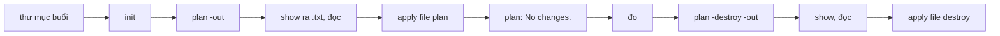

# Khuôn lệnh Terraform của buổi lab

Trang tra cứu khuôn mà mọi lệnh `terraform` trong README của lab theo, cùng lý do của từng phần. README của lab viết sẵn lệnh của từng
bước và trỏ về đây, không chép lại lý do. Mọi lệnh `terraform` ở đây chạm account AWS: người học chạy, AI chỉ soạn.

Luồng một root trong buổi:



## Thư mục buổi

Bản văn bản của plan có account ID, tên và id tài nguyên: chỉ ghi vào thư mục buổi `.session/` ở gốc repo, nơi git bỏ qua (repo public).
Đặt biến `SVP_LAB_SESSION_DIR` ở bước đầu mỗi buổi, từ gốc repo `svp-labs` (ví dụ lab `multi-region-dr`):

```sh
export SVP_LAB_SESSION_DIR="$PWD/.session/multi-region-dr-$(date -u +%Y%m%dT%H%M%SZ)" && mkdir -p "$SVP_LAB_SESSION_DIR"
```

- Mỗi buổi một thư mục mới, tên có lab và giờ UTC: hai buổi không ghi đè bản plan của nhau.
- Biến chỉ sống trong terminal đó. Terminal mới thì export lại đúng thư mục của buổi đang chạy, không tạo thư mục mới giữa buổi.
- Tên khác `SVP_SESSION_DIR` của `svp-infra`: hai terminal mở hai repo không ghi nhầm chỗ của nhau.

## Khuôn lệnh

Mọi lệnh chạy từ gốc repo bằng `-chdir=<root>`. Ví dụ root `multi-region-dr/terraform`, slug `multi-region-dr`, account stg:

```sh
AWS_PROFILE=anhnv-stg terraform -chdir=multi-region-dr/terraform init -input=false

AWS_PROFILE=anhnv-stg \
TF_VAR_account_id="$SVP_AWS_STG_ACCOUNT_ID" \
  terraform -chdir=multi-region-dr/terraform plan -input=false -out=multi-region-dr.tfplan
AWS_PROFILE=anhnv-stg terraform -chdir=multi-region-dr/terraform show -no-color multi-region-dr.tfplan \
  > "$SVP_LAB_SESSION_DIR/multi-region-dr-plan.txt"
```

Đọc bản văn bản (mục [Đọc plan](#đọc-plan)), rồi apply đúng file đó:

```sh
AWS_PROFILE=anhnv-stg terraform -chdir=multi-region-dr/terraform apply -input=false multi-region-dr.tfplan \
  && rm multi-region-dr/terraform/multi-region-dr.tfplan
```

Lý do từng phần:

- **`-chdir` từ gốc repo.** Đường dẫn `.session/` và tên root trong lệnh giống nhau ở mọi lab, không `cd` qua lại. `-chdir` đổi thư mục
  làm việc của cả lệnh: file `-out` và đối số của `show`, `apply` tính từ thư mục root, nên file plan nằm ở `<root>/<slug>.tfplan`.
- **Mỗi biến môi trường một dòng**, cuối dòng là dấu cách rồi `\`, lệnh thụt hai cách. Một dòng dài bị terminal cắt khi dán thì mất
  `TF_VAR_*` ở cuối mà không báo gì.
- **`AWS_PROFILE` trong chính lệnh**, không `export` cho cả terminal: lệnh nào cũng nói nó chạy trên account nào.
- **`-input=false`.** Thiếu biến bắt buộc thì lệnh dừng ngay ở `No value for required variable` thay vì ngồi chờ nhập (chạy qua `| grep`
  thì không thấy câu hỏi).
- **`plan -out` rồi `show -no-color` ra `.txt`.** Bản văn bản đủ của plan nằm trong thư mục buổi, để đọc hết và để dán lại khi cần hỏi.
  `-no-color` bỏ mã màu ANSI khỏi file.
- **`apply` chỉ nhận file plan đã đọc.** Apply đúng thứ đã đọc, không plan lại ngầm: state của root đổi sau lượt plan (một lệnh khác đã
  apply) thì apply dừng ở `Saved plan is stale` thay vì làm khác plan. File plan giữ giá trị biến của lượt plan, nên lệnh apply chỉ cần
  profile. `rm` sau apply thành công: file plan đã cũ và chứa giá trị nhạy cảm ở dạng rõ (git bỏ qua `*.tfplan`).
- **`init -input=false`.** Root của lab không có khối backend: state là file local `<root>/terraform.tfstate` (git bỏ qua `*.tfstate`),
  `init` chỉ tải provider theo `.terraform.lock.hcl` đã commit.

## Đọc plan

Dòng mỗi tài nguyên đổi và dòng tổng:

```sh
grep -E '^\s*# .* (will|must) be|^Plan:' "$SVP_LAB_SESSION_DIR/multi-region-dr-plan.txt"
```

- **Mong đợi:** mỗi dòng `# <địa chỉ> will be created|updated in-place|destroyed` hay `must be replaced`, cuối cùng `Plan: N to add, N to
  change, N to destroy.`
- **So với số của lab:** dòng `Plan:` của lần plan đầu trên account trống là dòng `Plan:` của root đó ở trang inventory của lab
  (`<lab>/docs/inventory.md`). README của lab nêu phần chênh khi bước plan chạy với giá trị khác giá trị của inventory.
- **Dừng, không apply** khi có `destroyed` hay `must be replaced` ở plan tạo mới, hay số khác mong đợi mà README không giải thích: dán
  các dòng trên để hỏi.

## Sau apply: `No changes.`

Plan lại cùng biến, `-input=false`, không `-out`:

```sh
AWS_PROFILE=anhnv-stg \
TF_VAR_account_id="$SVP_AWS_STG_ACCOUNT_ID" \
  terraform -chdir=multi-region-dr/terraform plan -input=false
```

- **Mong đợi:** `No changes. Your infrastructure matches the configuration.`
- Một dòng đổi hay `-/+` (thay thế) còn lại sau apply là chênh lệch vĩnh viễn giữa code và account, tức lỗi code: không apply, dán plan và
  báo để sửa code.

## Gỡ

Không `terraform destroy` trần: gỡ cũng đi qua plan, đọc rồi apply đúng file đó.

```sh
AWS_PROFILE=anhnv-stg \
TF_VAR_account_id="$SVP_AWS_STG_ACCOUNT_ID" \
  terraform -chdir=multi-region-dr/terraform plan -destroy -input=false -out=multi-region-dr-destroy.tfplan
AWS_PROFILE=anhnv-stg terraform -chdir=multi-region-dr/terraform show -no-color multi-region-dr-destroy.tfplan \
  > "$SVP_LAB_SESSION_DIR/multi-region-dr-destroy-plan.txt"
grep -E '^\s*# .* (will|must) be|^Plan:' "$SVP_LAB_SESSION_DIR/multi-region-dr-destroy-plan.txt"
```

Đọc `multi-region-dr-destroy-plan.txt`; đúng như mong đợi (dưới) thì sang khối sau, apply đúng file plan đã đọc:

```sh
AWS_PROFILE=anhnv-stg terraform -chdir=multi-region-dr/terraform apply -input=false multi-region-dr-destroy.tfplan \
  && rm multi-region-dr/terraform/multi-region-dr-destroy.tfplan
```

- **Vì sao không `destroy` trần:** `destroy` hỏi `yes` trên một danh sách in ra terminal, dễ gõ `yes` trước khi đọc hết, và không để lại
  bản văn bản. Plan `-destroy` ra file cho đọc trọn danh sách sẽ xoá, so với thứ đã tạo, rồi mới xoá.
- **Mong đợi:** `Plan: 0 to add, 0 to change, N to destroy.`, N bằng số tài nguyên lab đã tạo trong buổi; sau apply, `Destroy complete!`.
- Root phụ thuộc nhau gỡ theo thứ tự ngược lúc dựng; README của lab nêu thứ tự và lệnh quét tài nguyên sót.

## Khi apply lỗi giữa chừng

1. Đọc lỗi, đừng apply lại ngay. Phần đã tạo nằm trong state local; plan lại cùng root chỉ còn phần chưa tạo.
2. Áp phần không lỗi bằng `-target=<địa chỉ>` khi cần, theo cùng khuôn `plan -out`, `show`, `apply`. `-target` kéo theo mọi thứ địa chỉ đó
   phụ thuộc, nên target một tài nguyên phụ thuộc thứ đang lỗi thì lỗi lại.
3. Thử bản sửa của một PR chưa merge: `git switch --detach origin/<nhánh>`, plan và apply theo khuôn, rồi `git switch main`. Không tạo nhánh
   cục bộ cho việc này.
4. Gỡ lỗi giữa chừng cũng vậy: plan `-destroy` lại cùng root chỉ còn phần chưa xoá. Không xoá file state khi plan `-destroy` còn liệt kê
   tài nguyên: mất state thì Terraform không còn biết tài nguyên đó, chỉ còn cách xoá tay.

## Khoá state local

Root của lab không có backend nên dùng backend `local`: state là file trên máy và Terraform khoá nó bằng API của hệ điều hành ([T1]). Trên
macOS, Linux đó là khoá POSIX `fcntl` trên file state, cùng file `.terraform.tfstate.lock.info` cạnh state ghi ai đang giữ ([T2]).

- **Lệnh có thể ghi state tự khoá** (`plan`, `apply`), không cần cờ ([T4]); không tắt bằng `-lock=false`.
- **Khoá theo tiến trình.** Khoá sống cùng tiến trình `terraform` giữ nó; tiến trình kết thúc (xong, Ctrl+C, đóng terminal, bị kill) thì
  hệ điều hành nhả khoá. Không có khoá kẹt kiểu khoá trong bucket S3 của `svp-infra`.
- **`force-unlock` không dùng được:** tài liệu Terraform ghi state local không thể được tiến trình khác mở khoá ([T3]).
- **Gặp `Error acquiring the state lock`** ở root local nghĩa là một tiến trình `terraform` khác đang chạy trên cùng root (terminal khác,
  lệnh chạy nền). Tìm bằng `pgrep -fl terraform` (bỏ qua `terraform-ls`, language server của editor, nó không giữ khoá), chờ lệnh đó xong
  hay dừng nó ở terminal của nó, rồi chạy lại lệnh bị chặn.
- File `.terraform.tfstate.lock.info` còn lại sau khi tiến trình đã chết không giữ khoá; lệnh sau ghi đè nó.

## Lệnh `aws` trong README

AWS CLI v2 đưa output vào pager (`less`) khi chạy trên terminal: trong vòng lặp hay lệnh dán nhiều dòng, mỗi lệnh dừng ở `(END)` chờ
phím `q`. Luật cho lệnh `aws` của lab:

- **Mọi lệnh `aws` trao người học trong `.md` có `--no-cli-pager`**, cả lệnh đọc, `sso login` và `ssm start-session`.
- **Script `scripts/*.sh` gọi `aws` đặt `export AWS_PAGER=""` đầu file**, sau `set -euo pipefail`: người học chạy script từ shell có hay
  không có `AWS_PAGER`, output vẫn chảy thẳng ra terminal.
- Test của script bỏ `AWS_PAGER`, `AWS_PROFILE`, `AWS_REGION` và `SVP_AWS_STG_ACCOUNT_ID` khỏi môi trường ở đầu file: kết quả không đổi
  theo `.envrc` của máy chạy.

## Nguồn

- [T1] HashiCorp, [Backend type: local](https://developer.hashicorp.com/terraform/language/backend/local): "stores state on the local
  filesystem, locks that state using system APIs".
- [T2] HashiCorp, mã nguồn Terraform, [`internal/states/statemgr/filesystem_lock_unix.go`][t2-lock] và
  [`filesystem.go`][t2-fs] (`lockInfoPath`).
- [T3] HashiCorp, [`terraform force-unlock`](https://developer.hashicorp.com/terraform/cli/commands/force-unlock): "Local state files
  cannot be unlocked by another process".
- [T4] HashiCorp, [State locking](https://developer.hashicorp.com/terraform/language/state/locking).

[t2-lock]: https://github.com/hashicorp/terraform/blob/main/internal/states/statemgr/filesystem_lock_unix.go
[t2-fs]: https://github.com/hashicorp/terraform/blob/main/internal/states/statemgr/filesystem.go
