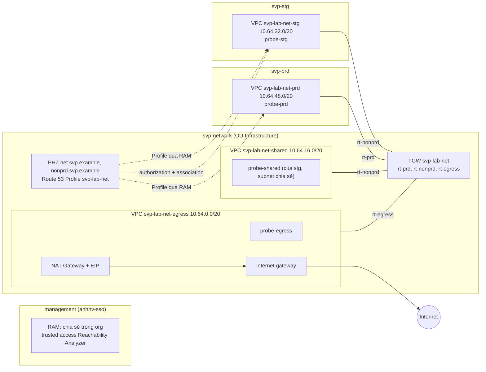
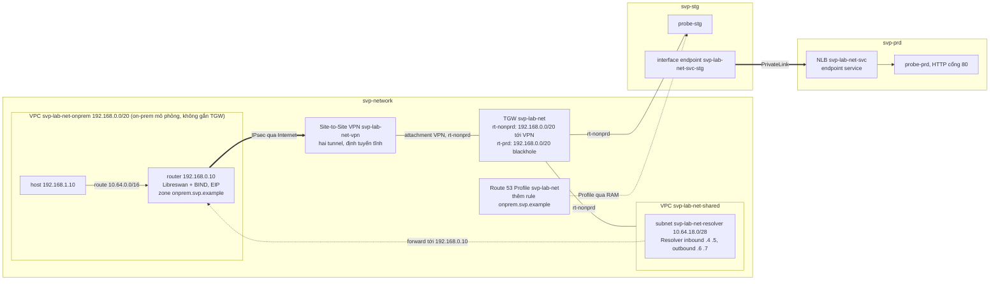
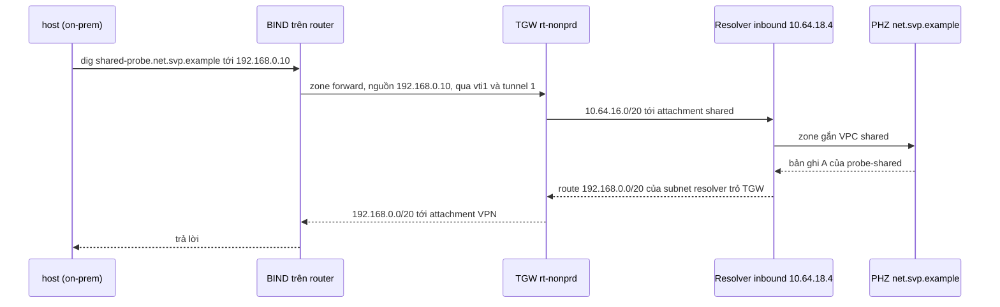

# multi-account-networking

Bài lab mạng nhiều account của svp: account `svp-network` giữ Transit Gateway nối VPC của `svp-network`, `svp-stg`,
`svp-prd`, tách prd khỏi non-prd, cho một lối ra Internet chung qua một NAT Gateway, chia sẻ subnet và DNS riêng qua AWS
RAM. Code sẵn cho buổi người học chạy; mọi lệnh chạm AWS ở mục [Chạy buổi](#chạy-buổi) do người học chạy. Phần so sánh
Direct Connect và Cloud WAN ở [`docs/direct-connect-cloud-wan.md`](docs/direct-connect-cloud-wan.md). Phần hybrid
(root `hybrid/`) thêm một site on-prem mô phỏng nối Transit Gateway qua Site-to-Site VPN, DNS hai chiều qua Route 53
Resolver, và PrivateLink từ prd sang stg.

## Câu hỏi

Một account mạng riêng nối VPC của nhiều account qua Transit Gateway thì gói tin đi đường nào, prd và non-prd có thật sự
không tới được nhau, một NAT Gateway dùng chung có phục vụ được mọi VPC, DNS riêng chia sẻ thế nào giữa account, và tất
cả tốn bao nhiêu mỗi giờ? Phần hybrid hỏi thêm: một mạng on-prem nối hub qua Site-to-Site VPN thì tới được env nào,
DNS riêng phân giải hai chiều giữa on-prem và AWS ra sao, và PrivateLink có nối được hai account mà Transit Gateway cố
ý tách không?

svp đang quyết: mỗi env một account theo AWS SRA
([ADR-0059](https://github.com/anhnvcoder/svp-backend/blob/main/docs/adr/0059-org-structure-guardrails.md)), mỗi env một
VPC không nối VPC nào khác, NAT và endpoint interface riêng trong VPC của env; bộ endpoint chung ở VPC shared-services
qua Transit Gateway là phương án đã cân nhắc và không chọn vì lab chỉ có một VPC mỗi account
([ADR-0064](https://github.com/anhnvcoder/svp-backend/blob/main/docs/adr/0064-interface-endpoints.md)). Bài này đo cái
giá và cái được của mô hình hub khi số VPC, account hay đường hybrid tăng, để có số khi svp cần quyết lại.

## Thiết kế



Đường đi của một gói stg → Internet và đường về:

```mermaid
sequenceDiagram
  participant S as probe-stg
  participant RN as TGW rt-nonprd
  participant T as subnet tgw (VPC egress)
  participant N as NAT Gateway
  participant I as Internet gateway
  participant W as checkip.amazonaws.com
  participant RE as TGW rt-egress
  S->>RN: route 0.0.0.0/0 của subnet workload trỏ TGW
  RN->>T: 0.0.0.0/0 tới attachment egress
  T->>N: route 0.0.0.0/0 của subnet tgw trỏ NAT
  N->>I: đổi IP nguồn thành EIP của NAT
  I->>W: yêu cầu HTTPS
  W-->>I: trả lời tới EIP
  I-->>N: trả lời
  N->>RE: đổi đích về IP probe-stg; subnet public route 10.64.0.0/16 trỏ TGW
  RE-->>S: 10.64.32.0/20 tới attachment stg
```

### Account và quyền

- Root `account/` tạo OU `Infrastructure` dưới root của org và account `svp-network` trong đó. AWS SRA đặt account mạng
  ở OU Infrastructure để tách dịch vụ mạng khỏi workload, bảo mật và hạ tầng khác [N1]. Root chạy bằng `anhnv-sso`
  (management), không đụng tài nguyên nào của [`aws/org`](https://github.com/anhnvcoder/svp-infra/tree/main/aws/org);
  email root của account ở `account.auto.tfvars` (gitignore, mẫu ở
  [`account/account.auto.tfvars.example`](account/account.auto.tfvars.example)).
- Account sống qua các buổi, `close_on_deletion = false` và `prevent_destroy`: đóng account là thủ tục riêng ở mục [Đóng
  account `svp-network`](#đóng-account-svp-network). Mỗi buổi chỉ dựng và gỡ root `core/` và, khi buổi có phần hybrid,
  root `hybrid/`.
- Root `core/` chạy bằng `anhnv-sso`, có một provider cho management và một provider cho mỗi account `svp-network`,
  `svp-stg`, `svp-prd` qua `OrganizationAccountAccessRole` (cùng khuôn
  [`aws/baseline/providers.tf`](https://github.com/anhnvcoder/svp-infra/blob/main/aws/baseline/providers.tf)); mỗi
  provider `allowed_account_ids` đúng account của nó. Mỗi module dưới `modules/` chỉ có provider mặc định; root chọn
  account bằng `providers`. Root `hybrid/` cùng khuôn, không có provider management (không bật gì ở cấp org).

### Truy cập dịch vụ trong org

Hai công tắc cấp org, bật đầu buổi, tắt cuối buổi:

- **Chia sẻ RAM trong org**: tài nguyên `aws_ram_sharing_with_organization` của root `core/` (provider management). Bật
  thì account trong org nhận tài nguyên chia sẻ không cần lời mời, RAM tạo service-linked role
  `AWSServiceRoleForResourceAccessManager` ở management [N2]; destroy của provider tắt trusted access
  `ram.amazonaws.com` [N3]. Mọi share của bài (`svp-lab-net-tgw`, `svp-lab-net-subnet`, `svp-lab-net-dns`) có
  `depends_on` tới nó: apply bật trước khi share, destroy gỡ share trước khi tắt. Subnet chỉ chia sẻ được cho account
  trong cùng org [N4].
- **Trusted access của Reachability Analyzer** (`reachabilityanalyzer.networkinsights.amazonaws.com`): bật bằng lệnh của
  bước 2 ở mục Chạy buổi, tạo service-linked role ở các account thành viên; người ở management chạy được phân tích với
  nguồn, đích ở mọi account của org, tài nguyên account khác ghi bằng ARN [N5].

Khi hai công tắc bật, plan của [`aws/org`](https://github.com/anhnvcoder/svp-infra/tree/main/aws/org) đòi gỡ
`ram.amazonaws.com` và `reachabilityanalyzer.networkinsights.amazonaws.com` khỏi `aws_service_access_principals` (danh
sách đó là toàn bộ): không apply `aws/org` cho tới khi bài tắt chúng. Đưa chúng lên đường chính cần ADR riêng.

### Transit Gateway và route table

- Một Transit Gateway ở `svp-network`: không bảng mặc định (`default_route_table_association`,
  `default_route_table_propagation` tắt), nên không attachment nào tự vào bảng chung; `auto_accept_shared_attachments`
  bật vì attachment tới từ account trong org qua share RAM [N6].
- Ba bảng, mọi route là route tĩnh (không propagation), plan cho thấy toàn bộ định tuyến:

| Bảng | Attachment gắn vào | Route |
| --- | --- | --- |
| `svp-lab-net-rt-prd` | prd | `0.0.0.0/0` → egress; `10.64.48.0/20` → prd; `10.64.16.0/20`, `10.64.32.0/20` blackhole |
| `svp-lab-net-rt-nonprd` | stg, shared | `0.0.0.0/0` → egress; `10.64.16.0/20` → shared; `10.64.32.0/20` → stg; `10.64.48.0/20` blackhole |
| `svp-lab-net-rt-egress` | egress | `10.64.16.0/20` → shared; `10.64.32.0/20` → stg; `10.64.48.0/20` → prd (đường về) |

- VPC dùng chung ở bảng non-prd vì subnet của nó chỉ chia sẻ cho stg.
- **Vì sao cần blackhole:** bảng env có `0.0.0.0/0` tới VPC egress. Không có blackhole, gói prd → stg khớp `0.0.0.0/0`,
  vào VPC egress, NAT Gateway chuyển tiếp nó ra subnet public, route `10.64.0.0/16` đưa nó lại TGW, bảng egress đưa nó
  tới stg: hai env thông nhau qua lối ra chung. Route blackhole CIDR của env kia cụ thể hơn `0.0.0.0/0` nên TGW bỏ gói
  từ đầu. Whitepaper multi-VPC của AWS dùng cùng cách: route blackhole để hai VPC không nói chuyện với nhau qua egress
  [N7].
- Mỗi VPC một AZ (cùng zone ID ở mọi account, mặc định `apse1-az1`), attachment ở một subnet `/28` riêng. Tài nguyên ở
  AZ không có subnet của attachment không tới được TGW [N8]; hướng dẫn thiết kế khuyên subnet riêng nhỏ `/28` cho mỗi
  attachment [N9].

Phương án nối VPC (trạng thái ngành theo AWS SRA [N1]); chỉ phương án đầu được dựng:

- **Transit Gateway trong account mạng (chọn)**, current: SRA khuyên Transit Gateway khi nối từ 10 VPC trở lên. Được:
  hub-spoke, route table tách env, một chỗ cho egress và hybrid. Mất: phí mỗi attachment-giờ và mỗi GB (mục [Chi
  phí](#chi-phí)).
- **VPC peering**, current khi dưới 10 VPC đều được kiểm soát. Được: không phí giờ. Mất: không bắc cầu [N10], mỗi cặp
  VPC một peering, không lối ra chung.
- **Cloud WAN**, current cho mạng nhiều region quản bằng một policy [N25]. Được: segment, policy một chỗ. Mất: thêm phí
  core network edge mỗi region; svp chỉ có một region. So trên giấy ở
  [`docs/direct-connect-cloud-wan.md`](docs/direct-connect-cloud-wan.md).
- **VPC Lattice**, current, nối service với service ở tầng ứng dụng qua VPC và account [N1]. Không thay định tuyến IP,
  egress, DNS của bài.

### Egress tập trung

VPC `svp-lab-net-egress` có subnet `public` (NAT Gateway, route `0.0.0.0/0` → Internet gateway, `10.64.0.0/16` → TGW),
`tgw` (attachment, `0.0.0.0/0` → NAT) và `probe`. Một NAT Gateway cho cả bài: rẻ hơn mỗi VPC một NAT, cái giá là một AZ
hỏng thì mọi VPC mất Internet; whitepaper khuyên mỗi AZ một NAT Gateway khi cần sẵn sàng cao [N7]. Phương án khác là mỗi
VPC một NAT như đường chính của svp: không cần TGW cho Internet, nhưng mỗi VPC trả phí NAT riêng. AWS SRA còn đòi kiểm
gói ở cả hai chiều vào, ra tại account mạng [N1]; bài không dựng tường lửa (AWS Network Firewall): đây là khoảng trống
có chủ đích, không phải thiết kế cho prd.

### VPC dùng chung

VPC `svp-lab-net-shared` thuộc `svp-network`; subnet `svp-lab-net-shared-workload` chia sẻ cho stg qua share
`svp-lab-net-subnet`. stg chạy instance `svp-lab-net-probe-shared` trong subnet đó, với security group của chính stg.
Account tham gia không tạo, xoá, gắn route table hay thay NACL của subnet chia sẻ, nhưng sở hữu ENI, security group của
mình [N4]: route table của subnet chia sẻ nằm trong module `spoke-vpc` chạy ở `svp-network`.

### DNS riêng chéo account

- Hai private hosted zone ở `svp-network`, tạo cùng VPC dùng chung: `net.svp.example` (bản ghi `egress-probe`,
  `shared-probe`) và `nonprd.svp.example` (bản ghi `shared-probe`).
- **Route 53 Profile** `svp-lab-net` gom zone `net` (sau này cả rule Resolver), chia sẻ qua share `svp-lab-net-dns` cho
  stg, prd; mỗi account gắn Profile vào VPC spoke của mình. Một VPC gắn tối đa hai Profile; khi cấu hình gắn thẳng VPC
  và cấu hình trong Profile cùng khớp một truy vấn, cấu hình gắn thẳng thắng [N11].
- **Cách cũ, authorization + association**: chủ zone `nonprd.svp.example` cho phép VPC stg
  (`aws_route53_vpc_association_authorization`), account stg tự gắn VPC vào zone (`aws_route53_zone_association`) [N12].
  prd không có cặp này nên không phân giải được tên trong zone đó.
- Profile, current: AWS mô tả nó làm việc quản DNS của nhiều VPC dễ như của một VPC, đổi Profile thì mọi VPC gắn nó nhận
  thay đổi [N11]. Cặp authorization + association vẫn được hỗ trợ, không phí giờ, nhưng mỗi VPC mỗi zone một cặp.
  Profile tính phí theo giờ (mục [Chi phí](#chi-phí)).

### Instance thử

Mỗi VPC một instance `t4g.nano` (AMI Amazon Linux 2023 arm64 từ tham số SSM công khai, có sẵn SSM Agent [N13]): IMDSv2,
hop limit 1 (theo declarative policy của org), ổ gốc mã hoá, không key pair, không IP công khai. Vào bằng Session
Manager; security group chỉ nhận ping và TCP 80 từ `10.64.0.0/16` (không gì nghe cổng 80: kết nối bị từ chối vẫn chứng
minh có đường), ra HTTPS mọi nơi và mọi thứ trong `10.64.0.0/16`. SSM Agent cần HTTPS ra endpoint `ssm`, `ssmmessages`,
`ec2messages` hay endpoint interface của chúng [N14]: ở đây nó ra qua egress tập trung như mọi gói khác.

### Account `svp-network` và đường chính

Đường chính không đổi trong bài này; khi account còn sống:

- Mọi policy gắn root của org áp lên nó: SCP (`deny-other-regions` chỉ cho `ap-southeast-1`, `us-east-1`;
  `protect-baseline`; `deny-iam-users`…), RCP data perimeter, declarative policy EC2, tag policy
  ([`aws/modules/org-policies/main.tf`](https://github.com/anhnvcoder/svp-infra/blob/main/aws/modules/org-policies/main.tf))
  [N15]. Backup policy chỉ gắn OU `Prod`, `NonProd` nên không áp. Bài chỉ dùng hai region đó và tag ở mục [Tham
  chiếu](#tham-chiếu).
- Dịch vụ phát hiện tự bật theo cấu hình org: GuardDuty với `auto_enable_organization_members = "ALL"`
  ([`aws/security/guardduty.tf`](https://github.com/anhnvcoder/svp-infra/blob/main/aws/security/guardduty.tf)) bật cho
  cả account mới vào org [N16]; configuration policy Security Hub CSPM gắn root, account mới thừa hưởng [N17]; Inspector
  tự bật quét ECR cho account mới
  ([`aws/security/inspector.tf`](https://github.com/anhnvcoder/svp-infra/blob/main/aws/security/inspector.tf)). Module
  `paid-features` không biết account này nên không tắt được các dịch vụ đó cho nó.
- [`aws/baseline`](https://github.com/anhnvcoder/svp-infra/tree/main/aws/baseline) không dựng baseline cho account này
  (Config recorder, mã hoá EBS mặc định): instance của bài tự mã hoá ổ gốc.
- Plan kế tiếp của [`aws/security`](https://github.com/anhnvcoder/svp-infra/tree/main/aws/security) thêm
  `aws_inspector2_member_association.members["<id svp-network>"]` và đổi `account_ids` của
  `aws_inspector2_enabler.members`, vì danh sách thành viên Inspector là mọi account `ACTIVE` của org.
- Phí của account để không: mục [Chi phí](#chi-phí).

Người học chọn sau mỗi buổi: **giữ account** cho buổi sau (chịu phí để không và diff plan ở trên; apply plan
`aws/security` lúc đó thì Inspector bật cho account, không có image ECR nên không quét gì), hay **đóng account** ngay
(bài không còn buổi nào). Đóng account là đường duy nhất để gỡ nó; đưa account thứ bảy lên đường chính là một thay đổi
riêng của `svp-infra`.

### Phần hybrid: on-prem mô phỏng, VPN, DNS hai chiều, PrivateLink

Root `hybrid/` dựng trên root `core/`, tra tài nguyên của `core/` bằng data source theo tên và tag ở mục
[Tham chiếu](#tham-chiếu), không đọc state của nó.



Truy vấn DNS từ on-prem tới private hosted zone của bài:



Gói tin từ on-prem tới spoke stg và đường về:

```mermaid
sequenceDiagram
  participant H as host 192.168.1.10
  participant R as router
  participant V as VPN svp-lab-net-vpn
  participant T as TGW
  participant S as probe-stg
  H->>R: route 10.64.0.0/16 của subnet lan trỏ ENI của router
  R->>V: vti1, ESP trong UDP 4500 từ EIP; selector 192.168.0.0/20 tới 10.64.0.0/16
  V->>T: attachment VPN gắn rt-nonprd
  T->>S: 10.64.32.0/20 tới attachment stg
  S-->>T: route 0.0.0.0/0 của subnet workload trỏ TGW
  T-->>V: rt-nonprd, 192.168.0.0/20 tới attachment VPN
  V-->>R: tunnel 1 hay tunnel 2, phía AWS chọn
  R-->>H: chuyển ra subnet lan
```

#### Site-to-Site VPN tới on-prem mô phỏng

- **On-prem là một VPC** `svp-lab-net-onprem` (`192.168.0.0/20`) ở `svp-network`, không gắn Transit Gateway: chỉ nối
  phần còn lại của bài qua Internet và VPN, như một văn phòng thật. Subnet `edge` giữ router, route `0.0.0.0/0` ra
  Internet gateway; subnet `lan` giữ host, route `10.64.0.0/16` trỏ ENI của router. Router và host là `t4g.nano` Amazon
  Linux 2023 như instance thử của lõi (IMDSv2, ổ gốc mã hoá, không key pair, vào bằng Session Manager).
- **Router** chạy Libreswan 4.12 (IPsec) và BIND 9.18 (DNS), cài từ kho của Amazon Linux 2023 [N34]. Script khởi động
  ở [`modules/onprem-site/templates/router.sh.tftpl`](modules/onprem-site/templates/router.sh.tftpl). Router chuyển
  gói không phải của nó nên ENI tắt source/destination check, như NAT instance [N35].
- **Thứ tự tạo** không vòng: EIP và customer gateway theo EIP, rồi VPN connection (AWS cấp địa chỉ hai tunnel), rồi
  router, vì cấu hình và security group của router cần địa chỉ tunnel. EIP nằm ở module `site-vpn` (địa chỉ của site,
  ở site thật là IP của nhà mạng); module `onprem-site` gắn nó vào ENI của router trước khi instance khởi động.
- **VPN gắn thẳng Transit Gateway**: whitepaper multi-VPC của AWS khuyên gom VPN về Transit Gateway thay vì mỗi VPC một
  VPN trên virtual private gateway hay tự dựng VPN trên EC2 [N38]. Hai phương án kia không dựng.
- **Định tuyến tĩnh, không BGP.** AWS khuyên BGP khi thiết bị hỗ trợ vì BGP dò được tunnel chết để chuyển sang tunnel
  kia [N26]; router ở đây là host IPsec không có daemon BGP, và bài đo đường đi chứ không đo hội tụ định tuyến. Cái giá:
  không bên nào tự rút route khỏi tunnel hỏng (mục [Đo gì](#đo-gì) có phép đo chuyển tunnel bằng tay). VPN tĩnh trên
  Transit Gateway không quảng bá gì: route tới on-prem là route tĩnh trong route table của Transit Gateway [N27].
- **On-prem thuộc phía non-prd.** Attachment VPN gắn `svp-lab-net-rt-nonprd`; bảng đó có `192.168.0.0/20` tới VPN, bảng
  `svp-lab-net-rt-prd` có blackhole cho dải đó. Cho prd thấy on-prem thì site thành đường vòng giữa prd và stg (gói prd
  vào VPN, site chuyển nó sang stg): cần một route table riêng cho VPN với route tới cả hai env và tường lửa ở site; bài
  không dựng phần đó.
- **Hai tunnel cố định thuật toán.** Mặc định AWS cho cả IKEv1 lẫn IKEv2 [N30]; bài ghim IKEv2, AES256, SHA2-256, DH
  group 14 cho cả hai phase, vòng đời 8 giờ và 1 giờ (trong khoảng AWS cho phép [N30]), router dùng đúng bộ đó. Traffic
  selector của VPN là `192.168.0.0/20` tới `10.64.0.0/16`: tunnel không chở dải nào khác.
- **Khoá PSK.** `aws_vpn_connection` đặt `preshared_key_storage = "SecretsManager"`: AWS sinh khoá cho từng tunnel và
  giữ trong một secret Secrets Manager của account [N29]; Terraform, state và user data chỉ có ARN (`preshared_key_arn`).
  Role của router chỉ có `secretsmanager:GetSecretValue` trên đúng secret đó; script khởi động đọc khoá, ghi
  `/etc/ipsec.d/svp-lab-net.secrets` (quyền 600). Tài liệu AWS không tả cấu trúc giá trị của secret: script lấy chuỗi
  nằm dưới địa chỉ ngoài hay số thứ tự của tunnel, khác thì dừng và chỉ in tên các khoá JSON (bước 8 của mục Chạy buổi).
- **Security group của router** chỉ nhận UDP 500 và 4500 từ đúng hai địa chỉ tunnel, cùng mọi thứ từ dải `192.168.0.0/20`
  của site. Router nằm sau NAT 1:1 của EIP nên IPsec đi trong UDP 4500 (NAT traversal), không cần luật ESP [N28].
  Không cổng 22, không gì khác từ Internet.
- **Giới hạn của mô phỏng:** một router là một điểm hỏng; không BGP nên không tự chuyển tunnel; không kẹp MSS (truyền
  TCP lớn qua tunnel có thể kẹt, bài chỉ dùng ping, DNS và `curl` nhỏ); cấu hình VTI, route chỉ chạy một lần lúc khởi
  động, khởi động lại router thì mất (thay instance bằng `terraform apply -replace` của `hybrid`).

#### DNS hai chiều

- Hai Resolver endpoint ở VPC dùng chung, nơi hai private hosted zone của lõi đã gắn: whitepaper multi-VPC khuyên gom
  endpoint vào một VPC trung tâm của account mạng và gắn mọi PHZ vào VPC đó, thay vì endpoint ở mỗi VPC [N39].
- Endpoint nằm ở subnet `/28` riêng `svp-lab-net-resolver` (`10.64.18.0/28`), route table chỉ có `192.168.0.0/20` tới
  Transit Gateway: địa chỉ cố định (inbound `.4`, `.5`; outbound `.6`, `.7`), không instance nào chiếm trước. Mỗi
  endpoint tối thiểu hai địa chỉ; AWS khuyên đặt ở hai AZ [N31], bài dùng một AZ như mọi VPC khác.
- **On-prem hỏi AWS:** BIND trên router forward `net.svp.example` và `nonprd.svp.example` tới hai địa chỉ inbound;
  security group của inbound chỉ nhận cổng 53 từ `192.168.0.0/20`. Resolver của VPC (`.2`) không tới được từ on-prem
  [N39].
- **AWS hỏi on-prem:** rule `FORWARD` `onprem.svp.example` tới `192.168.0.10:53` qua endpoint outbound; security group
  của outbound chỉ cho cổng 53 tới `192.168.0.10`.
- **Rule đi qua Profile.** Rule được gắn vào Route 53 Profile `svp-lab-net` của lõi (Profile nhận cả rule Resolver
  [N11]); Profile đã chia sẻ qua share RAM `svp-lab-net-dns`, nên rule tới VPC stg, prd mà không cần share riêng. Hệ quả:
  prd cũng phân giải tên on-prem dù không có route tới đó. Cách cũ là share rule qua RAM rồi gắn rule vào từng VPC
  [N39]: chọn được VPC nào nhận, đổi lại mỗi VPC một association.
- BIND trả lời cả hai phía nhưng chỉ đệ quy cho site (`allow-recursion`), không là open resolver; security group cũng
  không mở cổng 53 ra Internet. `dnssec-validation no`: `example.` không có trong root zone đã ký, nên kiểm DNSSEC sẽ loại
  mọi câu trả lời của `svp.example`.
- Quota: mỗi account mỗi region 4 Resolver endpoint, tối đa 6 địa chỉ mỗi endpoint, 1 000 rule; mỗi account mỗi region 5
  Profile, mỗi VPC tối đa 2 Profile, mỗi Profile 1 000 rule [N32]. Giá theo giờ ở mục [Chi phí](#chi-phí).

#### PrivateLink chéo account

- **Provider ở prd:** NLB internal `svp-lab-net-svc` ở subnet workload của prd, target là probe-prd cổng 80. Dịch vụ HTTP
  là `python3 -m http.server` có sẵn trong image, chạy bằng user động của systemd, khởi động qua một SSM association
  (`AWS-RunShellScript`) của root `hybrid`, nên instance của lõi không bị thay. Không gì nghe cổng 80 của probe-stg,
  probe-shared: phép đo của lõi không đổi.
- **Hai lớp cho phép:** endpoint service chỉ cho principal `arn:aws:iam::<id stg>:root`, và `acceptance_required = true`
  với một `aws_vpc_endpoint_connection_accepter` chấp nhận đúng endpoint của stg. Cho phép cả account nghĩa là mọi role
  của stg có quyền tạo endpoint đều nối được; bước chấp nhận ghim từng endpoint. AWS tả đúng hai núm này: cho phép
  principal nào, và chấp nhận tự động hay tay [N33].
- **Consumer ở stg:** interface endpoint `svp-lab-net-svc-stg` ở subnet workload của stg, security group chỉ nhận TCP 80
  từ VPC stg. Endpoint chỉ dùng được ở AZ chung với service, so theo AZ ID [N33]: mọi VPC của bài cùng zone ID.
- **Không private DNS name:** đặt tên riêng cho endpoint service phải xác minh quyền sở hữu domain bằng bản ghi TXT ở DNS
  công khai [N33]; bài chỉ có `svp.example`, nên client gọi tên DNS vùng của endpoint (output `service_dns_name`).
- PrivateLink cho truy cập một chiều từ consumer tới một dịch vụ cụ thể, kể cả khi hai VPC trùng dải địa chỉ [N40]: gói
  không đi qua Transit Gateway, nên bảng route vẫn chặn prd và stg. Phương án khác: VPC Lattice nối service với service
  qua nhiều account bằng service network và auth policy [N41]; bài không dựng.
- Quota: mỗi VPC tối đa 50 interface endpoint (cộng cả endpoint Gateway Load Balancer); mỗi endpoint 10 Gbps mỗi AZ, tự
  tăng tới 100 Gbps [N42].

## Đo gì

Mỗi số đo: định nghĩa, cách đo (bước của mục [Chạy buổi](#chạy-buổi)), kết quả mong đợi.

- **Cách ly env.** Có đường TCP 80 giữa prd và non-prd không. Đo: `reachability.sh` với `stg-to-prd`, `prd-to-stg`,
  `prd-to-shared` (bước 4); ping và `curl` trong phiên SSM (bước 5). Mong đợi: `found=unreachable` kèm mã giải thích
  (khác `-`); ping mất 100%; `curl` hết giờ.
- **Egress tập trung.** Spoke ra được Internet qua NAT dùng chung không. Đo: `reachability.sh` với `stg-to-internet`,
  `prd-to-internet` (đích là Internet gateway); `curl https://checkip.amazonaws.com` từ probe-stg, probe-shared,
  probe-prd. Mong đợi: `found=reachable`; cả ba `curl` in đúng output `nat_public_ip`.
- **VPC dùng chung.** stg tới được instance của chính nó trong subnet của `svp-network` không. Đo: `reachability.sh` với
  `stg-to-shared`; ping từ probe-stg; `describe-subnets` từ stg đọc chủ subnet. Mong đợi: `found=reachable`; ping mất
  0%; `OwnerId` là id của `svp-network`.
- **DNS chéo account.** Tên của hai zone phân giải ở VPC nào. Đo: `getent hosts` trong phiên SSM của probe-stg,
  probe-prd. Mong đợi: stg phân giải cả hai zone; prd phân giải `net.svp.example`, không ra địa chỉ nào cho
  `nonprd.svp.example`.
- **Chi phí mỗi giờ.** USD theo account và usage type của ngày buổi. Đo: Cost Explorer ngày sau buổi (bước 6). Mong đợi:
  gần bảng của mục [Chi phí](#chi-phí).

Reachability Analyzer chỉ nhận TCP hay UDP [N18], nên mọi đường dùng TCP (80 giữa instance, 443 tới Internet gateway và
ở `prd-to-site` của phần hybrid).
Mỗi lần chạy script tạo một path và một phân tích ở management, in một dòng (mốc UTC, kết quả mong đợi, kết quả thật,
`verdict=PASS|FAIL`, số giây, mã giải thích), xoá cả hai khi thoát, và trả mã 1 khi kết quả khác mong đợi.

Phần hybrid (bước 7 tới 12 của mục [Chạy buổi](#chạy-buổi)):

- **Tunnel UP.** Trạng thái hai tunnel phía AWS và phía router. Đo: `describe-vpn-connections` đọc `VgwTelemetry` (bước
  8); `ipsec trafficstatus` trên router. Mong đợi: hai tunnel `UP`, router có SA cho `tunnel1` và `tunnel2`.
- **Gói tin hai chiều qua VPN.** host on-prem với probe-stg. Đo: ping và `curl` từ host tới probe-stg, rồi từ probe-stg
  tới host (bước 9). Mong đợi: ping mất 0% cả hai chiều; `curl` báo `Connection refused` cả hai chiều (gói tới nơi,
  không gì nghe cổng 80).
- **prd không thấy on-prem.** Đường từ probe-prd tới host dừng ở transit gateway. Đo: `reachability.sh prd-to-site`
  trên TCP 443 (bước 10): security group của probe-prd chỉ cho ra ngoài dải lab cổng 443, nên phân tích qua được nó và
  đi tới transit gateway; ping hay cổng 80 chết ngay ở security group, không đo được route. Mong đợi:
  `found=unreachable` kèm mã giải thích (khác `-`), khớp route blackhole `192.168.0.0/20` của `svp-lab-net-rt-prd`.
- **Phân giải hai chiều.** Đo: trên host `dig @192.168.0.10 shared-probe.net.svp.example +short`; trên probe-stg,
  probe-prd `getent hosts router.onprem.svp.example` (bước 9). Mong đợi: host nhận địa chỉ của probe-shared; probe-stg và
  probe-prd nhận `192.168.0.10` (rule đi theo Profile tới cả prd, mục DNS hai chiều).
- **PrivateLink.** stg gọi được dịch vụ của prd qua endpoint, còn đường IP giữa hai env vẫn chặn. Đo: `curl` tới
  `service_dns_name` từ probe-stg; `reachability.sh prd-to-stg` (bước 10); ping probe-prd từ probe-stg (bước 5).
  Mong đợi: `curl` in `svp-lab-net-svc`; `found=unreachable` kèm mã giải thích; ping mất 100%.
- **Chuyển tunnel (tuỳ chọn).** Số giây ping mất khi tunnel 1 ngừng và router chuyển route sang tunnel 2 (bước 11). Định
  tuyến tĩnh không tự chuyển: phép đo cho thấy cái BGP làm hộ.
- **Chi phí mỗi giờ phần hybrid.** USD theo usage type của ngày buổi. Đo: Cost Explorer ngày sau buổi (bước 12). Mong
  đợi: gần bảng hybrid của mục [Chi phí](#chi-phí).

## Chi phí

Region `ap-southeast-1`, USD, on-demand; Free Tier không tính. Buổi lõi 3 giờ. Nguồn là file Price List công khai của
AWS ([P1]–[P7]) và trang giá; mọi dòng đọc 2026-11-17.

| Tài nguyên | Lượng | Đơn giá | Nguồn | USD/giờ |
| --- | --- | --- | --- | --- |
| TGW VPC attachment | 4 (egress, shared, stg, prd) | $0,07 mỗi attachment-giờ | [P1] `APS1-TransitGateway-Hours` | 0,280 |
| NAT Gateway | 1 | $0,059 mỗi giờ | [P2] | 0,059 |
| IPv4 công khai (EIP của NAT) | 1 | $0,005 mỗi IP-giờ | [P1] `APS1-PublicIPv4:InUseAddress` | 0,005 |
| EC2 `t4g.nano` Linux | 4 | $0,0053 mỗi giờ | [P2] | 0,021 |
| EBS gp3 ổ gốc | ~32 GB (4 × ~8 GB, ước lượng) | $0,096 mỗi GB-tháng (730 giờ) | [P2] | 0,004 |
| Route 53 Profiles | 1 account chủ, 2 association | $0,75 mỗi giờ, tới 100 association | [P3], [N19] | 0,750 |
| Private hosted zone | 2 | $0,50 mỗi zone-tháng; xoá trong 12 giờ thì không tính | [P4], [N19] | 0 |
| **Mỗi giờ** | | | | **~1,12** |

| Theo lượng dùng | Lượng (ước lượng) | Đơn giá | Nguồn | USD/buổi |
| --- | --- | --- | --- | --- |
| Reachability Analyzer | 6 phân tích | $0,10 mỗi phân tích | [P1] `APS1-Analysis-Runs` | 0,60 |
| Dữ liệu qua TGW | ~0,1 GB (SSM Agent, ping, curl) | $0,02 mỗi GB | [P1] `APS1-TransitGateway-Bytes` | ~0,002 |
| Dữ liệu qua NAT | ~0,1 GB | $0,059 mỗi GB | [P2] | ~0,006 |

**Một buổi lõi 3 giờ: ~$3,97** (3 × 1,12 + 0,61). Route 53 Profiles chiếm 2/3 phí mỗi giờ; cặp authorization +
association không tốn phí giờ. Ai trả phí attachment và dữ liệu giữa ba account thì đọc ở bước 6 của Chạy buổi.

Phần hybrid, chạy cùng lõi; Secrets Manager và Elastic Load Balancing từ [P8], [P9], đọc 2026-11-17:

| Tài nguyên | Lượng | Đơn giá | Nguồn | USD/giờ |
| --- | --- | --- | --- | --- |
| Resolver endpoint ENI | 4 (2 inbound, 2 outbound) | $0,125 mỗi ENI-giờ | [P3] `APS1-ResolverNetworkInterface` | 0,500 |
| TGW VPN attachment | 1 | $0,07 mỗi attachment-giờ | [P1] `APS1-TransitGateway-Hours` | 0,070 |
| Site-to-Site VPN connection | 1 | $0,05 mỗi connection-giờ | [P1] `APS1-VPN-Usage-Hours:ipsec.1` | 0,050 |
| Network Load Balancer | 1 | $0,0252 mỗi giờ | [P8] `APS1-LoadBalancerUsage` | 0,025 |
| Interface endpoint | 1 (một AZ) | $0,013 mỗi endpoint-giờ | [P1] `APS1-VpcEndpoint-Hours` | 0,013 |
| EC2 `t4g.nano` Linux | 2 (router, host) | $0,0053 mỗi giờ | [P2] | 0,011 |
| IPv4 công khai | 2 (EIP của router, IP của host) | $0,005 mỗi IP-giờ | [P1] `APS1-PublicIPv4:InUseAddress` | 0,010 |
| EBS gp3 ổ gốc | ~16 GB (2 × ~8 GB, ước lượng) | $0,096 mỗi GB-tháng (730 giờ) | [P2] | 0,002 |
| Secret của VPN | 1 | $0,40 mỗi secret-tháng, chia theo giờ [N36] | [P9] `APS1-AWSSecretsManager-Secret` | 0,001 |
| **Mỗi giờ** | | | | **~0,68** |

| Theo lượng dùng | Lượng (ước lượng) | Đơn giá | Nguồn | USD/buổi |
| --- | --- | --- | --- | --- |
| Reachability Analyzer | 2 phân tích (`prd-to-stg`, `prd-to-site` ở bước 10) | $0,10 mỗi phân tích | [P1] `APS1-Analysis-Runs` | 0,20 |
| NLB capacity unit | gần 0 (vài `curl`) | $0,006 mỗi NLCU-giờ | [P8] `APS1-LCUUsage` | ~0 |
| Truy vấn Resolver | dưới 10 000 | $0,40 mỗi triệu truy vấn | [P3] `APS1-DNS-Queries` | ~0 |
| Dữ liệu qua TGW, endpoint | ~0,01 GB | $0,02 và $0,01 mỗi GB | [P1] `APS1-TransitGateway-Bytes`, `APS1-VpcEndpoint-Bytes` | ~0 |
| Gọi API Secrets Manager | vài lần | $0,05 mỗi 10 000 lần | [P9] | ~0 |

Dữ liệu từ AWS ra on-prem qua VPN tính như data transfer ra Internet của EC2 [N37]; buổi chỉ vài MB. Bốn ENI của
Resolver chiếm ba phần tư phí mỗi giờ của phần hybrid; gắn rule vào Profile có sẵn không thêm phí Profile, vốn tính
theo association với VPC [N19], [P3].
**Một buổi lõi cộng hybrid 3 giờ: ~$6,2** (lõi ~$3,97 + 3 × 0,68 + 0,20).

Phí của `svp-network` để không mỗi tháng (không buổi nào chạy), ước theo cách của [phụ lục
ADR-0060](https://github.com/anhnvcoder/svp-backend/blob/main/docs/adr/appendix/0060-org-detection-logging.md) §12:

| Khoản | Giả định (ước lượng) | Đơn giá | Nguồn | USD/tháng |
| --- | --- | --- | --- | --- |
| GuardDuty | ~50 000 event CloudTrail × 2 region | $0,0000046 mỗi event; `us-east-1` $0,000004 | [P5] | ~0,43 |
| Security Hub CSPM | ~1 800 check | $0,001 mỗi check (100 000 đầu mỗi account mỗi region) | [P6] | ~1,80 |
| Config | 0 item: không recorder ở account này | $0,003 mỗi item | [P7] | 0 |
| Inspector | Chỉ quét image ECR; account không có registry | | | 0 |
| **Tổng** | | | | **~2,2 (1–4)** |

Tháng đầu gần như $0: GuardDuty dùng thử 30 ngày cho account chưa từng bật [N20], check Security Hub miễn phí 30 ngày
dùng thử [P6].

## Chạy buổi

Người học chạy mọi lệnh dưới đây, từ gốc bản clone `svp-labs`, sau khi PR của bài đã merge (từ `main`). Cần AWS CLI v2
kèm Session Manager plugin [N21], Terraform 1.15, `jq`; `aws sso login --profile anhnv-sso`; biến terminal
`SVP_AWS_MGMT_ACCOUNT_ID`, `SVP_AWS_STG_ACCOUNT_ID`, `SVP_AWS_PRD_ACCOUNT_ID` như ở `svp-infra`, và
`SVP_AWS_NETWORK_ACCOUNT_ID` (bước 0). Không apply
[`aws/org`](https://github.com/anhnvcoder/svp-infra/tree/main/aws/org) trong buổi.

**0. Lần đầu: account `svp-network`.** Tạo account là bước gần như không đảo ngược (account đóng còn trong org tới 90
ngày [N23]). Kiểm account của profile:

```sh
AWS_PROFILE=anhnv-sso aws sts get-caller-identity --query Account --output text --region ap-southeast-1
```

Số in ra phải bằng `$SVP_AWS_MGMT_ACCOUNT_ID`; khác thì dừng. Chép `account/account.auto.tfvars.example` thành
`account.auto.tfvars` cùng thư mục, điền email chưa account AWS nào dùng. Rồi:

```sh
AWS_PROFILE=anhnv-sso TF_VAR_management_account_id=$SVP_AWS_MGMT_ACCOUNT_ID terraform -chdir=multi-account-networking/account init
AWS_PROFILE=anhnv-sso TF_VAR_management_account_id=$SVP_AWS_MGMT_ACCOUNT_ID terraform -chdir=multi-account-networking/account \
  plan -out=account.tfplan
```

Mong đợi `Plan: 2 to add, 0 to change, 0 to destroy` (OU `Infrastructure`, account `svp-network`). Dán plan lại nếu
khác. Rồi:

```sh
AWS_PROFILE=anhnv-sso TF_VAR_management_account_id=$SVP_AWS_MGMT_ACCOUNT_ID terraform -chdir=multi-account-networking/account \
  apply account.tfplan
export SVP_AWS_NETWORK_ACCOUNT_ID="$(AWS_PROFILE=anhnv-sso terraform -chdir=multi-account-networking/account \
  output -raw network_account_id)"
echo "$SVP_AWS_NETWORK_ACCOUNT_ID"
```

Dòng cuối là một id 12 số; đặt biến này ở mọi terminal của các buổi sau. Thêm profile của account mới vào
`~/.aws/config` (một lần; chỉ dùng cho lệnh quét sót), thay `<id>` bằng id vừa in:

```ini
[profile anhnv-network]
source_profile = anhnv-sso
role_arn = arn:aws:iam::<id>:role/OrganizationAccountAccessRole
region = ap-southeast-1
```

**1. Zone có `t4g.nano`.** Mọi VPC ở zone ID của biến `availability_zone_id` (mặc định `apse1-az1`):

```sh
AWS_PROFILE=anhnv-stg aws ec2 describe-instance-type-offerings --location-type availability-zone-id \
  --filters Name=instance-type,Values=t4g.nano --region ap-southeast-1 --query 'InstanceTypeOfferings[].Location' --output text
```

Lệnh liệt kê các zone ID có loại instance đó [N22]. Không thấy `apse1-az1` thì thêm `TF_VAR_availability_zone_id=<zone
ID có trong danh sách>` vào mọi lệnh Terraform của `core` trong buổi.

**2. Bật trusted access của Reachability Analyzer** (chia sẻ RAM bật ở bước 3, cùng apply):

```sh
AWS_PROFILE=anhnv-sso aws sts get-caller-identity --query Account --output text --region ap-southeast-1
AWS_PROFILE=anhnv-sso aws ec2 enable-reachability-analyzer-organization-sharing --region ap-southeast-1
AWS_PROFILE=anhnv-sso aws organizations list-aws-service-access-for-organization --region us-east-1 \
  --query 'EnabledServicePrincipals[].ServicePrincipal' --output text
```

Dòng đầu bằng `$SVP_AWS_MGMT_ACCOUNT_ID`. Lệnh cuối phải có `reachabilityanalyzer.networkinsights.amazonaws.com`; bật có
thể mất vài phút [N5]. Dán lại output nếu thiếu.

**3. Dựng `core`:**

```sh
AWS_PROFILE=anhnv-sso TF_VAR_management_account_id=$SVP_AWS_MGMT_ACCOUNT_ID TF_VAR_network_account_id=$SVP_AWS_NETWORK_ACCOUNT_ID \
  TF_VAR_stg_account_id=$SVP_AWS_STG_ACCOUNT_ID TF_VAR_prd_account_id=$SVP_AWS_PRD_ACCOUNT_ID \
  terraform -chdir=multi-account-networking/core init
AWS_PROFILE=anhnv-sso TF_VAR_management_account_id=$SVP_AWS_MGMT_ACCOUNT_ID TF_VAR_network_account_id=$SVP_AWS_NETWORK_ACCOUNT_ID \
  TF_VAR_stg_account_id=$SVP_AWS_STG_ACCOUNT_ID TF_VAR_prd_account_id=$SVP_AWS_PRD_ACCOUNT_ID \
  terraform -chdir=multi-account-networking/core plan -out=core.tfplan
```

Mong đợi `Plan: 128 to add, 0 to change, 0 to destroy`. Dừng và dán plan lại nếu có `change`, `destroy`, hay provider
báo account không nằm trong `allowed_account_ids`. Rồi:

```sh
AWS_PROFILE=anhnv-sso TF_VAR_management_account_id=$SVP_AWS_MGMT_ACCOUNT_ID TF_VAR_network_account_id=$SVP_AWS_NETWORK_ACCOUNT_ID \
  TF_VAR_stg_account_id=$SVP_AWS_STG_ACCOUNT_ID TF_VAR_prd_account_id=$SVP_AWS_PRD_ACCOUNT_ID \
  terraform -chdir=multi-account-networking/core apply core.tfplan
```

Mong đợi `Apply complete! Resources: 128 added`. Ghi mốc giờ bắt đầu buổi (UTC) cho bước 6.

**4. Reachability Analyzer** (sáu phân tích, ~$0,60):

```sh
P="$(AWS_PROFILE=anhnv-sso terraform -chdir=multi-account-networking/core output -json probes)"
IGW="$(AWS_PROFILE=anhnv-sso terraform -chdir=multi-account-networking/core output -raw internet_gateway_arn)"
arn() { jq -r --arg k "$1" '.[$k].instance_arn' <<<"$P"; }
R=multi-account-networking/scripts/reachability.sh
AWS_PROFILE=anhnv-sso $R stg-to-prd "$(arn stg)" "$(arn prd)" 80 unreachable
AWS_PROFILE=anhnv-sso $R prd-to-stg "$(arn prd)" "$(arn stg)" 80 unreachable
AWS_PROFILE=anhnv-sso $R prd-to-shared "$(arn prd)" "$(arn shared)" 80 unreachable
AWS_PROFILE=anhnv-sso $R stg-to-shared "$(arn stg)" "$(arn shared)" 80 reachable
AWS_PROFILE=anhnv-sso $R stg-to-internet "$(arn stg)" "$IGW" 443 reachable
AWS_PROFILE=anhnv-sso $R prd-to-internet "$(arn prd)" "$IGW" 443 reachable
```

Dán lại sáu dòng. Mọi dòng phải `verdict=PASS`; ba dòng `unreachable` có mã giải thích (khác `-`), dán lại để đối chiếu
với bảng route ở mục Thiết kế.

**5. Đo trong phiên SSM.** Mở phiên tới probe-stg (thoát bằng `exit`):

```sh
echo "$P" | jq -r 'to_entries[] | "\(.key) \(.value.private_ip)"'
AWS_PROFILE=anhnv-sso terraform -chdir=multi-account-networking/core output -raw nat_public_ip
AWS_PROFILE=anhnv-stg aws ssm start-session --target "$(jq -r .stg.instance_id <<<"$P")" --region ap-southeast-1
```

Trong phiên (thay `<ip shared>`, `<ip prd>` bằng địa chỉ in ở lệnh đầu):

```sh
curl -sS -m 5 https://checkip.amazonaws.com
ping -c 3 -W 2 <ip shared>
ping -c 3 -W 2 <ip prd>
curl -sS -m 3 http://<ip shared>/
curl -sS -m 3 http://<ip prd>/
getent hosts shared-probe.net.svp.example
getent hosts shared-probe.nonprd.svp.example
```

Mong đợi: `curl checkip` in đúng `nat_public_ip`; ping shared mất 0%, ping prd mất 100%; `curl` tới shared báo
`Connection refused` (gói tới nơi, không gì nghe cổng 80), tới prd báo hết giờ; hai `getent` in địa chỉ của
probe-shared. Lặp ở probe-prd (`AWS_PROFILE=anhnv-prd`, `.prd.instance_id`): `curl checkip` in `nat_public_ip`, ping stg
và shared mất 100%, `getent hosts shared-probe.net.svp.example` in địa chỉ, `getent hosts
shared-probe.nonprd.svp.example` không in gì. Lặp `curl checkip` ở probe-shared (`AWS_PROFILE=anhnv-stg`,
`.shared.instance_id`). Chủ của subnet chứa probe-shared, đọc từ stg:

```sh
S=$(AWS_PROFILE=anhnv-stg aws ec2 describe-instances --instance-ids "$(jq -r .shared.instance_id <<<"$P")" --region ap-southeast-1 \
  --query 'Reservations[0].Instances[0].SubnetId' --output text)
AWS_PROFILE=anhnv-stg aws ec2 describe-subnets --subnet-ids "$S" --region ap-southeast-1 --query 'Subnets[0].OwnerId' --output text
```

Số in ra bằng `$SVP_AWS_NETWORK_ACCOUNT_ID`. Dán lại mọi output.

**Khi mất phiên SSM:** SSM Agent ra Internet qua egress tập trung, nên route của TGW, VPC egress hay NAT hỏng thì phiên
cũng hỏng. Control plane (Terraform, console) không đi qua đường đó: chạy `reachability.sh ... stg-to-internet` để thấy
chỗ đứt, sửa bằng `terraform apply` của `core`. Cần vào instance khi egress còn hỏng thì thêm endpoint interface `ssm`,
`ssmmessages`, `ec2messages` vào VPC đó [N14] ($0,013 mỗi endpoint-giờ [P1] `APS1-VpcEndpoint-Hours`, ba endpoint ~$0,04
mỗi giờ), gỡ khi xong.

**6. Chi phí thật** (ngày sau buổi, thay `<ngày>` bằng ngày UTC của buổi, `<ngày sau>` bằng ngày kế tiếp):

```sh
AWS_PROFILE=anhnv-sso aws ce get-cost-and-usage --time-period Start=<ngày>,End=<ngày sau> --granularity DAILY \
  --metrics UnblendedCost --group-by Type=DIMENSION,Key=LINKED_ACCOUNT Type=DIMENSION,Key=USAGE_TYPE --region us-east-1 \
  --filter '{"Dimensions":{"Key":"USAGE_TYPE","Values":["APS1-TransitGateway-Hours","APS1-TransitGateway-Bytes",
"APS1-NatGateway-Hours","APS1-NatGateway-Bytes","APS1-DNS-ProfileBasePackage","APS1-Analysis-Runs","APS1-BoxUsage:t4g.nano"]}}'
```

Dán lại bảng. Cộng các dòng và so với bảng Chi phí; chạy vào ngày không có buổi `svp-infra` nào (bastion của đường chính
cũng là `t4g.nano`).

### Phần hybrid

Sau bước 5, cùng buổi, khi `core` còn sống: thứ tự dựng là `account` (một lần) → `core` → `hybrid`; mục
[Dọn dẹp](#dọn-dẹp) gỡ `hybrid` trước `core`. Cùng các biến terminal; thêm `TF_VAR_availability_zone_id` như ở `core`
nếu bước 1 đã đổi zone.

**7. Dựng `hybrid`:**

```sh
AWS_PROFILE=anhnv-sso aws sts get-caller-identity --query Account --output text --region ap-southeast-1
AWS_PROFILE=anhnv-sso TF_VAR_network_account_id=$SVP_AWS_NETWORK_ACCOUNT_ID TF_VAR_stg_account_id=$SVP_AWS_STG_ACCOUNT_ID \
  TF_VAR_prd_account_id=$SVP_AWS_PRD_ACCOUNT_ID terraform -chdir=multi-account-networking/hybrid init
AWS_PROFILE=anhnv-sso TF_VAR_network_account_id=$SVP_AWS_NETWORK_ACCOUNT_ID TF_VAR_stg_account_id=$SVP_AWS_STG_ACCOUNT_ID \
  TF_VAR_prd_account_id=$SVP_AWS_PRD_ACCOUNT_ID terraform -chdir=multi-account-networking/hybrid plan -out=hybrid.tfplan
```

Dòng đầu bằng `$SVP_AWS_MGMT_ACCOUNT_ID`. Mong đợi `Plan: 76 to add, 0 to change, 0 to destroy`; dừng và dán plan lại
nếu có `change`, `destroy`, hay data source báo không tìm thấy tài nguyên của `core` (chưa dựng `core`, hay tên lệch mục
[Tham chiếu](#tham-chiếu)). Rồi:

```sh
AWS_PROFILE=anhnv-sso TF_VAR_network_account_id=$SVP_AWS_NETWORK_ACCOUNT_ID TF_VAR_stg_account_id=$SVP_AWS_STG_ACCOUNT_ID \
  TF_VAR_prd_account_id=$SVP_AWS_PRD_ACCOUNT_ID terraform -chdir=multi-account-networking/hybrid apply hybrid.tfplan
```

Mong đợi `Apply complete! Resources: 76 added`. Ghi mốc giờ (UTC) cho bước 12.

**8. Tunnel UP** (vài phút sau apply, router cần cài gói và dựng tunnel):

```sh
O=multi-account-networking/hybrid
S="$(AWS_PROFILE=anhnv-sso terraform -chdir=$O output -json site)"
AWS_PROFILE=anhnv-network aws ec2 describe-vpn-connections --region ap-southeast-1 \
  --vpn-connection-ids "$(AWS_PROFILE=anhnv-sso terraform -chdir=$O output -raw vpn_connection_id)" \
  --query 'VpnConnections[0].VgwTelemetry[].[OutsideIpAddress,Status,StatusMessage]' --output text
```

Mong đợi hai dòng `UP`. Còn `DOWN` sau 10 phút thì mở phiên tới router:

```sh
AWS_PROFILE=anhnv-network aws ssm start-session --target "$(jq -r .router.instance_id <<<"$S")" --region ap-southeast-1
```

Trong phiên, dán lại output của:

```sh
sudo tail -n 30 /var/log/cloud-init-output.log
sudo ipsec trafficstatus
ip route show 10.64.0.0/16
```

Dòng `no key for tunnel …` nghĩa là secret có cấu trúc khác cái script nhận: dòng đó chỉ in tên khoá JSON, không in giá
trị. Sửa hàm `key_for` của script khởi động rồi thay router bằng `terraform apply` của `hybrid` với
`-replace=module.site.aws_instance.router`.

**9. Gói tin và DNS hai chiều.** Mở phiên tới host:

```sh
AWS_PROFILE=anhnv-sso terraform -chdir=multi-account-networking/core output -json probes | jq -r '.stg.private_ip'
AWS_PROFILE=anhnv-network aws ssm start-session --target "$(jq -r .host.instance_id <<<"$S")" --region ap-southeast-1
```

Trong phiên (thay `<ip stg>` bằng địa chỉ in ở lệnh đầu):

```sh
ping -c 3 -W 2 <ip stg>
curl -sS -m 3 http://<ip stg>/
dig @192.168.0.10 shared-probe.net.svp.example +short
dig @192.168.0.10 host.onprem.svp.example +short
```

Mong đợi: ping mất 0%; `curl` báo `Connection refused`; `dig` đầu in địa chỉ của probe-shared, `dig` sau in
`192.168.1.10`. Rồi trong phiên SSM của probe-stg (lệnh mở phiên ở bước 5):

```sh
ping -c 3 -W 2 192.168.1.10
curl -sS -m 3 http://192.168.1.10/
getent hosts router.onprem.svp.example
```

Mong đợi: ping mất 0%; `curl` báo `Connection refused`; `getent` in `192.168.0.10`. Lặp `getent` ở probe-prd: cũng in
`192.168.0.10`. Dán lại mọi output.

**10. PrivateLink và cách ly của prd:**

```sh
AWS_PROFILE=anhnv-sso terraform -chdir=multi-account-networking/hybrid output -raw service_dns_name
AWS_PROFILE=anhnv-sso $R prd-to-stg "$(arn prd)" "$(arn stg)" 80 unreachable
AWS_PROFILE=anhnv-sso $R prd-to-site "$(arn prd)" "$(jq -r .host.instance_arn <<<"$S")" 443 unreachable
```

Hai lệnh sau dùng `R`, `arn` của bước 4 và `S` của bước 8 (chạy lại các dòng đầu của hai bước đó nếu terminal mới).
Trong phiên SSM của probe-stg:

```sh
curl -sS -m 5 http://<service_dns_name>/
```

Mong đợi: `curl` in `svp-lab-net-svc`; hai dòng `reachability.sh` có `verdict=PASS` và mã giải thích (khác `-`), dán
lại để đối chiếu với route của `svp-lab-net-rt-prd`. `curl` hết giờ thì dán lại output của:

```sh
AWS_PROFILE=anhnv-prd aws elbv2 describe-target-health --region ap-southeast-1 \
  --target-group-arn "$(AWS_PROFILE=anhnv-prd aws elbv2 describe-target-groups --names svp-lab-net-svc \
  --region ap-southeast-1 --query 'TargetGroups[0].TargetGroupArn' --output text)"
AWS_PROFILE=anhnv-stg aws ec2 describe-vpc-endpoints --filters Name=tag:Name,Values=svp-lab-net-svc-stg \
  --region ap-southeast-1 --query 'VpcEndpoints[0].State' --output text
```

Mong đợi target `healthy` (dịch vụ HTTP đã chạy) và endpoint `available` (đã được chấp nhận).

**11. Chuyển tunnel (tuỳ chọn).** Phiên thứ nhất ở host chạy `ping -c 180 <ip stg>`; phiên thứ hai ở router:

```sh
sudo ipsec auto --down tunnel1
sudo ip route del 10.64.0.0/16 dev vti1
```

Đợi `ping` xong, dán lại dòng thống kê của nó và kết quả bước 8 lúc đó (tunnel 1 `DOWN`). Số gói mất nhân 1 giây là thời
gian gián đoạn; phía AWS chuyển sang tunnel 2 khi nó thấy tunnel 1 chết. Trả lại như cũ:

```sh
sudo ipsec auto --up tunnel1
sudo ip route add 10.64.0.0/16 dev vti1 src 192.168.0.10 metric 100
```

**12. Chi phí thật phần hybrid** (ngày sau buổi, như bước 6):

```sh
AWS_PROFILE=anhnv-sso aws ce get-cost-and-usage --time-period Start=<ngày>,End=<ngày sau> --granularity DAILY \
  --metrics UnblendedCost --group-by Type=DIMENSION,Key=LINKED_ACCOUNT Type=DIMENSION,Key=USAGE_TYPE --region us-east-1 \
  --filter '{"Dimensions":{"Key":"USAGE_TYPE","Values":["APS1-VPN-Usage-Hours:ipsec.1","APS1-ResolverNetworkInterface",
"APS1-LoadBalancerUsage","APS1-VpcEndpoint-Hours","APS1-PublicIPv4:InUseAddress","APS1-AWSSecretsManager-Secret"]}}'
```

Dán lại bảng; cộng với dòng `APS1-TransitGateway-Hours` của bước 6 (attachment VPN thêm một attachment-giờ mỗi giờ) rồi
so với bảng hybrid của mục Chi phí.

Kết thúc buổi bằng mục [Dọn dẹp](#dọn-dẹp), cả destroy lẫn quét sót.

## Dọn dẹp

Theo thứ tự ngược lúc dựng, cùng các biến terminal của buổi.

**0. Destroy `hybrid`** (khi buổi có phần hybrid; trước `core`, vì `hybrid` gắn rule vào Profile và luật vào security
group của `core`):

```sh
AWS_PROFILE=anhnv-sso TF_VAR_network_account_id=$SVP_AWS_NETWORK_ACCOUNT_ID TF_VAR_stg_account_id=$SVP_AWS_STG_ACCOUNT_ID \
  TF_VAR_prd_account_id=$SVP_AWS_PRD_ACCOUNT_ID terraform -chdir=multi-account-networking/hybrid destroy
```

Mong đợi `Destroy complete! Resources: 76 destroyed.` Service-linked role `AWSServiceRoleForVPCS2SVPN` (VPN tạo khi
dùng Secrets Manager [N29]) ở lại `svp-network`, không tính phí. Rồi xoá `hybrid/terraform.tfstate.backup` và
`hybrid/hybrid.tfplan`: chúng giữ state trước destroy, mọi thuộc tính dạng rõ (cấu hình customer gateway, ARN secret,
địa chỉ).

**1. Destroy `core`** (gỡ mọi share RAM, rồi tắt chia sẻ RAM trong org):

```sh
AWS_PROFILE=anhnv-sso TF_VAR_management_account_id=$SVP_AWS_MGMT_ACCOUNT_ID TF_VAR_network_account_id=$SVP_AWS_NETWORK_ACCOUNT_ID \
  TF_VAR_stg_account_id=$SVP_AWS_STG_ACCOUNT_ID TF_VAR_prd_account_id=$SVP_AWS_PRD_ACCOUNT_ID \
  terraform -chdir=multi-account-networking/core destroy
```

Mong đợi `Destroy complete! Resources: 128 destroyed.` Service-linked role `AWSServiceRoleForResourceAccessManager` ở
lại management; tài liệu RAM tả cách xoá nó khi muốn gỡ hẳn [N2].

**2. Tắt trusted access của Reachability Analyzer** [N5], rồi kiểm cả hai công tắc đã tắt:

```sh
AWS_PROFILE=anhnv-sso aws organizations disable-aws-service-access \
  --service-principal reachabilityanalyzer.networkinsights.amazonaws.com --region us-east-1
AWS_PROFILE=anhnv-sso aws organizations list-aws-service-access-for-organization --region us-east-1 \
  --query 'EnabledServicePrincipals[].ServicePrincipal' --output text
```

Output của lệnh sau không có `ram.amazonaws.com` lẫn `reachabilityanalyzer.networkinsights.amazonaws.com`; danh sách còn
lại đúng như `aws_service_access_principals` của
[`aws/org/organization.tf`](https://github.com/anhnvcoder/svp-infra/blob/main/aws/org/organization.tf).

**3. Quét sót** ở ba account của bài và management, hai region được phép. Theo tag:

```sh
for p in anhnv-network anhnv-stg anhnv-prd anhnv-sso; do for r in ap-southeast-1 us-east-1; do
  echo "== $p $r"
  AWS_PROFILE=$p aws resourcegroupstaggingapi get-resources --tag-filters Key=Lab,Values=multi-account-networking --region "$r" \
    --query 'ResourceTagMappingList[].ResourceARN' --output text
done; done
```

Theo tiền tố tên và loại tính tiền theo giờ (có thể sót tag):

```sh
for p in anhnv-network anhnv-stg anhnv-prd; do
  echo "== $p"
  AWS_PROFILE=$p aws ec2 describe-transit-gateway-attachments --filters Name=tag:Name,Values='svp-lab-net*' \
    Name=state,Values=pendingAcceptance,pending,available,modifying --region ap-southeast-1 \
    --query 'TransitGatewayAttachments[].TransitGatewayAttachmentId' --output text
  AWS_PROFILE=$p aws ec2 describe-instances --filters Name=tag:Name,Values='svp-lab-net-*' \
    Name=instance-state-name,Values=pending,running,stopping,stopped --region ap-southeast-1 \
    --query 'Reservations[].Instances[].InstanceId' --output text
done
AWS_PROFILE=anhnv-network aws ec2 describe-nat-gateways --filter Name=state,Values=pending,available,deleting \
  --region ap-southeast-1 --query 'NatGateways[].NatGatewayId' --output text
AWS_PROFILE=anhnv-network aws ec2 describe-addresses --region ap-southeast-1 --query 'Addresses[].AllocationId' --output text
AWS_PROFILE=anhnv-network aws ec2 describe-transit-gateways --filters Name=state,Values=pending,available,modifying \
  --region ap-southeast-1 --query 'TransitGateways[].TransitGatewayId' --output text
AWS_PROFILE=anhnv-network aws route53profiles list-profiles --region ap-southeast-1 --query 'ProfileSummaries[].Name' --output text
AWS_PROFILE=anhnv-network aws route53 list-hosted-zones --region us-east-1 --query 'HostedZones[].Name' --output text
AWS_PROFILE=anhnv-network aws ram get-resource-shares --resource-owner SELF --resource-share-status ACTIVE --region ap-southeast-1 \
  --query 'resourceShares[].name' --output text
AWS_PROFILE=anhnv-sso aws ec2 describe-network-insights-paths --filters Name=tag:Lab,Values=multi-account-networking \
  --region ap-southeast-1 --query 'NetworkInsightsPaths[].NetworkInsightsPathId' --output text
```

Thêm cho phần hybrid (loại tính tiền theo giờ ở `svp-network`, `svp-prd`, `svp-stg`; secret của VPN do AWS tạo, tên bắt
đầu bằng `s2svpn` [N29]):

```sh
AWS_PROFILE=anhnv-network aws ec2 describe-vpn-connections --filters Name=state,Values=pending,available,deleting \
  --region ap-southeast-1 --query 'VpnConnections[].VpnConnectionId' --output text
AWS_PROFILE=anhnv-network aws ec2 describe-customer-gateways --filters Name=state,Values=pending,available \
  --region ap-southeast-1 --query 'CustomerGateways[].CustomerGatewayId' --output text
AWS_PROFILE=anhnv-network aws route53resolver list-resolver-endpoints --region ap-southeast-1 \
  --query 'ResolverEndpoints[].Name' --output text
AWS_PROFILE=anhnv-network aws route53resolver list-resolver-rules --region ap-southeast-1 \
  --query 'ResolverRules[?RuleType==`FORWARD`].Name' --output text
AWS_PROFILE=anhnv-network aws secretsmanager list-secrets --filters Key=name,Values=s2svpn --region ap-southeast-1 \
  --query 'SecretList[].Name' --output text
AWS_PROFILE=anhnv-prd aws ec2 describe-vpc-endpoint-service-configurations --region ap-southeast-1 \
  --query 'ServiceConfigurations[].ServiceId' --output text
AWS_PROFILE=anhnv-prd aws elbv2 describe-load-balancers --region ap-southeast-1 \
  --query 'LoadBalancers[?starts_with(LoadBalancerName, `svp-lab-net`)].LoadBalancerName' --output text
AWS_PROFILE=anhnv-stg aws ec2 describe-vpc-endpoints --filters Name=tag:Name,Values='svp-lab-net-*' \
  --region ap-southeast-1 --query 'VpcEndpoints[].VpcEndpointId' --output text
```

Mong đợi mọi lệnh in rỗng (chỉ các dòng `==`). Còn gì thì dán lại; xoá bằng Terraform (chạy lại destroy) trước, tay sau.

### Đóng account `svp-network`

Chỉ khi bài không còn buổi nào, sau Dọn dẹp ở trên. Đóng account không đảo ngược: account đóng hiện `CLOSED` trong org
tới 90 ngày, vẫn tính vào quota số account; trong 30 ngày liên tiếp chỉ đóng được 20% hay 250 account thành viên, tối đa
1 000 [N23].

```sh
AWS_PROFILE=anhnv-sso aws sts get-caller-identity --query Account --output text --region ap-southeast-1
AWS_PROFILE=anhnv-sso aws organizations close-account --account-id "$SVP_AWS_NETWORK_ACCOUNT_ID" --region us-east-1
AWS_PROFILE=anhnv-sso terraform -chdir=multi-account-networking/account state rm aws_organizations_account.network
```

Dòng đầu bằng `$SVP_AWS_MGMT_ACCOUNT_ID`. Sau khi AWS gỡ hẳn account khỏi org (lệnh dưới không in id nào), xoá OU:

```sh
AWS_PROFILE=anhnv-sso aws organizations list-accounts-for-parent --region us-east-1 --query 'Accounts[].Id' --output text \
  --parent-id "$(AWS_PROFILE=anhnv-sso terraform -chdir=multi-account-networking/account output -raw infrastructure_ou_id)"
AWS_PROFILE=anhnv-sso TF_VAR_management_account_id=$SVP_AWS_MGMT_ACCOUNT_ID terraform -chdir=multi-account-networking/account destroy
```

Mong đợi `Destroy complete! Resources: 1 destroyed.` Rồi xoá khối `[profile anhnv-network]` khỏi `~/.aws/config`, file
`account.auto.tfvars`, state local của ba root (`terraform.tfstate*`) và plan đã lưu (`account.tfplan`, `core.tfplan`,
`hybrid.tfplan`):
state và plan giữ email root và mọi thuộc tính dạng rõ.

## Đề SAP

Theo exam guide SAP-C02 [N24]:

- **1.1** Architect network connectivity strategies: Transit Gateway, route table tách env, blackhole, egress tập trung,
  VPC sharing, DNS riêng chéo account; Direct Connect, Cloud WAN trên giấy. Hybrid: Site-to-Site VPN trên Transit
  Gateway, định tuyến tĩnh so với BGP, Resolver inbound và outbound với on-prem, PrivateLink giữa account.
- **1.2** Prescribe security controls: cách ly prd và non-prd ở tầng định tuyến, chia sẻ RAM chỉ trong org, SCP và RCP
  áp lên account mới. Hybrid: PSK trong Secrets Manager, thuật toán tunnel ghim, endpoint service một principal và chấp
  nhận từng endpoint, on-prem không tới prd.
- **1.3** Design reliable and resilient architectures: cái giá của một NAT Gateway, một AZ; SSM phụ thuộc lối ra chung.
  Hybrid: hai tunnel, chuyển tunnel không BGP, router một điểm hỏng.
- **1.4** Design a multi-account AWS environment: account mạng ở OU Infrastructure, trusted access, delegated service,
  hệ quả lên dịch vụ tự bật theo org.
- **1.5** Determine cost optimization and visibility strategies: phí attachment, NAT dùng chung so với NAT mỗi VPC,
  Route 53 Profiles so với association trực tiếp, phí của account để không. Hybrid: phí ENI của Resolver, VPN và
  attachment VPN, PrivateLink so với route qua Transit Gateway.

## Kiểm offline

Từ gốc repo, không chạm AWS:

```sh
make tf-check DIRS=multi-account-networking
make shellcheck DIRS=multi-account-networking
bash multi-account-networking/scripts/reachability-test.sh
make docs-check DOCS='multi-account-networking/**/*.md'
```

`make tf-check` gồm cả root `hybrid/` và module của nó; script khởi động của router là template
(`modules/onprem-site/templates/router.sh.tftpl`), `make shellcheck` không quét, test của module `onprem-site` kiểm các
dòng chính của bản render.

## Tham chiếu

- [`account/`](account/): root, OU `Infrastructure` và account `svp-network` (management).
- [`core/`](core/): root, chia sẻ RAM trong org, Transit Gateway, bốn VPC, share RAM, instance thử, DNS.
- [`modules/tgw-hub/`](modules/tgw-hub/): Transit Gateway, ba route table, gắn attachment, route.
- [`modules/egress-vpc/`](modules/egress-vpc/): VPC egress, NAT Gateway, Internet gateway, attachment.
- [`modules/spoke-vpc/`](modules/spoke-vpc/): VPC spoke (cả VPC dùng chung), subnet workload và tgw, attachment.
- [`modules/ram-share/`](modules/ram-share/): một share RAM chỉ trong org.
- [`modules/probe/`](modules/probe/): instance thử, security group, role SSM.
- [`modules/dns-hub/`](modules/dns-hub/): hai private hosted zone, bản ghi, authorization, Route 53 Profile.
- [`modules/dns-spoke/`](modules/dns-spoke/): association của Profile và zone ở account spoke.
- [`scripts/reachability.sh`](scripts/reachability.sh): một đường Reachability Analyzer, kèm `reachability-test.sh`.
- [`hybrid/`](hybrid/): root, on-prem mô phỏng, VPN, Resolver endpoint, PrivateLink; tra tài nguyên của `core/` theo tên
  ở dưới.
- [`modules/site-vpn/`](modules/site-vpn/): EIP và customer gateway, VPN connection, gắn attachment VPN, route tới
  on-prem.
- [`modules/onprem-site/`](modules/onprem-site/): VPC on-prem, router (Libreswan, BIND), host, security group, role.
- [`modules/dns-resolver/`](modules/dns-resolver/): subnet riêng, Resolver inbound và outbound, rule forward, gắn rule vào
  Profile.
- [`modules/privatelink-provider/`](modules/privatelink-provider/): dịch vụ HTTP qua SSM, NLB internal, endpoint service,
  chấp nhận endpoint.
- [`modules/privatelink-consumer/`](modules/privatelink-consumer/): interface endpoint và security group của nó.

Tên và tag cho root khác tra cứu bằng data source (region `ap-southeast-1`):

- Tag của mọi tài nguyên: `Project=svp`, `ManagedBy=terraform`, `Lab=multi-account-networking`.
- `svp-network`: Transit Gateway tag `Name=svp-lab-net`; route table của nó `svp-lab-net-rt-prd`,
  `svp-lab-net-rt-nonprd`, `svp-lab-net-rt-egress`; VPC `svp-lab-net-egress` (subnet và route table `-public`, `-tgw`,
  `-probe`) và `svp-lab-net-shared` (`-workload`, `-tgw`); share RAM `svp-lab-net-tgw`, `svp-lab-net-subnet`,
  `svp-lab-net-dns`; zone `net.svp.example`, `nonprd.svp.example`; Profile `svp-lab-net`.
- `svp-stg`, `svp-prd`: VPC `svp-lab-net-stg`, `svp-lab-net-prd` (subnet và route table `-workload`, `-tgw`);
  association của Profile cùng tên VPC.
- Attachment TGW mang tag `Name` bằng tên VPC; instance, security group, role IAM
  `svp-lab-net-probe-<egress|shared|stg|prd>`.
- Dải địa chỉ: cả bài `10.64.0.0/16`; egress `10.64.0.0/20`, shared `10.64.16.0/20`, stg `10.64.32.0/20`, prd
  `10.64.48.0/20`; phần còn lại của `10.64.0.0/16` chưa dùng.
- Root `hybrid/` tra: Transit Gateway `svp-lab-net` và hai bảng `svp-lab-net-rt-prd`, `svp-lab-net-rt-nonprd`; VPC
  `svp-lab-net-shared` và Profile `svp-lab-net` (ở `svp-network`); VPC `svp-lab-net-stg`, subnet
  `svp-lab-net-stg-workload`, security group `svp-lab-net-probe-stg` (ở stg); VPC `svp-lab-net-prd`, subnet
  `svp-lab-net-prd-workload`, instance `svp-lab-net-probe-prd` đang chạy (ở prd).
- Tên của `hybrid/`: VPC `svp-lab-net-onprem` (`192.168.0.0/20`, subnet `-edge` `192.168.0.0/24`, `-lan`
  `192.168.1.0/24`), instance `svp-lab-net-onprem-router` (`192.168.0.10`) và `svp-lab-net-onprem-host`
  (`192.168.1.10`), zone on-prem `onprem.svp.example`; VPN `svp-lab-net-vpn` và customer gateway cùng tên; subnet
  `svp-lab-net-resolver` (`10.64.18.0/28` trong VPC shared), endpoint `svp-lab-net-resolver-inbound`, `-outbound`, rule
  `svp-lab-net-resolver-site`; NLB, target group, endpoint service `svp-lab-net-svc` (prd), interface endpoint
  `svp-lab-net-svc-stg` (stg).

## Nguồn

Đọc 2026-11-17.

- [N1] AWS SRA, Infrastructure OU – Network account:
  <https://docs.aws.amazon.com/prescriptive-guidance/latest/security-reference-architecture/network.html>
- [N2] AWS RAM, chia sẻ trong AWS Organizations:
  <https://docs.aws.amazon.com/ram/latest/userguide/getting-started-sharing.html>,
  <https://docs.aws.amazon.com/ram/latest/userguide/security-disable-sharing-with-orgs.html>
- [N3] Mã nguồn provider `hashicorp/aws`, xoá `aws_ram_sharing_with_organization` tắt service principal
  `ram.amazonaws.com`:
  <https://github.com/hashicorp/terraform-provider-aws/blob/main/internal/service/ram/sharing_with_organization.go>
- [N4] VPC sharing và giới hạn của account tham gia:
  <https://docs.aws.amazon.com/vpc/latest/userguide/vpc-sharing.html>,
  <https://docs.aws.amazon.com/vpc/latest/userguide/vpc-share-limitations.html>
- [N5] Reachability Analyzer nhiều account, bật và tắt trusted access, service principal:
  <https://docs.aws.amazon.com/vpc/latest/reachability/multi-account.html>,
  <https://docs.aws.amazon.com/vpc/latest/reachability/enable-trusted-access.html>,
  <https://docs.aws.amazon.com/vpc/latest/reachability/disable-trusted-access.html>,
  <https://docs.aws.amazon.com/organizations/latest/userguide/services-that-can-integrate-ra.html>
- [N6] Tuỳ chọn của Transit Gateway: <https://docs.aws.amazon.com/vpc/latest/tgw/create-tgw.html>
- [N7] Whitepaper "Building a Scalable and Secure Multi-VPC AWS Network Infrastructure", mục Centralized egress to
  internet, trang "Using the NAT gateway for centralized IPv4 egress":
  <https://docs.aws.amazon.com/whitepapers/latest/building-scalable-secure-multi-vpc-network-infrastructure/welcome.html>
- [N8] Transit Gateway VPC attachment: <https://docs.aws.amazon.com/vpc/latest/tgw/tgw-vpc-attachments.html>
- [N9] Thiết kế Transit Gateway: <https://docs.aws.amazon.com/vpc/latest/tgw/tgw-best-design-practices.html>
- [N10] VPC peering: <https://docs.aws.amazon.com/vpc/latest/peering/vpc-peering-basics.html>
- [N11] Route 53 Profiles: <https://docs.aws.amazon.com/Route53/latest/DeveloperGuide/profiles.html>
- [N12] Gắn private hosted zone với VPC của account khác:
  <https://docs.aws.amazon.com/Route53/latest/DeveloperGuide/hosted-zone-private-associate-vpcs-different-accounts.html>
- [N13] SSM Agent cài sẵn trên AMI:
  <https://docs.aws.amazon.com/systems-manager/latest/userguide/ami-preinstalled-agent.html>
- [N14] Điều kiện của Session Manager (HTTPS ra endpoint, hay endpoint interface):
  <https://docs.aws.amazon.com/systems-manager/latest/userguide/session-manager-prerequisites.html>
- [N15] SCP gắn root áp lên mọi OU và account bên dưới:
  <https://docs.aws.amazon.com/organizations/latest/userguide/orgs_manage_policies_scps_evaluation.html>
- [N16] GuardDuty, tự bật cho account của org (`ALL` gồm account mới):
  <https://docs.aws.amazon.com/guardduty/latest/ug/set-guardduty-auto-enable-preferences.html>
- [N17] Security Hub CSPM, configuration policy gắn root được account mới thừa hưởng:
  <https://docs.aws.amazon.com/securityhub/latest/userguide/configuration-policies-overview.html>
- [N18] `CreateNetworkInsightsPath` (giao thức `tcp | udp`, tài nguyên account khác ghi bằng ARN):
  <https://docs.aws.amazon.com/AWSEC2/latest/APIReference/API_CreateNetworkInsightsPath.html>
- [N19] Trang giá Route 53 (Profiles tính theo account cho tới 100 association, ví dụ tính cho account chủ Profile; zone
  xoá trong 12 giờ không tính): <https://aws.amazon.com/route53/pricing/>
- [N20] Trang giá GuardDuty (dùng thử 30 ngày): <https://aws.amazon.com/guardduty/pricing/>
- [N21] Session Manager plugin cho AWS CLI:
  <https://docs.aws.amazon.com/systems-manager/latest/userguide/session-manager-working-with-install-plugin.html>
- [N22] `describe-instance-type-offerings`:
  <https://docs.aws.amazon.com/cli/latest/reference/ec2/describe-instance-type-offerings.html>
- [N23] Đóng account thành viên:
  <https://docs.aws.amazon.com/organizations/latest/userguide/orgs_manage_accounts_close.html>,
  <https://docs.aws.amazon.com/accounts/latest/reference/manage-acct-closing.html>
- [N24] Exam guide AWS Certified Solutions Architect – Professional (SAP-C02):
  <https://docs.aws.amazon.com/aws-certification/latest/solutions-architect-professional-02/solutions-architect-professional-02.html>
- [N25] AWS Cloud WAN: <https://docs.aws.amazon.com/network-manager/latest/cloudwan/what-is-cloudwan.html>
- [N26] Định tuyến tĩnh và động của Site-to-Site VPN (khuyên BGP để chuyển tunnel):
  <https://docs.aws.amazon.com/vpn/latest/s2svpn/vpn-static-dynamic.html>
- [N27] Attachment VPN của Transit Gateway (VPN tĩnh cần route tĩnh trong route table):
  <https://docs.aws.amazon.com/vpc/latest/tgw/tgw-vpn-attachments.html>
- [N28] Customer gateway sau NAT (UDP 500, 4500 khi NAT traversal) và luật tường lửa:
  <https://docs.aws.amazon.com/vpn/latest/s2svpn/cgw-options.html>,
  <https://docs.aws.amazon.com/vpn/latest/s2svpn/FirewallRules.html>
- [N29] PSK của Site-to-Site VPN trong Secrets Manager; service-linked role `AWSServiceRoleForVPCS2SVPN` quản secret
  tên `s2svpn!…`: <https://docs.aws.amazon.com/vpn/latest/s2svpn/enhanced-security.html>,
  <https://docs.aws.amazon.com/vpn/latest/s2svpn/enhanced-security-storage.html>,
  <https://docs.aws.amazon.com/vpn/latest/s2svpn/using-service-linked-roles.html>,
  <https://docs.aws.amazon.com/aws-managed-policy/latest/reference/AWSVPCS2SVpnServiceRolePolicy.html>
- [N30] Tuỳ chọn tunnel (mặc định IKEv1 và IKEv2, vòng đời phase 1 900–28 800 giây, phase 2 900–3 600 giây):
  <https://docs.aws.amazon.com/vpn/latest/s2svpn/tunnel-configure.html>
- [N31] Giá trị của Resolver endpoint (tối thiểu hai địa chỉ, khuyên hai AZ):
  <https://docs.aws.amazon.com/Route53/latest/DeveloperGuide/resolver-forwarding-inbound-queries-values.html>
- [N32] Quota của Route 53 (Resolver endpoint, rule, Profiles):
  <https://docs.aws.amazon.com/Route53/latest/DeveloperGuide/DNSLimitations.html>
- [N33] Endpoint service: cho phép principal và chấp nhận kết nối, AZ ID, xác minh private DNS name:
  <https://docs.aws.amazon.com/vpc/latest/privatelink/configure-endpoint-service.html>,
  <https://docs.aws.amazon.com/vpc/latest/privatelink/create-endpoint-service.html>,
  <https://docs.aws.amazon.com/vpc/latest/privatelink/manage-dns-names.html>
- [N34] Gói RPM của Amazon Linux 2023 (`libreswan` 4.12, `bind` 9.18, `aarch64`):
  <https://docs.aws.amazon.com/linux/al2023/release-notes/all-packages-AL2023.12.html>
- [N35] NAT instance tắt source/destination check:
  <https://docs.aws.amazon.com/vpc/latest/userguide/work-with-nat-instances.html>
- [N36] Trang giá Secrets Manager (secret lưu dưới một tháng tính theo giờ):
  <https://aws.amazon.com/secrets-manager/pricing/>
- [N37] Trang giá Site-to-Site VPN (dữ liệu ra tính theo giá data transfer của EC2): <https://aws.amazon.com/vpn/pricing/>
- [N38] Whitepaper multi-VPC, mục VPN (khuyên gom VPN về Transit Gateway):
  <https://docs.aws.amazon.com/whitepapers/latest/building-scalable-secure-multi-vpc-network-infrastructure/vpn.html>
- [N39] Whitepaper multi-VPC, mục DNS (Resolver endpoint tập trung, share rule qua RAM, Resolver `.2` không tới được từ
  on-prem):
  <https://docs.aws.amazon.com/whitepapers/latest/building-scalable-secure-multi-vpc-network-infrastructure/dns.html>
- [N40] Whitepaper multi-VPC, mục AWS PrivateLink:
  <https://docs.aws.amazon.com/whitepapers/latest/building-scalable-secure-multi-vpc-network-infrastructure/aws-privatelink.html>
- [N41] Whitepaper multi-VPC, mục Amazon VPC Lattice:
  <https://docs.aws.amazon.com/whitepapers/latest/building-scalable-secure-multi-vpc-network-infrastructure/vpc-lattice.html>
- [N42] Quota của PrivateLink: <https://docs.aws.amazon.com/vpc/latest/privatelink/vpc-limits-endpoints.html>
- [P1] AWS Price List `AmazonVPC`, `ap-southeast-1` (phát hành 2026-11-05):
  <https://pricing.us-east-1.amazonaws.com/offers/v1.0/aws/AmazonVPC/current/ap-southeast-1/index.json>
- [P2] AWS Price List `AmazonEC2`, `ap-southeast-1` (phát hành 2026-11-14; NAT Gateway, `t4g.nano`, gp3):
  <https://pricing.us-east-1.amazonaws.com/offers/v1.0/aws/AmazonEC2/current/ap-southeast-1/index.csv>
- [P3] AWS Price List `AmazonRoute53`, `ap-southeast-1` (phát hành 2026-11-14; `APS1-DNS-ProfileBasePackage`,
  `APS1-ResolverNetworkInterface`, `APS1-DNS-Queries`):
  <https://pricing.us-east-1.amazonaws.com/offers/v1.0/aws/AmazonRoute53/current/ap-southeast-1/index.json>
- [P4] AWS Price List `AmazonRoute53`, toàn cầu (phát hành 2026-11-14; `HostedZone`):
  <https://pricing.us-east-1.amazonaws.com/offers/v1.0/aws/AmazonRoute53/current/index.json>
- [P5] AWS Price List `AmazonGuardDuty` (phát hành 2026-10-30):
  <https://pricing.us-east-1.amazonaws.com/offers/v1.0/aws/AmazonGuardDuty/current/ap-southeast-1/index.json>,
  <https://pricing.us-east-1.amazonaws.com/offers/v1.0/aws/AmazonGuardDuty/current/us-east-1/index.json>
- [P6] AWS Price List `AWSSecurityHub`, `ap-southeast-1` (phát hành 2026-11-08; `APS1-PaidComplianceCheck`,
  `APS1-FreeComplianceCheck`):
  <https://pricing.us-east-1.amazonaws.com/offers/v1.0/aws/AWSSecurityHub/current/ap-southeast-1/index.json>
- [P7] AWS Price List `AWSConfig`, `ap-southeast-1` (phát hành 2026-11-08):
  <https://pricing.us-east-1.amazonaws.com/offers/v1.0/aws/AWSConfig/current/ap-southeast-1/index.json>
- [P8] AWS Price List `AWSELB`, `ap-southeast-1` (phát hành 2026-11-11; `APS1-LoadBalancerUsage`, `APS1-LCUUsage`):
  <https://pricing.us-east-1.amazonaws.com/offers/v1.0/aws/AWSELB/current/ap-southeast-1/index.json>
- [P9] AWS Price List `AWSSecretsManager`, `ap-southeast-1` (phát hành 2026-11-11; `APS1-AWSSecretsManager-Secret`):
  <https://pricing.us-east-1.amazonaws.com/offers/v1.0/aws/AWSSecretsManager/current/ap-southeast-1/index.json>
