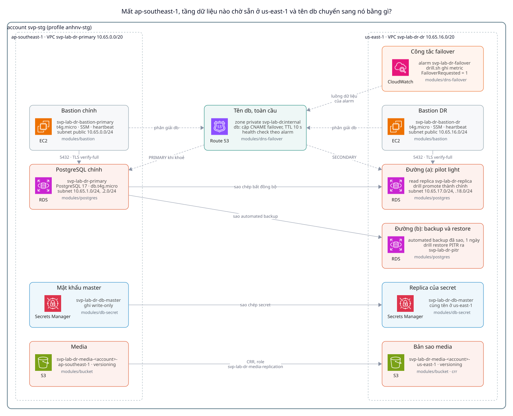
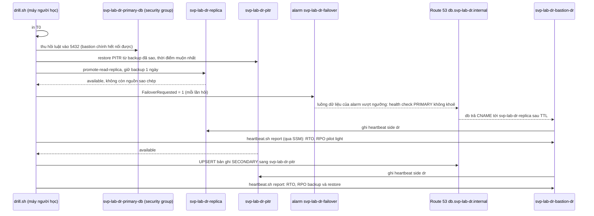
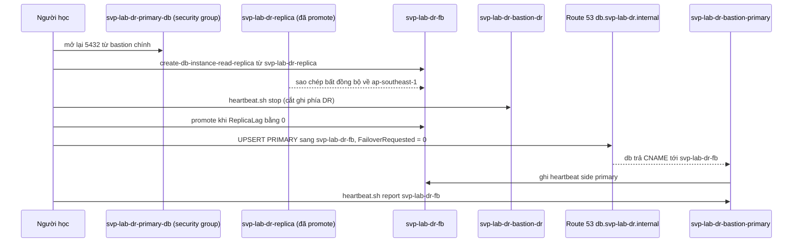

# Lab `multi-region-dr`: pilot light tầng dữ liệu của svp ở region thứ hai

Bài dựng tầng dữ liệu của svp (PostgreSQL trên RDS, bucket media) ở `ap-southeast-1` cùng bản chờ ở `us-east-1`, mô
phỏng mất region chính rồi đo RTO, RPO của hai đường khôi phục: read replica chéo region (pilot light) và automated
backup sao sang region khác (backup và restore). Số đo trả lời svp tốn bao nhiêu và chờ bao lâu nếu phải sống sót mất
region. Bảng bốn chiến lược DR ở quy mô svp nằm ở [`docs/dr-strategies.md`](docs/dr-strategies.md).

| | |
| --- | --- |
| Dựng | RDS PostgreSQL chính, read replica và backup đã sao ở region kia, CRR media, secret nhiều region, tên `db` failover |
| Trả lời | Mất `ap-southeast-1`: RTO, RPO của pilot light so với backup và restore; CRR mất bao lâu |
| Phí | ~0,080 USD mỗi giờ khi đang dựng, ~0,9 USD mỗi buổi 3 giờ ([Chi phí](#chi-phí)) |
| Thời gian | Ước tính, chưa đo: dựng 30–45 phút, đo ~1,5 giờ, failback tuỳ chọn ~1 giờ, gỡ ~30 phút; một buổi ~3 giờ |

## Câu hỏi

- Mất cả `ap-southeast-1`, tầng dữ liệu của svp phục vụ lại ở `us-east-1` sau bao lâu (RTO) và mất bao nhiêu dữ liệu
  (RPO), khi khôi phục bằng read replica chéo region so với restore từ automated backup đã sao sang region kia? Media
  sang region kia mất bao lâu?
- svp đang quyết: [ADR-0067](https://github.com/anhnvcoder/svp-backend/blob/main/docs/adr/0067-backup-dr.md) §2, §12 để
  mất region ngoài phạm vi. Backup chỉ ở `ap-southeast-1` (bản copy chéo account cùng region); mất region là mất dữ liệu
  từ lần backup cuối, env dựng lại trống từ IaC.
  [Phụ lục §12](https://github.com/anhnvcoder/svp-backend/blob/main/docs/adr/appendix/0067-backup-dr.md#12-dr-đa-region-và-chi-phí)
  ước pilot light "hàng chục tới hàng trăm" USD mỗi tháng, chưa đo.
- Số đo của bài là đầu vào để quyết lại §12 khi svp cần sống sót mất region; kết luận ghi vào ADR mới của `svp-backend`
  sau buổi chạy.

## Thiết kế

<picture>
  <source media="(prefers-color-scheme: dark)" srcset="../docs/diagrams/multi-region-dr/overview-dark.svg">
  
</picture>

Mũi tên liền là dữ liệu đi, mũi tên đứt là điều khiển (phân giải tên, công tắc). Mỗi bastion chạy `scripts/heartbeat.sh`:
mỗi giây phân giải CNAME `db.svp-lab-dr.internal`, nối TLS `verify-full` tới host RDS mà CNAME trỏ (chứng chỉ RDS mang
tên endpoint instance [N11]) và ghi một dòng `heartbeat` mang giờ của chính máy đó. Bastion ở `ap-southeast-1` ghi
`side = primary`, bastion ở `us-east-1` ghi `side = dr`. `scripts/drill.sh` trên máy người học điều khiển cả hai qua SSM
Run Command; `svp-lab-dr-pitr` (restore của đường (b)) và `svp-lab-dr-fb` (failback) do drill và người học tạo ngoài
Terraform.

Chọn gì, phương án khác, trạng thái ngành:

- **Đường (a), pilot light:** read replica chéo region của RDS, promote khi mất region. Phương án khác: Aurora Global
  Database (đổi engine, xem [`docs/dr-strategies.md`](docs/dr-strategies.md)); AWS Backup copy sang region thứ hai.
  Hiện hành [N1], [N22].
- **Đường (b), backup và restore:** sao chép automated backup chéo region của RDS, restore PITR ở `us-east-1`. Phương án
  khác: AWS Backup copy (phương án của ADR-0067 phụ lục §12). Hiện hành; `ap-southeast-1` → `us-east-1` là cặp được hỗ
  trợ [N5], [N6].
- **Media:** S3 Cross-Region Replication, Replication Time Control tắt. Phương án khác: RTC bật; S3 Batch Replication cho
  object có trước rule [N18]. Hiện hành [N18], [N19].
- **Tên database, failover:** zone private Route 53, cặp bản ghi failover, health check theo CloudWatch alarm làm công
  tắc. Phương án khác: ARC routing control; ARC Region switch; sửa bản ghi bằng tay. Hiện hành [N13], [N24]; readiness
  check của ARC ngừng nhận khách mới từ 2026-04-30 [P12].
- **Mật khẩu:** secret Secrets Manager nhiều region (replica ở `us-east-1`), ghi bằng thuộc tính write-only. Phương án
  khác: hai secret riêng, mỗi region một. Hiện hành [N21].
- **Đường SSM của bastion:** subnet public, IP công khai, không luật vào. Phương án khác: NAT Gateway; interface endpoint
  `ssm`, `ssmmessages`, `ec2messages` [N27] và `secretsmanager`. Rẻ nhất theo bảng ở mục [Chi phí](#chi-phí).

Lý do các lựa chọn:

- **Công tắc failover là quyết định có chủ đích.** Replica chưa promote chỉ đọc, nên đổi DNS trước khi promote xong chỉ
  đưa client tới lỗi ghi. Whitepaper DR của AWS khuyên tự động hoá các bước nhưng dè dặt với failover tự kích hoạt theo
  health check hay alarm [N22]. `drill.sh` promote replica, chờ instance độc lập, rồi ghi `FailoverRequested = 1`; giá
  trị đó vượt ngưỡng của alarm `svp-lab-dr-failover`, health check của bản ghi PRIMARY thành không khoẻ và Route 53 trả
  bản ghi SECONDARY. Alarm nằm ở `us-east-1`, region còn sống.
- **Health check theo alarm, không gọi endpoint.** Health checker của Route 53 ở ngoài VPC; với zone private, AWS hướng
  dẫn dùng metric, alarm và health check theo alarm [N13]. Route 53 chỉ nhận alarm độ phân giải chuẩn, statistic thường,
  không "M out of N", không metric math, cùng account [N14]: alarm của bài dùng `Maximum`, chu kỳ 60 s, một datapoint.
  Route 53 không đợi alarm sang `ALARM`: health check xét chính luồng dữ liệu mà alarm theo dõi, theo tiêu chí của
  alarm [N14], nên có thể không khoẻ trước khi alarm đổi trạng thái. Drill ngừng ghi metric thì luồng thiếu dữ liệu;
  công tắc giữ nguyên nhờ `LastKnownStatus`: health check lấy trạng thái của lần cuối CloudWatch đủ dữ liệu (health
  check mới chưa có trạng thái thì coi là khoẻ) [N15]. `treat_missing_data = ignore` [N17] giữ trạng thái của chính
  alarm trên CloudWatch, cho khớp với health check.
- **Mô phỏng mất region.** RDS không dừng được instance có replica hay là replica [N4], nên `drill.sh failover` thu hồi
  luật vào 5432 của security group `svp-lab-dr-primary-db` (bastion chính không nối mới được) tại T0. Khác mất region
  thật: luồng sao chép vẫn chạy tới lúc promote, CloudWatch, S3, Secrets Manager của `ap-southeast-1` vẫn sống. Vì thế
  RPO đo được của đường (a) là cận dưới; script in thêm `ReplicaLag` lớn nhất trong 5 phút trước T0, phần dữ liệu mà mất
  region thật có thể mất. Đường (b) restore tới thời điểm khôi phục muộn nhất (`--use-latest-restorable-time`) đọc ngay
  sau T0, đúng thứ một sự cố thật để lại. Promote là một chiều: replica thành instance độc lập, không làm replica lại
  được [N3].
- **Khoá KMS do AWS quản lý.** Storage RDS dùng `aws/rds` của mỗi region; RDS bắt buộc chỉ định khoá của region đích cho
  replica mã hoá chéo region [N2]; backup sao sang dùng cùng khoá đó (`KmsKeyId` là khoá của region đích [N5]). Root đọc
  `alias/aws/rds` ở `us-east-1` bằng `DescribeKey`, KMS gắn alias định sẵn với khoá AWS managed [N12]. Bucket dùng
  SSE-S3, secret dùng `aws/secretsmanager` của mỗi region [N21]. Không dịch vụ nào bắt buộc CMK.
- **TLS.** PostgreSQL 15 trở lên trên RDS mặc định `rds.force_ssl = 1` [N10], nên bài dùng parameter group mặc định;
  bastion kiểm chứng chỉ server bằng bundle toàn cầu của RDS [N11].
- **Mạng.** Mỗi VPC một subnet public cho bastion và hai subnet database ở hai AZ, vì subnet group của RDS cần ít nhất
  hai AZ [N26]; subnet database có route table riêng không route nào ra ngoài VPC. Zone private gắn VPC của cả hai
  region cùng account [N16].
- **Sao chép media.** CRR cần versioning ở cả hai bucket, role cho S3 với quyền theo hướng dẫn của S3 [N18], [N20]; bài
  sao chép cả delete marker (hai bucket giữ mọi version nên object bị xoá vẫn lấy lại được). RTC tắt: phép đo tự đo thời
  gian CRR bằng cách hỏi bucket đích mỗi giây, nên không cần metric của RTC; RTC cam kết 99,9 % object trong 15 phút
  [N19] và tính thêm $0,015 mỗi GB [P5].

Đổi mật khẩu master: tăng `password_version` rồi plan, apply theo bước 3, 4 của [Chạy buổi](#chạy-buổi). Terraform ghi
giá trị mới vào instance chính và secret (replica của secret tự đồng bộ, read replica theo instance nguồn); `heartbeat.sh`
đọc secret ở mỗi lần chạy nên lần `drill.sh start` sau dùng giá trị mới, writer đang chạy phải `start` lại.

## Đo gì

T0 là mốc `drill.sh` in khi bắt đầu mô phỏng mất region. Mỗi số đo: định nghĩa, cách đo, mong đợi.

- **RTO pilot light:** từ T0 tới dòng `side = dr` đầu tiên ghi thành công vào `svp-lab-dr-replica` đã promote, qua CNAME
  `db.svp-lab-dr.internal` với `connect_timeout=2` (độ phân giải của RTO); gồm cả TTL của bản ghi.
  - Cách đo: dòng `RTO pilot-light` của `drill.sh failover`.
  - Mong đợi: promote "có thể mất vài phút hay lâu hơn" [N3], cộng chu kỳ alarm 60 s và TTL 10 s; pilot light điển hình:
    RTO hàng chục phút [N23].
- **RPO pilot light:** T0 trừ giờ client của dòng `side = primary` mới nhất có trong `svp-lab-dr-replica` sau khi promote.
  - Cách đo: dòng `RPO pilot-light`.
  - Mong đợi: vài giây trong mô phỏng (cận dưới); mất region thật: tới `ReplicaLag` lúc T0; pilot light điển hình: RPO
    phút [N23].
- **`ReplicaLag`:** metric `AWS/RDS` `ReplicaLag` của `svp-lab-dr-replica`.
  - Cách đo: `drill.sh lag` (15 phút), dòng `ReplicaLag` của `drill.sh failover` (5 phút trước T0).
  - Mong đợi: replica khác region trễ hơn replica cùng region [N1]; AWS không công bố số: đo.
- **RTO backup và restore:** từ T0 tới dòng `side = dr` đầu tiên trong `svp-lab-dr-pitr` (restore PITR từ backup đã sao),
  sau khi `drill.sh` trỏ bản ghi SECONDARY sang nó.
  - Cách đo: dòng `RTO backup-restore`.
  - Mong đợi: dài hơn pilot light (dựng instance mới); backup và restore điển hình: RTO tới 24 giờ [N23].
- **RPO backup và restore:** T0 trừ giờ client của dòng `side = primary` mới nhất trong `svp-lab-dr-pitr`.
  - Cách đo: dòng `RPO backup-restore`.
  - Mong đợi: phút: RDS đẩy log giao dịch lên S3 mỗi năm phút [N9], cộng độ trễ sao chéo region (AWS không công bố).
- **Thời gian CRR:** từ lúc `put-object` một object 1 MiB vào bucket nguồn tới lúc `head-object` ở bucket đích thành
  công, hỏi mỗi giây.
  - Cách đo: `drill.sh crr 5`.
  - Mong đợi: không RTC thì AWS không cam kết; tham chiếu RTC: 99,9 % trong 15 phút [N19].

Sai số: T0 lấy đồng hồ máy người học, dòng heartbeat lấy đồng hồ của hai bastion, độ phân giải 1 giây; RTO, RPO lệch
thêm bằng độ lệch giữa các đồng hồ đó. Kiểm độ lệch của máy trước buổi bằng `sntp time.aws.com` (máy chủ NTP công khai
của Amazon Time Sync [N28]).

## Tài nguyên

| Root | Việc | Tạo gì trên account trống |
| --- | --- | --- |
| `multi-region-dr/terraform` | Cả bài, hai region: mạng, bastion, RDS, backup sao, secret, bucket, CRR, DNS | [Inventory][inv-root] |

Plan đầu trên account trống hứa đúng dòng `Plan:` ở mục root đó; trang inventory chia số theo phần và theo loại tài
nguyên, kèm sơ đồ.

[inv-root]: docs/inventory.md#multi-region-drterraform

## Chi phí

Đơn giá on-demand, USD, đúng region của tài nguyên, đọc 2026-11-17 từ file Price List bulk công khai (cột URL) và trang
giá. Free Tier không tính (50 health check đầu cho endpoint AWS miễn phí [P9]; bảng vẫn tính giá). Buổi tính 3 giờ,
ước tính chưa đo: dựng 30–45 phút (RDS chính rồi replica chéo region, tuần tự), đo ~1,5 giờ (chờ 15 phút sau bước 7 của
[Chạy buổi](#chạy-buổi), `drill.sh failover` chờ tối đa 1 giờ), gỡ ~30 phút; failback tuỳ chọn thêm ~1 giờ.

| Tài nguyên | Đơn vị | Đơn giá | URL | Ngày đọc |
| --- | --- | --- | --- | --- |
| RDS PostgreSQL `db.t4g.micro` Single-AZ, `ap-southeast-1` | giờ | 0,025 | [P1] | 2026-11-17 |
| RDS PostgreSQL `db.t4g.micro` Single-AZ, `us-east-1` | giờ | 0,016 | [P2] | 2026-11-17 |
| RDS gp3, `ap-southeast-1` / `us-east-1` | GB-tháng | 0,138 / 0,115 | [P1], [P2] | 2026-11-17 |
| Backup RDS vượt phần miễn phí (gồm backup đã sao), hai region | GB-tháng | 0,095 | [P1], [P2] | 2026-11-17 |
| EC2 `t4g.micro`, `ap-southeast-1` / `us-east-1` | giờ | 0,0106 / 0,0084 | [P3], [P4] | 2026-11-17 |
| EBS gp3, `ap-southeast-1` / `us-east-1` | GB-tháng | 0,096 / 0,08 | [P3], [P4] | 2026-11-17 |
| IPv4 công khai đang dùng, mỗi region | giờ | 0,005 | [P6] | 2026-11-17 |
| Chuyển dữ liệu `ap-southeast-1` → `us-east-1` (replica, backup sao, CRR) | GB | 0,09 | [P7] | 2026-11-17 |
| S3 Standard, `ap-southeast-1` / `us-east-1` | GB-tháng | 0,025 / 0,023 | [P5] | 2026-11-17 |
| S3 PUT, mỗi region | 1.000 request | 0,005 | [P5] | 2026-11-17 |
| S3 RTC (không bật, để so) | GB | 0,015 | [P5] | 2026-11-17 |
| Secret Secrets Manager (replica tính như một secret: trang giá không nói riêng) | secret-tháng, theo giờ | 0,40 | [P8] | 2026-11-17 |
| Hosted zone Route 53 (xoá trong 12 giờ thì không tính) | zone-tháng | 0,50 | [P9] | 2026-11-17 |
| Health check Route 53 cho endpoint AWS (gồm loại theo alarm), tính theo phần tháng | health check-tháng | 0,50 | [P9] | 2026-11-17 |
| CloudWatch alarm độ phân giải chuẩn, `us-east-1` | alarm-tháng | 0,10 | [P10] | 2026-11-17 |
| CloudWatch metric tuỳ chỉnh `FailoverRequested` | metric-tháng | 0,30 | [P10] | 2026-11-17 |
| CloudWatch API (`PutMetricData`, `GetMetricStatistics`) | 1.000 request | 0,01 | [P10] | 2026-11-17 |
| NAT Gateway, `ap-southeast-1` / `us-east-1` (không dựng, để so) | giờ | 0,059 / 0,045 | [P3], [P11] | 2026-11-17 |
| Interface endpoint mỗi AZ, `ap-southeast-1` / `us-east-1` (không dựng, để so) | giờ | 0,013 / 0,01 | [P6] | 2026-11-17 |

Mỗi giờ khi mọi thứ chạy:

| Khoản | Cách tính | USD mỗi giờ |
| --- | --- | --- |
| RDS chính và replica | 0,025 + 0,016 | 0,041 |
| gp3 20 GB của hai instance | 20 × (0,138 + 0,115) / 730 | 0,0069 |
| Hai bastion | 0,0106 + 0,0084 | 0,019 |
| EBS gp3 8 GB của hai bastion | 8 × (0,096 + 0,08) / 730 | 0,0019 |
| Hai IPv4 công khai | 2 × 0,005 | 0,01 |
| Secret và replica | 2 × 0,40 / 730 | 0,0011 |
| **Cộng mỗi giờ** | | **~0,080** |

Mỗi buổi 3 giờ:

| Khoản | Cách tính | USD |
| --- | --- | --- |
| Tài nguyên chạy cả buổi | 3 × 0,080 | 0,24 |
| `svp-lab-dr-pitr` khoảng 1 giờ (RDS và gp3) | 0,016 + 20 × 0,115 / 730 | 0,019 |
| `svp-lab-dr-fb` của failback khoảng 1 giờ (tuỳ chọn) | 0,025 + 20 × 0,138 / 730 | 0,029 |
| Chuyển dữ liệu chéo region, ước tới 2 GB (snapshot đầu của replica và của backup sao, WAL, probe CRR) | 2 × 0,09 | 0,18 |
| Alarm, metric tuỳ chỉnh (trần: cả tháng, không giả định chia theo giờ) | 0,10 + 0,30 | ≤ 0,40 |
| Health check 3 giờ | 0,50 × 3 / 730 | 0,002 |
| Hosted zone xoá trong 12 giờ | 0 | 0 |
| API CloudWatch, PUT S3, backup lưu vài giờ | dưới 1.000 request mỗi loại; dưới 1 GB × 3 giờ | < 0,01 |
| **Cộng mỗi buổi** | | **~0,9** |

So đường SSM, cộng hai region: hai IPv4 công khai 0,01 USD mỗi giờ; một NAT Gateway mỗi region 0,104; bốn interface
endpoint mỗi region (một AZ) 0,092. Khoản lớn nhất của buổi là chuyển dữ liệu chéo region và trần của metric, alarm.

## Điều kiện trước

- [ ] **Account `svp-stg`** có và profile `anhnv-stg` ghi vào nó (runbook
  [`accounts-setup.md`](https://github.com/anhnvcoder/svp-infra/blob/main/docs/runbooks/accounts-setup.md) của
  `svp-infra`). Tổ chức chỉ cho account thành viên dùng hai region của bài, `ap-southeast-1` và `us-east-1`.
- [ ] **Trên máy:** AWS CLI v2, `jq`, Terraform 1.15; `sntp` để kiểm độ lệch đồng hồ (mục [Đo gì](#đo-gì)).
- [ ] **Repo:** PR của bài đã merge; chạy từ gốc repo `svp-labs`, trên `main`.
- [ ] **Biến account:** `SVP_AWS_STG_ACCOUNT_ID` (12 số của account `svp-stg`) export trong terminal, không ghi vào file nào.
- [ ] **Thư mục buổi** đặt ngay đầu buổi, cùng terminal với mọi lệnh sau (lý do:
  [`docs/terraform-commands.md`](../docs/terraform-commands.md#thư-mục-buổi)):

  ```sh
  export SVP_LAB_SESSION_DIR="$PWD/.session/multi-region-dr-$(date -u +%Y%m%dT%H%M%SZ)" && mkdir -p "$SVP_LAB_SESSION_DIR"
  ```

- [ ] **Lab chạy trước:** không cần; bài không đọc tài nguyên của lab khác.

## Chạy buổi

Mọi lệnh `terraform` theo khuôn của [`docs/terraform-commands.md`](../docs/terraform-commands.md) (lý do từng phần ở đó).
Buổi chạy trong account `svp-stg` bằng profile `anhnv-stg`.

1. **Kiểm account** trước lệnh ghi đầu tiên.

   ```sh
   AWS_PROFILE=anhnv-stg aws sts get-caller-identity --no-cli-pager --query Account --output text \
     --region ap-southeast-1
   ```

   - Mong đợi, dán lại: 12 số bằng `$SVP_AWS_STG_ACCOUNT_ID`.
   - Bẫy: số khác thì dừng; profile đang trỏ account khác.

2. **Init.** Root không có backend: state là file local, `init` chỉ tải provider theo lock file đã commit.

   ```sh
   AWS_PROFILE=anhnv-stg terraform -chdir=multi-region-dr/terraform init -input=false
   ```

   - Mong đợi: `Terraform has been successfully initialized!`.

3. **Plan** ra file, bản văn bản vào thư mục buổi, rồi đọc.

   ```sh
   AWS_PROFILE=anhnv-stg \
   TF_VAR_account_id="$SVP_AWS_STG_ACCOUNT_ID" \
     terraform -chdir=multi-region-dr/terraform plan -input=false -out=multi-region-dr.tfplan
   AWS_PROFILE=anhnv-stg terraform -chdir=multi-region-dr/terraform show -no-color multi-region-dr.tfplan \
     > "$SVP_LAB_SESSION_DIR/multi-region-dr-plan.txt"
   grep -E '^\s*# .* (will|must) be|^Plan:' "$SVP_LAB_SESSION_DIR/multi-region-dr-plan.txt"
   ```

   - Mong đợi, dán lại: dòng `Plan:` bằng dòng `Plan:` của root ở [trang inventory][inv-root]; mọi dòng `will be created`.
   - Bẫy: `No value for required variable` là thiếu `TF_VAR_account_id` (biến account chưa export). Có `destroyed` hay
     `must be replaced`, hay số khác mong đợi: không apply, dán các dòng đó
     ([Đọc plan](../docs/terraform-commands.md#đọc-plan)).

4. **Apply** đúng file plan đã đọc. Replica chéo region dựng sau instance chính, nên đây là bước lâu nhất của buổi.

   ```sh
   AWS_PROFILE=anhnv-stg terraform -chdir=multi-region-dr/terraform apply -input=false multi-region-dr.tfplan \
     && rm multi-region-dr/terraform/multi-region-dr.tfplan
   ```

   - Mong đợi, dán lại: `Apply complete!` cùng output `replicated_backups_arn` (phải là ARN
     `arn:aws:rds:us-east-1:...:auto-backup:...`).
   - Bẫy: lỗi giữa chừng thì đọc lỗi, đừng apply lại ngay
     ([Khi apply lỗi giữa chừng](../docs/terraform-commands.md#khi-apply-lỗi-giữa-chừng)).

5. **Plan lại**, không `-out`: code và account phải khớp.

   ```sh
   AWS_PROFILE=anhnv-stg \
   TF_VAR_account_id="$SVP_AWS_STG_ACCOUNT_ID" \
     terraform -chdir=multi-region-dr/terraform plan -input=false
   ```

   - Mong đợi: `No changes. Your infrastructure matches the configuration.`
   - Bẫy: còn dòng đổi là lỗi code: dán plan, không apply.

6. **Chờ SSM agent** của hai bastion.

   ```sh
   AWS_PROFILE=anhnv-stg aws ssm describe-instance-information --no-cli-pager --region ap-southeast-1 --output text \
     --query 'InstanceInformationList[].[InstanceId,PingStatus]'
   AWS_PROFILE=anhnv-stg aws ssm describe-instance-information --no-cli-pager --region us-east-1 --output text \
     --query 'InstanceInformationList[].[InstanceId,PingStatus]'
   ```

   - Mong đợi: mỗi lệnh in một dòng `<instance id> Online`.
   - Bẫy: in rỗng thì agent chưa đăng ký (user data còn cài gói); chờ vài phút rồi chạy lại.

7. **Tạo bảng `heartbeat` và chạy hai writer.**

   ```sh
   SVP_AWS_STG_ACCOUNT_ID=$SVP_AWS_STG_ACCOUNT_ID multi-region-dr/scripts/drill.sh start
   ```

   - Mong đợi, dán lại: `table heartbeat ready`, hai dòng `writer ... started`.
   - Bẫy: chờ ít nhất 15 phút trước bước 10: backup đã sao cần có log chứa các dòng heartbeat (log lên S3 mỗi năm phút
     [N9]).

8. **Đọc `ReplicaLag`** 15 phút gần nhất.

   ```sh
   multi-region-dr/scripts/drill.sh lag
   ```

   - Mong đợi, dán lại: dòng `ReplicaLag of svp-lab-dr-replica ...`.

9. **Đo thời gian CRR** với năm object 1 MiB.

   ```sh
   SVP_AWS_STG_ACCOUNT_ID=$SVP_AWS_STG_ACCOUNT_ID multi-region-dr/scripts/drill.sh crr 5
   ```

   - Mong đợi, dán lại: năm dòng `CRR ...: <n> s`.

10. **Mô phỏng mất region và đo cả hai đường.** Lệnh chạy tới khi `svp-lab-dr-pitr` có dòng `side = dr` (tới một giờ).

    ```sh
    SVP_AWS_STG_ACCOUNT_ID=$SVP_AWS_STG_ACCOUNT_ID multi-region-dr/scripts/drill.sh failover
    ```

    - Mong đợi, dán lại toàn bộ output; tìm các dòng `T0`, `ReplicaLag over the 5 min before T0`, `RTO pilot-light`,
      `RPO pilot-light`, `RTO backup-restore`, `RPO backup-restore`.
    - Bẫy: mã thoát 1 kèm `RPO ...: unknown` nghĩa là database khôi phục không có dòng `side = primary` nào (thường do
      bước 7 chạy chưa đủ lâu trước bước này).
    - Bẫy: lệnh tra backup đã sao trước T0; thiếu backup hay backup chưa có thời điểm khôi phục thì lệnh dừng trước dòng
      `T0`, chưa đổi gì: chờ rồi chạy lại.
    - Bẫy: lệnh dừng lỗi sau dòng `primary cut off` thì database chính vẫn bị chặn và chạy lại báo `already cut off?`.
      Chưa có dòng `pilot light: svp-lab-dr-replica promoting`: mở lại bằng bước 1 của
      [failback](#failback-tuỳ-chọn), chạy `drill.sh cleanup` (xoá `svp-lab-dr-pitr` nếu đã tạo, dừng writer), rồi chạy
      lại từ bước 7. Đã có dòng đó: promote là một chiều, đi tiếp failback hay dọn dẹp.

Bước 10 theo thời gian:



### Failback (tuỳ chọn)

Khoảng một giờ: dựng replica chiều ngược `svp-lab-dr-fb` ở `ap-southeast-1` từ `svp-lab-dr-replica` đã promote, promote
nó rồi đưa DNS về. Bản ghi SECONDARY lúc này trỏ `svp-lab-dr-pitr`; failback chỉ đổi bản ghi PRIMARY và công tắc.

1. **Mở lại đường bastion chính** tới security group của database chính (bản failback dùng chung group này).

   ```sh
   SG=$(AWS_PROFILE=anhnv-stg aws ec2 describe-security-groups --no-cli-pager --region ap-southeast-1 \
     --filters Name=group-name,Values=svp-lab-dr-primary-db --query 'SecurityGroups[0].GroupId' --output text)
   BASTION_SG=$(AWS_PROFILE=anhnv-stg aws ec2 describe-security-groups --no-cli-pager --region ap-southeast-1 \
     --filters Name=group-name,Values=svp-lab-dr-bastion-primary --query 'SecurityGroups[0].GroupId' --output text)
   AWS_PROFILE=anhnv-stg aws ec2 authorize-security-group-ingress --no-cli-pager --region ap-southeast-1 \
     --group-id "$SG" \
     --ip-permissions "IpProtocol=tcp,FromPort=5432,ToPort=5432,UserIdGroupPairs=[{GroupId=$BASTION_SG}]"
   ```

   - Mong đợi, dán lại: `"Return": true`.

2. **Tạo replica chiều ngược** với khoá `aws/rds` của `ap-southeast-1` (instance nguồn đã có backup từ lúc promote).

   ```sh
   SRC=$(AWS_PROFILE=anhnv-stg aws rds describe-db-instances --no-cli-pager --region us-east-1 \
     --db-instance-identifier svp-lab-dr-replica --query 'DBInstances[0].DBInstanceArn' --output text)
   KEY=$(AWS_PROFILE=anhnv-stg aws kms describe-key --no-cli-pager --region ap-southeast-1 --key-id alias/aws/rds \
     --query KeyMetadata.Arn --output text)
   date -u
   AWS_PROFILE=anhnv-stg aws rds create-db-instance-read-replica --no-cli-pager --region ap-southeast-1 \
     --source-region us-east-1 \
     --db-instance-identifier svp-lab-dr-fb --source-db-instance-identifier "$SRC" --kms-key-id "$KEY" \
     --db-instance-class db.t4g.micro --db-subnet-group-name svp-lab-dr-primary --vpc-security-group-ids "$SG" \
     --no-publicly-accessible --tags Key=Project,Value=svp Key=Lab,Value=multi-region-dr \
     --query 'DBInstance.DBInstanceStatus' --output text
   ```

   - Mong đợi, dán lại: giờ bắt đầu (`date -u`) và `DBInstanceStatus` `creating`.

3. **Chờ replica sẵn sàng**, ghi giờ xong (thời gian dựng replica ngược).

   ```sh
   AWS_PROFILE=anhnv-stg aws rds wait db-instance-available --no-cli-pager --region ap-southeast-1 \
     --db-instance-identifier svp-lab-dr-fb
   date -u
   ```

   - Mong đợi, dán lại: hai dòng `date -u` của bước 2 và bước này.

4. **Dừng ghi ở phía DR** (cửa sổ cắt của failback).

   ```sh
   DR_BASTION=$(AWS_PROFILE=anhnv-stg aws ec2 describe-instances --no-cli-pager --region us-east-1 \
     --filters Name=tag:Name,Values=svp-lab-dr-bastion-dr Name=instance-state-name,Values=running \
     --query 'Reservations[].Instances[].InstanceId' --output text)
   AWS_PROFILE=anhnv-stg aws ssm send-command --no-cli-pager --region us-east-1 --instance-ids "$DR_BASTION" \
     --document-name AWS-RunShellScript --parameters 'commands=["/opt/svp-lab-dr/heartbeat.sh stop"]' \
     --query Command.CommandId --output text
   ```

   - Mong đợi, dán lại: `CommandId`.

5. **Promote `svp-lab-dr-fb`** khi `ReplicaLag` về 0, chờ nó độc lập.

   ```sh
   AWS_PROFILE=anhnv-stg aws cloudwatch get-metric-statistics --no-cli-pager --region ap-southeast-1 \
     --namespace AWS/RDS \
     --metric-name ReplicaLag --dimensions Name=DBInstanceIdentifier,Value=svp-lab-dr-fb \
     --period 60 --statistics Maximum \
     --start-time "$(date -u -v-5M +%Y-%m-%dT%H:%M:%SZ)" --end-time "$(date -u +%Y-%m-%dT%H:%M:%SZ)" \
     --query 'Datapoints[].Maximum' --output text
   AWS_PROFILE=anhnv-stg aws rds promote-read-replica --no-cli-pager --region ap-southeast-1 \
     --db-instance-identifier svp-lab-dr-fb \
     --backup-retention-period 1 --query 'DBInstance.DBInstanceStatus' --output text
   AWS_PROFILE=anhnv-stg aws rds wait db-instance-available --no-cli-pager --region ap-southeast-1 \
     --db-instance-identifier svp-lab-dr-fb
   date -u
   ```

   - Mong đợi, dán lại: output của `get-metric-statistics` (toàn 0) và `date -u` cuối.
   - Bẫy: `date -v-5M` là cú pháp `date` của macOS (5 phút trước).

6. **Trỏ bản ghi PRIMARY sang `svp-lab-dr-fb`** rồi đóng công tắc.

   ```sh
   ZONE=$(AWS_PROFILE=anhnv-stg aws route53 list-hosted-zones-by-name --no-cli-pager --region us-east-1 \
     --dns-name svp-lab-dr.internal --query "HostedZones[?Name=='svp-lab-dr.internal.'] | [0].Id" --output text)
   FB=$(AWS_PROFILE=anhnv-stg aws rds describe-db-instances --no-cli-pager --region ap-southeast-1 \
     --db-instance-identifier svp-lab-dr-fb --query 'DBInstances[0].Endpoint.Address' --output text)
   HC=$(AWS_PROFILE=anhnv-stg aws route53 list-health-checks --no-cli-pager --region us-east-1 --output text \
     --query "HealthChecks[?HealthCheckConfig.AlarmIdentifier.Name=='svp-lab-dr-failover'] | [0].Id")
   AWS_PROFILE=anhnv-stg aws route53 change-resource-record-sets --no-cli-pager --region us-east-1 \
     --hosted-zone-id "$ZONE" \
     --change-batch "$(jq -cn --arg h "$FB" --arg hc "$HC" '{Changes: [{Action: "UPSERT", ResourceRecordSet: {
       Name: "db.svp-lab-dr.internal", Type: "CNAME", SetIdentifier: "primary", Failover: "PRIMARY", TTL: 10,
       HealthCheckId: $hc, ResourceRecords: [{Value: $h}]}}]}')" --query ChangeInfo.Status --output text
   AWS_PROFILE=anhnv-stg aws cloudwatch put-metric-data --no-cli-pager --region us-east-1 --namespace svp-lab-dr \
     --metric-name FailoverRequested --value 0
   ```

   - Mong đợi, dán lại: `Status` của thay đổi (`PENDING` rồi `INSYNC`).

7. **Kiểm** writer chính (chạy từ bước 7 của buổi) ghi lại được vào `svp-lab-dr-fb`, và dữ liệu ghi ở phía DR đã về.

   ```sh
   PRIMARY_BASTION=$(AWS_PROFILE=anhnv-stg aws ec2 describe-instances --no-cli-pager --region ap-southeast-1 \
     --filters Name=tag:Name,Values=svp-lab-dr-bastion-primary Name=instance-state-name,Values=running \
     --query 'Reservations[].Instances[].InstanceId' --output text)
   CMD=$(AWS_PROFILE=anhnv-stg aws ssm send-command --no-cli-pager --region ap-southeast-1 \
     --instance-ids "$PRIMARY_BASTION" \
     --document-name AWS-RunShellScript --parameters "commands=[\"/opt/svp-lab-dr/heartbeat.sh report $FB\"]" \
     --query Command.CommandId --output text)
   sleep 5
   AWS_PROFILE=anhnv-stg aws ssm get-command-invocation --no-cli-pager --region ap-southeast-1 --command-id "$CMD" \
     --instance-id "$PRIMARY_BASTION" --query StandardOutputContent --output text
   ```

   - Mong đợi, dán lại: output của `report`; sau vài phút, `primary_last` mới hơn giờ của bước 6 và `dr_first` có giá trị.
   - Bẫy: lệnh cuối in rỗng khi lệnh trên bastion chưa xong: chạy lại nó.



## Dọn dẹp

Chạy đủ năm bước trước khi kết thúc buổi, kể cả khi buổi dừng giữa chừng.

1. **Dừng writer, xoá instance mà drill và failback tạo ngoài Terraform** (`svp-lab-dr-pitr`, `svp-lab-dr-fb`).

   ```sh
   SVP_AWS_STG_ACCOUNT_ID=$SVP_AWS_STG_ACCOUNT_ID multi-region-dr/scripts/drill.sh cleanup
   ```

   - Mong đợi, dán lại: các dòng `deleted`.

2. **Gỡ root** bằng plan `-destroy`, đọc rồi apply đúng file đó. Instance chính, replica (đã promote hay chưa) xoá không
   snapshot cuối, kèm automated backup; bucket xoá cả version; secret xoá ngay, replica trước; zone xoá cả bản ghi drill
   đã đổi.

   ```sh
   AWS_PROFILE=anhnv-stg \
   TF_VAR_account_id="$SVP_AWS_STG_ACCOUNT_ID" \
     terraform -chdir=multi-region-dr/terraform plan -destroy -input=false -out=multi-region-dr-destroy.tfplan
   AWS_PROFILE=anhnv-stg terraform -chdir=multi-region-dr/terraform show -no-color multi-region-dr-destroy.tfplan \
     > "$SVP_LAB_SESSION_DIR/multi-region-dr-destroy-plan.txt"
   grep -E '^\s*# .* (will|must) be|^Plan:' "$SVP_LAB_SESSION_DIR/multi-region-dr-destroy-plan.txt"
   ```

   Đọc `multi-region-dr-destroy-plan.txt` trong thư mục buổi; đúng như mong đợi (dưới) thì sang khối sau, apply đúng file plan đã đọc:

   ```sh
   AWS_PROFILE=anhnv-stg terraform -chdir=multi-region-dr/terraform apply -input=false multi-region-dr-destroy.tfplan \
     && rm multi-region-dr/terraform/multi-region-dr-destroy.tfplan
   ```

   - Mong đợi, dán lại: `Plan: 0 to add, 0 to change, N to destroy.` với N bằng số `to add` của bước 3 của
     [Chạy buổi](#chạy-buổi), rồi `Destroy complete!`.
   - Bẫy: N nhỏ hơn thì một phần chưa từng tạo (apply lỗi giữa chừng) hay đã bị xoá tay; đọc danh sách trước khi apply.

3. **Xoá backup đã sao còn giữ ở `us-east-1`:** gỡ root dừng sao chép nhưng RDS giữ backup đã sao tới hết retention [N7].

   ```sh
   SVP_AWS_STG_ACCOUNT_ID=$SVP_AWS_STG_ACCOUNT_ID multi-region-dr/scripts/drill.sh purge
   ```

   - Mong đợi, dán lại: các dòng `deleted automated backup` (có thể không có dòng nào).

4. **Quét sót** ở cả hai region và dịch vụ toàn cầu, chỉ đọc.

   ```sh
   SVP_AWS_STG_ACCOUNT_ID=$SVP_AWS_STG_ACCOUNT_ID multi-region-dr/scripts/sweep.sh
   ```

   - Mong đợi, dán lại: mọi dòng `none` và `sweep: nothing left`.
   - Bẫy: có dòng `LEFT` thì xoá thứ đó rồi quét lại; chưa sang bước 5. Dòng `ERROR` là danh sách không đọc được (thường do
     phiên đăng nhập của profile hết hạn): chưa biết sạch hay không, đăng nhập lại rồi quét lại.

5. **Xoá state local và file plan còn sót**, chỉ khi bước 4 in `sweep: nothing left`: mất state khi còn tài nguyên thì Terraform
   không còn biết chúng, chỉ còn cách xoá tay. State không giữ mật khẩu (write-only) nhưng giữ account ID, ARN, endpoint.

   ```sh
   rm -f multi-region-dr/terraform/terraform.tfstate multi-region-dr/terraform/terraform.tfstate.backup \
     multi-region-dr/terraform/*.tfplan
   ```

## Sau buổi

Ghi lại, từ output đã dán:

- RTO, RPO của hai đường và `ReplicaLag` 5 phút trước T0 (bước 10 của [Chạy buổi](#chạy-buổi)); `ReplicaLag` 15 phút
  (bước 8); năm thời gian CRR (bước 9).
- Thời gian thật của `apply` (bước 4), của dựng và promote replica ngược nếu chạy [failback](#failback-tuỳ-chọn), của gỡ.
- Phí thật của buổi trên Cost Explorer khi số đã cập nhật, so với mục [Chi phí](#chi-phí).

Kết luận vào ADR mới của `svp-backend`, đầu vào để quyết lại
[ADR-0067](https://github.com/anhnvcoder/svp-backend/blob/main/docs/adr/0067-backup-dr.md) §12 (mất region ngoài phạm vi
hay pilot light). README này không viết kết luận trước buổi.

Xoá thư mục buổi chỉ sau khi đã chép số đo ở trên: nó giữ bản văn bản của mọi plan.

```sh
rm -rf "${SVP_LAB_SESSION_DIR:?}"
```

## Ôn SAP-C03

Task statement của exam guide SAP-C03 [N25] mà bài phục vụ:

- 1.4 Design network architectures (skill 1.4.5): failover routing của Route 53 giữa hai region, zone private gắn VPC của
  hai region, CIDR không chồng.
- 1.5 Design data, storage, and database architectures (skill 1.5.4): read replica chéo region, so với Aurora Global
  Database ở [`docs/dr-strategies.md`](docs/dr-strategies.md).
- 2.2 Design solutions to implement encryption and key management strategies: khoá `aws/rds` của mỗi region cho bản sao
  mã hoá, TLS `verify-full`.
- 3.2 Optimize data transfer and network costs (skill 3.2.2, 3.2.3): CRR không RTC, phí chuyển dữ liệu chéo region; so
  NAT Gateway, interface endpoint, IPv4 công khai.
- 3.4 Optimize storage and database costs (skill 3.4.4): retention 1 ngày của backup đã sao, xoá backup sau buổi.
- 4.2 Design disaster recovery architectures (skill 4.2.1, 4.2.4): RTO, RPO, chi phí của pilot light so với backup và
  restore; failover bằng health check của Route 53.
- 4.3 Design solutions to meet business continuity and resiliency requirements (skill 4.3.2): diễn tập failover, đo thời
  gian khôi phục.
- 5.4 Design operational automation and resilient systems (skill 5.4.1): CloudWatch alarm làm công tắc failover.

### 1. Chọn chiến lược DR theo RTO, RPO và chi phí (task 4.2)

Một công ty chạy RDS for PostgreSQL ở `ap-southeast-1`; tầng ứng dụng dựng lại từ IaC trong 20 phút. Khi mất cả region,
yêu cầu RPO dưới 5 phút, RTO dưới 30 phút, và chi phí thường ngày thấp nhất có thể. Chọn cách nào?

- A. Sao automated backup sang `us-east-1`, restore PITR khi sự cố.
- B. Read replica chéo region ở `us-east-1`, promote khi sự cố; tầng ứng dụng dựng khi cần.
- C. Một bản thu nhỏ đủ chức năng ở `us-east-1`, nhận traffic ngay ở công suất thấp.
- D. Bật Multi-AZ cho instance chính.

**Đáp án:** B. Pilot light giữ database luôn bật ở region DR, server ứng dụng tắt [N22]; AWS xếp pilot light ở RPO phút,
RTO hàng chục phút [N23], và đây là mức rẻ nhất đạt cả hai yêu cầu.

**Vì sao không phải:**

- A: log giao dịch lên S3 mỗi năm phút [N9] cộng độ trễ sao chéo region, nên RPO có thể vượt 5 phút; RTO gồm dựng
  instance mới.
- C: warm standby đạt yêu cầu nhưng chạy compute thường ngày, đắt hơn pilot light ([`docs/dr-strategies.md`](docs/dr-strategies.md)).
- D: standby của Multi-AZ ở AZ khác trong cùng region [N30], mất region là mất cả hai.

**Trong lab:** bước 10 của [Chạy buổi](#chạy-buổi) đo RTO, RPO của cả A và B trên cùng sự cố ([Đo gì](#đo-gì)).

### 2. Failover DNS cho database chỉ có IP private (task 4.2)

Client trong VPC của hai region gọi database qua một tên trong zone private Route 53. Endpoint RDS chỉ có IP private.
Khi đội vận hành quyết định failover, tên đó phải trả endpoint ở region DR mà không ai sửa bản ghi bằng tay. Cấu hình nào?

- A. Bản ghi failover, health check TCP 5432 tới IP private của instance chính.
- B. Bản ghi failover, health check theo một CloudWatch alarm; script failover ghi metric làm alarm vượt ngưỡng.
- C. Bản ghi weighted 100/0, đổi trọng số khi sự cố.
- D. Bản ghi failover, calculated health check gộp health check HTTP của hai endpoint.

**Đáp án:** B. Health checker của Route 53 ở ngoài VPC; với endpoint chỉ có IP private, AWS hướng dẫn tạo metric, alarm,
rồi health check theo luồng dữ liệu của alarm [N13].

**Vì sao không phải:**

- A: health checker không tới được IP private trong VPC [N13].
- C: đổi trọng số là sửa bản ghi bằng tay lúc sự cố, trái yêu cầu.
- D: calculated health check chỉ gộp trạng thái của health check con [N14]; health check con vẫn không tới được endpoint.

**Trong lab:** module `dns-failover`, lý do "Health check theo alarm" ở [Thiết kế](#thiết-kế).

### 3. Thứ tự promote và đổi DNS (task 4.3)

Đội diễn tập failover sang read replica chéo region. Họ muốn RTO ngắn nhưng không để client nhận lỗi ghi. Thứ tự nào?

- A. Đổi DNS sang replica, rồi promote.
- B. Promote replica, chờ nó thành instance độc lập, rồi bật công tắc DNS.
- C. Health check gọi endpoint chính tự đổi DNS khi chính lỗi; promote sau.
- D. Restore snapshot mới nhất ở region DR thành instance mới, rồi trỏ DNS.

**Đáp án:** B. Replica chưa promote chỉ đọc; promote "có thể mất vài phút hay lâu hơn" [N3]. Whitepaper DR khuyên tự
động hoá các bước nhưng dè dặt với failover tự kích hoạt theo health check [N22].

**Vì sao không phải:**

- A: client tới instance chỉ đọc, lỗi ghi tới khi promote xong.
- C: failover tự kích hoạt mà whitepaper dè dặt [N22], và DNS vẫn trỏ replica chưa promote.
- D: dựng instance mới làm RTO dài hơn và mất phần dữ liệu sau snapshot.

**Trong lab:** sơ đồ tuần tự của bước 10 ([Chạy buổi](#chạy-buổi)): `drill.sh` promote rồi mới ghi `FailoverRequested`.

### 4. Sao media chéo region đúng chi phí (task 3.2)

Bucket media đã có 50 TB. Region DR cần bản sao của cả object cũ lẫn object mới; không có cam kết thời gian sao chép, chi
phí và công vận hành thấp nhất. Chọn gì?

- A. CRR bật Replication Time Control.
- B. CRR không RTC cho object mới, một job S3 Batch Replication cho object có trước rule.
- C. Lambda theo sự kiện `ObjectCreated` chép sang bucket kia.
- D. CRR không RTC, chờ CRR tự sao object cũ.

**Đáp án:** B. Live replication chỉ sao object ghi sau khi có rule; object có trước sao bằng Batch Replication [N18].

**Vì sao không phải:**

- A: RTC cam kết 99,9 % object trong 15 phút [N19] và tính thêm $0,015 mỗi GB [P5]: trả cho cam kết không ai cần.
- C: tự viết, tự vận hành phần chép, thử lại và theo dõi lỗi, trong khi S3 có sẵn tính năng.
- D: CRR không sao object có trước rule [N18].

**Trong lab:** bước 9 của [Chạy buổi](#chạy-buổi) đo thời gian CRR không RTC; dòng RTC ở [Chi phí](#chi-phí).

### 5. Replica mã hoá chéo region (task 2.2)

Instance RDS for PostgreSQL ở `ap-southeast-1` mã hoá bằng khoá AWS managed `aws/rds`. Cần read replica ở `us-east-1`,
vẫn mã hoá. Chỉ định khoá KMS nào khi tạo replica?

- A. ARN của khoá `aws/rds` ở `ap-southeast-1`.
- B. Một khoá KMS ở `us-east-1`, ví dụ `aws/rds` của `us-east-1`.
- C. Không khoá nào: tạo replica không mã hoá, bật mã hoá sau khi promote.
- D. Bắt buộc một multi-Region key của KMS.

**Đáp án:** B. Replica mã hoá ở region khác cần khoá KMS của region đích [N2]; khoá KMS gắn với region tạo ra nó [N31].

**Vì sao không phải:**

- A: khoá của region nguồn không dùng được ở region đích [N2], [N31].
- C: RDS không cho replica không mã hoá của instance mã hoá, và không bật mã hoá cho instance đã tạo [N31].
- D: RDS nhận khoá bất kỳ của region đích [N2]; bài dùng `aws/rds` của `us-east-1`, không multi-Region key.

**Trong lab:** lý do "Khoá KMS do AWS quản lý" ở [Thiết kế](#thiết-kế), data source `aws_kms_key.dr_rds` của root.

## Kiểm offline

Chạy từ gốc repo, không chạm AWS:

```sh
make tf-check DIRS=multi-region-dr
make shellcheck DIRS=multi-region-dr
make script-test DIRS=multi-region-dr
make docs-check DOCS='multi-region-dr/**/*.md'
make diagrams-check NAMES=multi-region-dr
make inventory-check
make lock DIRS=multi-region-dr  # only when a root changes its providers
```

## Tham chiếu

- `terraform/`: root, provider `aws.primary` (`ap-southeast-1`) và `aws.dr` (`us-east-1`), `allowed_account_ids`, tag
  mặc định, user data của bastion (`user-data.sh.tftpl`).
- `modules/network/`: VPC, subnet public của bastion, hai subnet database không route ra ngoài.
- `modules/bastion/`: EC2 SSM, IMDSv2, role đọc đúng secret của region nó.
- `modules/postgres/`: instance chính hay replica chéo region, sao chép automated backup vào region của nó.
- `modules/db-secret/`: secret nhiều region của mật khẩu master, ghi write-only.
- `modules/bucket/`: bucket media có versioning, chặn public, chỉ TLS.
- `modules/crr/`: role và cấu hình Cross-Region Replication.
- `modules/dns-failover/`: zone private, alarm công tắc, health check, cặp bản ghi failover.
- `scripts/heartbeat.sh`: writer và `report` trên bastion; `scripts/heartbeat-test.sh`.
- `scripts/drill.sh`: `start`, `lag`, `crr`, `failover`, `cleanup`, `purge` trên máy người học; `scripts/drill-test.sh`.
- `scripts/sweep.sh`: quét sót, chỉ đọc; `scripts/sweep-test.sh`.
- `docs/inventory.md`: tài nguyên root tạo trên account trống, sinh bằng `make inventory`.
- `../docs/diagrams/multi-region-dr/overview.d2`: nguồn sơ đồ ở [Thiết kế](#thiết-kế), sinh SVG bằng `make diagrams`.
- Tên và tag mà script tra cứu: tag `Lab = multi-region-dr`, tiền tố `svp-lab-dr-`; instance RDS `svp-lab-dr-primary`,
  `svp-lab-dr-replica`, `svp-lab-dr-pitr`, `svp-lab-dr-fb`; security group `svp-lab-dr-primary-db`,
  `svp-lab-dr-replica-db`; tag `Name` của bastion `svp-lab-dr-bastion-primary`, `svp-lab-dr-bastion-dr`; secret
  `svp-lab-dr-db-master`; bản ghi `db.svp-lab-dr.internal`; metric `svp-lab-dr` / `FailoverRequested`; alarm
  `svp-lab-dr-failover`; bucket `svp-lab-dr-media-<account>-<region>`.

## Nguồn

Tài liệu AWS đọc 2026-11-17; [N25], [N30], [N31] đọc 2026-11-22.

- [N1] Amazon RDS, Creating a read replica in a different AWS Region:
  <https://docs.aws.amazon.com/AmazonRDS/latest/UserGuide/USER_ReadRepl.XRgn.html>
- [N2] Amazon RDS API, CreateDBInstanceReadReplica (`KmsKeyId`):
  <https://docs.aws.amazon.com/AmazonRDS/latest/APIReference/API_CreateDBInstanceReadReplica.html>
- [N3] Amazon RDS, Promoting a read replica:
  <https://docs.aws.amazon.com/AmazonRDS/latest/UserGuide/USER_ReadRepl.Promote.html>; API PromoteReadReplica
  (`BackupRetentionPeriod`): <https://docs.aws.amazon.com/AmazonRDS/latest/APIReference/API_PromoteReadReplica.html>
- [N4] Amazon RDS, Stopping an Amazon RDS DB instance temporarily:
  <https://docs.aws.amazon.com/AmazonRDS/latest/UserGuide/USER_StopInstance.html>
- [N5] Amazon RDS, Replicating automated backups to another AWS Region:
  <https://docs.aws.amazon.com/AmazonRDS/latest/UserGuide/USER_ReplicateBackups.html>; API
  StartDBInstanceAutomatedBackupsReplication:
  <https://docs.aws.amazon.com/AmazonRDS/latest/APIReference/API_StartDBInstanceAutomatedBackupsReplication.html>
- [N6] Amazon RDS, Supported Regions and DB engines for cross-Region automated backups:
  <https://docs.aws.amazon.com/AmazonRDS/latest/UserGuide/Concepts.RDS_Fea_Regions_DB-eng.Feature.CrossRegionAutomatedBackups.html>
- [N7] Amazon RDS, Stopping automated backup replication và Deleting replicated backups:
  <https://docs.aws.amazon.com/AmazonRDS/latest/UserGuide/AutomatedBackups.StopReplicating.html>,
  <https://docs.aws.amazon.com/AmazonRDS/latest/UserGuide/AutomatedBackups.Delete.html>; terraform-provider-aws v6.73.0,
  xoá `aws_db_instance_automated_backups_replication` gọi `StopDBInstanceAutomatedBackupsReplication`:
  <https://github.com/hashicorp/terraform-provider-aws/blob/v6.73.0/internal/service/rds/instance_automated_backups_replication.go>
- [N8] Amazon RDS, Restoring to a specified time from a replicated backup:
  <https://docs.aws.amazon.com/AmazonRDS/latest/UserGuide/AutomatedBackups.PiTR.html>; API
  RestoreDBInstanceToPointInTime:
  <https://docs.aws.amazon.com/AmazonRDS/latest/APIReference/API_RestoreDBInstanceToPointInTime.html>
- [N9] Amazon RDS, Restoring a DB instance to a specified time (log giao dịch mỗi năm phút):
  <https://docs.aws.amazon.com/AmazonRDS/latest/UserGuide/USER_PIT.html>
- [N10] Amazon RDS, Using SSL with a PostgreSQL DB instance (`rds.force_ssl`):
  <https://docs.aws.amazon.com/AmazonRDS/latest/UserGuide/PostgreSQL.Concepts.General.SSL.html>
- [N11] Amazon RDS, Using SSL/TLS to encrypt a connection to a DB instance (bundle toàn cầu):
  <https://docs.aws.amazon.com/AmazonRDS/latest/UserGuide/UsingWithRDS.SSL.html>
- [N12] AWS KMS API, DescribeKey (alias AWS định sẵn):
  <https://docs.aws.amazon.com/kms/latest/APIReference/API_DescribeKey.html>
- [N13] Route 53, Configuring failover in a private hosted zone:
  <https://docs.aws.amazon.com/Route53/latest/DeveloperGuide/dns-failover-private-hosted-zones.html>
- [N14] Route 53, Types of Amazon Route 53 health checks (theo dõi CloudWatch alarm, calculated health check):
  <https://docs.aws.amazon.com/Route53/latest/DeveloperGuide/health-checks-types.html>
- [N15] Route 53 API, HealthCheckConfig (`InsufficientDataHealthStatus`):
  <https://docs.aws.amazon.com/Route53/latest/APIReference/API_HealthCheckConfig.html>
- [N16] Route 53, Considerations when working with a private hosted zone và Associating more VPCs with a private hosted
  zone: <https://docs.aws.amazon.com/Route53/latest/DeveloperGuide/hosted-zone-private-considerations.html>,
  <https://docs.aws.amazon.com/Route53/latest/DeveloperGuide/hosted-zone-private-associate-vpcs.html>
- [N17] Amazon CloudWatch, Configuring how CloudWatch alarms treat missing data:
  <https://docs.aws.amazon.com/AmazonCloudWatch/latest/monitoring/alarms-and-missing-data.html>
- [N18] Amazon S3, Replicating objects, Requirements, What does Amazon S3 replicate:
  <https://docs.aws.amazon.com/AmazonS3/latest/userguide/replication.html>,
  <https://docs.aws.amazon.com/AmazonS3/latest/userguide/replication-requirements.html>,
  <https://docs.aws.amazon.com/AmazonS3/latest/userguide/replication-what-is-isnot-replicated.html>
- [N19] Amazon S3, Meeting compliance requirements with S3 Replication Time Control:
  <https://docs.aws.amazon.com/AmazonS3/latest/userguide/replication-time-control.html>
- [N20] Amazon S3, Setting up permissions for live replication:
  <https://docs.aws.amazon.com/AmazonS3/latest/userguide/setting-repl-config-perm-overview.html>
- [N21] Secrets Manager, Replicate secrets across Regions và Delete a secret:
  <https://docs.aws.amazon.com/secretsmanager/latest/userguide/create-manage-multi-region-secrets.html>,
  <https://docs.aws.amazon.com/secretsmanager/latest/userguide/manage_delete-secret.html>
- [N22] AWS Whitepaper, Disaster recovery options in the cloud:
  <https://docs.aws.amazon.com/whitepapers/latest/disaster-recovery-workloads-on-aws/disaster-recovery-options-in-the-cloud.html>
- [N23] AWS Well-Architected, REL13-BP02 Use defined recovery strategies to meet the recovery objectives:
  <https://docs.aws.amazon.com/wellarchitected/latest/reliability-pillar/rel_planning_for_recovery_disaster_recovery.html>
- [N24] Amazon Application Recovery Controller, Routing control và Region switch:
  <https://docs.aws.amazon.com/r53recovery/latest/dg/routing-control.html>,
  <https://docs.aws.amazon.com/r53recovery/latest/dg/region-switch.html>
- [N25] AWS Certified Solutions Architect - Professional (SAP-C03) exam guide:
  <https://docs.aws.amazon.com/aws-certification/latest/solutions-architect-professional-03/solutions-architect-professional-03.html>
- [N26] Amazon RDS, Working with a DB instance in a VPC (subnet group ở ít nhất hai AZ):
  <https://docs.aws.amazon.com/AmazonRDS/latest/UserGuide/USER_VPC.WorkingWithRDSInstanceinaVPC.html>
- [N27] AWS Systems Manager, endpoint SSM Agent cần (`ssm`, `ssmmessages`, `ec2messages`):
  <https://docs.aws.amazon.com/systems-manager/latest/userguide/setup-create-vpc.html>
- [N28] Amazon EC2, Set the time reference on your EC2 instance (`time.aws.com`):
  <https://docs.aws.amazon.com/AWSEC2/latest/UserGuide/set-time.html>
- [N29] Amazon Linux 2023, danh sách gói (`postgresql17`, `bind-utils` của user data):
  <https://docs.aws.amazon.com/linux/al2023/release-notes/all-packages-AL2023.12.html>
- [N30] Amazon RDS, Multi-AZ DB instance deployments (standby đồng bộ ở AZ khác):
  <https://docs.aws.amazon.com/AmazonRDS/latest/UserGuide/Concepts.MultiAZSingleStandby.html>
- [N31] Amazon RDS, Encrypting Amazon RDS resources, mục Limitations (replica mã hoá, khoá KMS theo region):
  <https://docs.aws.amazon.com/AmazonRDS/latest/UserGuide/Overview.Encryption.html>

Giá đọc 2026-11-17 (file Price List bulk công khai, trang giá):

- [P1] AmazonRDS `ap-southeast-1`:
  <https://pricing.us-east-1.amazonaws.com/offers/v1.0/aws/AmazonRDS/current/ap-southeast-1/index.json>
- [P2] AmazonRDS `us-east-1`:
  <https://pricing.us-east-1.amazonaws.com/offers/v1.0/aws/AmazonRDS/current/us-east-1/index.json>
- [P3] AmazonEC2 `ap-southeast-1` (instance, EBS, NAT Gateway):
  <https://pricing.us-east-1.amazonaws.com/offers/v1.0/aws/AmazonEC2/current/ap-southeast-1/index.csv>
- [P4] AmazonEC2 `us-east-1` (instance, EBS):
  <https://pricing.us-east-1.amazonaws.com/offers/v1.0/aws/AmazonEC2/current/us-east-1/index.csv>
- [P5] AmazonS3 `ap-southeast-1` (lưu, request, RTC sang `us-east-1`) và `us-east-1`:
  <https://pricing.us-east-1.amazonaws.com/offers/v1.0/aws/AmazonS3/current/ap-southeast-1/index.json>,
  <https://pricing.us-east-1.amazonaws.com/offers/v1.0/aws/AmazonS3/current/us-east-1/index.json>
- [P6] AmazonVPC (IPv4 công khai, interface endpoint) `ap-southeast-1`, `us-east-1`:
  <https://pricing.us-east-1.amazonaws.com/offers/v1.0/aws/AmazonVPC/current/ap-southeast-1/index.json>,
  <https://pricing.us-east-1.amazonaws.com/offers/v1.0/aws/AmazonVPC/current/us-east-1/index.json>
- [P7] AWSDataTransfer `ap-southeast-1` (`APS1-USE1-AWS-Out-Bytes`):
  <https://pricing.us-east-1.amazonaws.com/offers/v1.0/aws/AWSDataTransfer/current/ap-southeast-1/index.json>
- [P8] AWS Secrets Manager pricing: <https://aws.amazon.com/secrets-manager/pricing/>
- [P9] Amazon Route 53 pricing: <https://aws.amazon.com/route53/pricing/>; Price List AmazonRoute53 (toàn cầu):
  <https://pricing.us-east-1.amazonaws.com/offers/v1.0/aws/AmazonRoute53/current/aws-other/index.json>
- [P10] AmazonCloudWatch `us-east-1` (alarm, metric, API):
  <https://pricing.us-east-1.amazonaws.com/offers/v1.0/aws/AmazonCloudWatch/current/us-east-1/index.json>
- [P11] AmazonEC2 `us-east-1` (NAT Gateway):
  <https://pricing.us-east-1.amazonaws.com/offers/v1.0/aws/AmazonEC2/current/us-east-1/index.csv>
- [P12] Amazon Application Recovery Controller pricing:
  <https://aws.amazon.com/application-recovery-controller/pricing/>
