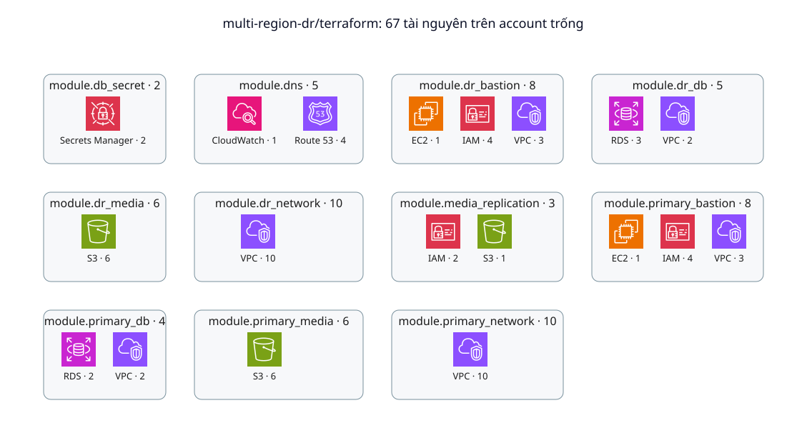

# Tài nguyên mỗi root của `multi-region-dr` tạo trên account trống

Trang này đếm, cho mỗi root Terraform của lab, các tài nguyên mà lần `apply` đầu tiên tạo trên account chưa có gì của root đó, chia
theo phần và theo loại, kèm một sơ đồ. Đọc trước khi chạy một root để biết plan đúng ra bao nhiêu `to add` và chúng thuộc dịch vụ
nào; các bước của buổi ở [README của lab](../README.md). Trang và sơ đồ sinh bằng `make inventory` từ plan của `terraform test` trên
provider giả: offline, không credential, không phí. Không sửa tay: `make inventory-check` ở CI đỏ khi trang hay sơ đồ lệch code. Lý
do chọn cách này, và các phương án đã bỏ:
[ADR-0081](https://github.com/anhnvcoder/svp-backend/blob/main/docs/adr/0081-terraform-inventory.md).

## Cách đọc

- Dòng `Plan: …` là dòng tóm tắt `terraform plan` in ra trên account trống; `to import` là tài nguyên root nhận quản qua khối `import`
  thay vì tạo.
- **Phần**: lời gọi module cấp root (`module.<tên>`); tài nguyên khai báo thẳng trong root thì là file `.tf` khai báo nó.
- Bảng theo loại đếm mọi bản của `count`, `for_each`; cột dịch vụ là dịch vụ AWS của icon trên sơ đồ.
- Sơ đồ: mỗi khối một phần, tiêu đề ghi số tài nguyên của phần; mỗi icon một dịch vụ AWS kèm số tài nguyên của dịch vụ đó trong phần.
  Icon lấy từ bộ AWS Architecture Icons ([nguồn và bản](../../docs/diagrams/README.md#icon)).

## Giới hạn

- Số là của **account trống chạy lần đầu**. Chạy root trên account đã có một phần của nó: plan thật chỉ hiện phần còn thiếu cùng các
  thay đổi.
- Giá trị: biến theo mặc định của `variables.tf`, rồi theo `*.auto.tfvars.example` của root nếu có; account id giả dạng
  `000000000000`. Buổi đặt biến khác (file `*.auto.tfvars`) thì số đổi theo.
- Data source trả giá trị giả của `scripts/inventory/<slug>.tftest.hcl` (provider giả, không đọc account). Mỗi root dưới đây nêu giả
  định nào của giá trị giả quyết định số.

## `multi-region-dr/terraform`

- Account trống ở cả hai region (`ap-southeast-1` chính, `us-east-1` DR); khoá KMS `aws/rds` của region DR
  là giá trị giả.
- Khi sinh bảng, khối `ephemeral` thay bằng giá trị giả của `scripts/inventory/multi-region-dr.override.hcl`
  (provider giả không trả được ephemeral); ephemeral không phải tài nguyên nên số không đổi.

`Plan: 67 to add, 0 to change, 0 to destroy.`

<picture>
  <source media="(prefers-color-scheme: dark)" srcset="../../docs/diagrams/inventory/multi-region-dr-dark.svg">
  
</picture>

| Phần | Tài nguyên |
| --- | ---: |
| `module.db_secret` | 2 |
| `module.dns` | 5 |
| `module.dr_bastion` | 8 |
| `module.dr_db` | 5 |
| `module.dr_media` | 6 |
| `module.dr_network` | 10 |
| `module.media_replication` | 3 |
| `module.primary_bastion` | 8 |
| `module.primary_db` | 4 |
| `module.primary_media` | 6 |
| `module.primary_network` | 10 |

| Loại | Dịch vụ | Số |
| --- | --- | ---: |
| `aws_cloudwatch_metric_alarm` | CloudWatch | 1 |
| `aws_db_instance` | RDS | 2 |
| `aws_db_instance_automated_backups_replication` | RDS | 1 |
| `aws_db_subnet_group` | RDS | 2 |
| `aws_iam_instance_profile` | IAM | 2 |
| `aws_iam_role` | IAM | 3 |
| `aws_iam_role_policy` | IAM | 3 |
| `aws_iam_role_policy_attachment` | IAM | 2 |
| `aws_instance` | EC2 | 2 |
| `aws_internet_gateway` | VPC | 2 |
| `aws_route53_health_check` | Route 53 | 1 |
| `aws_route53_record` | Route 53 | 2 |
| `aws_route53_zone` | Route 53 | 1 |
| `aws_route_table` | VPC | 4 |
| `aws_route_table_association` | VPC | 6 |
| `aws_s3_bucket` | S3 | 2 |
| `aws_s3_bucket_ownership_controls` | S3 | 2 |
| `aws_s3_bucket_policy` | S3 | 2 |
| `aws_s3_bucket_public_access_block` | S3 | 2 |
| `aws_s3_bucket_replication_configuration` | S3 | 1 |
| `aws_s3_bucket_server_side_encryption_configuration` | S3 | 2 |
| `aws_s3_bucket_versioning` | S3 | 2 |
| `aws_secretsmanager_secret` | Secrets Manager | 1 |
| `aws_secretsmanager_secret_version` | Secrets Manager | 1 |
| `aws_security_group` | VPC | 4 |
| `aws_subnet` | VPC | 6 |
| `aws_vpc` | VPC | 2 |
| `aws_vpc_security_group_egress_rule` | VPC | 4 |
| `aws_vpc_security_group_ingress_rule` | VPC | 2 |
