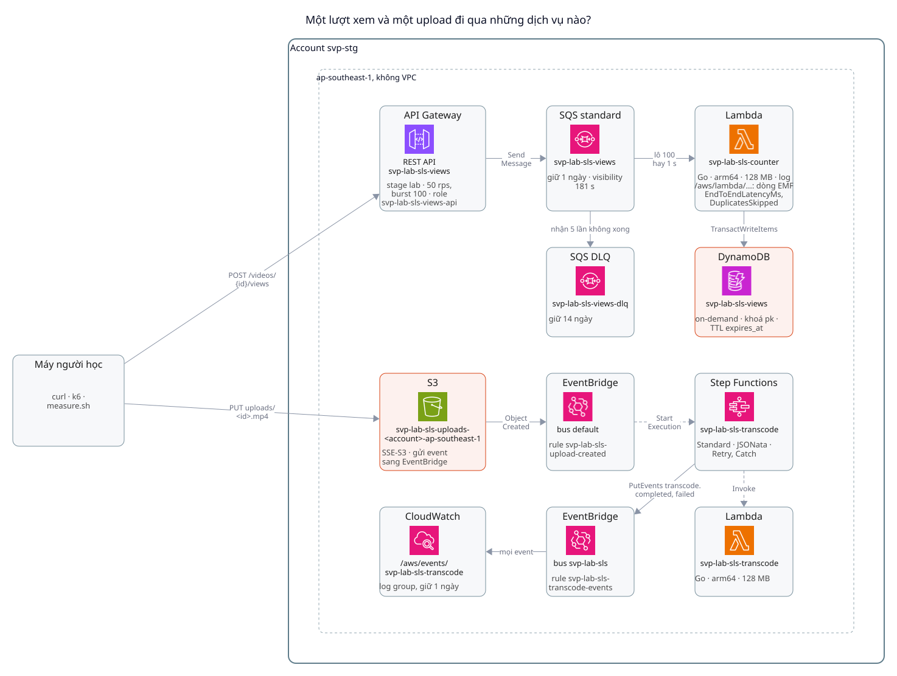
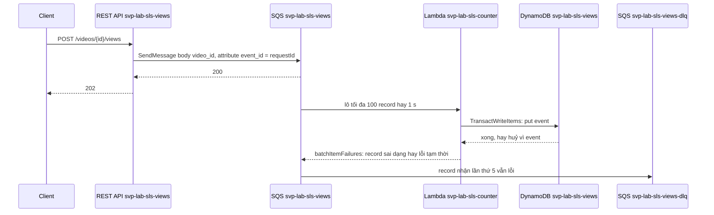
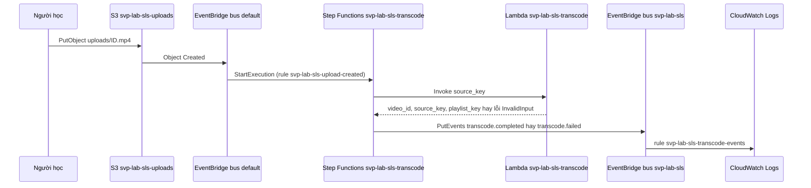

# Lab `serverless-variant`: bộ đếm lượt xem và điều phối transcode của svp bằng dịch vụ serverless

Bài dựng lại hai luồng của svp bằng dịch vụ managed, không cluster: ghi lượt xem qua API Gateway, SQS, Lambda Go và
DynamoDB; điều phối transcode bằng S3, EventBridge và Step Functions. Bài đo độ trễ, chống đếm trùng, đường thất bại và
chi phí mỗi triệu event, rồi so với đường EKS của svp ở [`docs/eks-vs-serverless.md`](docs/eks-vs-serverless.md).

| | |
| --- | --- |
| Dựng | Một root ở `svp-stg`, `ap-southeast-1`, không VPC: API Gateway → SQS → Lambda → DynamoDB; S3 → EventBridge → Step Functions |
| Trả lời | Hai luồng của svp làm serverless thì được, mất gì: độ trễ, đếm đúng một lần, đường lỗi, chi phí mỗi triệu event so với EKS |
| Phí | Theo lượng dùng, không theo giờ dựng: trần ~1,4 USD mỗi giờ khi endpoint bị gọi liên tục; ~0,2 USD mỗi buổi ([Chi phí](#chi-phí)) |
| Thời gian | Ước tính, chưa đo: dựng ~10 phút, đo ~50 phút, gỡ và quét ~10 phút; ~70 phút, trong buổi 2 giờ ([Chạy buổi](#chạy-buổi)) |

## Câu hỏi

- svp chạy engagement trên EKS: lượt xem đi Kafka, consumer gom lô 5.000 record hay 1 s rồi ghi Postgres một
  transaction mỗi lô, chống trùng theo offset
  ([ADR-0009](https://github.com/anhnvcoder/svp-backend/blob/main/docs/adr/0009-engagement-feed-stage2b.md) §3, §4).
  Transcode của stg, prd là MediaConvert, trạng thái job về qua EventBridge và SQS
  ([ADR-0066](https://github.com/anhnvcoder/svp-backend/blob/main/docs/adr/0066-mediaconvert-transcode.md)).
- Nếu làm hai luồng đó serverless thì được và mất gì: độ trễ API và đầu-cuối, đúng một lần khi SQS giao lại, đường lỗi
  của bước transcode, chi phí mỗi triệu event ở mức tải nhỏ và ở mục tiêu tải ~10.000 event/s của svp
  ([architecture §2](https://github.com/anhnvcoder/svp-backend/blob/main/docs/architecture.md#2-ràng-buộc-và-yêu-cầu-phi-chức-năng)).
- Số đo của bài là đầu vào cho ADR mới của `svp-backend` sau buổi chạy; đường chính không đổi.

## Thiết kế

<picture>
  <source media="(prefers-color-scheme: dark)" srcset="../docs/diagrams/serverless-variant/overview-dark.svg">
  
</picture>

Hai hàng trên là luồng ghi lượt xem, hai hàng dưới là luồng transcode; mỗi khối là một tài nguyên của root, đúng tên trong Terraform.
Nguồn sơ đồ: [`overview.d2`](../docs/diagrams/serverless-variant/overview.d2).

Hợp đồng giữa Terraform và Go (tên biến, bảng, khoá, attribute, lỗi, metric) là một: Terraform đặt `TABLE_NAME`,
`DEDUPE_TTL_SECONDS`, tên bảng và hàng đợi; code đọc chúng ở [`functions/`](functions/).

| Phần | Chọn | Phương án khác | Trạng thái ngành, nguồn |
| --- | --- | --- | --- |
| Cửa vào lượt xem | REST API tích hợp thẳng SQS `SendMessage` bằng mapping template, không Lambda ở đường vào | HTTP API với integration `SQS-SendMessage`; Lambda sau API rồi gửi SQS | Hiện hành; HTTP API rẻ hơn nhưng không biến đổi body request, không throttling theo client, không WAF [N7], [N8] |
| Hàng đợi | SQS standard, DLQ sau 5 lần nhận | SQS FIFO; Kinesis Data Streams, giữ thứ tự mỗi shard [N32] (so ở [`docs/eks-vs-serverless.md`](docs/eks-vs-serverless.md)) | Hiện hành; standard giao ít nhất một lần, có thể trùng và lệch thứ tự [N9] |
| Đếm đúng một lần | Một `TransactWriteItems` mỗi lượt xem: put mục `event#<event_id>` nếu chưa có cùng cộng `views` của `video#<id>` | Gom lô rồi cộng một lần mỗi video (như svp), chống trùng theo sequence number của Kinesis | Hiện hành [N21]; một mục chịu tối đa 1.000 WCU mỗi giây [N22] |
| Bảng | DynamoDB on-demand, khoá `pk`, TTL `expires_at` xoá mục chống trùng, PITR tắt | Provisioned capacity; PITR bật | Hiện hành; TTL xoá không tốn write capacity [N20] |
| Lambda | Go, `provided.al2023`, arm64, 128 MB | Runtime `go1.x` (đã ngừng), x86_64 | `go1.x` đã ngừng, Go chạy trên runtime OS-only [N17], [N18] |
| Điều phối transcode | Step Functions Standard, JSONata, `Retry` cho lỗi tạm thời của Lambda, `Catch` | Express; bridge trong cluster như ADR-0066 | Hiện hành; Standard chạy mỗi bước đúng một lần trừ khi `Retry`, giữ lịch sử 90 ngày [N25] |
| Sự kiện kết quả | Bus custom `svp-lab-sls`, rule chép mọi sự kiện vào CloudWatch Logs | SNS; loại bus custom mới ra mắt 9/2026 (thứ tự, lưu trữ sẵn) | Bus custom do `aws_cloudwatch_event_bus` tạo: provider `hashicorp/aws` 6.73 chưa có tham số chọn loại mới; loại mới là emerging [P7] |

Lý do các lựa chọn:

- **Không Lambda ở đường vào.** Mapping template dựng form `SendMessage` của SQS [N1], [N2]: body
  `{"video_id":"<id>"}` và attribute `event_id` = `$context.requestId`. Id lấy từ path qua `$util.escapeJavaScript`
  (thoát theo luật chuỗi JavaScript: id không đóng được chuỗi JSON) rồi `$util.urlEncode` (id nằm trọn trong một tham
  số form) [N3], nên id nào cũng không thêm được trường JSON hay tham số form. `$util.escapeJavaScript` biến `'` thành
  `\'`, không hợp lệ trong JSON [N3]: id chứa `'` cho body không phải JSON, `counter` từ chối như mọi id sai dạng, nên
  bài không thêm `.replaceAll` mà AWS chỉ cho trường hợp đó. Id không phải UUID vẫn thành message: `counter` trả nó về
  hàng đợi (`batchItemFailures`), sau 5 lần nhận SQS chuyển nó sang DLQ. Request có `Content-Type` không có template
  bị trả 415 (`NEVER`) thay vì tới SQS nguyên dạng [N4]. Lỗi của SQS thành 500 với body cố định, không lộ tên hàng
  đợi hay account.
- **`event_id` do client đổi được.** AWS ghi `$context.requestId` là id client ghi đè được [N3]. Client gửi lại cùng id
  chỉ làm lượt của chính nó bị bỏ; client đổi id mỗi lần thì đếm nhiều lần, giống route ẩn danh của svp, nên giới hạn
  nằm ở throttle của stage. Bài giữ đúng hợp đồng; đổi sang `$context.extendedRequestId` là quyết định của ADR sau buổi.
- **Throttle của stage là trần chi phí.** Mọi method của stage `lab` 50 request/s, bucket 100 [N5]: đủ cho k6 của buổi,
  thấp để người lạ tìm ra URL tiêu ít. AWS áp throttle theo kiểu cố gắng, là mục tiêu chứ không phải trần cứng [N5],
  nên trần mỗi giờ ở mục Chi phí là ước tính. Quota của account là 10.000 request/s chung mọi API của region [N6].
- **Hàng đợi.** Giữ 1 ngày (một buổi và phần phân tích), DLQ giữ 14 ngày, tối đa của SQS [N11]: message chuyển sang
  DLQ giữ thời điểm vào hàng đợi gốc, nên DLQ phải giữ lâu hơn [N10]. `maxReceiveCount` 5, mức AWS khuyên cho Lambda
  [N12]. Visibility timeout 181 s = 6 × timeout 30 s của `counter` + cửa sổ gom 1 s, theo hướng dẫn [N12].
- **Event source mapping.** Lô tối đa 100 record hay 1 s (lô trên 10 bắt buộc cửa sổ ≥ 1 s [N12]): chờ tối đa bằng
  consumer gom lô của svp. `ReportBatchItemFailures`: record lỗi về hàng đợi một mình, record xong trong lô không chạy
  lại [N13]. Lambda bắt đầu 5 lô song song, thêm tới 300 mỗi phút, tối đa 1.250 [N14]; quota concurrency của account
  mặc định 1.000 [N15].
- **Chống trùng.** `DEDUPE_TTL_SECONDS` = giữ của hàng đợi + 86.400 = 172.800 s: mục `event#` sống lâu hơn mọi lần
  giao lại. TTL xoá mục hết hạn trong vài ngày, không tốn write capacity [N20]. Mỗi lượt xem tốn hai write có
  transaction, mỗi write 2 WRU [N21], [P4].
- **IAM tối thiểu.** Role của API chỉ `sqs:SendMessage` tới `svp-lab-sls-views`. Role của `counter` chỉ đọc, xoá
  message của hàng đợi đó (đúng ba quyền của policy AWS `AWSLambdaSQSQueueExecutionRole` [N16]) và `PutItem`,
  `UpdateItem` trên bảng với điều kiện `dynamodb:EnclosingOperation` = `TransactWriteItems` [N21]: không ghi lẻ được.
  Role của state machine chỉ invoke `svp-lab-sls-transcode`, `events:PutEvents` lên bus `svp-lab-sls`, ghi log group
  của nó; các quyền log delivery dùng `*` vì AWS không hỗ trợ ARN cho chúng [N30]. EventBridge ghi vào log group qua
  resource policy, không qua role [N31]; policy chỉ mở log group `/aws/events/svp-lab-sls-transcode`.
- **Log group do Terraform tạo**, giữ 1 ngày: không để Lambda tự tạo `/aws/lambda/<tên>` ở lần chạy đầu [N19], nên
  destroy xoá được. Log group của state machine mang tiền tố `/aws/vendedlogs/states/` theo hướng dẫn [N30].
- **Transcode.** S3 bật gửi event sang EventBridge thì gửi mọi loại event; rule chỉ lấy `Object Created` dưới
  `uploads/` [N24]. State machine đưa `{"source_key": detail.object.key}` cho `transcode` [N24], [N27]. `Retry` bắt
  `Lambda.ServiceException`, `Lambda.AWSLambdaException`, `Lambda.SdkClientException`,
  `Lambda.TooManyRequestsException` (2 s, 6 lần, hệ số 2, như ví dụ của AWS) [N26]. `InvalidInput` không thử lại:
  `Catch` lấy `errorMessage` của Lambda bằng `$parse($states.errorOutput.Cause)` [N29] rồi phát `transcode.failed`;
  lỗi còn lại sau các lần thử cũng phát `transcode.failed`, để bên nghe luôn biết kết quả. PutEvents lỗi entry thì task
  lỗi `EventBridge.FailedEntry` [N28].
- **Không VPC, không CMK.** Mọi dịch vụ của bài là endpoint công khai của AWS; bucket SSE-S3, hàng đợi SSE-SQS, bảng
  và log group khoá của dịch vụ. trivy chỉ báo HIGH một chỗ (CMK của bucket), bỏ qua có lý do tại resource.

### Ghi một lượt xem



### Transcode một upload



## Đo gì

`scripts/measure.sh` in mỗi số kèm đơn vị và mốc UTC; test của nó là `scripts/measure-test.sh`.

| Số đo | Định nghĩa | Cách đo | Mong đợi |
| --- | --- | --- | --- |
| Độ trễ API | p50, p95, p99 của `http_req_duration` k6 cho `POST /videos/{id}/views`, từ máy người học, tải hằng 20 request/s trong 5 phút trên mười video | `measure.sh load` (k6 từ image ghim digest như `K6_IMAGE` của `svp-backend`) | AWS không công bố; ngưỡng tham chiếu p99 < 150 ms (SLO feed của svp, không phải SLO của route này); mọi request 202 |
| Độ trễ đầu-cuối | `EndToEndLatencyMs`: từ `SentTimestamp` của message tới lúc `counter` ghi xong, một dòng EMF mỗi lượt được cộng [N23] | `measure.sh e2e 15` (p50, p95, p99 của metric trong 15 phút) | Khoảng cửa sổ gom 1 s cộng thời gian ghi; svp chấp nhận số lượt xem trễ tối đa ~1 phút ([architecture §2](https://github.com/anhnvcoder/svp-backend/blob/main/docs/architecture.md#2-ràng-buộc-và-yêu-cầu-phi-chức-năng)) |
| Lượt trùng bị bỏ | Gửi hai lần cùng body, cùng `event_id` thẳng vào hàng đợi, như SQS giao lại | `measure.sh duplicate`: chờ riêng hai message vừa gửi, tới khi `views` của video là 1 và log của `counter` ghi một trong hai là `duplicate view skipped`; hạn chờ cộng một visibility timeout cho bản bị xung đột transaction rồi giao lại | `views` của video bằng 1; `DuplicatesSkipped` tăng 1 |
| Đường thất bại của state machine | Upload `uploads/<uuid>.txt` (đuôi sai) cạnh `uploads/<uuid>.mp4` | `measure.sh transcode` | `.mp4`: `transcode.completed`; `.txt`: `transcode.failed` mang `errorMessage`, execution `FAILED`, task `Transcode` chạy một lần (không `Retry`) |
| Id sai dạng | `POST /videos/not-a-uuid/views` | Bước 7 của [Chạy buổi](#chạy-buổi) | 202; sau 5 lần nhận (~5 × 181 s) ở DLQ [N10] |
| Chi phí mỗi triệu event | Tổng (lượng dùng × đơn giá) chia số lượt đếm, lượng dùng lấy từ CloudWatch trong cửa sổ đo | `measure.sh e2e` in số request API, invocation và thời lượng trung bình của Lambda, message SQS, nhận rỗng, WRU của DynamoDB; tính theo bảng ở mục Chi phí | Gần ước tính ~7,8 USD (mục Chi phí); lệch nhiều thì tìm khoản lệch |

## Tài nguyên

Bài có một root. Số tài nguyên, chia theo phần và theo loại, ở trang [inventory](docs/inventory.md) (sinh từ plan trên provider giả).

| Root | Việc | Inventory |
| --- | --- | --- |
| `serverless-variant/terraform` | Cả hai luồng: API, hàng đợi, DLQ, hai hàm, bảng, bucket, state machine, bus | [mục của root][inv-root] |

[inv-root]: docs/inventory.md#serverless-variantterraform

## Chi phí

Đơn giá on-demand, USD, `ap-southeast-1`, đọc 2026-11-17 từ file Price List bulk công khai (cột URL) và trang giá.
Free Tier không tính. Buổi tính 2 giờ. Bài không có tài nguyên tính theo giờ: mọi khoản theo lượng dùng.

| Tài nguyên | Đơn vị | Đơn giá | URL | Ngày đọc |
| --- | --- | --- | --- | --- |
| API Gateway REST API, 333 triệu request đầu mỗi tháng | 1 triệu request | 4,25 | [P1] | 2026-11-17 |
| API Gateway HTTP API, 300 triệu đầu (không dựng, để so) | 1 triệu request | 1,25 | [P1] | 2026-11-17 |
| SQS standard, mỗi request tới 64 KB | 1 triệu request | 0,40 | [P2] | 2026-11-17 |
| Lambda arm64, request | 1 triệu request | 0,20 | [P3] | 2026-11-17 |
| Lambda arm64, thời lượng | GB-giây | 0,0000133334 | [P3] | 2026-11-17 |
| DynamoDB on-demand, write request unit | 1 triệu WRU | 0,71 | [P4] | 2026-11-17 |
| DynamoDB, lưu trữ | GB-tháng | 0,285 | [P4] | 2026-11-17 |
| CloudWatch Logs, nạp log (Standard, 10 TB đầu) | GB | 0,70 | [P5] | 2026-11-17 |
| CloudWatch metric tuỳ chỉnh (EMF), tính theo giờ | metric-tháng | 0,30 | [P5] | 2026-11-17 |
| Step Functions Standard | state transition | 0,000025 | [P6] | 2026-11-17 |
| EventBridge: event tuỳ chỉnh, event dữ liệu S3 đã bật | 1 triệu event | 1,00 | [P7] | 2026-11-17 |
| S3 PUT | 1.000 request | 0,005 | [P8] | 2026-11-17 |
| Kinesis Data Streams provisioned (không dựng, để so) | shard-giờ | 0,0184 | [P9] | 2026-11-17 |
| Kinesis PUT payload unit 25 KB (không dựng, để so) | 1 triệu unit | 0,0195 | [P9] | 2026-11-17 |

Một triệu lượt xem, **ước tính từ đơn giá** (giả định ghi rõ; buổi đo thay bằng số thật):

| Khoản | Cách tính | USD |
| --- | --- | --- |
| API Gateway | 1.000.000 × 4,25 / 10⁶ | 4,25 |
| SQS | 1 `SendMessage` mỗi lượt, giả định nhận và xoá theo lô 10: 1,2 triệu request × 0,40 / 10⁶ | 0,48 |
| DynamoDB | 2 write có transaction × 2 WRU = 4 WRU mỗi lượt [N21]: 4 triệu × 0,71 / 10⁶ | 2,84 |
| Lambda | 10.000 invocation (lô 100) × 0,20 / 10⁶; giả định 10 ms mỗi lượt ở 128 MB: 1.250 GB-giây × 0,0000133334 | 0,02 |
| CloudWatch Logs | giả định ~300 B log mỗi lượt (dòng EMF): 0,3 GB × 0,70 | 0,21 |
| **Cộng** | | **~7,8** |

Với HTTP API thay REST API: ~4,8 USD mỗi triệu. Khoản lớn nhất là API Gateway rồi DynamoDB (chống trùng gấp đôi số write).

Trần mỗi giờ khi endpoint bị gọi liên tục đúng mức throttle (50 request/s = 180.000 request mỗi giờ; throttle là mục
tiêu cố gắng [N5], nên đây là ước tính):

| Khoản | Cách tính | USD mỗi giờ |
| --- | --- | --- |
| API Gateway | 180.000 × 4,25 / 10⁶ | 0,77 |
| DynamoDB | 180.000 × 4 WRU × 0,71 / 10⁶ | 0,51 |
| SQS | 180.000 × 1,2 request × 0,40 / 10⁶; id sai dạng nhận 5 lần nhưng không ghi DynamoDB | 0,09 |
| Lambda, Logs | theo dòng trên | < 0,05 |
| **Trần mỗi giờ** | | **~1,4** |

Mỗi buổi 2 giờ (ba lượt k6 tới 20 request/s × 5 phút và các phép thử nhỏ, khoảng 20.000 lượt xem):

| Khoản | Cách tính | USD |
| --- | --- | --- |
| Lượt xem | 20.000 × 7,8 / 10⁶ | 0,16 |
| Poll rỗng của Lambda trên SQS | giả định tới 10 request mỗi giây cả buổi: 72.000 × 0,40 / 10⁶ | 0,03 |
| Metric EMF | 2 metric × 0,30 / 730 × 2 giờ | < 0,01 |
| Step Functions, EventBridge, S3, Logs của transcode | vài chục execution, mỗi cái 4 transition | < 0,01 |
| **Cộng mỗi buổi** | | **~0,2** |

Rủi ro: endpoint không xác thực, ai có URL đều gọi được trong lúc buổi chạy; trần ~1,4 USD mỗi giờ ở trên, hết khi
destroy. Không đăng URL ở đâu.

## Điều kiện trước

- [ ] **Trên máy:** AWS CLI v2, `jq`, Docker (k6 chạy từ image ghim digest), Go theo `functions/go.mod`, Terraform 1.15, `curl`,
  `uuidgen`.
- [ ] **Mã nguồn:** gốc repo `svp-labs` trên `main`, sau khi PR của bài đã merge. Mọi lệnh dưới đây chạy từ gốc repo.
- [ ] **Profile** `anhnv-stg` (account `svp-stg`) đã ghi như trang
  [thiết lập account của `svp-infra`](https://github.com/anhnvcoder/svp-infra/blob/main/docs/runbooks/accounts-setup.md); đăng nhập SSO một
  lần cho mọi profile cùng phiên:

  ```sh
  AWS_PROFILE=anhnv-sso aws sso login --no-cli-pager --region us-east-1
  ```

- [ ] **Biến account:** `SVP_AWS_STG_ACCOUNT_ID` (12 số của `svp-stg`) export trong terminal, không ghi vào file nào.
- [ ] **Thư mục buổi** ([`terraform-commands.md`](../docs/terraform-commands.md#thư-mục-buổi)):

  ```sh
  export SVP_LAB_SESSION_DIR="$PWD/.session/serverless-variant-$(date -u +%Y%m%dT%H%M%SZ)" && mkdir -p "$SVP_LAB_SESSION_DIR"
  ```

- [ ] **Build hai hàm trước `plan`.** `archive_file` của root đọc `build/<tên>/bootstrap` ngay lúc `plan`, nên thiếu bước này thì
  plan dừng ở lỗi đọc file. Mong đợi hai dòng `lambda-build counter`, `lambda-build transcode`; dán lại cả hai.

  ```sh
  make lambda-build
  ```

- [ ] **Lab chạy trước:** không cần. Bài không dùng VPC hay tài nguyên của lab khác.

## Chạy buổi

Lệnh `terraform` theo khuôn của [`docs/terraform-commands.md`](../docs/terraform-commands.md) (lý do từng phần ở đó). Buổi chạy trong
account `svp-stg` bằng profile `anhnv-stg`. Thời gian ở tóm tắt là ước tính từ các lần chờ trong bước: k6 5 phút, chờ metric 5 phút,
DLQ ít nhất 15 phút (chạy song song các bước 8–12), thử trùng tối đa 180 s cộng một visibility timeout 181 s.

1. **Kiểm account** trước lệnh ghi đầu tiên. Dán lại output; nó phải bằng `$SVP_AWS_STG_ACCOUNT_ID`.

   ```sh
   AWS_PROFILE=anhnv-stg aws sts get-caller-identity --no-cli-pager --query Account --output text \
     --region ap-southeast-1
   ```

2. **Init.** Root không có backend (state local); `init` chỉ tải provider theo lock file. Mong đợi `Terraform has been successfully
   initialized!`.

   ```sh
   AWS_PROFILE=anhnv-stg terraform -chdir=serverless-variant/terraform init -input=false
   ```

3. **Plan** ra file, rồi bản văn bản vào thư mục buổi.

   ```sh
   AWS_PROFILE=anhnv-stg \
   TF_VAR_account_id="$SVP_AWS_STG_ACCOUNT_ID" \
     terraform -chdir=serverless-variant/terraform plan -input=false -out=serverless-variant.tfplan
   AWS_PROFILE=anhnv-stg terraform -chdir=serverless-variant/terraform show -no-color serverless-variant.tfplan \
     > "$SVP_LAB_SESSION_DIR/serverless-variant-plan.txt"
   grep -E '^\s*# .* (will|must) be|^Plan:' "$SVP_LAB_SESSION_DIR/serverless-variant-plan.txt"
   ```

   - **Mong đợi:** mọi dòng `will be created`; dòng `Plan:` bằng dòng của root ở [trang inventory][inv-root]. Account thật không đổi số:
     inventory dùng id giả cùng dạng.
   - **Dán lại** dòng `Plan:`.
   - **Bẫy:** lỗi của `data.archive_file` nhắc tới `build/<tên>/bootstrap` là chưa `make lambda-build` (mục Điều kiện trước).
     `No value for required variable` là thiếu `SVP_AWS_STG_ACCOUNT_ID` trong terminal.

4. **Apply** đúng file plan đã đọc. Mong đợi `Apply complete!`; dán lại dòng đó.

   ```sh
   AWS_PROFILE=anhnv-stg terraform -chdir=serverless-variant/terraform apply -input=false serverless-variant.tfplan \
     && rm serverless-variant/terraform/serverless-variant.tfplan
   ```

5. **Plan lại**, không `-out`. Mong đợi `No changes. Your infrastructure matches the configuration.`; dòng đổi nào còn lại là lỗi code:
   dừng, dán plan.

   ```sh
   AWS_PROFILE=anhnv-stg \
   TF_VAR_account_id="$SVP_AWS_STG_ACCOUNT_ID" \
     terraform -chdir=serverless-variant/terraform plan -input=false
   ```

6. **Lấy URL và gửi một lượt xem.** Lệnh `curl` phải in `202`; sau vài giây `get-item` in `1`. Không đăng URL ở đâu (mục Chi phí).

   ```sh
   URL=$(AWS_PROFILE=anhnv-stg terraform -chdir=serverless-variant/terraform output -raw view_url)
   VIDEO=$(uuidgen | tr '[:upper:]' '[:lower:]')
   curl -s -o /dev/null -w '%{http_code}\n' -X POST "${URL/\{id\}/$VIDEO}"
   AWS_PROFILE=anhnv-stg aws dynamodb get-item --no-cli-pager --region ap-southeast-1 --table-name svp-lab-sls-views \
     --key "{\"pk\":{\"S\":\"video#$VIDEO\"}}" --query 'Item.views.N' --output text
   ```

7. **Id sai dạng.** Gửi một id sai dạng; nó đi hết 5 lần nhận trong khi các bước sau chạy. `curl` in `202`. Chạy lệnh thứ hai sau ít
   nhất 15 phút (sau bước 12 là vừa): nó in `1` (một message ở DLQ). Dán lại cả hai.

   ```sh
   curl -s -o /dev/null -w '%{http_code}\n' -X POST "${URL/\{id\}/not-a-uuid}"
   AWS_PROFILE=anhnv-stg aws sqs get-queue-attributes --no-cli-pager --region ap-southeast-1 \
     --queue-url "$(AWS_PROFILE=anhnv-stg aws sqs get-queue-url --no-cli-pager --region ap-southeast-1 \
       --queue-name svp-lab-sls-views-dlq --query QueueUrl --output text)" \
     --attribute-names ApproximateNumberOfMessages --query Attributes.ApproximateNumberOfMessages --output text
   ```

8. **Độ trễ API.** k6 20 request/s trong 5 phút. Dán lại các dòng `api latency`, `requests`.

   ```sh
   serverless-variant/scripts/measure.sh load "$URL" 20 5m
   ```

9. **Độ trễ đầu-cuối và lượng dùng.** Chờ 5 phút sau lượt k6 rồi chạy. Dán lại toàn bộ output; tìm `end-to-end latency`, rồi các dòng
   đếm dùng cho chi phí mỗi triệu event.

   ```sh
   SVP_AWS_STG_ACCOUNT_ID=$SVP_AWS_STG_ACCOUNT_ID serverless-variant/scripts/measure.sh e2e 15
   ```

10. **Lượt trùng.** Dán lại dòng `views of video ...: 1 (expected 1), message ... skipped as a duplicate`. Dòng `counted 2 times`
    nghĩa là cùng `event_id` bị đếm hai lần; dòng `no outcome after` nghĩa là chưa thấy kết quả của hai message trong hạn chờ, không
    phải đếm trùng: đọc log group `/aws/lambda/svp-lab-sls-counter`.

    ```sh
    SVP_AWS_STG_ACCOUNT_ID=$SVP_AWS_STG_ACCOUNT_ID serverless-variant/scripts/measure.sh duplicate
    ```

11. **Hai đường của state machine.** Dán lại hai dòng `uploads/...: transcode.completed`, `transcode.failed (...)`.

    ```sh
    SVP_AWS_STG_ACCOUNT_ID=$SVP_AWS_STG_ACCOUNT_ID serverless-variant/scripts/measure.sh transcode
    ```

12. **Lịch sử execution lỗi.** Task `Transcode` chỉ một lần `TaskFailed` (không thử lại `InvalidInput`), execution `FAILED` với lỗi
    `TranscodeFailed`. Dán lại output.

    ```sh
    ARN=$(AWS_PROFILE=anhnv-stg aws stepfunctions list-executions --no-cli-pager --region ap-southeast-1 \
      --status-filter FAILED \
      --state-machine-arn "arn:aws:states:ap-southeast-1:$SVP_AWS_STG_ACCOUNT_ID:stateMachine:svp-lab-sls-transcode" \
      --max-results 1 --query 'executions[0].executionArn' --output text)
    AWS_PROFILE=anhnv-stg aws stepfunctions get-execution-history --no-cli-pager --region ap-southeast-1 \
      --execution-arn "$ARN" \
      --query 'events[].type' --output text
    ```

## Dọn dẹp

Chạy đủ ba bước trước khi kết thúc buổi, kể cả khi buổi dừng giữa chừng (bước 4 lỗi giữa chừng: mục
[Khi apply lỗi giữa chừng](../docs/terraform-commands.md#khi-apply-lỗi-giữa-chừng)).

1. **Plan gỡ**, đọc, rồi apply đúng file đó. Bucket xoá cả object (`force_destroy`), log group xoá theo.

   ```sh
   AWS_PROFILE=anhnv-stg \
   TF_VAR_account_id="$SVP_AWS_STG_ACCOUNT_ID" \
     terraform -chdir=serverless-variant/terraform plan -destroy -input=false -out=serverless-variant-destroy.tfplan
   AWS_PROFILE=anhnv-stg terraform -chdir=serverless-variant/terraform show -no-color serverless-variant-destroy.tfplan \
     > "$SVP_LAB_SESSION_DIR/serverless-variant-destroy-plan.txt"
   grep -E '^\s*# .* (will|must) be|^Plan:' "$SVP_LAB_SESSION_DIR/serverless-variant-destroy-plan.txt"
   ```

   Đọc `serverless-variant-destroy-plan.txt` trong thư mục buổi; đúng như mong đợi (dưới) thì sang khối sau, apply đúng file plan đã đọc:

   ```sh
   AWS_PROFILE=anhnv-stg terraform -chdir=serverless-variant/terraform apply -input=false serverless-variant-destroy.tfplan \
     && rm serverless-variant/terraform/serverless-variant-destroy.tfplan
   ```

   - **Mong đợi:** `Plan: 0 to add, 0 to change, N to destroy.`, N bằng số `to add` ở [trang inventory][inv-root]; rồi `Destroy
     complete!`.
   - **Dán lại** dòng `Plan:` và dòng `Destroy complete!`.

2. **Quét sót**, chỉ đọc, profile và region nằm trong script. Mong đợi mọi dòng `none` và `sweep: nothing left`; có dòng `LEFT` thì
   xoá thứ đó rồi quét lại; dòng `ERROR` thường là phiên SSO hết hạn: đăng nhập lại rồi quét lại. Dán lại toàn bộ output.

   ```sh
   serverless-variant/scripts/sweep.sh
   ```

3. **Xoá file của buổi** khi sweep sạch và số đo đã ghi (mục Sau buổi): state local, file plan còn sót, zip của build (chúng giữ
   account ID, ARN, URL), rồi thư mục buổi.

   ```sh
   rm -f serverless-variant/terraform/terraform.tfstate serverless-variant/terraform/terraform.tfstate.backup \
     serverless-variant/terraform/*.tfplan serverless-variant/build/*.zip
   rm -rf "${SVP_LAB_SESSION_DIR:?}"
   ```

## Sau buổi

Không viết kết luận vào trang này trước buổi. Sau buổi:

- **Số đo cần ghi**, kèm mốc UTC mà `measure.sh` in: p50, p95, p99 của độ trễ API (bước 8) và đầu-cuối (bước 9); kết quả lượt trùng
  (bước 10), hai đường transcode (bước 11, 12), message ở DLQ (bước 7); lượng dùng của bước 9 nhân đơn giá ở mục Chi phí thành chi phí
  mỗi triệu event đo được, so với ước tính ~7,8 USD.
- **Trang so sánh:** thay số ước tính của [`docs/eks-vs-serverless.md`](docs/eks-vs-serverless.md) bằng số đo.
- **ADR mới ở `svp-backend`** nhận kết luận (giữ đường EKS hay chuyển luồng nào sang serverless, `$context.requestId` hay
  `$context.extendedRequestId`); README này thêm mục kết luận trỏ tới ADR đó.

## Ôn SAP-C03

Task statement của exam guide SAP-C03 [N33] mà bài phục vụ:

- 1.1 Design architectures built for the cloud: SQS standard với idempotency ở bên nhận, state ngoài ở DynamoDB, workflow bền bằng
  Step Functions, cửa vào API Gateway, Lambda scale theo hàng đợi.
- 1.5 Design data, storage, and database architectures: chọn DynamoDB theo kiểu truy cập, giới hạn ghi của một partition.
- 2.1 Design identity security architectures: role tối thiểu mỗi thành phần, điều kiện `dynamodb:EnclosingOperation`.
- 3.1 Design architectures based on AWS pricing models: REST so với HTTP API, Step Functions Standard so với Express, Lambda arm64.
- 3.4 Optimize storage and database costs: DynamoDB on-demand, TTL không tốn write, log giữ 1 ngày.
- 5.3 Design observability and monitoring solutions: metric bằng EMF từ log của Lambda.
- 5.4 Design operational automation and resilient systems: DLQ, partial batch response, `Retry` có backoff, `Catch`.

### 1. Đếm đúng một lần trên hàng đợi giao ít nhất một lần (task 1.1)

Một ứng dụng nhận lượt xem qua SQS standard, Lambda đọc theo lô và cộng vào bộ đếm. Thỉnh thoảng một message được giao hai lần và
lượt xem bị cộng hai lần. Yêu cầu: không đếm trùng, giữ thông lượng cao, ít thay đổi nhất.

- A. Chuyển sang SQS FIFO với deduplication theo nội dung.
- B. Mỗi message mang id; Lambda ghi trong một `TransactWriteItems`: put mục `event#<id>` có điều kiện chưa tồn tại, cùng cộng bộ đếm.
- C. Tăng visibility timeout lên 12 giờ để message không bị giao lại.
- D. Đặt `maxReceiveCount` bằng 1 để message lỗi sang DLQ ngay.

**Đáp án:** B. Standard queue giao ít nhất một lần [N9]; chống trùng phải nằm ở bên nhận. Transaction gộp phép kiểm id và phép cộng
thành một: lượt giao lại huỷ cả transaction, không cộng [N21].

**Vì sao không phải:**

- A: FIFO chỉ bỏ trùng lúc gửi, trong cửa sổ 5 phút [N34]; Lambda ghi xong mà xoá message không thành thì message vẫn được giao lại.
- C: visibility timeout dài chỉ hoãn lần giao lại, không bỏ được trùng, và làm message lỗi chờ lâu.
- D: mất lượt xem hợp lệ gặp lỗi tạm thời; không chống trùng.

**Trong lab:** bước 10 của [Chạy buổi](#chạy-buổi) gửi cùng `event_id` hai lần thẳng vào hàng đợi; `views` phải là 1.

### 2. Cửa vào ghi vào hàng đợi, không Lambda (task 3.1)

Một endpoint công khai nhận POST và chỉ cần đẩy body vào SQS. Yêu cầu: không code ở đường vào, giới hạn tốc độ để chặn chi phí khi
bị gọi tràn, chặn được request có body sai dạng trước khi vào hàng đợi.

- A. HTTP API với integration `SQS-SendMessage`.
- B. REST API, request validator kiểm body theo model JSON Schema, integration AWS tới `SendMessage` bằng mapping
  template, throttle ở stage.
- C. Application Load Balancer với target là Lambda gửi SQS.
- D. REST API, Lambda proxy integration gửi SQS.

**Đáp án:** B. Chỉ REST API có request validation [N7]: body không khớp model bị trả 400 trước integration, không tới
hàng đợi [N36]. Mapping template dựng form `SendMessage` không cần code [N1], [N3]; throttle của stage giới hạn tốc độ [N5].

**Vì sao không phải:**

- A: rẻ hơn (1,25 so với 4,25 USD mỗi triệu request [P1]), throttle được theo stage, route [N37] và gửi SQS không code [N8],
  nhưng không có request validation [N7]: body sai dạng vẫn vào hàng đợi. HTTP API cũng không giới hạn theo client, không
  biến đổi body [N7].
- C: thêm Lambda ở đường vào, trái yêu cầu không code; ALB tính theo giờ dù không có tải.
- D: thêm Lambda ở đường vào, trả thêm tiền mỗi request và phải viết, vận hành code.

**Trong lab:** module `view-ingest` không bật request validator: body của message do template dựng từ id trên path, nên
id sai dạng vẫn vào SQS rồi sang DLQ (bước 7 của [Chạy buổi](#chạy-buổi)); lab chỉ trả 415 cho request có `Content-Type`
không có template [N4]. Trần chi phí mỗi giờ ở [Chi phí](#chi-phí), so REST với HTTP API ở đó.

### 3. Điều phối transcode: Standard hay Express (task 1.1, 3.1)

Mỗi upload chạy một workflow ba bước: gọi Lambda kiểm file, gọi transcode, phát event kết quả. Bước transcode không idempotent; công ty
cần xem lại lịch sử từng lần chạy khi có khiếu nại. Lượng: vài nghìn upload mỗi ngày.

- A. Step Functions Express, log execution ra CloudWatch Logs.
- B. Step Functions Standard với `Retry` cho lỗi tạm thời của Lambda, `Catch` phát event lỗi.
- C. Chuỗi Lambda gọi nhau bất đồng bộ, lỗi vào DLQ của Lambda.
- D. SQS giữa mỗi bước, mỗi bước một Lambda.

**Đáp án:** B. Standard chạy mỗi bước đúng một lần trừ khi có `Retry`, giữ lịch sử 90 ngày; hợp với việc không idempotent [N25].

**Vì sao không phải:**

- A: Express chạy ít nhất một lần, tối đa 5 phút [N25]: bước không idempotent có thể chạy hai lần.
- C: không có lịch sử tập trung, lỗi rải ở nhiều DLQ, tự viết retry.
- D: tự xây điều phối, không có trạng thái của cả workflow.

**Trong lab:** module `transcode-flow`; bước 11, 12 thấy task `Transcode` không chạy lại khi `InvalidInput`.

### 4. Message lỗi trong lô SQS (task 5.4)

Lambda đọc SQS theo lô 100. Một record sai dạng làm cả lô lỗi, 99 record tốt bị xử lý lại nhiều lần rồi cùng vào DLQ. Yêu cầu: chỉ
record lỗi quay lại hàng đợi, record hỏng cuối cùng nằm ở DLQ để xem.

- A. Bật `ReportBatchItemFailures`, trả `batchItemFailures` cho record lỗi; DLQ với `maxReceiveCount` 5, giữ lâu hơn hàng đợi gốc.
- B. Giảm lô xuống 1.
- C. Bắt mọi lỗi trong Lambda rồi trả thành công.
- D. Bật Lambda destination khi lỗi cho event source mapping SQS.

**Đáp án:** A. Partial batch response chỉ trả record lỗi về hàng đợi [N13]; DLQ giữ thời điểm vào hàng đợi gốc nên phải giữ lâu hơn
[N10]; 5 lần nhận là mức AWS khuyên [N12].

**Vì sao không phải:**

- B: đúng nhưng số invocation gấp 100 lần, chi phí và độ trễ tăng.
- C: mất record lỗi, không ai biết.
- D: với SQS, message lỗi đi DLQ đặt ở redrive policy của hàng đợi nguồn [N12], không qua cấu hình phía Lambda.

**Trong lab:** bước 7 gửi id sai dạng; sau 5 lần nhận nó nằm ở `svp-lab-sls-views-dlq`.

### 5. Bộ đếm nóng trên DynamoDB (task 1.5)

Video lan truyền nhận 5.000 lượt xem mỗi giây; mỗi lượt cộng thẳng vào một mục `video#<id>`. Bảng on-demand còn xa trần của bảng nhưng
ghi vào mục đó bị throttle.

- A. Chuyển bảng sang provisioned 10.000 WCU.
- B. Gom lượt xem theo lô rồi cộng một lần mỗi video, hay chia bộ đếm thành nhiều mục (write sharding) và cộng lại lúc đọc.
- C. Thêm DAX trước bảng.
- D. Thêm global secondary index trên `video_id`.

**Đáp án:** B. Một partition tối đa 1.000 WCU mỗi giây [N22], [N35]; tải dồn vào một khoá thì throttle dù bảng còn dư. Gom lô hay
sharding chia ghi ra nhiều lần ít hơn hay nhiều khoá [N35].

**Vì sao không phải:**

- A: capacity của bảng không nâng trần của một partition.
- C: DAX là cache đọc, không giảm ghi.
- D: index thêm ghi, không chia tải của khoá gốc.

**Trong lab:** bài cộng từng lượt (hai write có transaction mỗi lượt, mục Chi phí); svp gom lô như phương án B. So ở
[`docs/eks-vs-serverless.md`](docs/eks-vs-serverless.md).

### 6. Quyền tối thiểu cho hàm ghi có transaction (task 2.1)

Hàm Lambda chỉ được ghi bảng bằng `TransactWriteItems` (put mục chống trùng cùng cập nhật bộ đếm), không bao giờ ghi lẻ một mục.

- A. Cho `dynamodb:TransactWriteItems` trên bảng.
- B. Cho `dynamodb:PutItem`, `dynamodb:UpdateItem` trên bảng, điều kiện `dynamodb:EnclosingOperation` = `TransactWriteItems`.
- C. Policy AWS managed `AmazonDynamoDBFullAccess`.
- D. Cho `dynamodb:*` trên bảng, permissions boundary chặn `DeleteItem`.

**Đáp án:** B. Quyền của `Put`, `Update` trong transaction là quyền `PutItem`, `UpdateItem`; điều kiện
`dynamodb:EnclosingOperation` chỉ cho chúng khi nằm trong transaction [N21].

**Vì sao không phải:**

- A: không cấp `PutItem`, `UpdateItem`, quyền mà các thao tác trong transaction cần [N21]: hàm không ghi được.
- C, D: rộng hơn cần; vẫn ghi lẻ được.

**Trong lab:** statement `CountInTransactions` của module `counter` ở `terraform/main.tf`; mục Thiết kế, ý "IAM tối thiểu".

## Kiểm offline

Chạy từ gốc repo, không chạm AWS:

```sh
make tf-check DIRS=serverless-variant
make go-test lambda-build DIRS=serverless-variant
make shellcheck DIRS=serverless-variant
bash serverless-variant/scripts/measure-test.sh
make docs-check DOCS='serverless-variant/**/*.md'
make diagrams-check NAMES=serverless-variant
make lock DIRS=serverless-variant  # only when the root changes its providers
```

## Tham chiếu

- `terraform/`: root, provider `aws` (`ap-southeast-1`), `allowed_account_ids`, tag mặc định, `archive_file` nén
  `build/<tên>/bootstrap`.
- `modules/function/`: một hàm Go arm64, role của nó, log group `/aws/lambda/<tên>`.
- `modules/view-ingest/`: REST API, mapping template sang SQS, throttle của stage, hàng đợi và DLQ, role của API.
- `modules/view-counter/`: bảng DynamoDB, event source mapping từ hàng đợi tới `counter`.
- `modules/transcode-flow/`: bucket upload, rule `Object Created`, state machine và role, bus `svp-lab-sls`, rule chép
  sự kiện vào CloudWatch Logs.
- `functions/`: code Go của `counter`, `transcode`.
- [`docs/inventory.md`](docs/inventory.md): tài nguyên root tạo trên account trống, sinh bằng `make inventory`.
- `../docs/diagrams/serverless-variant/overview.d2`: sơ đồ của mục Thiết kế, sinh SVG bằng `make diagrams`.
- `scripts/measure.sh`: `load`, `e2e`, `duplicate`, `transcode` trên máy người học; `scripts/measure-test.sh`.
- `scripts/sweep.sh`: quét sót, chỉ đọc.
- Tên và tag mà script tra cứu: tag `Lab = serverless-variant`, tiền tố `svp-lab-sls-`; API `svp-lab-sls-views` stage
  `lab`; hàng đợi `svp-lab-sls-views`, `svp-lab-sls-views-dlq`; bảng `svp-lab-sls-views`; hàm `svp-lab-sls-counter`,
  `svp-lab-sls-transcode`; state machine `svp-lab-sls-transcode`; bus `svp-lab-sls`; log group
  `/aws/events/svp-lab-sls-transcode`, `/aws/lambda/svp-lab-sls-counter` (dòng `duplicate view skipped` mang
  `message_id`); bucket `svp-lab-sls-uploads-<account>-ap-southeast-1`; metric `svp-lab-sls` /
  `EndToEndLatencyMs`, `DuplicatesSkipped`, dimension `Function = counter`.

## Nguồn

Tài liệu AWS đọc 2026-11-17.

- [N1] API Gateway, Tutorial: Create a REST API with an AWS integration (role thực thi cho tích hợp dịch vụ AWS):
  <https://docs.aws.amazon.com/apigateway/latest/developerguide/getting-started-aws-proxy.html>
- [N2] Amazon SQS API Reference, SendMessage (request dạng form `Action=SendMessage`, `MessageAttribute.N`):
  <https://docs.aws.amazon.com/AWSSimpleQueueService/latest/APIReference/API_SendMessage.html>
- [N3] API Gateway, Variables for data transformations (`$input.params`, `$util.escapeJavaScript`, `$util.urlEncode`,
  `$context.requestId`): <https://docs.aws.amazon.com/apigateway/latest/developerguide/api-gateway-mapping-template-reference.html>
- [N4] API Gateway, Method request behavior for payloads without mapping templates:
  <https://docs.aws.amazon.com/apigateway/latest/developerguide/integration-passthrough-behaviors.html>
- [N5] API Gateway, Throttle requests to your REST APIs:
  <https://docs.aws.amazon.com/apigateway/latest/developerguide/api-gateway-request-throttling.html>
- [N6] API Gateway, Quotas: <https://docs.aws.amazon.com/apigateway/latest/developerguide/limits.html>
- [N7] API Gateway, Choose between REST APIs and HTTP APIs:
  <https://docs.aws.amazon.com/apigateway/latest/developerguide/http-api-vs-rest.html>
- [N8] API Gateway, Integration subtype reference (HTTP API, `SQS-SendMessage`):
  <https://docs.aws.amazon.com/apigateway/latest/developerguide/http-api-develop-integrations-aws-services-reference.html>
- [N9] Amazon SQS, Standard queues:
  <https://docs.aws.amazon.com/AWSSimpleQueueService/latest/SQSDeveloperGuide/standard-queues.html>
- [N10] Amazon SQS, Using dead-letter queues:
  <https://docs.aws.amazon.com/AWSSimpleQueueService/latest/SQSDeveloperGuide/sqs-dead-letter-queues.html>
- [N11] Amazon SQS, Message quotas (giữ message 60 s tới 14 ngày):
  <https://docs.aws.amazon.com/AWSSimpleQueueService/latest/SQSDeveloperGuide/quotas-messages.html>
- [N12] AWS Lambda, Creating and configuring an Amazon SQS event source mapping:
  <https://docs.aws.amazon.com/lambda/latest/dg/services-sqs-configure.html>
- [N13] AWS Lambda, Handling errors for an SQS event source (partial batch response):
  <https://docs.aws.amazon.com/lambda/latest/dg/services-sqs-errorhandling.html>
- [N14] AWS Lambda, Configuring scaling behavior for SQS event source mappings:
  <https://docs.aws.amazon.com/lambda/latest/dg/services-sqs-scaling.html>
- [N15] AWS Lambda, Lambda quotas: <https://docs.aws.amazon.com/lambda/latest/dg/gettingstarted-limits.html>
- [N16] AWS managed policy `AWSLambdaSQSQueueExecutionRole`:
  <https://docs.aws.amazon.com/aws-managed-policy/latest/reference/AWSLambdaSQSQueueExecutionRole.html>
- [N17] AWS Lambda, Lambda runtimes (`provided.al2023`): <https://docs.aws.amazon.com/lambda/latest/dg/lambda-runtimes.html>
- [N18] AWS Lambda, Building Lambda functions with Go: <https://docs.aws.amazon.com/lambda/latest/dg/lambda-golang.html>
- [N19] AWS Lambda, Configuring CloudWatch log groups:
  <https://docs.aws.amazon.com/lambda/latest/dg/monitoring-cloudwatchlogs-loggroups.html>
- [N20] Amazon DynamoDB, Time to Live: <https://docs.aws.amazon.com/amazondynamodb/latest/developerguide/TTL.html>
- [N21] Amazon DynamoDB, Transactions (capacity, conflict) và Using IAM with DynamoDB transactions:
  <https://docs.aws.amazon.com/amazondynamodb/latest/developerguide/transaction-apis.html>,
  <https://docs.aws.amazon.com/amazondynamodb/latest/developerguide/transaction-apis-iam.html>
- [N22] Amazon DynamoDB, Burst and adaptive capacity (một mục tối đa 1.000 WCU):
  <https://docs.aws.amazon.com/amazondynamodb/latest/developerguide/burst-adaptive-capacity.html>
- [N23] Amazon CloudWatch, Embedded metric format specification:
  <https://docs.aws.amazon.com/AmazonCloudWatch/latest/monitoring/CloudWatch_Embedded_Metric_Format_Specification.html>
- [N24] Amazon S3, Using EventBridge và EventBridge event message structure:
  <https://docs.aws.amazon.com/AmazonS3/latest/userguide/EventBridge.html>,
  <https://docs.aws.amazon.com/AmazonS3/latest/userguide/ev-events.html>
- [N25] Step Functions, Choosing workflow type:
  <https://docs.aws.amazon.com/step-functions/latest/dg/choosing-workflow-type.html>
- [N26] Step Functions, Handling errors và Best practices (lỗi tạm thời của Lambda):
  <https://docs.aws.amazon.com/step-functions/latest/dg/concepts-error-handling.html>,
  <https://docs.aws.amazon.com/step-functions/latest/dg/sfn-best-practices.html>
- [N27] Step Functions, Invoke an AWS Lambda function: <https://docs.aws.amazon.com/step-functions/latest/dg/connect-lambda.html>
- [N28] Step Functions, Add EventBridge events: <https://docs.aws.amazon.com/step-functions/latest/dg/connect-eventbridge.html>
- [N29] Step Functions, Transforming data with JSONata: <https://docs.aws.amazon.com/step-functions/latest/dg/transforming-data.html>
- [N30] Step Functions, Using CloudWatch Logs to log execution history: <https://docs.aws.amazon.com/step-functions/latest/dg/cw-logs.html>
- [N31] EventBridge, Using resource-based policies (CloudWatch Logs):
  <https://docs.aws.amazon.com/eventbridge/latest/userguide/eb-use-resource-based.html>
- [N32] AWS Lambda, Using Lambda with Kinesis Data Streams: <https://docs.aws.amazon.com/lambda/latest/dg/with-kinesis.html>
- [N33] AWS Certified Solutions Architect - Professional (SAP-C03) exam guide:
  <https://docs.aws.amazon.com/aws-certification/latest/solutions-architect-professional-03/solutions-architect-professional-03.html>
- [N34] Amazon SQS, Exactly-once processing (FIFO, cửa sổ chống trùng 5 phút):
  <https://docs.aws.amazon.com/AWSSimpleQueueService/latest/SQSDeveloperGuide/FIFO-queues-exactly-once-processing.html>
- [N35] Amazon DynamoDB, Best practices for partition keys (mỗi partition tối đa 1.000 write unit mỗi giây) và Data modeling
  building blocks (write sharding):
  <https://docs.aws.amazon.com/amazondynamodb/latest/developerguide/bp-partition-key-design.html>,
  <https://docs.aws.amazon.com/amazondynamodb/latest/developerguide/data-modeling-blocks.html>
- [N36] API Gateway, Request validation for REST APIs (lỗi 400 trước integration request, model JSON Schema):
  <https://docs.aws.amazon.com/apigateway/latest/developerguide/api-gateway-method-request-validation.html>
- [N37] API Gateway, Throttle requests to your HTTP APIs (theo stage, route):
  <https://docs.aws.amazon.com/apigateway/latest/developerguide/http-api-throttling.html>

Giá đọc 2026-11-17 (file Price List bulk công khai của `ap-southeast-1`, trang giá):

- [P1] AmazonApiGateway: <https://pricing.us-east-1.amazonaws.com/offers/v1.0/aws/AmazonApiGateway/current/ap-southeast-1/index.json>
- [P2] AWSQueueService: <https://pricing.us-east-1.amazonaws.com/offers/v1.0/aws/AWSQueueService/current/ap-southeast-1/index.json>
- [P3] AWSLambda: <https://pricing.us-east-1.amazonaws.com/offers/v1.0/aws/AWSLambda/current/ap-southeast-1/index.json>
- [P4] AmazonDynamoDB: <https://pricing.us-east-1.amazonaws.com/offers/v1.0/aws/AmazonDynamoDB/current/ap-southeast-1/index.json>;
  DynamoDB on-demand pricing (write có transaction 2 WRU mỗi KB): <https://aws.amazon.com/dynamodb/pricing/on-demand/>
- [P5] AmazonCloudWatch: <https://pricing.us-east-1.amazonaws.com/offers/v1.0/aws/AmazonCloudWatch/current/ap-southeast-1/index.json>;
  CloudWatch pricing (metric tuỳ chỉnh tính theo giờ): <https://aws.amazon.com/cloudwatch/pricing/>
- [P6] AmazonStates: <https://pricing.us-east-1.amazonaws.com/offers/v1.0/aws/AmazonStates/current/ap-southeast-1/index.json>
- [P7] AWSEvents: <https://pricing.us-east-1.amazonaws.com/offers/v1.0/aws/AWSEvents/current/ap-southeast-1/index.json>;
  EventBridge pricing (event dữ liệu S3 tính tiền, giao tới dịch vụ cùng account miễn phí, các loại bus):
  <https://aws.amazon.com/eventbridge/pricing/>
- [P8] AmazonS3: <https://pricing.us-east-1.amazonaws.com/offers/v1.0/aws/AmazonS3/current/ap-southeast-1/index.json>
- [P9] AmazonKinesis: <https://pricing.us-east-1.amazonaws.com/offers/v1.0/aws/AmazonKinesis/current/ap-southeast-1/index.json>
